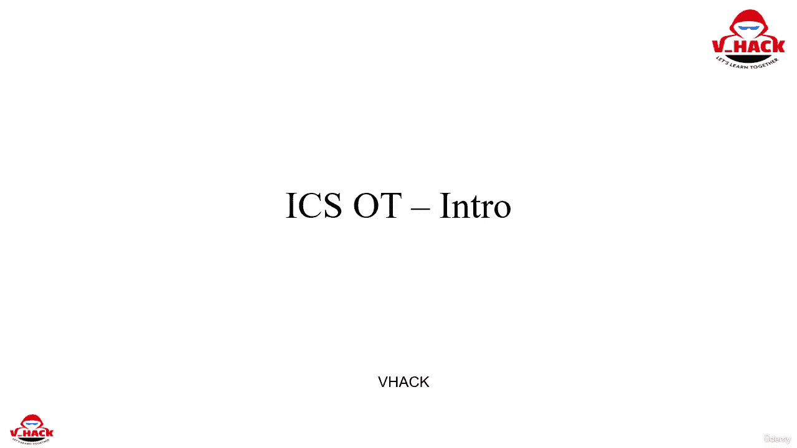
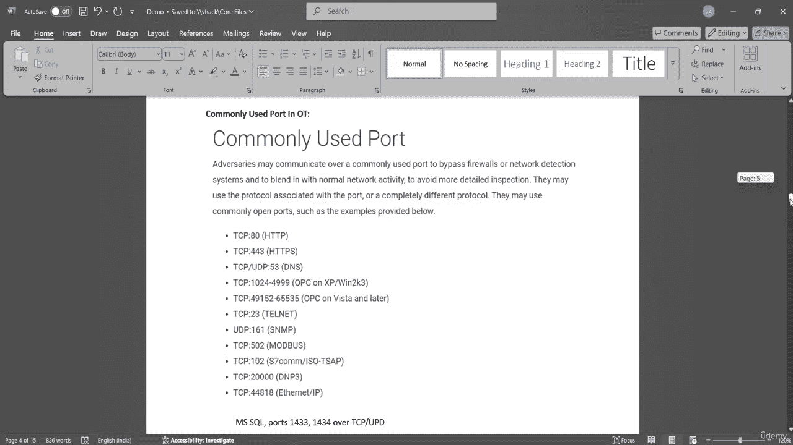
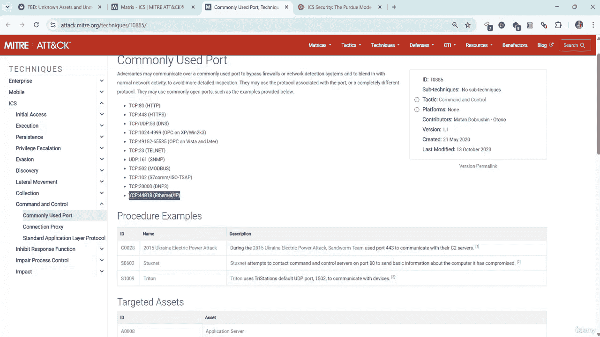
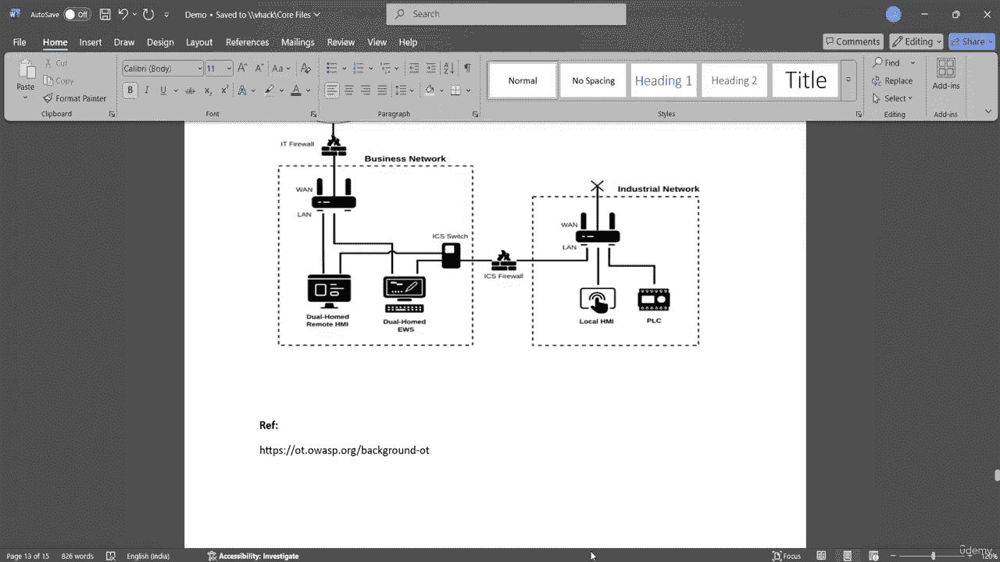
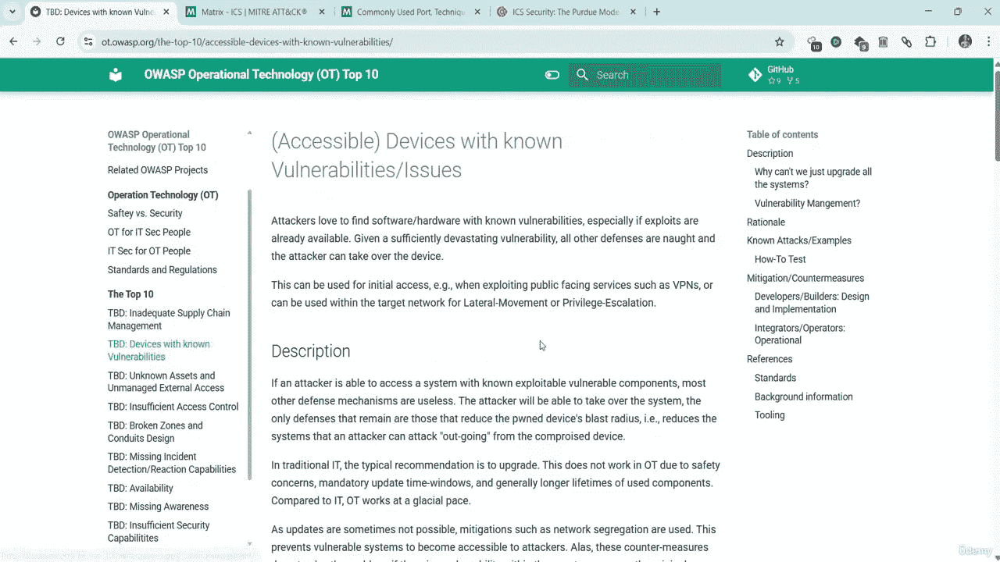
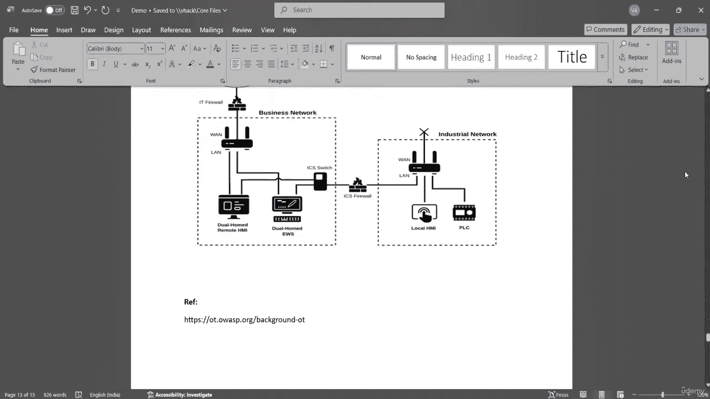
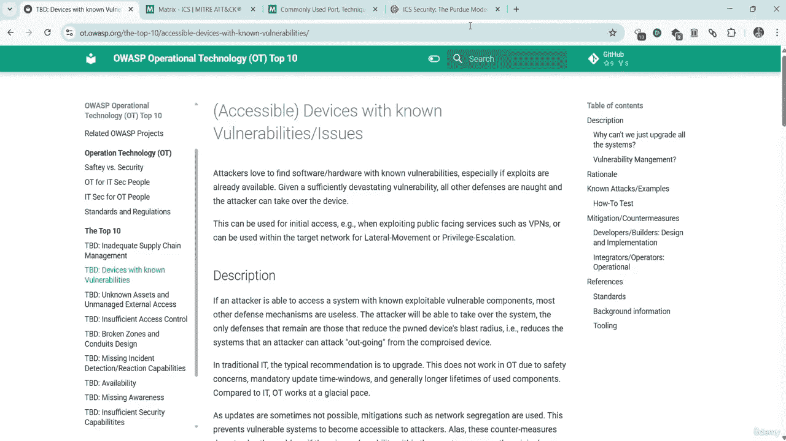
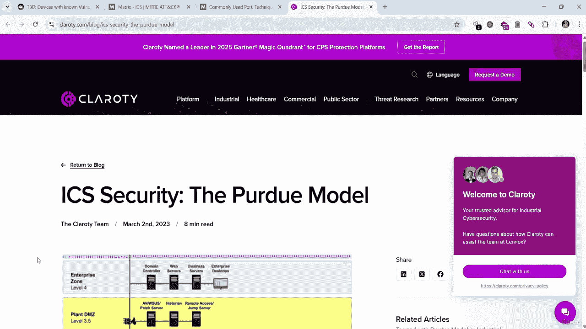
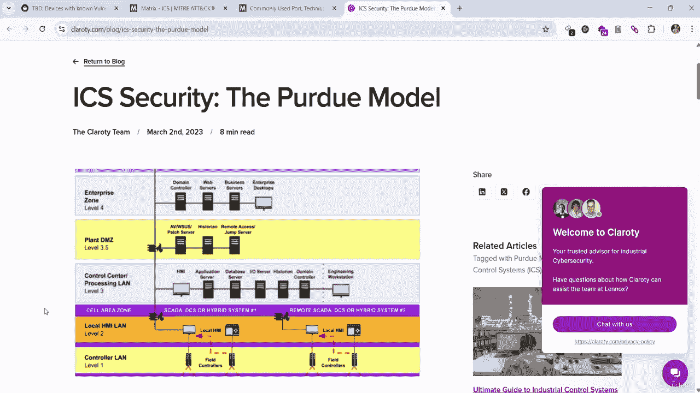
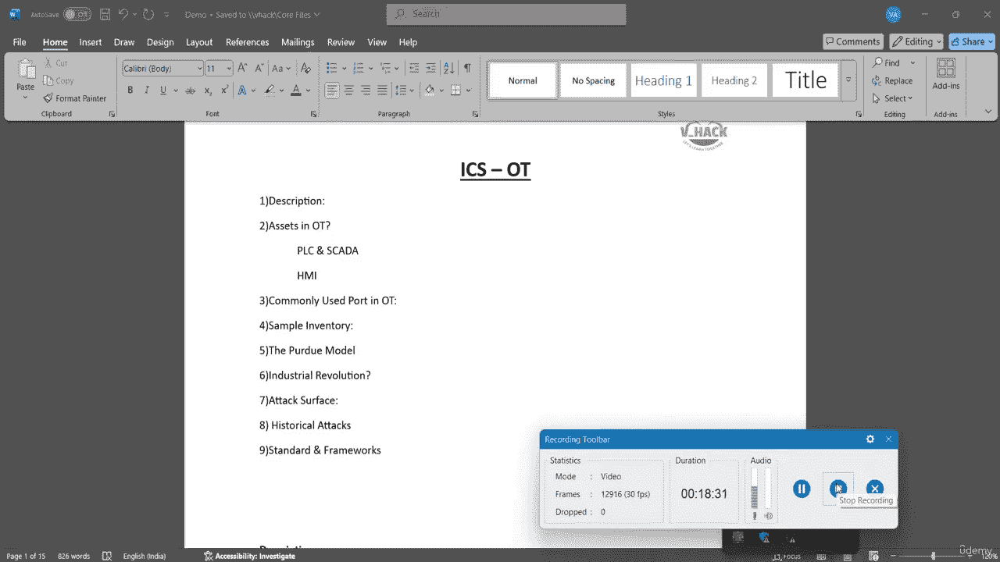

🛡️ Udemy - Ethical Hacking： 50-Day Hacker Challenge ： 50 Real Attacks： 01：OT与ICS SCADA入门




在本节课中，我们将要学习工业控制系统（ICS）与运营技术（OT）的基础知识。内容围绕工业控制系统的定义、核心设备、通信协议、资产清单、历史攻击案例以及安全标准展开。我们会先从工业控制系统是什么说起，再逐步引入PLC、SCADA和HMI等关键设备，接着讨论工业协议和资产清单的维护方法，随后回顾几次著名的工业网络攻击，最后介绍工业安全标准和漏洞扫描的基本方法。希望通过本节课，你能掌握工业控制领域的必要术语，为后续深入学习攻击技术打下基础。


工业控制系统是一种专门用于工业现场的控制体系，它涵盖了石油、大型电池厂以及其他各类制造企业的生产设备。这些设备共同属于运营技术范畴，也就是我们常说的OT。与普通的信息技术不同，运营技术更侧重于现场设备的实时控制和数据采集。在这个体系中，IAUT是一个比较特殊的概念，它主要指通过传感器、执行器或者二维码扫描仪、定位追踪器等组件来提升工业生产效率的技术。而SCADA系统则是在PLC和控制工程设备普及之前，就被广泛用于实现集中控制的技术。简单来说，IAUT和SCADA都是为了让工厂的设备能够更好地协同工作，提升整体生产效率。


在工业系统中，资产是指所有参与生产控制的设备和服务器。这些资产既包括传统的信息技术设备，也包括运营技术设备。常见的资产包括应用服务器、控制服务器、用于安装杀毒软件或补丁的服务器、域控制器、用于归档和存储数据的数据历史库，以及作为控制服务器一部分的SQL服务器。此外，PLC本身也属于资产范畴，工作站和交换机以及其他网络设备同样在列。以下是工业系统中常见的资产类型：

- 应用服务器
- 控制服务器
- 杀毒软件与补丁服务器
- 域控制器
- 数据历史库
- SQL服务器
- PLC可编程逻辑控制器
- HMI人机界面
- 工作站
- 交换机与网络设备


PLC是工业控制系统中的大脑，它负责运行预先编写的控制逻辑。我们可以把PLC的工作原理理解为一条简单的逻辑规则，比如当温度超过某个阈值时，系统需要立即采取降温措施。在实际工厂中，如果传感器检测到炉温过高，PLC就会按照程序打开喷水墙，让冷水流入加热元件，直到温度恢复到正常范围。以下代码展示了这种逻辑的简化形式：

```python
if 当前温度 > 安全阈值:
    打开冷却水阀门
    直到温度 <= 标称温度
```

而SCADA系统则是用来管理多个PLC、传感器和现场设备数据的集中平台。它可以从不同的PLC和现场设备中汇总数据，让操作人员从一个中心位置对整个生产线进行监控和控制。PLC负责具体的逻辑执行，SCADA负责整体数据的集中展示与调度。






HMI是指人机界面，它是人与工业设备之间进行交互的窗口。在装配线上，操作人员通常佩戴头盔，使用触摸面板与机器进行通信。通过HMI，操作人员可以向设备发送信号或操作指令，也可以实时查看机器、传感器和执行器的运行状态。与PLC侧重于后台逻辑编程不同，HMI更多是面向人工操作的可视化界面，它让工人能够知道当前有多少台设备在运行，生产进度如何，以及设备是否处于正常、故障或排查模式。


工业设备之间需要通过通信协议来交换数据，常见的协议包括端口80、443、53、234、20，以及Modbus、DNP3、EtherNet/IP等。不同的厂商和行业会选择不同的协议，比如供暖通风空调行业常使用BACnet协议，涉及47000系列端口，而历史数据保存可能使用143.3或1434端口，某些设备则使用61850协议。以下是一些常见工业协议及其用途：

- Modbus：用于PLC与现场设备之间的通信
- DNP3：常用于电力和水务行业的数据采集
- EtherNet/IP：工业以太网协议，广泛用于设备互连
- BACnet：供暖通风空调系统常用协议

维护资产清单的方法是记录每个设备的详细信息，包括供应商、型号、所在位置以及当前运行状态。比如某台设备来自西门子或艾伦布拉德利，型号可能是S7-1200或Micro400，安装位置可能在质量控制室或维修室，状态可能是运行中、故障或待排查。以下是一个典型的资产清单记录示例：

```json
{
  "供应商": "艾伦布拉德利",
  "型号": "S7-1200",
  "位置": "质量控制维修室",
  "状态": "运行中"
}
```

普渡参考模型是用来划分信息技术团队与运营技术团队边界的参考框架。这个模型从底层的传感器和现场设备开始，逐层向上包括现场控制、HMI、远程HMI、应用服务器、数据库服务器、数据历史库、域控制器、工程师工作站、跳转服务器、杀毒服务器和WSUS补丁服务器。再往上则是企业级的IT环境，包括域控制器、Web服务器、业务服务器和企业笔记本电脑，最外层是非军事区，通过防火墙与互联网连接。以下公式展示了该模型的分层逻辑：

工业网络 = 传感器 + 现场设备 + 现场控制 + HMI + 服务器 + 工作站
企业网络 = 域控制器 + Web服务器 + 业务服务器 + 企业终端
两者之间 = 工业防火墙 + 非军事区


工业经历了多次技术演进，每一次演进都带来了新的攻击面。工业1.0主要依赖纯机械设备，工业2.0引入电力和装配线实现大规模生产，工业3.0在PLC之上加入计算机来控制设备，工业4.0引入工业物联网，工业5.0则是人工智能时代。随着这些变化，攻击者能够利用的攻击向量也在不断增加。如今很多PLC设备都带有Web界面，攻击者可以通过远程访问进入系统，而BACnet到DNP3等协议如果被允许访问互联网，也会给外部攻击者创造机会。

以下是攻击面可能涉及的设备层级：

- 第零层：执行器和传感器
- 现场层：本地HMI
- 控制层：工程师工作站
- 办公层：办公系统和打印机
- 外部层：连接互联网的网络设备

如果这些设备暴露在公网上，攻击者就有很大机会接入内部网络。除了远程访问，物理访问也是一种风险。攻击者如果能够接触到设备，修改PLC基于信号（比如8和15）的逻辑参数，就可能导致逻辑控制错误，进而引发物理损坏、声誉受损，甚至威胁生命安全。


工业领域曾发生过多次严重的网络攻击事件，这些案例帮助我们理解OT环境的危险程度。首先是震网病毒，它专门针对PLC和SCADA系统，导致伊朗核设施遭到破坏，被认为是OT网络安全领域的分水岭。随后是勒索软件事件，诸如WannaCry和Petya，它们利用旧版XP、Vista以及Windows Server 2003系统中的SMB漏洞进行攻击。2021年的殖民管道事件造成了严重的能源供应中断。此外还有针对饮用水处理设施的攻击，攻击者曾篡改设备将氯含量提升到危险水平，所幸在水被供应给居民之前被发现并阻止。OT环境中的破坏性不仅限于声誉损失，还可能造成实体设备损坏。




工业安全领域有一套成熟的标准和框架，其中IEC 62443是最重要的标准之一。它讨论了如何制定安全策略、如何维护资产清单、如何进行补丁管理，以及如何构建网络架构的最佳实践。在分层模型中，工业网络和业务网络必须通过工业防火墙进行隔离，通常会使用防护设备，避免PLC或远程访问设备直接暴露。这些框架还建议对漏洞进行集中加固，并部署入侵检测安全监控。常见的风险定义包括未知资产、访问控制不足，以及存在大量漏洞的设备，这些都与OT环境中的常见攻击密切相关。










在对OT环境进行资产梳理时，被动扫描比主动扫描更加推荐。被动扫描可以通过镜像端口（Span Port）获取流量，从而避免主动扫描导致网络中断或影响保护设备。Clarity是一款常用的工具，它拥有覆盖多个厂商的大量签名，在资产清单匹配方面准确性较高。使用Clarity可以帮助我们构建包含不同固件版本、补丁管理情况的设备清单，补丁管理通常通过WSUS来完成。以下代码展示了被动扫描与主动扫描的简单区别：



```text
被动扫描：监听镜像端口流量，不主动发送探测包，网络影响小
主动扫描：向目标发送探测包，可能导致工业网络中断
```




本节课中，我们一起学习了工业控制系统（ICS）和运营技术（OT）的基本概念，梳理了PLC、SCADA、HMI等核心设备的作用，了解了常见工业协议和资产清单的维护方法，回顾了工业从1.0到5.0的演进过程及其引入的攻击面，并学习了震网病毒、勒索软件和管道被攻击等真实案例，最后介绍了IEC 62443等安全标准与被动扫描方法。希望你已经掌握了工业控制领域的必要术语，为后续深入学习攻击技术做好准备。


