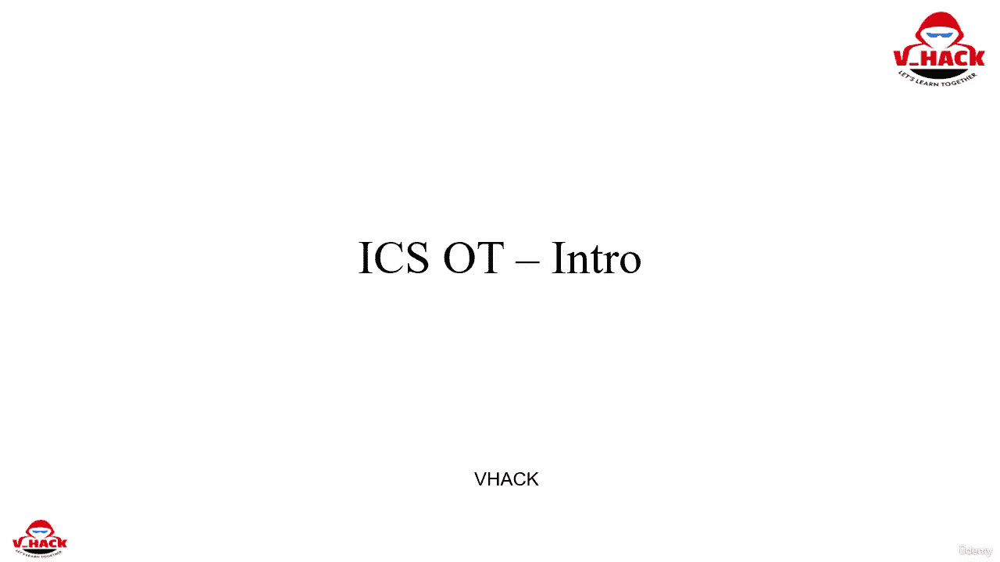
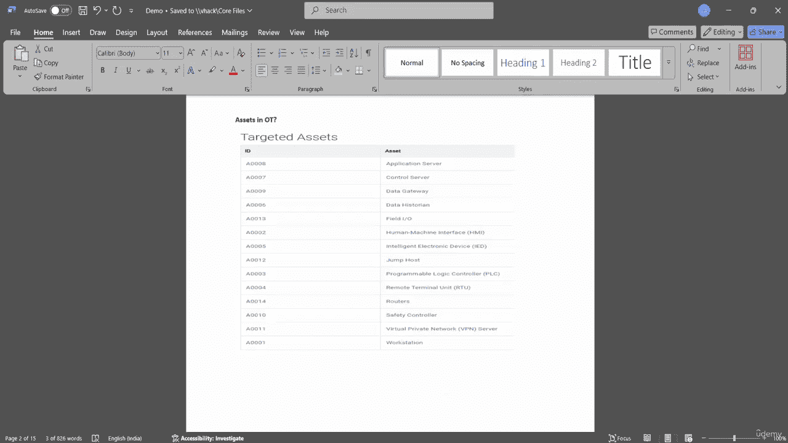
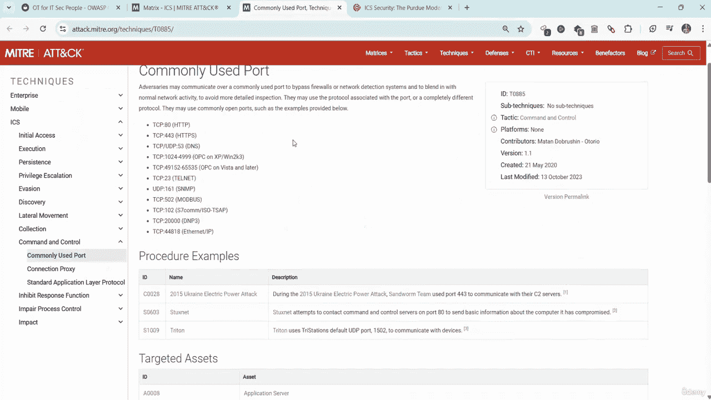
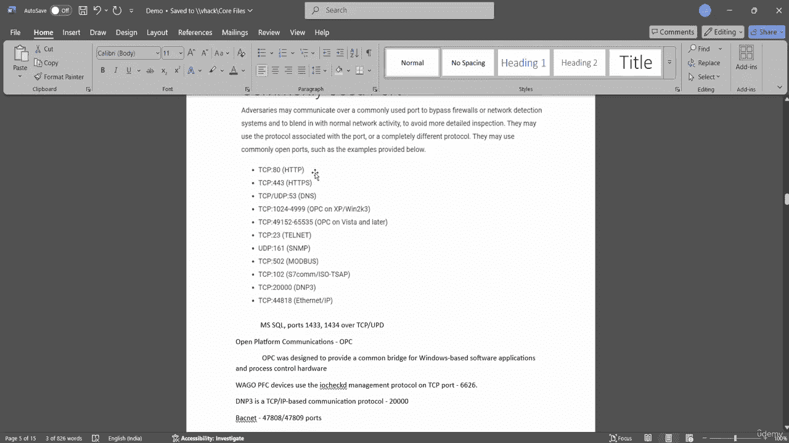
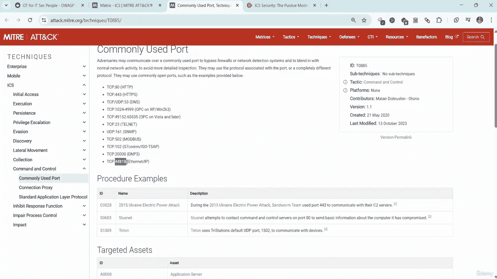
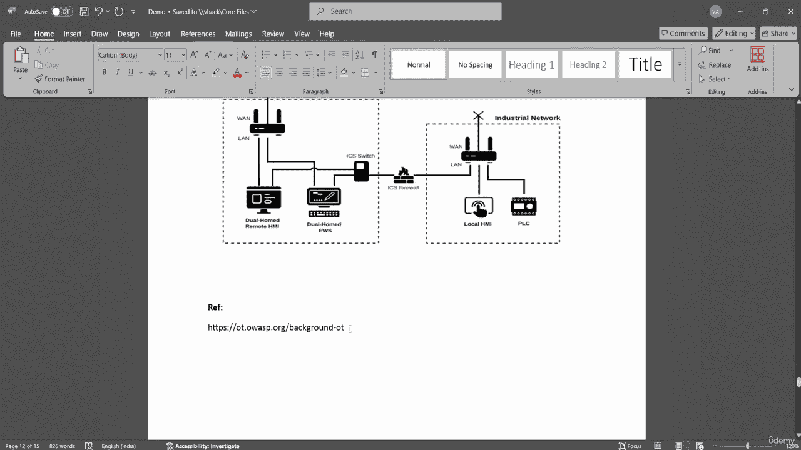
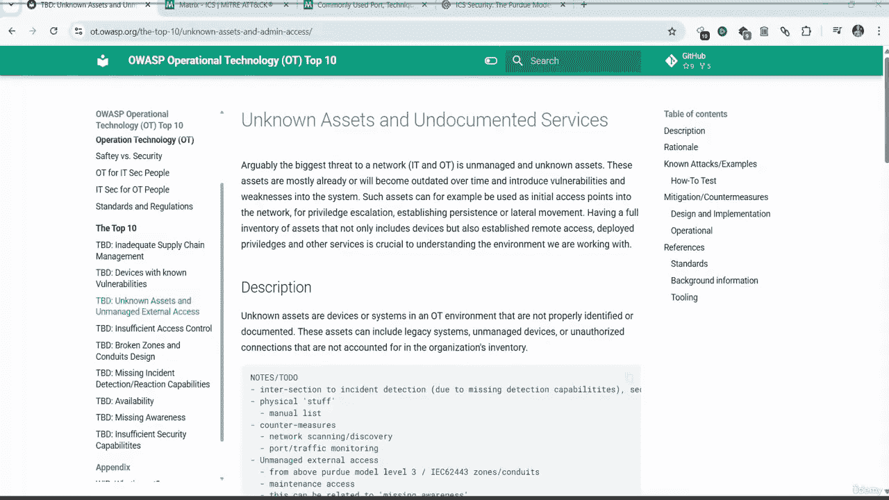
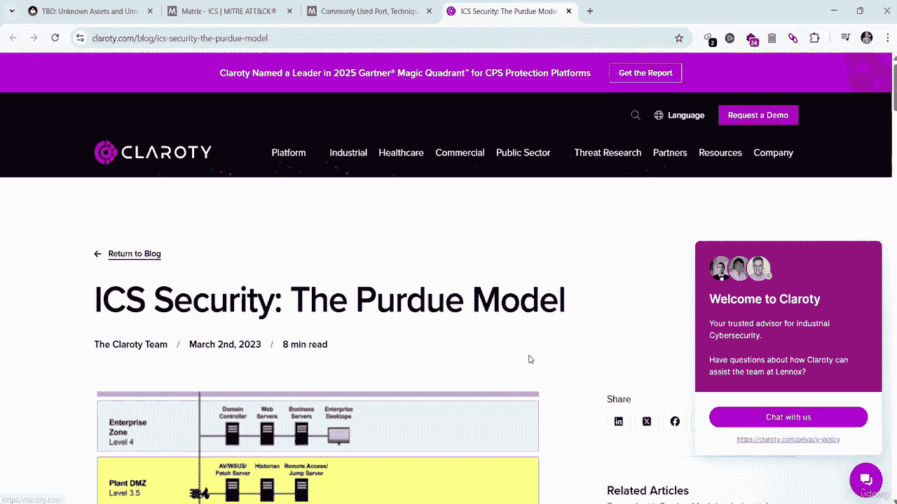

# 工业控制系统安全：01：远程PLC服务访问与攻击面分析 🔧

## 课程概述 📚

在本节课中我们将要学习工业控制系统安全的基础内容，重点围绕远程PLC服务访问与攻击面分析展开。首先我们会回顾欢迎回来的学习进度，进入下一模块后先了解远程PLC和远程服务访问的关键术语，然后梳理不同项目中的重要设备与角色。接着我们会看看攻击本质上属于历史攻击，这些攻击长期以来依据各种标准和框架进行分析。在讲解具体的技术细节之前，也会简要提及物联网术语，以及在第一部分第39行已经介绍过的资产和参与者概念。所有内容都会用最直白的语言讲解，确保完全没有工业控制背景的初学者也能听懂。下面我们正式进入第一个知识点。

## 工业控制系统的核心参与者与协议 🏭

在分析具体的攻击手法之前，我们必须先搞清楚工业控制系统里到底有哪些人在参与，他们常用什么协议来传输数据。上一节我们介绍了资产和参与者的基础概念，本节中我们来看看工业控制系统中的主要参与者以及他们常用的通信协议。

以下是工业控制系统中的主要参与者和协议类别：

- 系统制造商：负责设计和生产工业控制硬件与软件，例如厂商 Bradley 等公司。
- 运营公司：购买并使用这些系统进行日常生产运营。
- 工程师与技术人员：负责现场调试、维护和远程访问，通常有三名技术人员在一线操作。
- 主要通信协议：包括 Web 协议、现场总线协议以及工业以太网协议，用于在不同设备之间传递指令。

在工业控制系统中，不同的设备需要通过协议来交换信息。你可以把协议想象成设备之间说话的语言，这些协议决定了数据在 PLC（可编程逻辑控制器）和上层系统之间是如何流动的。无论是像 Kang 这样的参与者，还是其他十大主要参与者，他们的设备都依赖这些协议来完成工业革命时期的控制任务。理解清楚参与者和协议之后，后面分析攻击面就会容易很多。

核心关系可以用下面的公式来描述：

```text
工业控制系统 = 参与者集合 + 通信协议集合 + 控制器设备
```



这一部分的内容虽然比较抽象，但是只要把参与者和协议搞清楚，后面学习远程访问和攻击面分析就会轻松很多。下一节我们将进入远程PLC服务访问的具体原理。

## 远程PLC服务访问的基本原理 🔌



当工业控制系统中的远程服务被启用之后，攻击者就有了进入系统的潜在路径。上一节我们介绍了核心参与者与协议，本节中我们来看看远程PLC服务访问是如何在实际网络中运作的。

以下是远程PLC访问涉及的关键要素：

- 远程服务启用：一旦远程服务开启，PLC 就可以通过网络被外部设备访问。
- 设备类型：远程设备可以连接到 PLC，也可以通过 Web 协议与系统交互。
- 访问路径：数据可能经过不同的网络分段，例如第 3 个分段，或者通过端口 80、0、12 等跳转点进行传输。
- 操作人员：通常由现场技术人员操作，电脑和网络安全设备共同参与访问控制。

远程PLC访问的过程可以大白话理解为：工程师坐在办公室里，通过网络发送指令，让远处工厂里的PLC改变传感器的编程值，从而控制温度或其他实时参数。比如厂商 Bradley 提供的设备，支持多个PLC实时通信，数据粒度可以粗也可以细。这些访问可能发生在芯片等级，也可能发生在上层的网络物理访问层，具体取决于系统的部署方式。我们现在报告下一个窗口，看看远程访问信号是如何在系统中传播的。



代码层面的访问逻辑可以简化表示为：



```python
# 远程PLC访问伪代码示例
if remote_service_enabled:
    connect_to_plc(target_ip, port=8080)
    read_sensor_values()
    send_control_command(command)
```

掌握了这些基本原理后，我们就能更好地理解攻击者可能从哪个环节下手。下一节我们将回顾攻击面的构成以及历史上的典型攻击案例。

## 攻击面与历史攻击回顾 🎯

攻击面是指系统中所有可能被攻击者利用的入口点，包括网络层、Web层以及物理访问等多个维度。上一节我们学习了远程PLC服务访问的基本原理，本节中我们来看看攻击面具体包含哪些部分，以及历史上的攻击是如何发生的。

以下是攻击面的主要组成部分：

- 网络层攻击面：通过网络协议访问PLC或控制器，例如利用数据库漏洞或版本样本进行攻击。
- Web层攻击面：通过Web界面访问工业系统，可能出现在银行或其他机构的测试数据库中。
- 物理访问攻击面：直接接触设备，比如插入USB或连接现场控制器。
- 钓鱼邮件与终端攻击：攻击者可能通过钓鱼邮件入侵工程师工作站，而不是普通的企业笔记本电脑，然后在传感器层植入恶意代码。

在历史攻击中，很多事件都发生在第四层或第45层的组装环节，攻击者通过远程访问信号改变设备的编程值，导致传感器数据异常。这些攻击会沿着特定的路径传播，例如从互联网进入工业网络，再到达工程师工作站，最后影响生产现场。攻击面在不同层级上都有不同的漏洞样本，攻击者可以根据访问权限的高低，选择对应的攻击方式。

核心概念可以用下面的公式来表示：

```text
攻击面 = 网络层入口 + Web层入口 + 物理访问入口 + 终端入口
```

回顾历史攻击有助于我们理解攻击者的惯用手法，也为后面制定防御策略打下基础。下一节我们将讨论OT与IT环境中的补丁管理和系统清单。

## OT与IT环境的补丁管理与系统清单 🛠️

补丁管理是保障工业控制系统安全的重要环节，它涉及对操作技术（OT）和信息技术（IT）系统进行漏洞修复和资产清点。上一节我们回顾了攻击面与历史攻击，本节中我们来看看如何在OT和IT环境中部署补丁系统与清单管理。

以下是补丁管理与清单的关键步骤：

- 资产清单：列出OT环境中所有设备的版本信息和漏洞样本。
- 补丁部署：在DMC到工作站的链路中，通过防火墙或工业网络分发补丁。
- 环境分离：OT网络与IT网络需要合理隔离，避免工业业务受到外部网络的直接影响。
- 标准对照：参考IEC 62443等工业控制系统安全标准，制定财务与时间上的等效保护要求。

在实际操作中，补丁管理不仅仅是打个补丁那么简单，还需要考虑供应链中的小贡献者，以及系统出货时的安全状态。工业革命4.0带来了更多的连接性，也增加了财务风险，因此必须建立一套完整的清单机制，明确哪些设备需要打补丁，哪些设备可以暂时不处理。比如在DMC环境下，工作站可能通过工业网络连接，补丁的分发需要从防火墙层面进行控制，确保工业业务的连续性不受影响。

补丁管理流程可以用下面的代码块概括：

```text
补丁管理 = 资产清单 + 漏洞扫描 + 补丁测试 + 灰度部署 + 验证确认
```

做好补丁管理和清单工作之后，我们还需要关注供应链安全和相关的法律法规，这将是下一节的内容。

## 供应链安全与法律合规 ⚖️

供应链安全和法律合规是工业控制系统安全体系中不可忽视的部分，外部访问和第三方供应商可能引入额外的风险。上一节我们讨论了OT与IT环境的补丁管理与系统清单，本节中我们来看看供应链安全以及相关法律要求。

以下是供应链安全与法律合规的重要考量点：

- 供应链风险：供应链中的环节越多，外部访问的风险就可能越大，需要对每个供应商进行评估。
- 法律法规：不同地区的法律要求不同，例如台湾地区的描述级别可能有特定的合规标准。
- 主要供应商选择：优先选择具有清晰安全模型的主要供应商或IT系统，确保质量圈内的流程更加具体。
- 边缘模型应用：在边缘模型中明确各方的职责边界，避免责任不清导致安全漏洞。

供应链安全的核心思想是：即使你自己把系统做得再安全，如果供应商的设备或者外部访问路径有漏洞，整个工业控制系统依然可能被攻破。F组等标准制定机构可能有自己的定义，但无论具体标准如何，都需要结合实际的外部访问场景来进行合规性检查。法律层面的要求不应被忽视，尤其是在跨地区运营时，必须清楚各地法规对工业控制系统安全的具体描述。

相关合规要求可以简化为：



```text
合规要求 = 法律法规 + 供应商评估 + 外部访问控制 + 边界职责划分
```

供应链安全与法律合规的内容虽然偏向管理，但它直接影响技术层面的防御效果。下一节我们将介绍签名扫描与具体演示的基础内容。

## 签名扫描与具体演示基础 🔍

签名扫描是发现已知漏洞的常用手段，通过匹配特征码可以快速定位系统中的安全问题。上一节我们介绍了供应链安全与法律合规，本节中我们来看看签名扫描的基本场景以及如何进行具体演示。



以下是签名扫描的基本要素：

- 签名匹配：使用基础扫描场景中的签名，针对特定区域和供应商设备进行检查。
- 核心交换机识别：常见的核心交换机供应商设备通常是扫描的重点目标。
- 演示环境：具体演示可以基于tro或term等基础场景搭建，模拟真实的工业网络环境。

签名扫描的过程就像是给系统做一次体检，扫描工具会携带一份已知漏洞的“签名库”，去网络中比对每一个设备是否匹配。比如当你面对一个常见的核心交换机时，扫描工具可以读取它的版本号，然后与签名库进行比对，从而判断是否存在已知漏洞。具体演示时，我们会展示如何切换签名区域，选择不同的厂商设备，并观察扫描结果。这为后续的漏洞修复和加固提供了直观的依据。

签名扫描的基本逻辑可以表示为：

```python
# 签名扫描伪代码示例
for device in network_devices:
    signature = get_device_signature(device)
    if signature in vulnerability_database:
        report_vulnerability(device, signature)
```



通过签名扫描，安全人员可以在攻击者利用漏洞之前，先发现并修复系统中的问题。以上就是本节关于签名扫描与演示基础的全部内容。

## 本节总结 📝


本节课中我们一起学习了工业控制系统安全的多个核心主题。首先我们概述了远程PLC服务访问与攻击面分析的课程目标，然后梳理了工业控制系统的核心参与者与常用协议，接着讲解了远程PLC服务访问的基本原理与操作流程。之后我们回顾了攻击面的构成以及历史上的典型攻击案例，并讨论了OT与IT环境中的补丁管理与系统清单。随后我们探讨了供应链安全与法律合规的重要性，最后介绍了签名扫描与具体演示的基础知识。希望这些内容能帮助初学者建立对工业控制系统安全的整体认识，为后续深入学习打下坚实基础。

