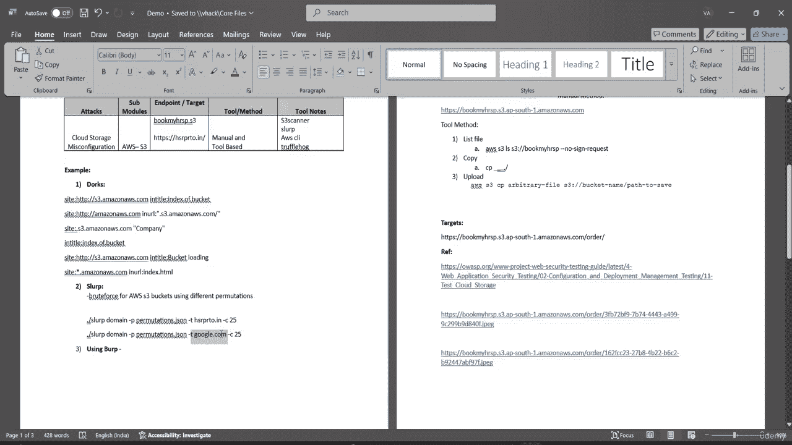
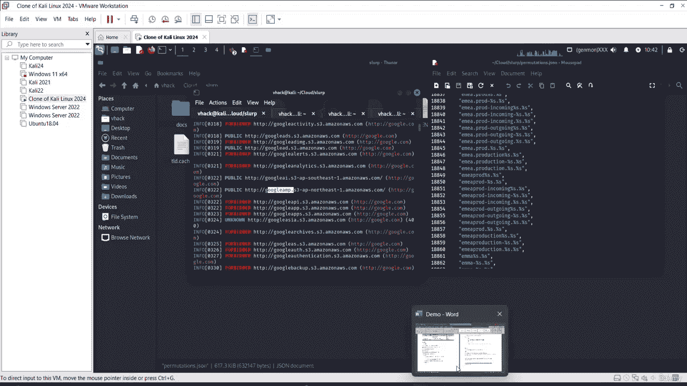
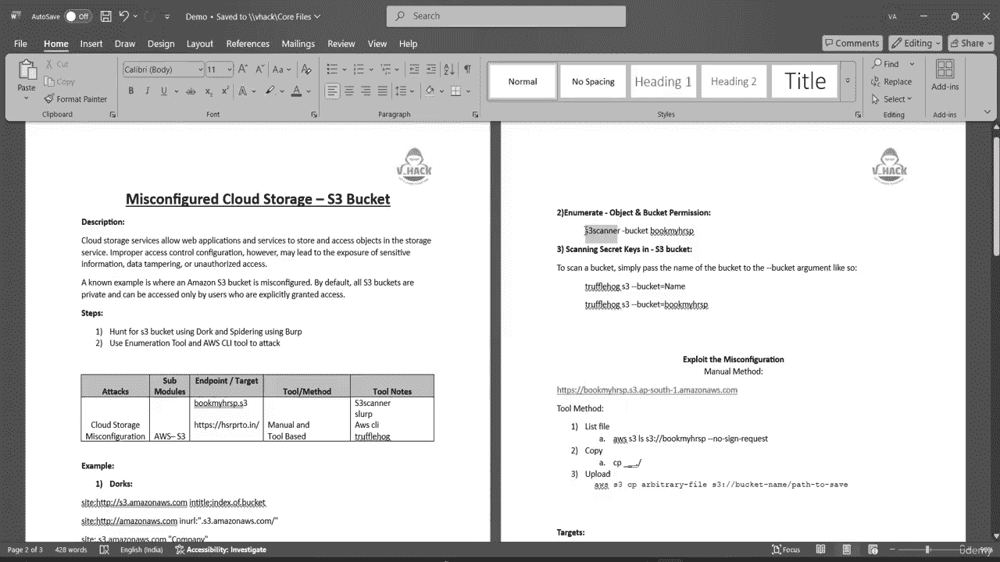
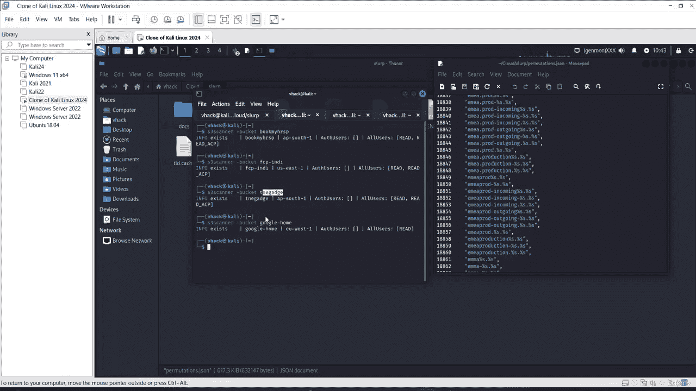
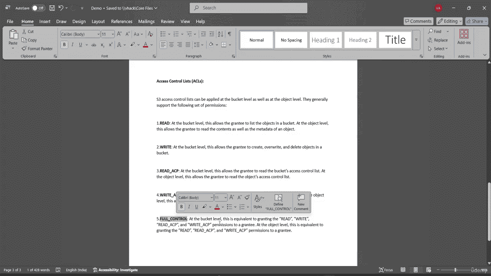
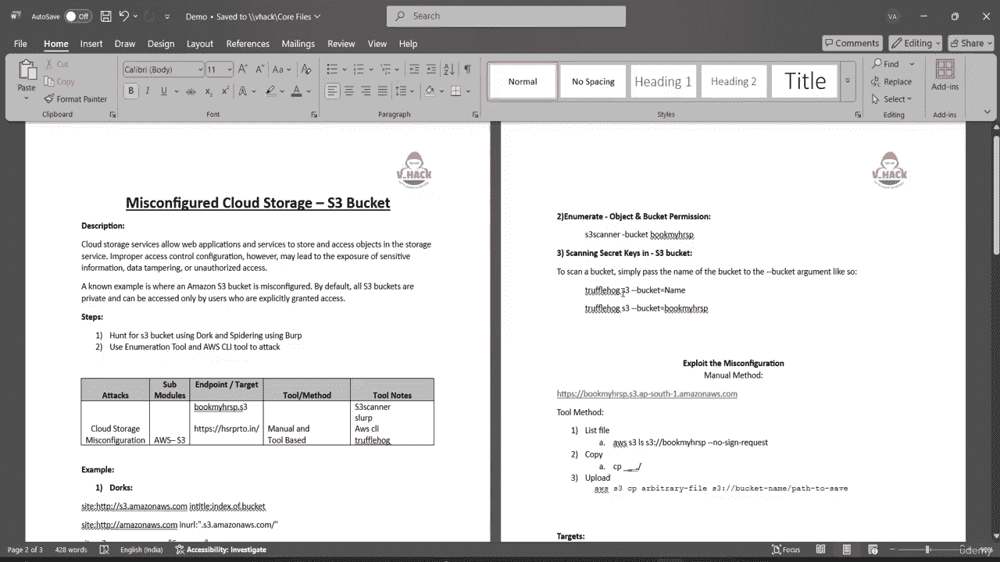
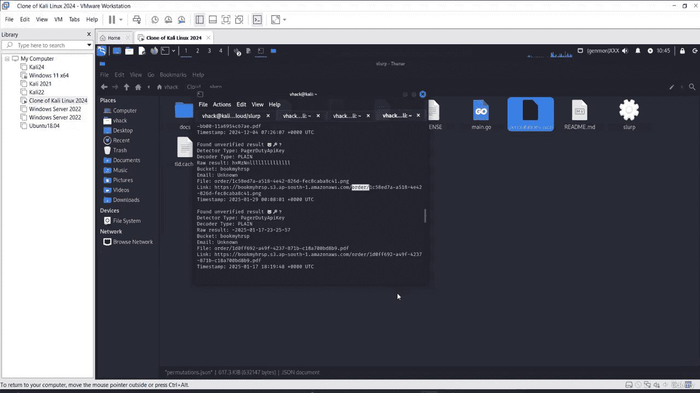
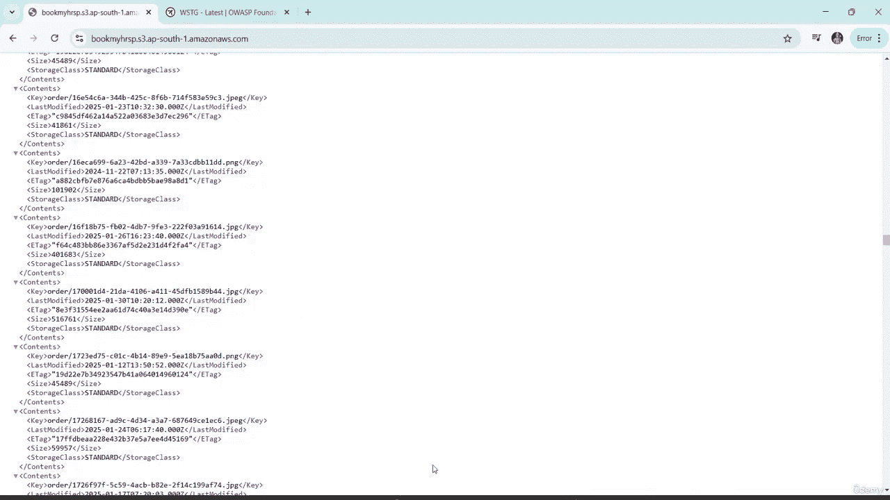
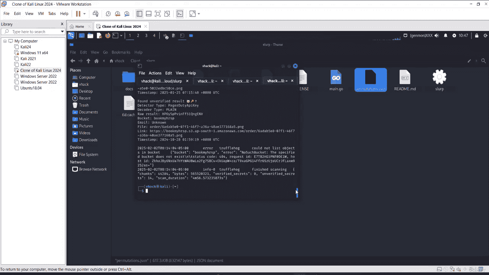
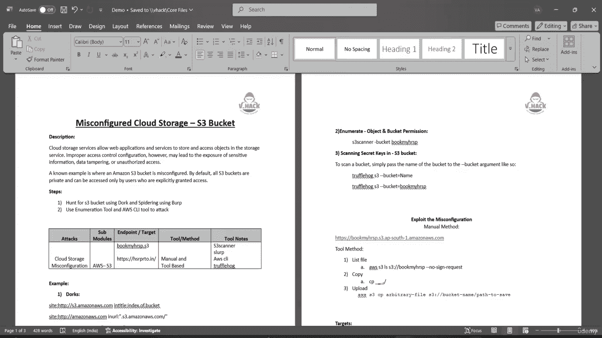

🛡️ Ethical Hacking：01：攻击云存储 – 枚举

在本节课中，我们将一起学习针对云存储服务的攻击技术，重点讲解 AWS S3 存储桶中的错误配置问题。你将了解如何发现目标公司的 S3 桶，如何枚举桶里的对象和访问权限，以及如何利用工具扫描桶中可能泄露的敏感信息。这些内容是云渗透测试的基础知识，适合零基础的初学者跟随学习，建议完整阅读后再动手实践。

上一节我们介绍了渗透测试的通用概念，本节中我们来看看云存储安全中常见的配置错误。当我们说到云存储时，最典型的服务就是 AWS 提供的 S3 存储桶。你可以把 S3 桶理解为一个放在云端的文件夹，里面可以存放图片、文档、备份数据等各种文件。如果这个文件夹的访问权限设置得不合理，就可能导致未授权的人也能读取里面的内容。

这种配置错误的核心含义可以用下面这句话来概括：

如果 S3 桶配置不当，经过身份验证的用户就可能访问到原本不应该公开的数据。

简单来说，就是原本应该只有公司内部员工才能看到的文件，因为管理员设置失误，变成了任何人都能下载。这就是本节课要重点讨论的漏洞类型，也是攻击者最容易入手的切入点之一。

在了解了什么是配置错误之后，我们需要先搞清楚 S3 桶的名字长什么样，否则后面没法进行查找。S3 桶的访问地址通常遵循固定的格式，其核心部分可以用下面这个公式表示：

桶名称.s3.amazonaws.com

这里的“桶名称”是指点号 S3 前面的那部分字符串。比如如果你看到一个地址是 example-data.s3.amazonaws.com，那么 example-data 就是这个桶的名字。在后续的枚举步骤中，我们会反复用到这个桶名称，所以识别出它是非常关键的第一步，建议初学者多花几分钟熟悉这个结构。

刚才我们介绍了 S3 桶的命名结构，本节中我们来看看如何去搜寻目标公司的 S3 桶。常见的方法主要有以下三种，每种都有自己的适用场景，你可以根据实际情况选择合适的方式。

以下是使用搜索引擎寻找 S3 桶的方法。

你可以在 Google 等搜索引擎中输入特定的搜索语句，来筛选出带有 s3.amazonaws.com 后缀的页面。搜索语句的基本结构大致如下：

site:s3.amazonaws.com 目标公司名

在搜索结果中，任何出现在点号 S3 前面的词，都可能是目标的桶名称。比如如果你想针对某家公司，可以在查询末尾加上该公司的域名后缀，这样更容易找到属于该企业的存储桶。这种方法不需要安装任何工具，只需要一个浏览器即可开始尝试。

以下是使用自动化工具爆破桶名的方法。

除了手动搜索，也可以使用专门的工具来生成大量可能的桶名组合。这里推荐使用名为 S3urp 的工具，它内置了一个叫做 permutations.json 的文件，里面包含近两万个常见的后缀和变体，比如 production、staging、inventory、assets 等等。在 Kali Linux 中安装该工具后，使用方式大致如下：

s3urp -t www.目标域名.com -p permutations.json

工具运行后会自动拼接出成百上千个候选桶名，并尝试访问它们。大部分结果可能会返回禁止访问，但你只需要关注那些能够正常连通的即可，它们前面的部分就是潜在的桶名称。这种方法适合目标比较明确、想要快速扩大搜索范围的场景。

以下是通过拦截网页请求寻找桶名的方法。

第三种方法不需要专门的扫描工具，而是在浏览目标网站时顺手发现。很多网站在处理付款或上传文件时，会把数据直接存到 AWS S3 上。你可以使用 Burp Suite 等代理工具拦截浏览器发出的请求和服务器返回的响应，从响应包中往往能看到类似这样的地址：

https://书店名称.s3.amazonaws.com

任何出现在点号 S3 之前的字符串，就是该网站使用的 S3 桶名称。比如如果地址里是 book-my-sharp.s3，那么 book-my-sharp 就是桶名。这种方法不需要猜解，直接从真实流量中获取，成功率很高，非常适合初学者快速上手。

找到 S3 桶的名称之后，接下来我们需要了解桶里有哪些文件，以及这些文件的访问权限是什么。此时可以使用一款名为 S3 Scanner 的工具，它是目前比较常用的选择之一，能够帮助我们快速判断桶的开放程度。

以下是 S3 Scanner 能检测的常见权限类型。

该工具在扫描时会检查以下几种访问控制权限：

- Read：允许读取桶中的对象
- Write：允许向桶中写入对象
- Read ACP：允许读取访问控制列表
- Write ACP：允许修改访问控制列表
- Full Control：最高权限，拥有完全控制能力

如果扫描结果显示“All Users”拥有 Read 权限，并且还能读取 ACP，说明这个桶对公众开放，任何人都可以下载其中的文件。当然，有些知名公司的桶已经做过加固，禁止读取访问控制列表，这种情况下即使能看到对象列表，也无法获取完整的权限信息。了解这些权限含义后，你就能快速评估目标桶的风险等级。

除了检查权限，我们还需要看桶里面到底藏着什么重要数据。这时候可以使用 TruffleHog 等工具，专门扫描 S3 桶中可能泄露的密钥、密码或令牌，这对后续的攻击非常有帮助。

以下是使用 TruffleHog 扫描 S3 桶的命令示例。

在命令行中，可以这样调用该工具：

trufflehog s3 --bucket 目标桶名称

扫描完成后，工具会列出大量可能包含敏感信息的页面和密钥。不过需要注意，扫描结果里可能会出现误报，也就是看起来像密钥但实际上不是。因此在拿到结果后，还需要人工逐条分析确认，不能完全依赖工具自动判断。从枚举的角度来看，使用 TruffleHog 可以大幅减少人工翻阅文件的工作量，把注意力集中在那些真正可疑的发现上。

本节课中，我们一起学习了如何攻击 AWS S3 云存储中的错误配置。首先搞清楚了 S3 桶的命名结构，即桶名称.s3.amazonaws.com；接着介绍了三种寻找 S3 桶的方法，分别是使用 Google 搜索语句、利用 S3urp 工具生成变体名、以及从 Web 请求响应中直接提取桶名。随后讲解了如何使用 S3 Scanner 枚举桶内对象和权限，重点关注 Read、Write、Read ACP、Write ACP 和 Full Control 等权限。最后介绍了如何用 TruffleHog 扫描桶中的敏感信息，并提醒需要人工排除误报。

下一节课中，我们将结合真实世界的案例，演示如何从一个 S3 桶中提取敏感信息，让你对整个攻击流程有更直观的了解。
