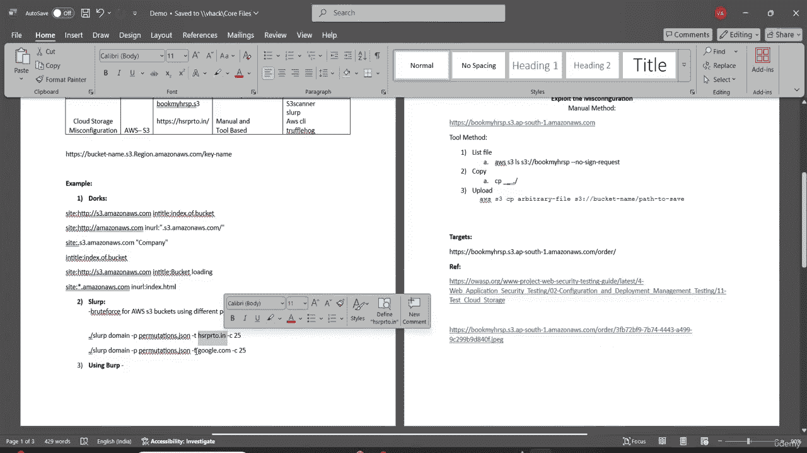
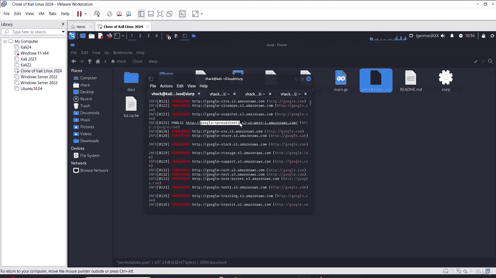
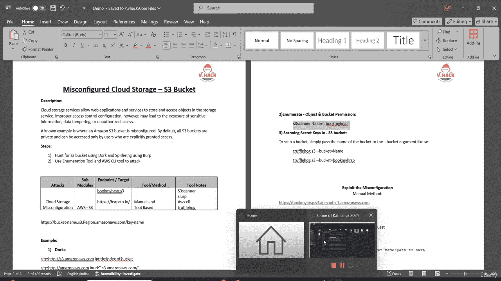
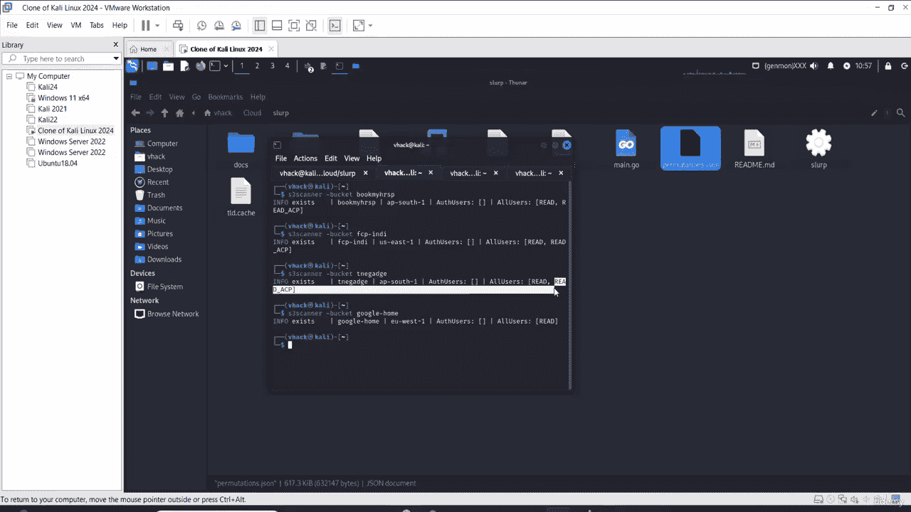
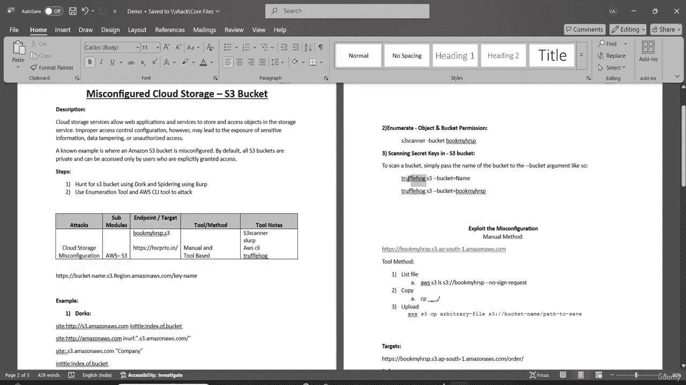
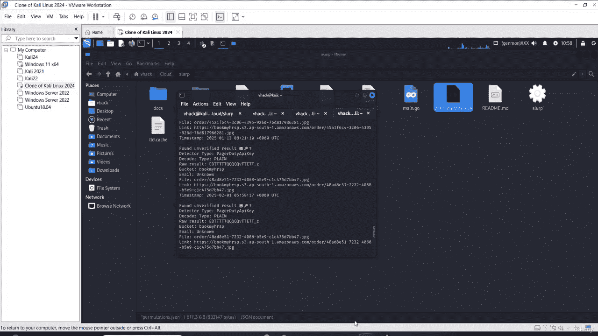
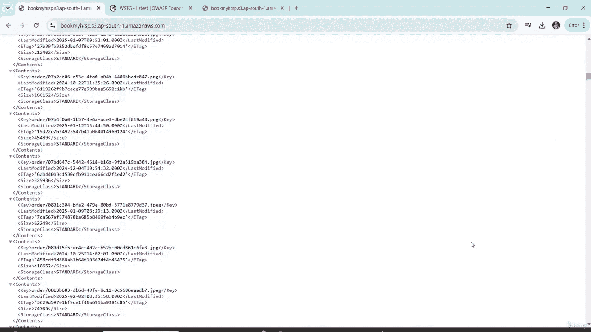
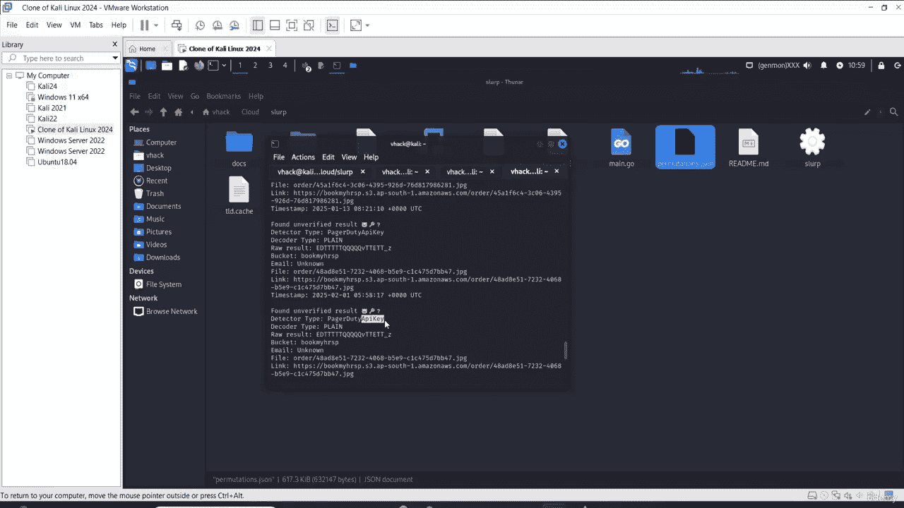
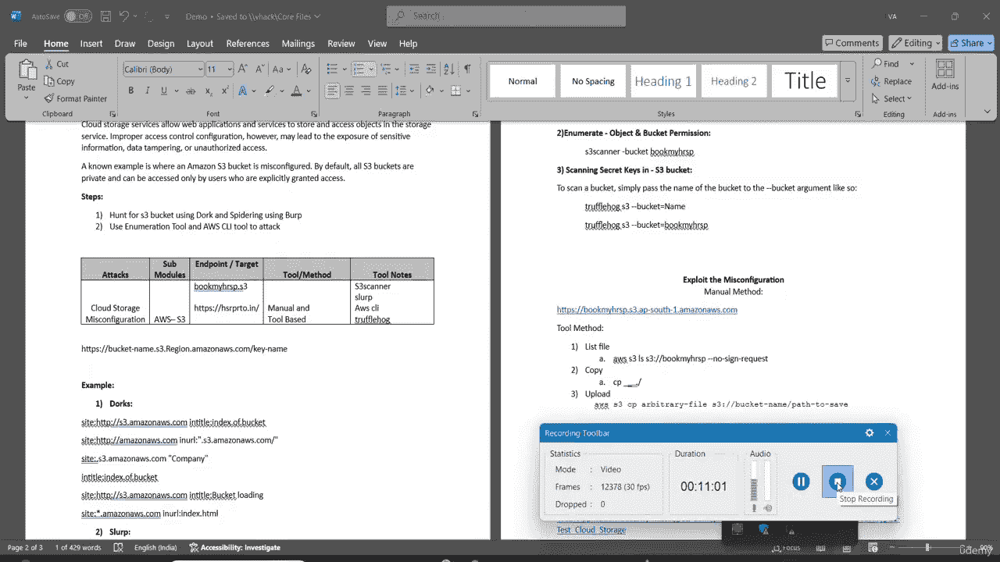

# 🛡️ Udemy - Ethical Hacking：50-Day Hacker Challenge：50 Real Attacks：p82：1 - 攻击云端 – 枚举

在本节课中我们将要学习云端攻击的枚举方法。这一节的内容主要围绕 AWS S3 存储桶展开，讲解如何发现云端存储中的常见配置错误，并演示如何利用读取权限访问敏感对象。无论你是刚开始接触云安全的新手，还是想要快速了解真实攻击场景的学习者，都能从中获得基础认知。我们会一步一步讲解，保证每个概念都用大白话解释清楚，避免使用晦涩难懂的专业术语。

---

## 云端利用与存储配置

上一节我们介绍了渗透测试的基本流程，本节中我们来看看云端枚举的具体操作。云端利用的第一步是搞清楚目标的云存储是如何配置的。在这里，AWS 层中的 S3 服务是一个非常典型的目标。我们需要先设定好存储路径，确认目标云存储的位置和访问方式。

配置云存储时，通常会涉及到路径参数和服务标识。我们可以把这个过程理解为在云平台上找到对应的存储桶，然后确认它的地址和权限设置。云端利用并不复杂，核心就是弄清楚数据放在哪里，以及谁能访问这些数据。掌握这些基础之后，后续的枚举工作会变得非常直接。

```python
cloud_path = "aws/s3/target-bucket-name"
storage_layer = "AWS S3"
```

---

## 三种常见配置错误

在探测存储服务时，最常见的动作就是检查存储桶是否开放。除了正常的枚举之外，还有一些与安全直接相关的问题需要关注。以下是三个常见的配置错误类型：

- 存储桶权限设置不当，允许未授权用户列出文件。
- 对象访问控制缺失，导致任何人都能下载敏感数据。
- 速率控制配置错误，使得攻击者可以快速发送大量请求。



这些配置错误看起来简单，但在真实攻击中经常被利用。了解它们能帮助我们更快地定位薄弱环节，避免在实际测试中走弯路。

---

## 工具安装与运行

本节我们已经了解了枚举的基本思路，接下来看看如何安装并运行相关工具。安装工具需要一段时间来完成处理工作，安装完成后，程序会自动启动另一个进程。此时我们可以继续往下操作，执行到第 00 个节点。

运行工具的具体步骤如下：

1. 启动安装程序，等待处理完成。
2. 确认后台进程已经启动。
3. 按照提示运行到指定的节点编号。

安装完成后，界面会显示当前的运行状态，这对后续的枚举操作非常重要。如果状态显示正常，就可以进入下一步的攻击演示。



---

## Google 挑战与支付页面

刚才我们完成了工具的安装，现在进入实战演示部分。在底部，Google 挑战即将开始，这里以 Maria Googlephone 示例为例进行说明。操作时，你需要在工具中打开 Google 电子表格，按照顺序选择选项。具体来说，先选择第二项，然后是第三项，接下来系统会弹出支付页面。

支付页面出现后，会出现三种不同的情况。即使是看起来普通的支付操作，也可能涉及对象的越权访问。整个流程的关键在于顺序，必须按照正确的顺序操作，才能触发后续的页面跳转。这看起来像是普通的网页浏览，但实际上已经触及到了云端对象的访问控制问题。

---



## 对象读取权限与存储桶权限

在支付环节处理完之后，我们需要重点查看对象的读取权限。这里有一个核心概念：即使系统提示不允许读取，实际操作中可能仍然成功读取了对象。读取权限的获得意味着攻击者可以访问存储桶中的文件内容。



以下是权限检查的关键步骤：

- 确认对象的读取访问控制列表。
- 检查存储桶的权限设置是否开放。
- 验证速率控制对象是否被正确限制。

如果存储桶权限设置不当，攻击者就可以绕过限制直接读取数据。这也是云端枚举中最容易被忽略的一点，很多初学者在这一步就会停下来，不知道为什么明明有权限却读取不到文件。



---

## Amazon S3 存储桶操作

前面我们讨论了读取权限，现在来看具体的 Amazon S3 操作。重点在于如何正确标识存储桶编号。当你创建存储桶并指定存储桶名称后，系统会生成对应的指示点。上传过程开始后，文件会被复制到独立的位置进行保存。

Amazon S3 存储桶的基本命名公式可以表示为：



```
Bucket Name = 目标前缀 + 随机后缀 + 区域标识
```



操作时，你需要在控制台输入存储桶名称，确认无误后点击上传。上传完成后，文件会自行复制，你可以通过枚举工具访问到这些副本。整个过程虽然看起来简单，但每一步都关系到最终能否成功枚举目标数据。



---

## 下一节演示预告

好了，本节的理论和基础操作已经讲解完毕。我们稍后会继续跟进下一节的演示内容，深入探讨更复杂的云端攻击场景。现在你可以先复习一下存储桶枚举和权限检查的步骤，为下一节的实战做好准备。不需要着急，把每个命令的作用都弄清楚再继续也不迟。

---



## 本节总结

本节课中我们一起学习了攻击云端的枚举方法。我们介绍了 AWS S3 存储配置的基本概念，梳理了三种常见的配置错误，讲解了工具的安装与运行流程，演示了 Google 挑战和支付页面的操作步骤，并重点说明了对象读取权限与存储桶权限的关系。希望这些内容能帮助你初步掌握云端安全测试的基础知识，为后续的深入学习打下坚实的基础。
