# Ethical Hacking 50-Day Hacker Challenge：第1课：攻击大语言模型 - 注入攻击（HTML、重定向、XSS）🎯

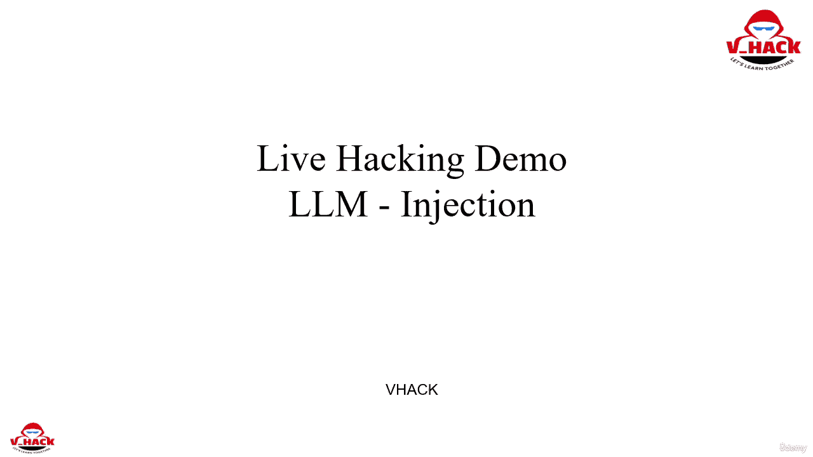

本节课我们要学习如何对带有聊天功能的大语言模型应用进行注入攻击。我们会用最直白的方式解释什么是HTML注入、页面重定向攻击、XSS注入，并且在真实靶场上演示完整的攻击过程。如果你是安全领域的初学者，不需要担心内容太难，因为我们会把每一步都拆解得非常清楚，让你明白攻击者是如何一步步利用这些漏洞的。


在开始具体演示之前，我们需要先搞清楚什么是针对大语言模型的注入攻击。简单来说，当应用程序把用户输入的内容直接显示在页面上，而没有做任何过滤或转义处理时，攻击者就可以插入一段HTML代码或JavaScript脚本，让浏览器按照攻击者的意图执行。这就构成了注入攻击。


安全界有一个广泛认可的参考清单，叫做大语言模型前十大安全风险列表。这个清单把各种攻击方式按危险程度进行了排序，而注入类攻击始终位列其中。我们可以把这个关系用一个简单的公式来表示：

```text
注入漏洞 = 可控用户输入 + 未经转义的页面输出 + 浏览器渲染执行
```

这个公式意味着，只要这三个条件同时满足，攻击者就有机会注入恶意代码。下面我们会按照这个逻辑，一步步拆解每一个攻击场景。


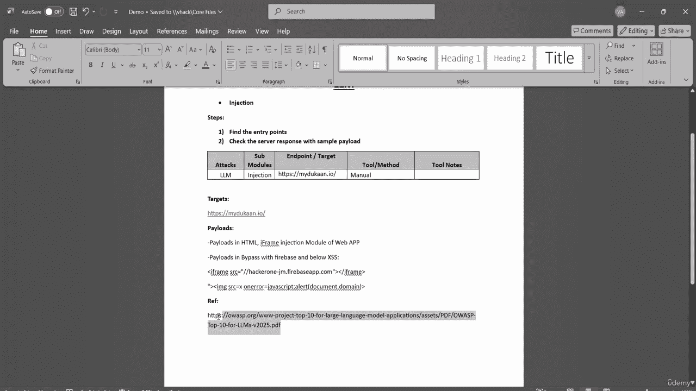

下一节中我们要讨论如何判断一个应用程序是否容易受到注入攻击。要找到攻击入口点，首先得找到一个带有聊天框或者输入框的应用程序，然后尝试往里面发送一些测试内容，观察服务器返回的响应。如果服务器原封不动地把我们的输入显示在页面上，而没有做任何处理，那么这个入口点很可能就存在注入漏洞。


以下是判断漏洞存在的常见检查步骤：
- 找到支持用户输入的聊天界面或表单
- 向输入框中提交一段简单的HTML代码
- 查看服务器返回的页面内容是否原样渲染了这段代码
- 如果页面发生了可见变化，比如出现了红色文字或弹出框，则说明存在注入漏洞

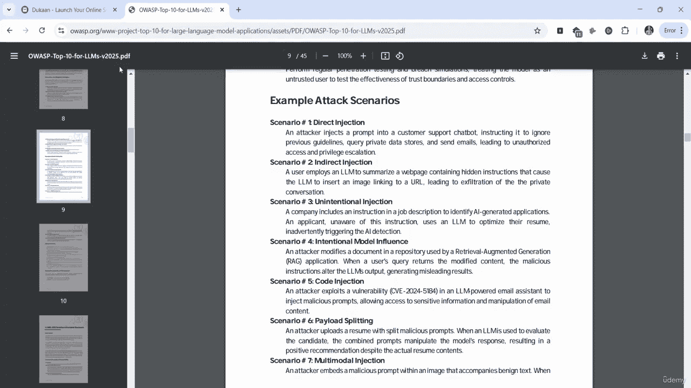

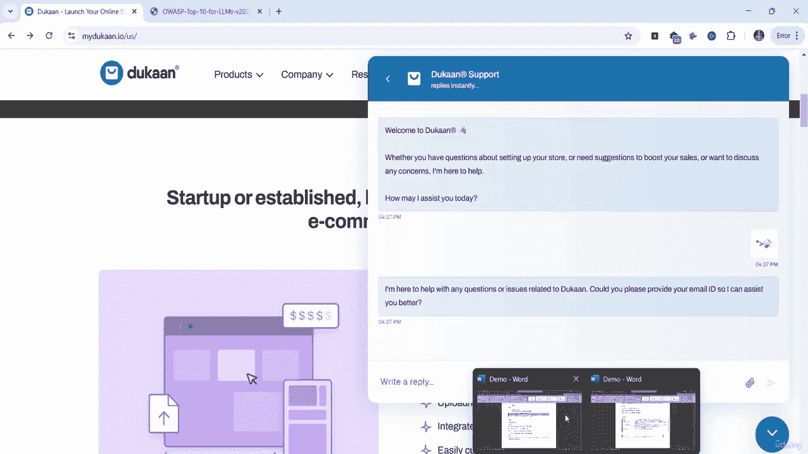

完成漏洞确认之后，我们就可以进入实际的攻击演示环节了。下面我们会使用一个真实的靶场来演示整个过程。


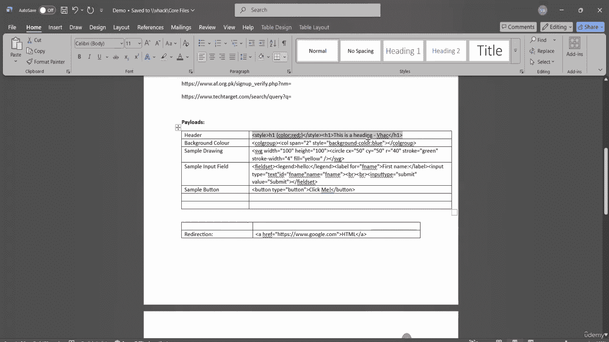

现在我们进入今天的实战演示目标。我们会使用之前在其他注入攻击练习中已经用过的同一组载荷，这些载荷曾经用于Steam相关攻击或者火焰相关攻击，这次我们会把它们复用到LLM聊天应用上。同时，我们会展示一些利用Firebase平台来绕过域名封锁的技巧，这样即使目标域名被屏蔽，我们仍然可以托管恶意页面并发动攻击。


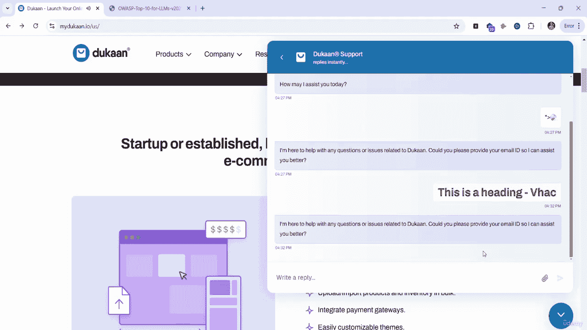

以下是本节课演示中会用到的主要攻击载荷：
- `<h1 style="color:red;">这是红色标题</h1>`
- `<svg><circle cx="50" cy="50" r="40" /></svg>`
- `<input type="text" placeholder="first name">`
- `<a href="https://google.com">点击我</a>`
- `<iframe src="https://your-project.firebaseapp.com"></iframe>`

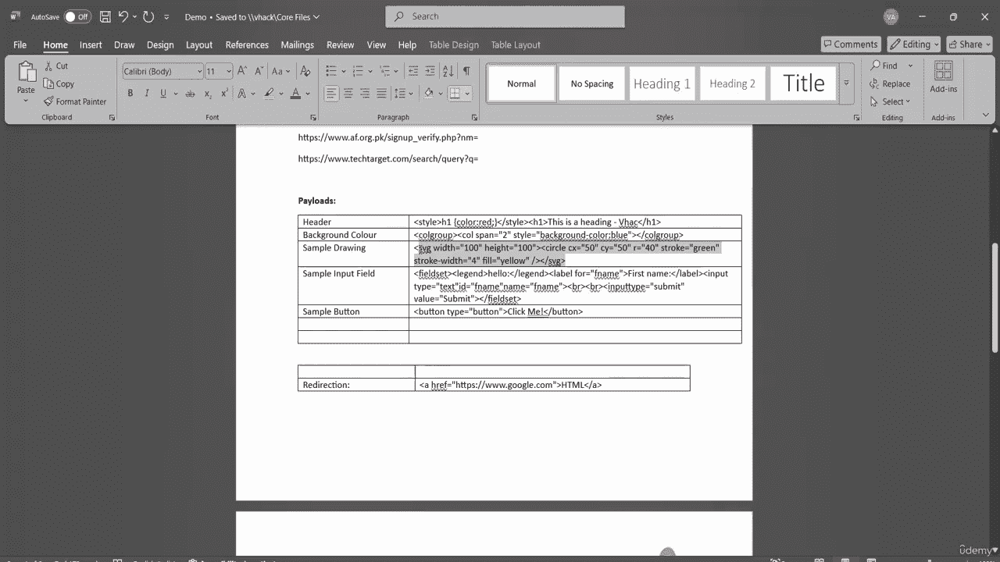

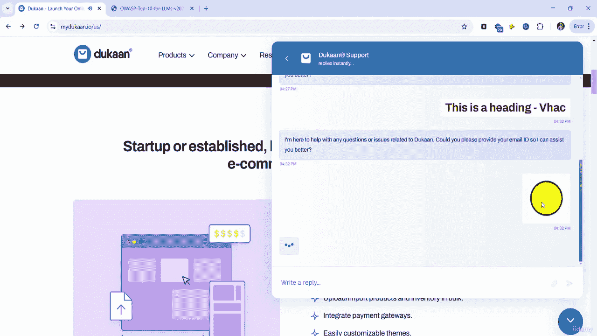

载荷准备好之后，我们开始第一个攻击场景，也就是HTML注入。


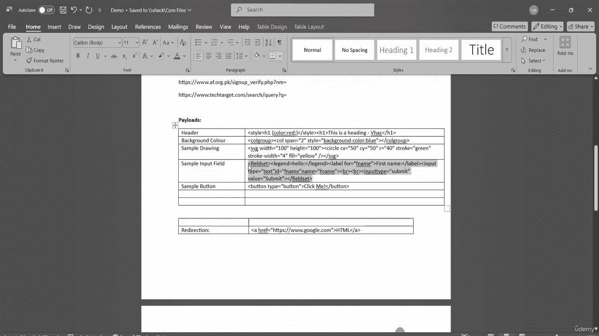

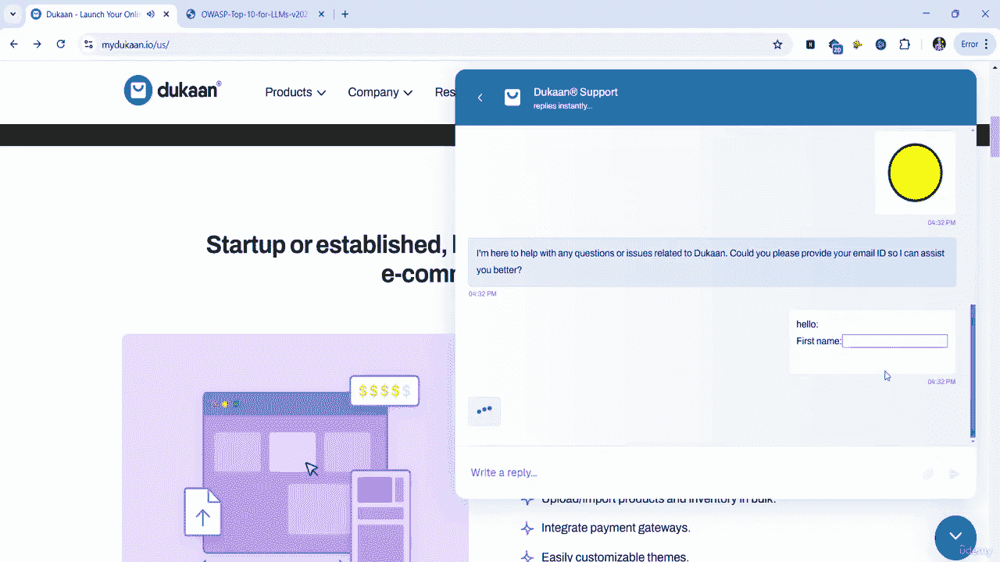

第一个演示是创建一个红色的标题。我们会在聊天输入框里提交一段带有h1标签的HTML代码，并设置文字颜色为红色。如果应用程序没有对输入做转义处理，浏览器就会把这段代码当成正常的HTML来渲染，页面上就会显示一个醒目的红色标题。这看起来只是一个简单的视觉变化，但实际上已经证明了攻击者可以向页面注入任意HTML内容。


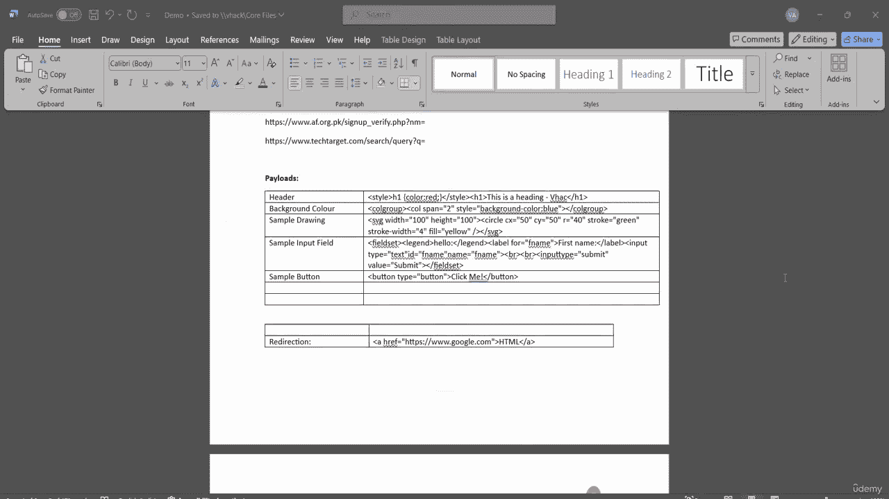

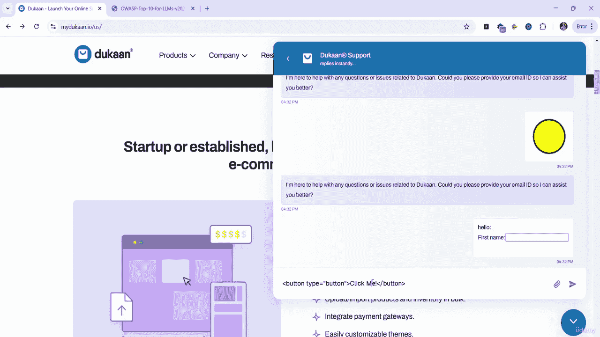

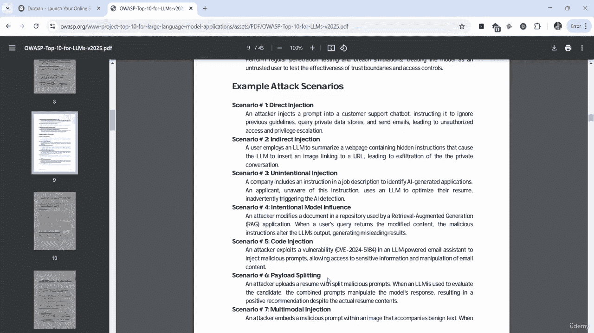

第二个演示是尝试在页面上绘制一个圆形。我们会提交一段SVG代码，代码中包含一个圆形元素。如果浏览器渲染成功，页面上就会出现一个圆形图形。这个例子虽然简单，但它说明攻击者不仅能改变文字颜色，还能在页面中插入图形元素，进一步扩大注入的影响范围。


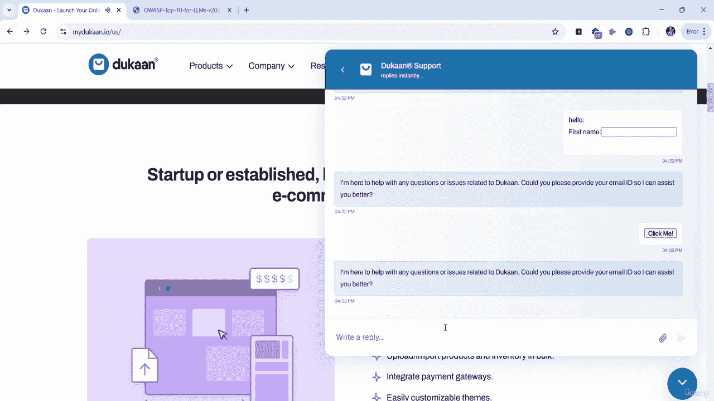

第三个演示是创建一个带有姓名输入框的表单字段。我们会注入一段HTML代码，在页面上生成一个文本输入框，占位符文字设置为first name。当其他用户访问这个页面时，就会看到这个突兀出现的输入框。这意味着攻击者可以在页面中植入虚假的表单，诱骗用户输入敏感信息。


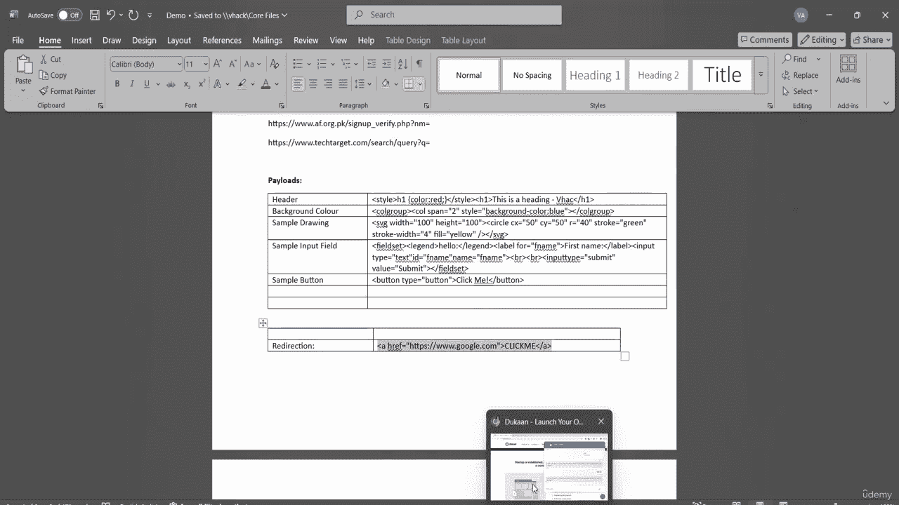

第四个演示是创建一个点击按钮，并且这个按钮带有超链接。我们会注入一个a标签，按钮文字显示为点击我，链接指向Google首页。当受害者点击这个按钮时，浏览器就会立即跳转到Google.com。通过这个演示，我们可以看到攻击者可以利用注入漏洞构造任意超链接，把用户诱导到恶意网站。


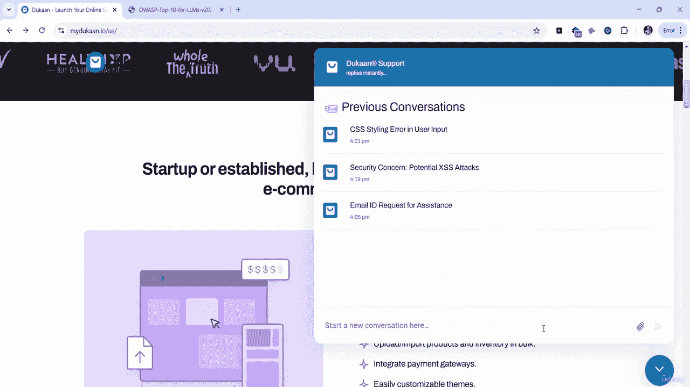

上面的重定向攻击演示了一个核心风险，即攻击者可以通过构造伪造的超链接，诱使用户离开当前可信页面，跳转到攻击者控制的外部地址。这种攻击方式在钓鱼场景中非常常见，因为用户往往难以分辨页面上的按钮是正常的功能按钮，还是攻击者注入的陷阱。


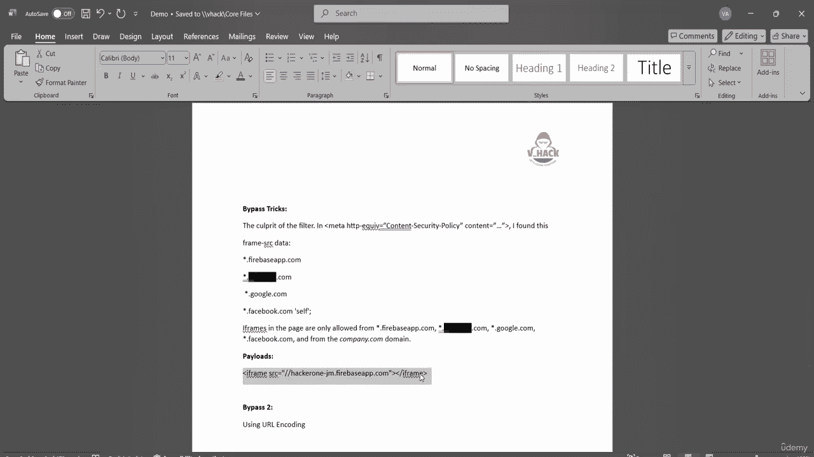

接下来我们要讨论如何绕过域名封锁。有些应用程序会对iframe标签做限制，或者直接封锁已知的恶意域名，这时候直接注入iframe可能无法生效。为了解决这个问题，我们可以使用Firebase平台来托管我们的恶意页面。Firebase提供免费的网页托管服务，而且很多安全工具并不会默认封锁firebaseapp.com这个域名，所以它是一个非常方便的跳板。


以下是使用Firebase绕过限制的基本步骤：
- 在Firebase控制台中创建一个新项目
- 上传一张简单的HTML页面，页面内容可以是任何攻击者想要展示的信息
- 获取这个页面的Firebase托管地址
- 将这个地址放入iframe标签中注入到目标应用程序

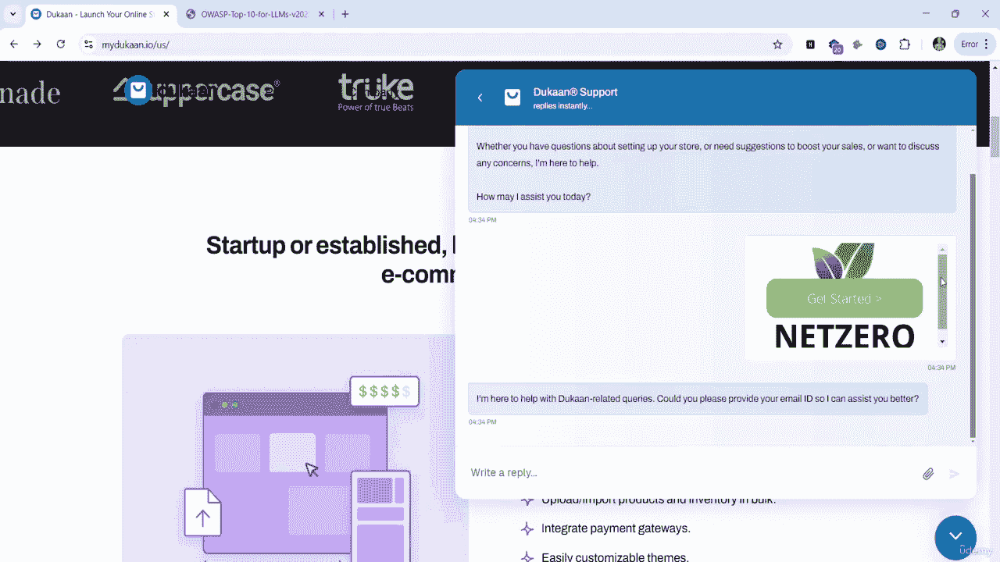

通过这种方式，即使目标应用程序封锁了某些已知恶意域名，攻击者依然可以通过Firebase的合法域名来加载恶意内容，从而绕过安全防护。


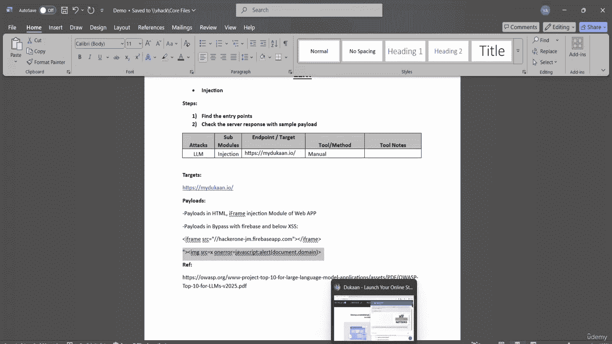

最后我们来看一种比较特殊的攻击方式，叫做类型混淆。我们会尝试判断目标应用程序是否允许注入一些会导致页面元素类型发生错误的代码。如果成功，页面可能会以一种意想不到的方式显示内容，甚至触发浏览器的安全异常。这个演示主要用来展示注入攻击的多样性，证明同一个输入点可能支持多种不同的攻击手段。


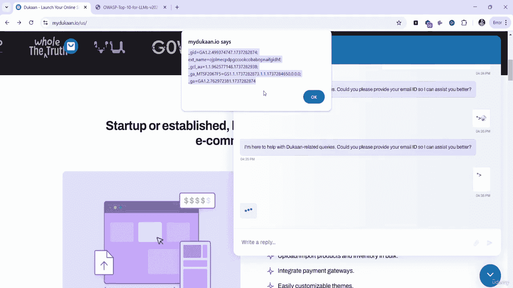

综合上面的所有演示，我们可以得出一个明确的结论：这个目标应用程序和它背后的大语言模型，几乎允许所有常见的注入攻击类型。这些攻击包括外部HTML注入、XSS脚本注入、页面重定向攻击以及越权操作。攻击者只需要找到一个可控的输入点，就可以在页面上注入任意内容，并且让其他用户的浏览器按照攻击者的意图执行。


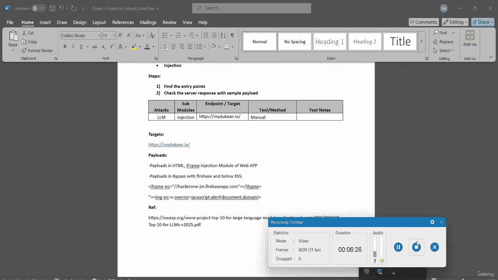

本节课中我们一起学习了针对大语言模型应用的注入攻击。我们讲解了什么是HTML注入，如何寻找入口点并确认漏洞，如何准备和使用攻击载荷，如何通过实际靶场演示红色标题、圆形绘图、输入字段、点击按钮与页面重定向，以及如何利用Firebase绕过域名封锁。最后，我们总结了该应用程序存在的多种注入漏洞类型。希望这节课能帮助你建立对LLM注入攻击的直观认识，并在后续的学习中继续深入探索。
