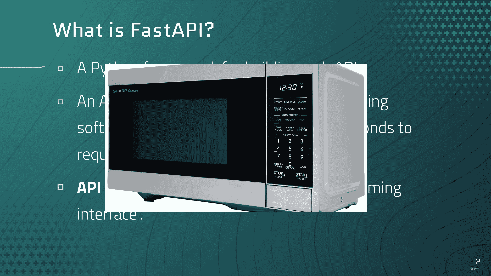
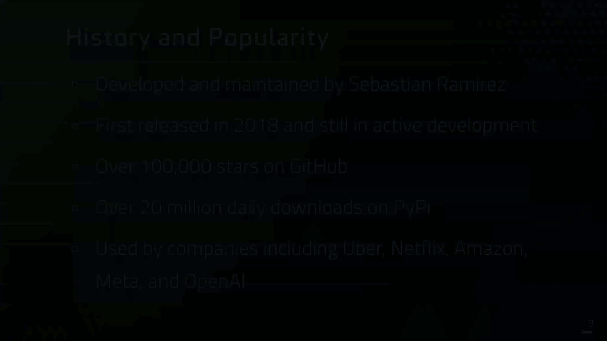
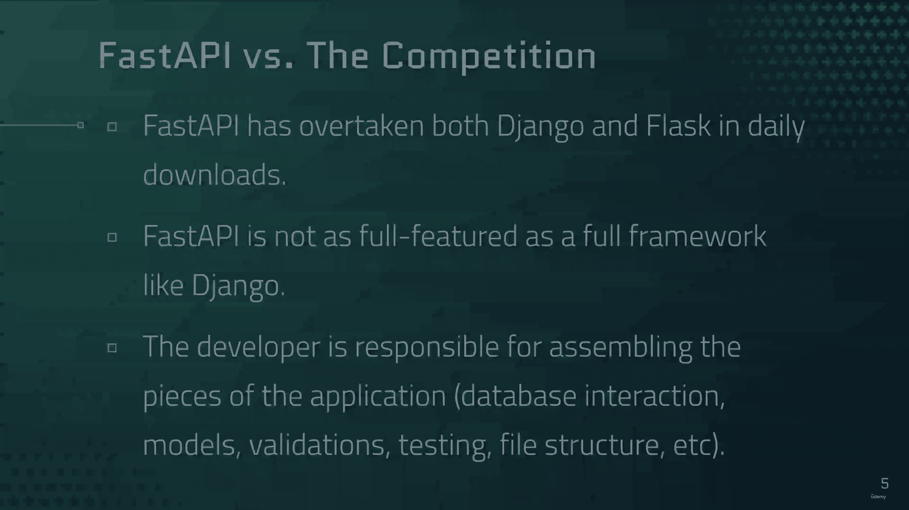

# 🚀 FastAPI 大师课：第01节：欢迎来到课程

在本节课中，我们将要学习 FastAPI 的定位、API 的两个含义、FastAPI 的历史与流行度、核心特性、与 Django 和 Flask 的简单差异、课程先修要求、内容大纲以及接下来的实战计划。欢迎加入这门课程，感谢你选择并参与学习。接下来直接进入主题，把基础概念一层一层讲清楚。

## 🧩 FastAPI 大师课：01.1：什么是 FastAPI

在正式写代码之前，先要弄清楚 FastAPI 是什么。FastAPI 是一个流行的 Python 框架，用来构建 Web API。这里的“框架”或“库”可以理解为一包已经写好的代码，开发者用它来解决某类常见问题。可以把库想成核心编程语言的可选扩展包。Python 是基础语言，而在 Python 的生态里，会有很多用 Python 写成的库，用来处理数据分析、化学、机器学习，甚至视频游戏引擎等问题。FastAPI 就是一个专门处理 Web 开发问题的库，也就是构建 Web 应用的服务器端或后端，也就是运行在互联网上的应用的后端部分。

为了把概念讲清楚，这里给出两个定义，以下是这两个定义的具体说明。

- 定义一：在 Web 应用的语境中，API 可以定义为一个 Web 服务器。Web 服务器就是互联网上持续运行、响应数据请求的软件应用。

- 定义二：API 是 Application Programming Interface 的缩写，中文是“应用编程接口”。interface 指的是与系统交互的点，也就是一个应用允许我们与它交互的方式。

当你在使用网站或手机 App 时，浏览器或 App 通常被称为客户端，客户端会向某个服务器发送请求，服务器再用数据响应。比如 LinkedIn 这样的 Web 应用，服务器或后端可能把职位、联系人发布的帖子等数据返回给你。后端是数据源，数据会发送回客户端，再渲染到对应的屏幕或浏览器上。最终可以把 API 想成一个持续运行的 Python 应用，它的任务就是把数据返回给各种客户端。

API 这个缩写的全称是 Application Programming Interface，其中 interface 被定义为与系统交互的点。换句话说，interface 就是应用允许我们与它交互的方式。可以用现实中的物理对象做类比，比如微波炉。微波炉内部有复杂的加热过程和物理过程，但我们与微波炉交互的方式是通过它的接口，也就是前面的面板，我们按按钮来设置时间等信息。这个面板就相当于 API，它定义了我们可以与这个对象交互的可能方式。

> 可以把 API 想成微波炉前面的控制面板。微波炉内部有复杂的加热和物理过程，但我们通过面板上的按钮设置时间、选择模式。这个面板就是人与微波炉交互的接口，它规定了可以怎样操作微波炉。Web 应用的 API 也是同样的道理。

Web 应用的 API 遵循同样的原则。我们不能直接对 LinkedIn 说“给我任意数据，并按任意形状返回”。LinkedIn 会定义路由或端点，这些路由和端点组成所谓的接口，也就是客户端可以请求数据的允许方式。API 定义了我们可以访问的可用入口点，客户端通过这些入口点完成 API 允许完成的各种任务。例如，后端可能定义类似下面的入口：

```python
@app.get("/jobs")
def get_jobs():
    return {"jobs": [...]}
```

了解了 API 和 FastAPI 的基本定位后，下一节我们来看看 FastAPI 的历史与流行度。



## 🕰️ FastAPI 大师课：01.2：FastAPI 的历史与流行度

上一节我们介绍了 FastAPI 是什么，本节中我们来看看它从哪里来、现在有多流行。FastAPI 最初由开发者 Sebastián Ramírez 开发，并且一直主要由他维护。FastAPI 首次发布于 2018 年，目前仍在活跃开发中，每个月都会看到 FastAPI 发布新版本。以下是几个能说明其流行度的关键事实。

- FastAPI 在 GitHub 上拥有超过 100,000 个星标。虽然不应该把星标数量当作质量的最终标准，但它确实说明这个库在 Python Web 开发生态中获得了立足点。

- FastAPI 在 PyPI 上的每日下载量超过 20,000,000 次。

- GitHub 星标和 PyPI 日下载量这两项统计，都高于 FastAPI 经常被拿来比较的两个竞争者：Django 和 Flask。

- 如今 FastAPI 被 Uber、Netflix、Amazon、Meta 和 OpenAI 等公司使用。



- 如果你在 2026 年开始一个新的 Python 后端 Web 开发项目，很有可能你会使用 FastAPI。

可以用下面的公式概括这些关键数据：

```text
GitHub Stars > 100,000
PyPI 日下载量 > 20,000,000
```

了解了流行度之后，接下来看看 FastAPI 为什么流行，也就是它的核心特性。

## ⚡ FastAPI 大师课：01.3：FastAPI 的核心特性

上一节我们看了 FastAPI 的历史和下载量，本节中我们来看看它的核心特性。FastAPI 的一些突出特性，也可以说是这个库 popularity 爆发的主要原因。以下是 FastAPI 的核心特性说明。

- 数据验证：FastAPI 会验证进入服务器的数据以及从服务器发送出去的数据的 payload 或数据形状。后端开发的一个关键部分是确保处理的是有效、经过净化、干净的数据，反过来也一样，要确保不向客户端发送过多数据，也不暴露敏感数据。FastAPI 结合一个叫 Pydantic 的工具，可以很容易地验证进入服务器和返回客户端的数据形状符合预期标准。

- 解析请求信息：FastAPI 有非常简单且一致的语法，用来解析查询参数、路径参数、Cookie、请求头等内容。如果这是你第一次接触后端应用，不熟悉这些术语也不用担心，后面会详细讲。这些是后端开发中常见的方面，FastAPI 让获取客户端发送的这些信息并在某个路由或端点中处理变得很容易。

- 速度优化：FastAPI 针对速度做了优化，它的名字也来自这里。这既包括实际的服务器性能和处理大量不同请求的能力，也包括所谓的开发者迭代速度，也就是你写代码的速度。相比竞争者，FastAPI 的样板代码或强制代码更少，入门和构建完整端点需要写的代码更少。

- 自动文档：FastAPI 能够直接从代码生成自动文档，生成到 Swagger，也叫 OpenAPI。只要编写常规的 FastAPI 代码，就能自动生成文档，展示应用中的所有端点，以及这些端点期望接收和返回给客户端的数据形状。

可以用下面的公式概括这些特性之间的关系：

```text
FastAPI 核心能力 = 数据验证 + 请求解析 + 速度优化 + 自动文档
```

这些特性让 FastAPI 很有吸引力，但它和 Django、Flask 到底有什么不同，下一节做一个简单比较。

## 🚗 FastAPI 大师课：01.4：与 Django、Flask 的简单比较

上一节我们介绍了 FastAPI 的核心特性，本节中我们来看看它和 Django、Flask 的差异。个人观点是，如果你刚开始学习 Python 后端开发，用哪个工具并不重要。可以把库和框架比作不同的汽车，一辆车可能优化速度，另一辆车可能优化安全性，但只要练习驾驶，你就会成为更好的司机。同样，用任何 Python 后端库写任何后端代码，都会提升你作为开发者的能力。

在做了这个类比之后，还是快速比较一下 FastAPI 和它的竞争者。前面提到，FastAPI 的每日下载量已经超过了 Django 和 Flask。技术差异的关键在于，FastAPI 不像 Django 那样是一个功能齐全的完整框架。Django 更加有主见，它对代码应该长什么样、应该使用哪些工具持有明确观点。可以把 Django 想成拿到一整套工具箱，里面有锤子、螺丝刀和电锯。

> Django 像一整套工具箱，里面有锤子、螺丝刀和电锯。FastAPI 更有限、更专注，主要聚焦服务器和路由定义，开发者有更多自由，也有更多责任去组装让应用运转起来的各个部件。

相比之下，FastAPI 更有限、更专注，主要聚焦服务器和路由定义。开发者因此有更多自由，但也有更多责任去组装让应用运转起来的各种部件。在 FastAPI 生态中，我们可以选择如何与数据库交互，选择使用哪个 ORM，选择如何测试这些端点，选择如何组织 FastAPI 应用中的文件结构。这里有更多自由，因为这个库在某种意义上没有那么聚焦，也不会强制或推行某种特定范式，这让你有更多空间去探索和尝试 Python 生态中的不同工具，并把它们组合起来使用。



FastAPI 建立在 Python 生态中的另外两个库之上，这两个库是 Starlette 和 Pydantic。为了理解 FastAPI 的组成，以下是它的两个基础层。

- Starlette：底层异步框架。可以把它看作让 FastAPI Web 服务器运行起来的基础层。

- Pydantic：数据验证库。课程中会大量深入讲解 Pydantic。它负责验证并转换到达某个端点的数据，也负责塑造和转换要返回给客户端的数据。

可以用下面的公式概括 FastAPI 的组成：

```text
FastAPI ≈ Starlette（异步 Web 基础） + Pydantic（数据验证） + 路由与开发体验
```

了解了框架差异和基础层之后，下一节说明学习这门课需要什么基础。

## 🎒 FastAPI 大师课：01.5：课程先修要求

上一节我们比较了框架，本节中我们来看看课程先修要求。课程推荐具备中级 Python 编程知识。你不需要成为专家，也不需要事先具备 Python 或其他语言的后端开发经验，但推荐掌握 Python 基础知识。以下是建议的先修技能说明。

- Python 基础：需要了解基本数据类型、列表、字典、字符串，具备函数和方法的使用经验，了解类定义和库导入。如果你从来没有接触过 Python，建议先学一门完整的 Python 课程，再继续这门课，因为本课程不会花时间解释例如字典是什么。课程会慢慢讲 FastAPI 和后端开发中的所有构造，但不会花太多时间专门讲核心 Python 构造。

- 终端基础：需要基本会使用终端，不要求很深，只要能导航文件系统并运行一些命令即可。因为后续课程会用终端安装依赖，也会用到 Git，如果你要克隆仓库，还会用 Git 下载课程材料。

- 代码编辑器基础：需要基本会用代码文本编辑器。本课程会使用 VS Code。

确认基础要求后，下一节看课程大纲。

## 🗺️ FastAPI 大师课：01.6：课程内容大纲

上一节我们说了先修要求，本节中我们来看看课程大纲。以下是课程计划覆盖的主要内容说明。

- 核心 FastAPI 语法：课程会讲 FastAPI 的核心语法和基本用法。

- 后端开发基本原则：会讲后端开发中共享的基本原则，这些原则不依赖具体框架或编程语言。

- 数据库内容：会讲数据库，包括结构化查询语言 SQL，以及对象关系映射器 ORM。

- Python 生态 дополнитель库：会深入 Python 生态中的其他库，包括 Pydantic 和 SQLModel。

- 面试相关专题：会讲一些面试中可能被问到的具体主题，比如认证和授权，以及更多内容。

了解大纲后，下一节进入实战计划与下一步。

## 🛠️ FastAPI 大师课：01.7：课程实战计划与下一步

上一节我们梳理了课程大纲，本节中我们来看看具体实战计划和下一步。接下来的第一步是安装 uv，它是一个流行的 Python 包和语言管理器。uv 是一个很简单的工具，可以让我们下载 Python，以及课程项目需要的所有依赖，比如 FastAPI。课程为 macOS 和 Windows 操作系统都准备了安装说明，选择正确的系统即可，另一个系统的说明可以跳过。这里要说明，如果你更喜欢使用其他 Python 管理器，或者更喜欢其他文本编辑器，完全没有问题。课程中围绕 FastAPI 和后端开发的概念是一样的，如果你有偏好，完全可以使用自己的工具。我只是觉得 uv 是很容易上手的入门方式。如果你不在意工具选择，或者已经有一段时间没有接触 Python 生态，你会发现这个工具很容易上手，也很适合开始学习。

以下是接下来要执行的步骤和项目安排说明。

- 安装 uv：先安装 uv，用它管理 Python 和课程依赖。

- 下载课程材料：安装 uv 后，下载课程材料，材料会放在 GitHub 上的一个仓库中。

- 完成 Rent a Room 项目：课程前 10 节会围绕一个项目展开，这个项目叫 Rent a Room。后面会详细讲这个项目，简单说，它受 Airbnb 启发。这个项目会提供很好的机会，让我们在真实领域中学习 FastAPI 基础概念，而不是做一个刻意编造的项目。我们会像一家新创业公司的联合创始人一样，构建真实功能，让用户可以从房东那里租房间。

- 学习专题章节：走完 Rent a Room 项目后，会有专门章节深入一些你可能需要知道的专业主题，比如面试可能涉及的认证、授权、测试等内容。这些主题会独立讲解，以便聚焦核心概念，不必把所有内容都绑回前面那个大项目。

- 集成前端：后面会讲如何把 FastAPI 和 React 这样的前端集成起来。

- 部署：最后会讲一些部署相关内容。

- 未来扩展：课程还有很多未来计划，希望学生反馈也能推动后续主题的建设和交付。以上只是暂定的实战计划，随着更多学生参与课程并提供反馈，计划会在不久后扩展。

可以用下面的流程概括接下来的路线：

```text
安装 uv -> 下载课程材料 -> Rent a Room 项目 -> 专题章节 -> React 集成 -> 部署 -> 根据反馈扩展
```

## 📌 FastAPI 大师课：01.8：本节总结

上一节我们完成了实战计划，本节中我们对整节课做总结。本节课中我们一起学习了 FastAPI 是什么，理解了库和框架的含义，掌握了 API 的两个定义，也就是 Web 服务器和应用编程接口。我们还用微波炉的接口做了类比，理解了路由和端点如何组成 Web API 的接口。接着我们了解了 FastAPI 的历史、GitHub 星标、PyPI 下载量、使用公司和发展趋势，也学习了它的数据验证、请求解析、速度优化和自动文档等核心特性。我们还比较了 FastAPI 与 Django、Flask 的差异，知道了 FastAPI 建立在 Starlette 和 Pydantic 之上。最后我们确认了课程先修要求，梳理了课程大纲和实战计划。本课内容到这里结束，下一节课会开始安装 uv，期待在下一节课见到你。

