# FastAPI Masterclass：第1部分 第2章：在macOS上安装uv（Python包与项目管理工具）🚀

在本节课中，我们将学习如何在macOS系统上安装uv这个命令行工具。uv是一个现代的Python包与项目管理工具，它能够帮助我们轻松地安装Python、依赖库以及像FastAPI这样的框架。同时，我们还会了解一些配套的命令和实用技巧，比如如何升级uv、如何设置shell自动补全，以及如何彻底卸载uv。这些内容虽然看起来简单，但却是后续开发FastAPI项目的基础，掌握了它们，你的开发环境搭建就会变得非常顺畅。

## 为什么选择uv？🤔

对于macOS系统，我们搭建开发环境的第一步就是安装uv命令行工具。如果你之前对uv不太熟悉，完全不用担心，因为它的用法非常简单明了。

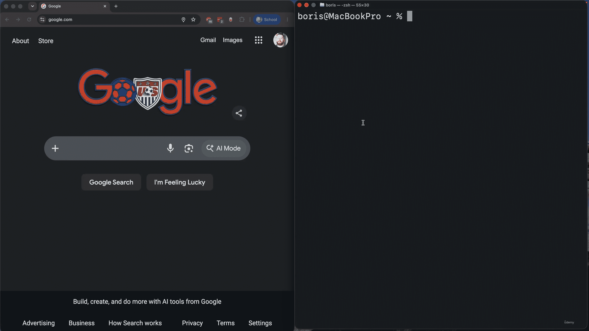

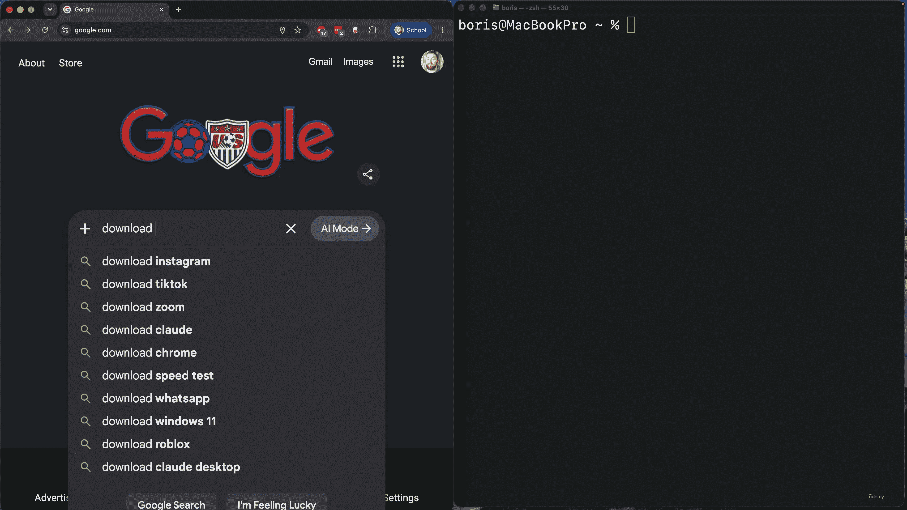

uv的一个核心功能是：它允许你非常方便地安装Python，以及各种依赖库，比如FastAPI。举个例子，当你从现在开始的一两节课后下载课程材料时，你只需要进入任何一个课程文件夹，然后运行一条命令——也就是`uv sync`——这条命令就会自动下载Python，同时下载该项目所有的依赖。整个过程几乎是全自动的，省去了很多手动配置的麻烦。

基本上，uv使得我们能够非常轻松地启动并运行一个特定的项目，连同它所有与Python相关的依赖。它把这些繁琐的事情都隐藏在了背后，让你可以专注于代码本身。如果你有自己偏好的Python安装和管理方式，或者你已经习惯了用其他工具来管理库依赖，那么你完全可以根据自己的喜好来使用。我们在这里推荐uv，主要是为了那些不太在乎这些细节、或者刚接触Python生态系统的初学者，提供一个坚实、现代且稳妥的默认选择。因此，在接下来的所有设置步骤中，我们都将使用uv来完成。

## 安装uv：从下载到执行 📥

首先，你需要打开你的终端（Terminal）。最好同时打开一个网页浏览器，把终端和浏览器并排放在屏幕上，这样方便你一边查看指令，一边操作。

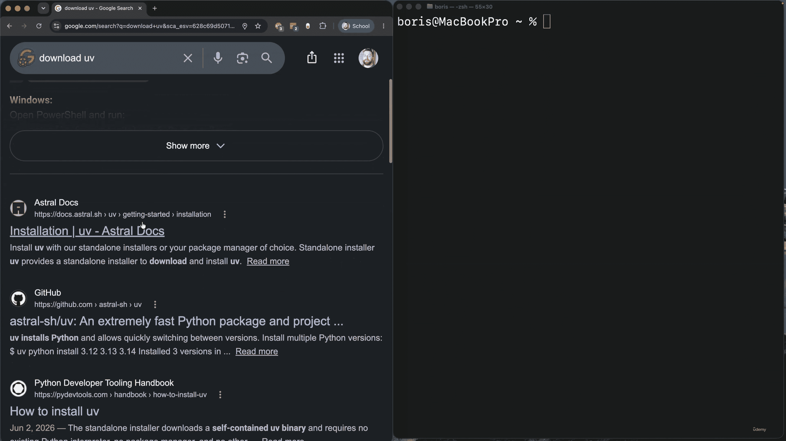

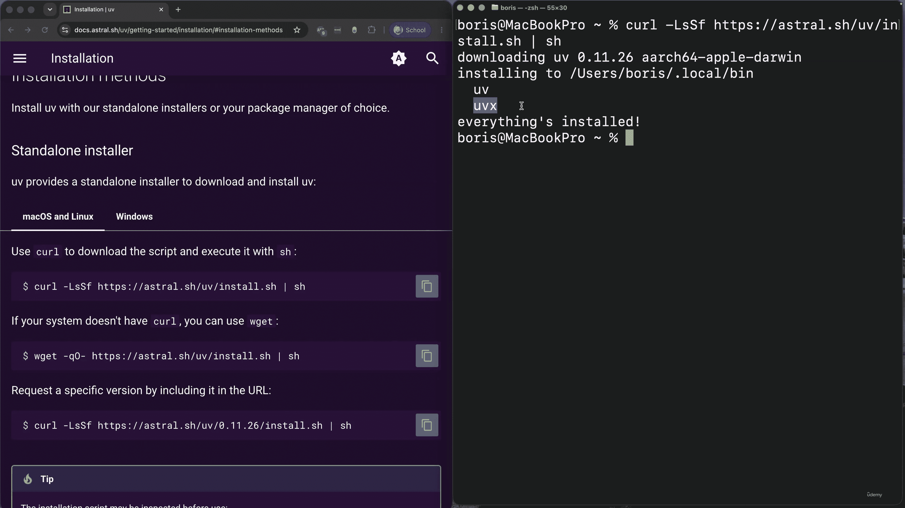

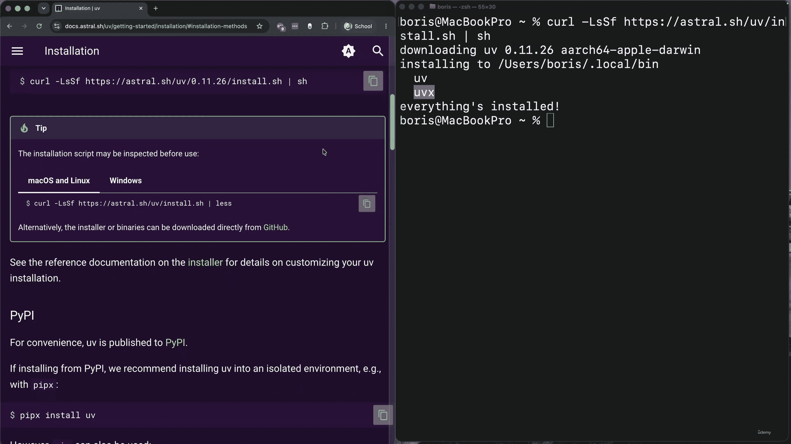

接下来，在浏览器中搜索“download uv”。搜索结果的第一个链接通常会是“astral docs”——也就是uv官方文档，这正是我们需要打开的页面。点击进入该页面后，你会看到一系列需要执行的命令行安装指令。在这个页面上，请确保你选中了“Mac”或“macOS”选项（Mac-wise）。然后，选择第一个安装选项，也就是使用`curl`命令的那个。你只需要点击该命令旁边的复制图标，然后回到终端，用`Command + V`把命令粘贴进去，再按回车执行即可。执行这个命令会下载并安装最新版本的uv。在安装过程中，我们还会获得一个附带工具，叫做`uvx`。这个工具的作用是允许你从终端直接执行一些顶层的Python命令，而不需要绑定到某个具体项目或者某个文件夹下的特定Python版本。

举个例子，如果你只是想快速地用Python获取某个库，然后用它来运行一个一次性的终端命令，那么`uvx`就非常有用。它让你可以临时使用Python环境，而不用先创建项目、安装依赖等等。所以，在这个安装页面上，你可以往下滚动，跳过那些可选的安装方式，直接使用我们上面提到的`curl`命令就够了。

## 常用命令与shell自动补全 ⚙️

安装完成之后，我们再来看几个其他有用的命令。如果你以后想在终端中升级uv，使用的命令是`uv selfupdate`。当然，由于我们刚刚安装，目前应该已经是最新版本了。不过，每个月检查一次，确保你使用的工具是最新版本，总是一个好习惯。所以，`uv selfupdate`这个命令值得记住。

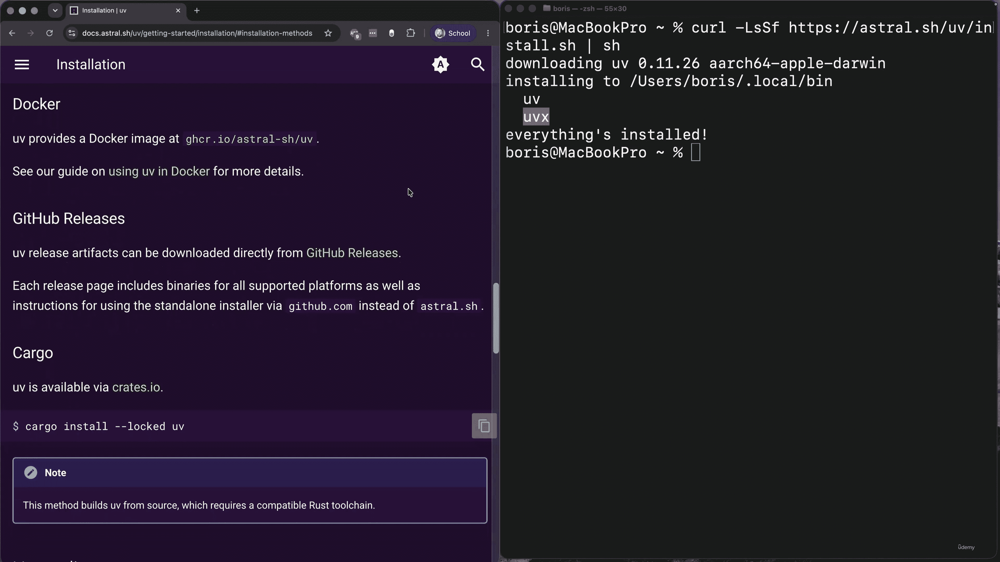

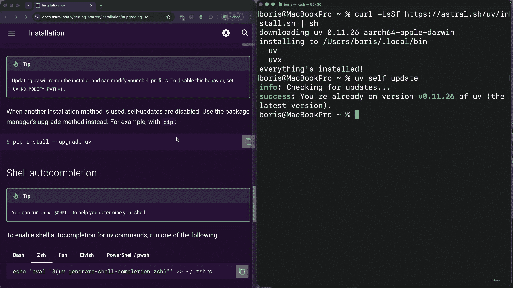

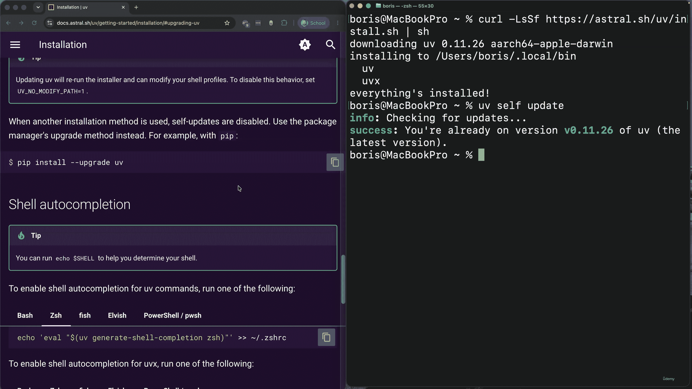

另外，我们还需要设置shell自动补全功能。这个功能可以让你在终端中按下`Tab`键时，自动补全uv的许多常用命令、参数和选项，非常方便。在设置之前，你需要知道你的终端使用的是哪种shell。因为不同版本的macOS，其默认shell可能不同。如果你不确定，可以在终端中执行以下命令来查看：

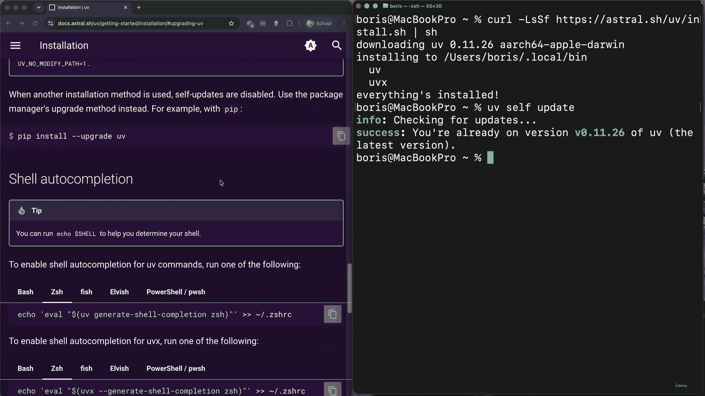

```bash
echo $SHELL
```

执行后，它会输出你当前使用的shell路径，比如我这里是`/bin/zsh`，也就是Z shell（Zsh）。在uv文档的自动补全设置区域，会有一个选项让你选择正在使用的shell。如果你使用的是Zsh，就确保选中Zsh；如果你使用的是其他终端或自定义的shell引擎，可以自由选择对应的选项卡。然后，复制对应的命令并执行，这将会为uv和uvx这两个工具都设置好自动补全。

接下来，我还会复制并粘贴另一个命令，这个命令会更新你的shell配置文件（比如`.zshrc`）。这样，每次终端启动时，它就会自动运行一系列命令，然后所有自动补全功能就都准备好了。换句话说，你不需要每次手动加载，打开终端就自动生效。

## 验证安装：执行uv查看可用命令 🔍

安装和配置完成后，我们还可以验证一下uv是否正常工作。如果你在终端中直接执行`uv`，你会看到该程序内可用的顶层命令列表。这基本上就是顶层帮助信息，它列出了我们可以用uv运行的各种命令。使用方法很简单，遵循一个固定的模式：运行`uv`后跟任意一个命令，例如`uv sync`、`uv selfupdate`等。

在本课程中，我们会经常使用的一个命令是`uv sync`。这个命令的作用是下载给定项目的所有依赖，包括Python本身以及项目中提到的所有库。可以说，它是我们后续项目工作的核心命令。当你看到`uv`输出的帮助列表时，你会对它的能力有一个整体印象，不过我们不需要死记硬背，用到的时候查阅即可。

## 卸载uv：一个可选的备用知识 🗑️

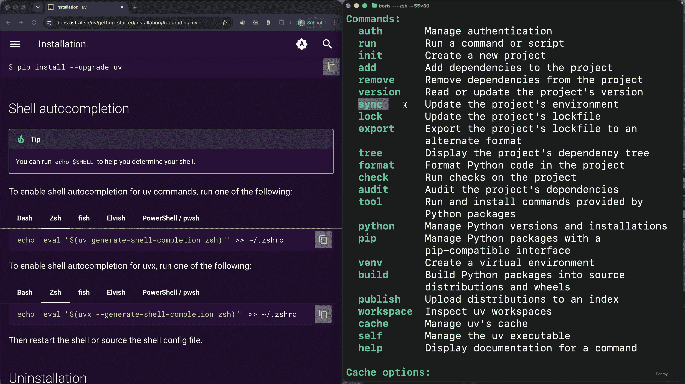

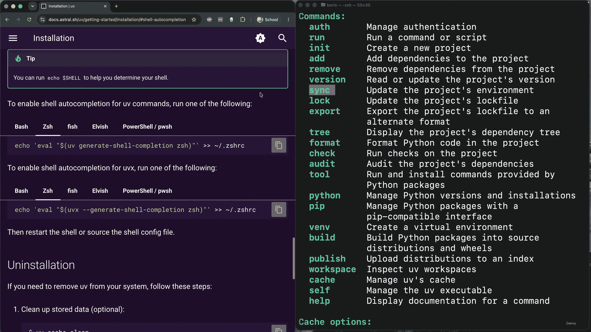

最后，我还想提一下卸载uv的方法。虽然我们这节课不会真正执行卸载操作，但多了解一些总是好的。如果你将来想要彻底移除uv，那么它会同时删除所有由uv管理的项目中的Python版本和依赖等。你可以在这个文档页面找到完整的卸载说明。这些说明同样是在终端中执行的命令。首先，`uv cache clean`基本上会清除缓存——也就是所有本地存储的已下载的可用Python版本和各种依赖。然后，你只需要简单地删除核心uv目录（即存放Python和uv的位置）即可。具体命令会在文档中给出，你就按照那里的步骤操作就行。

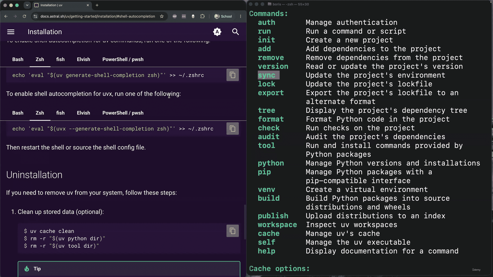

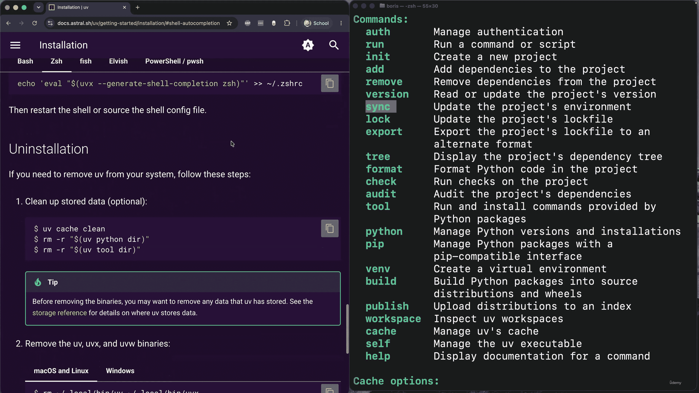

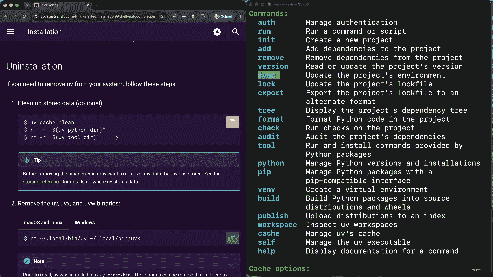

## 总结 📝

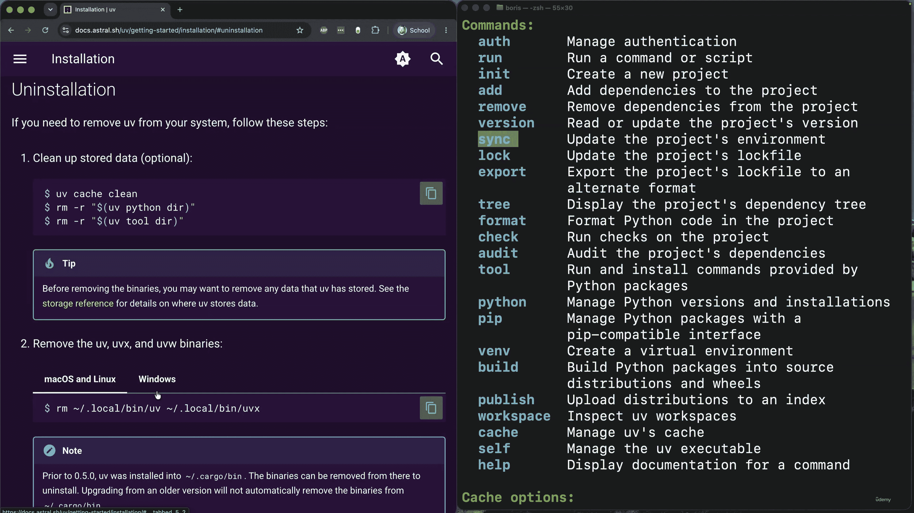

本节课中，我们一起学习了如何在macOS上安装uv这个强大的Python包和项目管理工具。我们从安装的准备工作开始，了解了为什么选择uv，然后逐步执行了安装命令，并认识了配套的uvx工具。接着，我们学习了几个重要的辅助命令，包括升级用的`uv selfupdate`、设置shell自动补全的方法，以及验证安装的`uv`命令。我们还特别提到了`uv sync`这个在后续课程中会高频使用的重要命令。最后，我们浏览了卸载uv的步骤，以备不时之需。现在，我们的环境已经准备就绪，在下一节课中，我们就可以下载课程材料，然后开始为第一个FastAPI项目下载依赖了。
