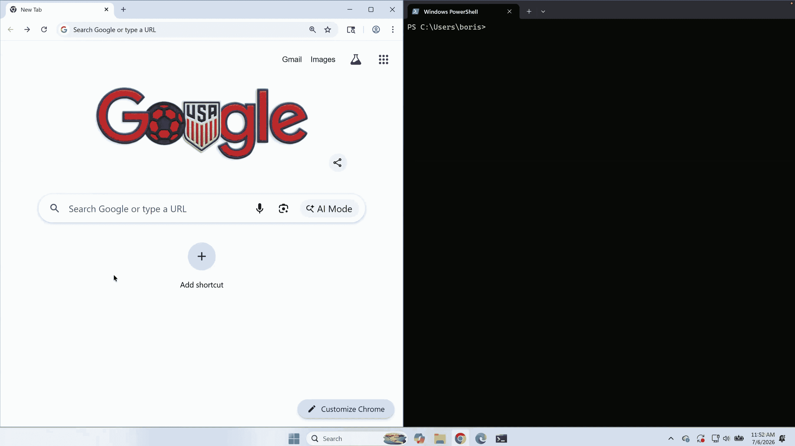
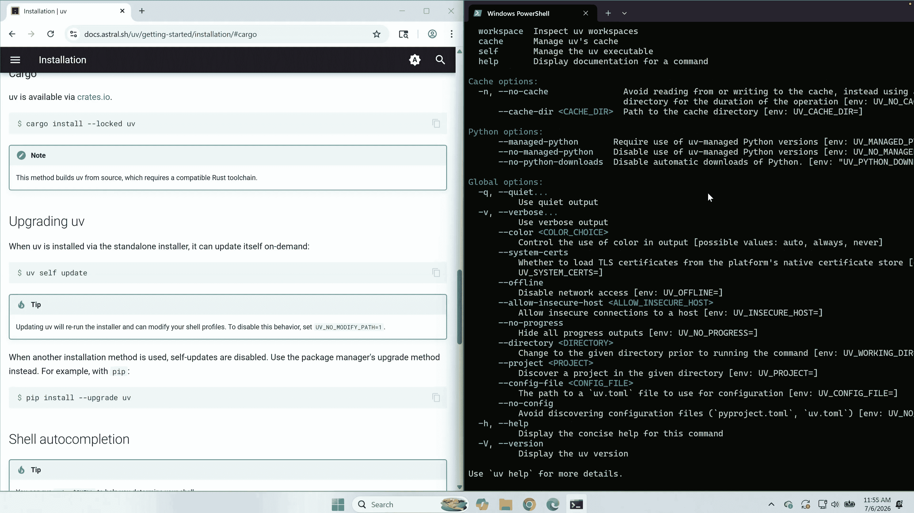
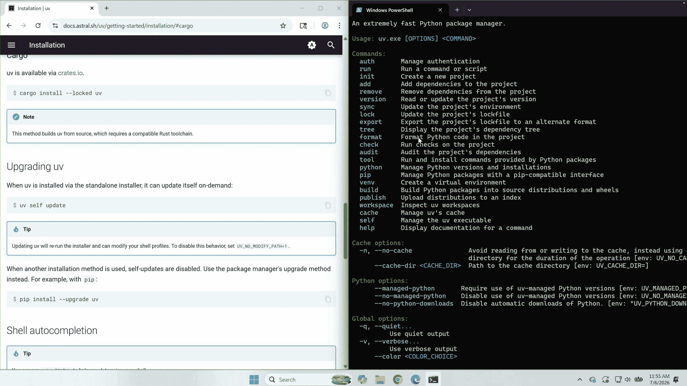
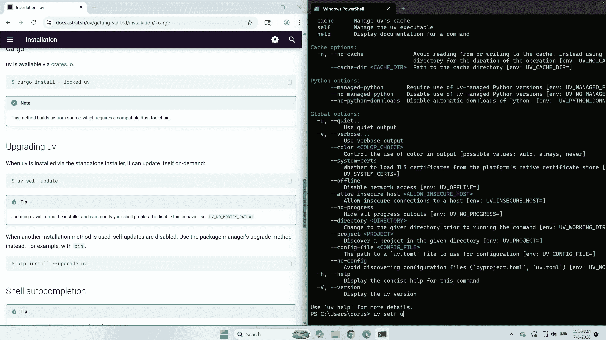
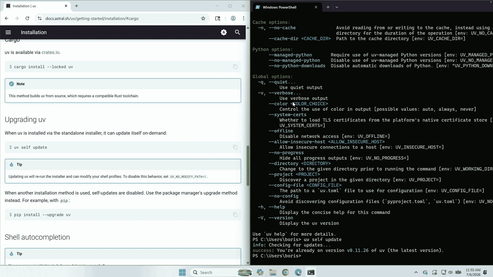
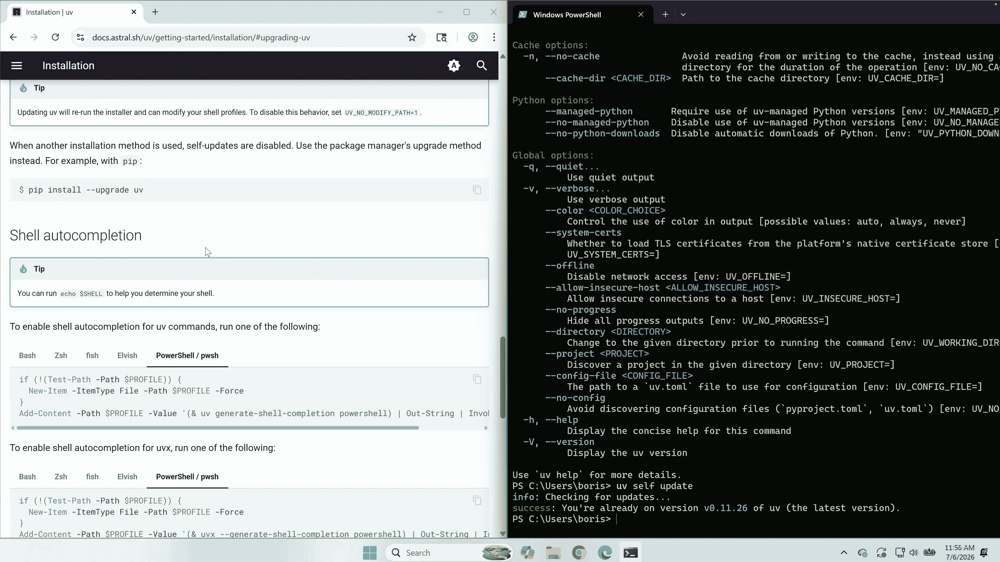
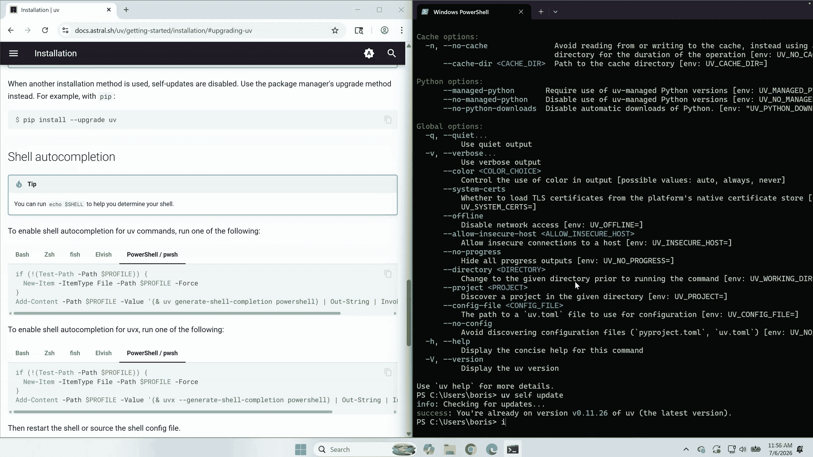
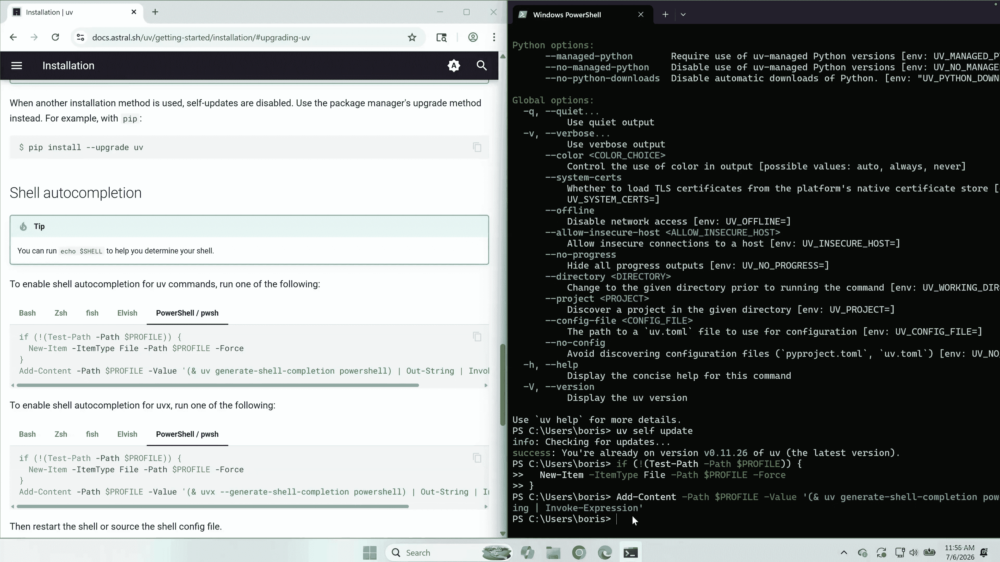
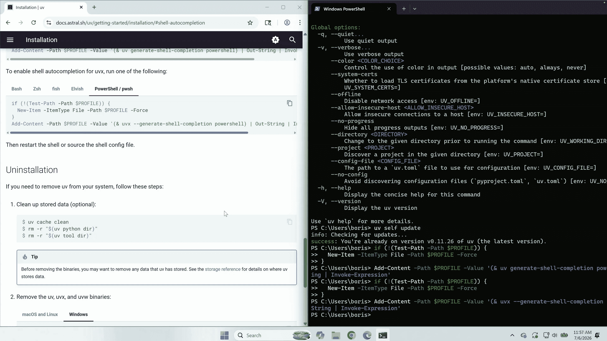
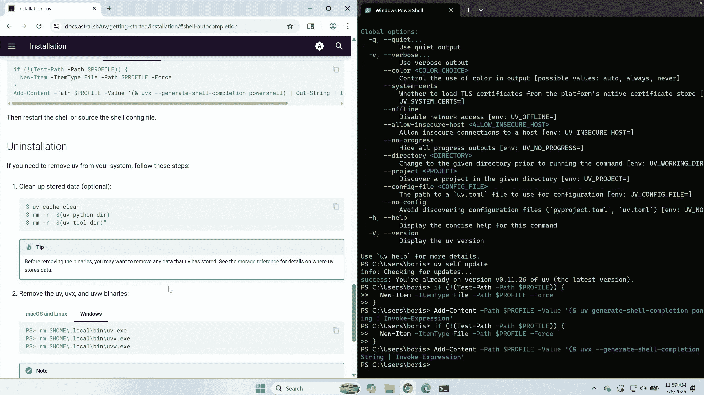

# 🚀 FastAPI Masterclass：第 4 章：在 Windows 上安装 uv，Python 包与项目管理器

在本教程中，我们将一起学习如何在 Windows 电脑上安装 uv 这个命令行工具。uv 是一个现代且流行的 Python 包与项目管理器，它可以帮助我们轻松管理多个 Python 版本，也能管理某个项目需要的依赖库，例如后面课程中会用到的 FastAPI。我们会从为什么选择 uv 讲起，然后一步步完成安装、检查、升级、自动补全设置，最后了解卸载方式。整个流程面向初学者，尽量用直白的方式说明，确保你能够跟着操作，并为下一课下载课程材料、使用 uv 获取第一个 FastAPI 项目的 Python 版本和依赖做好准备。

**为什么选择 uv**

在正式动手安装之前，我们先了解 uv 的定位和它带来的便利。uv 是一个流行且现代的选项，它允许你非常轻松地管理多个 Python 版本，同时也能管理 Python 依赖，也就是某个项目可能需要的库，比如一两节课之后会接触到的 FastAPI。当你从 GitHub 下载课程材料后，可以很方便地进入材料中的任意课程项目，然后执行一个命令 `uv sync`，它会自动下载该项目指定的 Python 版本，并安装项目需要的全部依赖，而且只需要一条终端命令。uv 之所以在 Python 生态中变得流行，正是因为它简单，并且能够快速搭建完整的开发环境。



下面的代码可以概括 uv 在这个场景里的核心作用，便于你记住它解决的问题。

```text
uv sync = 自动下载项目指定的 Python 版本 + 自动安装项目需要的依赖
```

当然，如果你对安装 Python 和管理依赖有自己的偏好，也有多种其他选项，你完全可以自由选择任意一种方式。不过对于刚入门的人来说，uv 是一个现代、简单、容易上手的工具，适合作为起点。下面我们列出选择 uv 的几个主要原因，帮助你理解它为什么适合本课程。

- uv 是现代且流行的 Python 工具。
- 它可以轻松管理多个 Python 版本。
- 它可以管理项目依赖，例如 FastAPI 这样的库。
- 下载课程材料后，进入项目执行 `uv sync` 即可同步环境。
- 一条终端命令就能下载 Python 版本并安装全部依赖。
- 它因简单和快速搭建完整开发环境而受到欢迎。

**安装 uv 的步骤**

了解了 uv 的价值之后，本节我们进入实际安装环节。首先打开终端、PowerShell，或者你在 Windows 电脑上常用的任意命令行工具；同时打开浏览器，搜索 `download UV`。搜索结果中的第一个链接来自 Astral 文档，这就是我们需要进入的页面。进入页面后，它通常会自动选择你的操作系统；如果没有自动选择，请确保手动选择 Windows。页面会给出需要在终端中执行的命令，你可以复制页面上的 PowerShell 命令，然后回到终端，用 `Ctrl+V` 粘贴并执行。安装过程可能需要一点时间，它会下载并安装 uv 以及相关内容。

以下是具体的安装操作步骤，按照顺序执行即可。

- 打开终端、PowerShell 或你选择的命令行工具。
- 打开浏览器并搜索 `download UV`。
- 进入第一个 Astral 文档链接。
- 确认页面选择的是 Windows。
- 复制页面给出的 PowerShell 安装命令。
- 回到终端，用 `Ctrl+V` 粘贴命令并执行。
- 等待下载和安装完成，过程中可能需要一点时间。
- 安装过程会安装 uv 以及一些配套内容。

安装完成后，除了 uv 本身，还会设置一些互补工具，例如 `uvx`。`uvx` 是终端中的一个实用工具，适合执行一次性的 Python 命令。如果你不想创建一个完整的 uv 项目，只是希望用某个指定版本的 Python 下载一个依赖，并执行一行代码，同时不在系统里留下杂乱内容，那么 `uvx` 就可以帮助你完成这类一次性操作。对初学者来说，可以先把它理解为一个“临时运行 Python 命令”的辅助工具，后面需要时再深入使用。

**检查安装、升级与 uvx**

安装完成后，我们还需要确认 uv 是否可用，并了解后续如何升级。你可以在 Astral 文档页面继续向下滚动，会看到其他安装选项；这些替代安装方式可以跳过。页面下方还会给出升级 uv 到最新版本的命令，当前安装的应该已经是最新版本，但以后需要升级时，可以在终端中执行 `uv self update`。需要记住，所有 uv 命令都以应用程序名 `uv` 作为前缀，后面再接具体命令。安装完成后，你可以直接执行 `uv`，它会显示顶层文档和帮助选项；在帮助信息中可以看到 `uv sync` 命令，这个命令用于用一条命令下载某个项目的依赖。建议每隔一段时间，比如每月运行一次升级命令，以确保使用的是最新版本。

下面是安装后建议进行的检查和升级操作。





- 在文档页面向下滚动，可以跳过其他替代安装方式。
- 升级 uv 的命令是 `uv self update`。
- 所有 uv 命令都以 `uv` 开头，后面接具体命令。
- 直接执行 `uv` 可以查看顶层文档和帮助选项。
- 在帮助信息中可以看到 `uv sync`，它用于一条命令下载项目依赖。
- 建议每月运行一次 `uv self update`，保持版本较新。

**配置 shell 自动补全**

确认安装和升级方式之后，本节我们来配置 shell 自动补全。自动补全的意思是，当你开始输入一部分 uv 命令时，按下 Tab 键，系统会自动补全命令，这样可以避免拼写错误，也能加快输入命令的速度。这个设置完全是可选的，但配置之后会方便很多。你可以复制文档中的自动补全命令，粘贴到终端中执行；由于粘贴的是一大段文本，终端可能会要求确认，但这是安全的。执行后，你的 PowerShell 或终端就会为 uv 命令提供自动补全。为了课程中可能用到 `uvx`，也可以复制对应的自动补全命令并执行。建议在课程结束时重启 PowerShell 或终端，确保这些命令注册生效。

自动补全带来的好处如下，方便你判断是否值得配置。

- 输入部分 uv 命令后按 Tab 键即可自动补全。
- 可以减少拼写错误。
- 可以加快命令输入速度。
- 自动补全设置完全可选。
- 复制并执行文档中的自动补全命令即可启用。
- 终端可能要求确认粘贴的大段文本，但内容是安全的。
- 还可以为 `uvx` 配置自动补全。
- 建议重启 PowerShell 或终端，让配置生效。

**卸载 uv 的方法**









自动补全配置完成后，最后我们来看看如何卸载 uv。本教程不会实际执行卸载命令，只是展示方法，以备以后需要。如果你希望从电脑中移除 uv，这个操作也会移除 uv 为你下载的所有 Python 版本，以及它在所有受管理项目中下载的所有包和库。文档会给出对应的终端命令，你可以执行这些命令来完成卸载。这个过程很简单：打开 PowerShell，按顺序运行 step1 和 step2，就可以把 uv 和 uvx 从电脑中完全移除。



以下是卸载时的操作顺序，了解即可，不需要现在执行。

- 打开 PowerShell。
- 按顺序运行文档中的 step1 命令。
- 按顺序运行文档中的 step2 命令。
- 完成后会完全移除 uv 和 uvx。
- 卸载也会移除 uv 管理过的 Python 版本和项目依赖库。

需要特别提醒的是，卸载 uv 不只影响一个项目，而是会影响它管理的所有 Python 版本和依赖，因此在执行前要确认自己不再需要这些环境。

> 卸载 uv 会同时清理它下载的 Python 版本和所有项目依赖库，执行前请确认影响范围。

**总结**





到这里，Python 管理方面的设置已经完成。本节课中我们一起学习了在 Windows 上安装 uv 的完整流程：先理解了 uv 为什么适合管理 Python 版本和项目依赖，然后通过终端执行安装命令完成安装，接着检查了 uv 的帮助信息、学习了 `uv self update` 升级方式，配置了可选的 shell 自动补全，最后了解了如何按 step1 和 step2 卸载 uv 与 uvx。完成这些准备后，下一课就可以下载课程材料，并使用 uv 为课程中的第一个 FastAPI 项目获取 Python 版本和所有依赖库。

