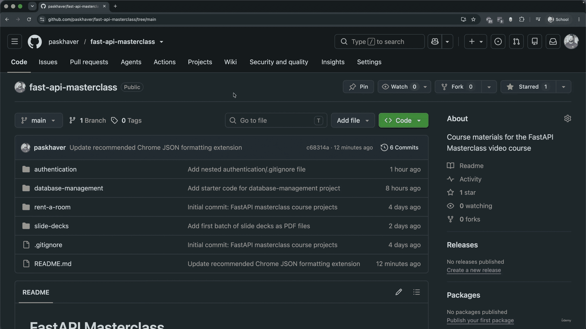
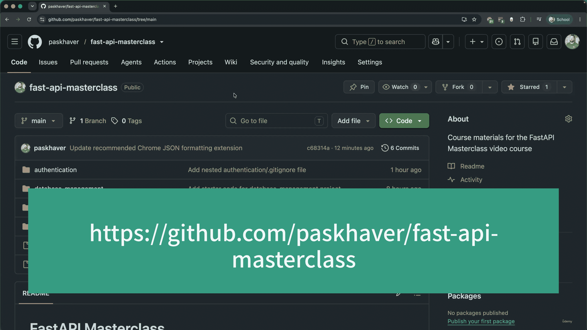
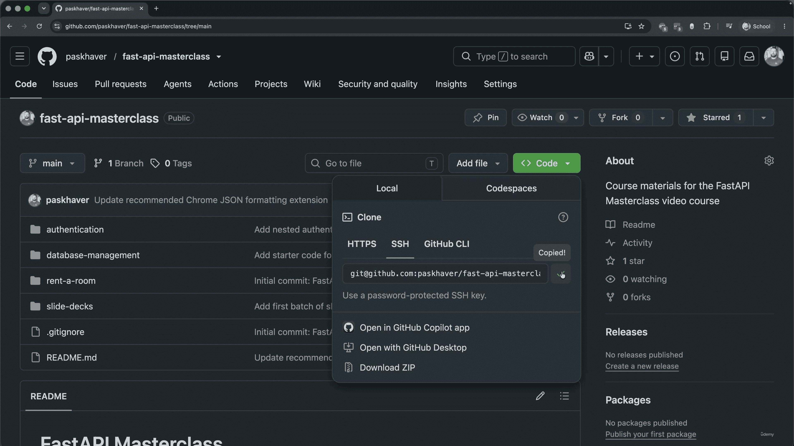
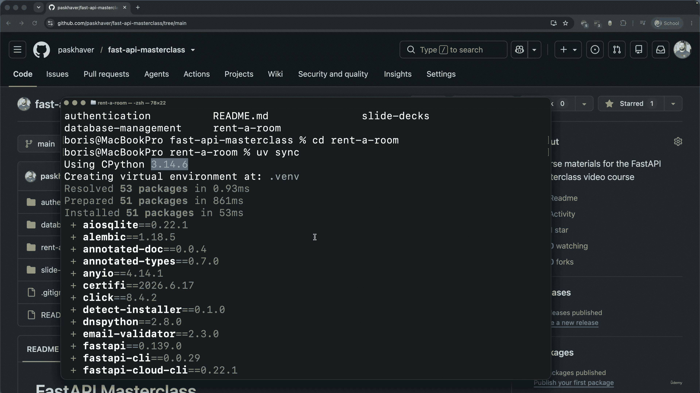

# 🐍 FastAPI 大师课：第 1 部分第 4 课：下载课程材料并使用 uv sync 下载项目依赖 📦

在本节课中我们将要学习如何从 GitHub 下载课程材料，如何理解课程仓库中的项目结构，如何用 Git clone 或 ZIP 压缩包把材料放到本地，如何用 VS Code 打开正确的项目文件夹，以及如何用 `uv sync` 一次性下载项目需要的 Python 版本和全部依赖。整个流程围绕一个核心目标展开：让每个独立项目都拥有自己独立的运行环境，这样后续写代码时就不会出现依赖混乱的问题。下面按照实际操作顺序逐步展开，每一步都会解释清楚它在做什么，以及为什么需要这样做。

## 📥 FastAPI 大师课：第 1 部分第 4 课：从 GitHub 获取课程材料

在完成前面的环境准备后，本节开始进入课程材料的获取环节。设置过程的下一步是从 GitHub 下载课程材料，这些材料放在一个公共仓库中，课程视频会在屏幕上提供链接，同时也会把链接作为本节课的资源附在课程页面里。仓库中有一个顶层 `slide-deck` 文件夹，里面会包含课程中所有演示文稿的 PDF 文件；除此之外，仓库里的每一个顶层项目都是一个独立的 Python 项目。举例来说，`authentication` 是一个项目，`database-management` 也是一个项目，它们彼此独立，不会互相混在一起。随着课程推进，讲师会告知当前正在使用哪一个项目；同时，随着课程不断更新，项目列表和文件夹列表可能会扩展，所以不同时间看到的文件夹列表可能不完全一样，这属于正常情况。

了解材料放在哪里之后，下一步需要认识仓库中的项目结构，因为后面打开编辑器和安装依赖都要围绕具体项目进行。



## 🗂️ FastAPI 大师课：第 1 部分第 4 课：认识仓库里的项目结构



上一节说明了课程材料来自 GitHub 公共仓库，本节来看看一个样例项目长什么样。可以点击进入 `authentication` 项目，每个项目都是一个非常精简的 uv 起始 Python 项目。这里最重要的细节是项目顶层的 `pyproject.toml` 文件，它负责配置项目的元数据，例如项目名称、版本号等信息；同时其中还有一个 `dependencies` 区域，用来列出项目代码运行所需要的全部库，也就是需要下载的代码包。举例来说，在依赖列表中会看到 `fastapi` 这样的库。后面会介绍一个命令 `uv sync`，通过这一条命令就可以下载 Python 以及当前项目文件夹中的所有依赖；同样的规则也适用于其他项目，只不过不同项目会有各自不同的依赖集合。

为了更直观地理解仓库结构，下面用目录树表示大致布局，实际目录名称以仓库当前内容为准：

```text
fastapi-masterclass/
├── slide-deck/
├── authentication/
├── database-management/
└── rent-a-room/
```

从目录结构可以看出，每个项目都像一个小房间，里面有自己的一套配置和依赖。了解项目结构之后，本节继续深入查看依赖配置，因为 `uv sync` 的行为正是由这些配置决定的。

## 🧪 FastAPI 大师课：第 1 部分第 4 课：查看项目依赖配置

在认识目录结构后，本节把注意力放到依赖配置上。每个独立项目都有自己的 `pyproject.toml`，这个文件可以理解成项目的说明书，里面写清楚项目叫什么、版本是多少，也写清楚项目运行需要哪些库。依赖关系可以用一个简单公式来描述，直接依赖是项目自己明确写出的库，传递依赖是这些库继续依赖的其他库，`uv` 会把两者都计算出来并安装。

下面用公式描述项目依赖的组成：

```text
项目运行所需依赖 = 直接依赖 ∪ 传递依赖
```

这个公式的含义很直白：假如项目依赖库 A，库 A 又依赖库 B，库 B 又依赖库 C，那么 `uv` 会沿着依赖关系继续查找，最终把 A、B、C 都准备好。理解这一点后，再去看 `pyproject.toml` 中的 `dependencies` 区域就不会觉得神秘，它只是列出项目直接需要的库，剩下的传递依赖由工具自动补齐。接下来进入实际下载仓库的步骤，因为只有把材料放到本地，才能在编辑器中打开并运行命令。

## 💻 FastAPI 大师课：第 1 部分第 4 课：把仓库下载到本地

了解依赖配置后，本节回到仓库顶层并开始下载材料。如果熟悉 Git，可以使用 `git clone` 把仓库克隆到本地；如果不熟悉 Git，也可以点击下载 ZIP 的按钮，把仓库的 ZIP 文件下载到电脑。ZIP 文件是压缩或归档文件，需要先展开才能访问里面的内容；在 Mac 上可以双击 ZIP 文件，在 Windows 上可以右键选择“全部提取”，这样才能得到文件夹里的嵌套内容。



下面列出两种常见的仓库下载方式，初学者可以根据自己是否熟悉 Git 来选择：

- 方式一：使用 `git clone <仓库链接>`，把远程仓库克隆到本地目录，后续也方便同步更新。
- 方式二：点击 Download ZIP，下载压缩包后解压到本地目录，适合不熟悉 Git 命令的初学者。

课程演示中使用的是 `git clone`，讲师复制仓库链接后进入终端，导航到自己的工作目录。讲师的工作目录是 `downloads`，项目材料具体放在哪里由自己决定；随后把仓库克隆到 `downloads` 中，就能看到新的 `fastapi-masterclass` 文件夹。下面的终端操作展示了这一过程的大致形式，仓库链接以实际课程提供的地址为准：

```bash
cd ~/Downloads
git clone <仓库链接>
cd fastapi-masterclass
ls
```

完成克隆后，进入最顶层的课程文件夹，会再次看到所有项目。下载完成后，下一步不是急着安装依赖，而是先在编辑器中打开正确的项目文件夹，因为打开方式会影响 Python 扩展对项目的识别。

## 📂 FastAPI 大师课：第 1 部分第 4 课：用编辑器打开正确的项目文件夹

下载仓库后，本节处理编辑器打开方式。进入仓库顶层后，会看到所有项目，这里有一个重要建议：课程会一次只处理一个项目，所以只打开当前正在工作的那个项目文件夹。以 VS Code 为例，不建议把最顶层的 `fastapi-masterclass` 文件夹直接打开到编辑器里，而是打开代表当前项目的具体文件夹，这样编辑器中的 Python 扩展才能识别真正的 Python 项目。原因是每个独立项目文件夹里都有顶层元数据文件，这些文件会告诉 VS Code 这是一个什么类型的项目、使用哪个 Python 版本、有哪些依赖可用。

课程中第一个要处理的项目是 `rent-a-room`，可以进入这个项目目录，然后在 VS Code 中用 `code .` 命令打开它，也可以在编辑器中选择 File > Open Folder 打开这个具体文件夹。请注意，这里打开的是 `rent-a-room` 文件夹，而不是最顶层的 `fastapi-masterclass` 文件夹，因为只有打开具体项目文件夹，VS Code 才能正确识别 Python 版本和依赖。下面的命令展示了进入项目目录并打开编辑器的常见做法：

```bash
cd rent-a-room
code .
```

完成项目文件夹的打开后，本节进入最后一步：真正下载这个项目的全部依赖，让项目具备运行条件。

## ⚙️ FastAPI 大师课：第 1 部分第 4 课：用 uv sync 安装依赖

完成编辑器打开操作后，本节实际安装项目依赖。正如前面提到的，安装依赖使用的是上一课已经安装好的 `uv` 工具，命令非常简单，就是 `uv sync`。这个命令会下载项目请求的 Python 版本以及所有项目依赖，整个动作通常很快。执行命令后可以向上滚动终端输出，查看已下载依赖的完整列表；一个库可能依赖另一个库，另一个库又可能依赖第三个库，`uv` 会找出所有这些需求并统一下载到项目文件夹中，最终保存在名为 `.venv` 的嵌套目录里，`.venv` 是虚拟环境的缩写。

下面是安装依赖的核心命令：

```bash
uv sync
```

执行后，项目文件夹中会出现类似下面的本地虚拟环境目录：

```text
rent-a-room/
└── .venv/
```

虚拟环境可以理解成项目自己的小仓库，里面放这个项目专用的 Python 和依赖，不会污染电脑上的其他项目。每个项目都是自包含的，会保存一份本地 Python 版本；课程示例中项目请求的 Python 版本是 `3.14.6`，如果电脑上还没有这个版本，`uv` 就会下载它，同时把所有依赖也下载到 `.venv` 文件夹中，让它们基本都在本地可用。之后在 VS Code 中打开 `rent-a-room` 项目时，Python 扩展就能识别这是一个 Python 项目，并知道它使用的确切 Python 版本以及所有可用依赖。

到这里，课程材料的设置流程就完成了。下面回顾本课的关键内容，把整个流程串起来，方便以后重新操作时快速查阅。

## ✅ FastAPI 大师课：第 1 部分第 4 课：本课总结

本节课中我们一起学习了从 GitHub 获取课程材料、理解独立项目结构、查看 `pyproject.toml` 依赖配置、用 Git clone 或 ZIP 下载仓库、用 VS Code 打开具体项目文件夹，以及用 `uv sync` 安装 Python 和依赖到 `.venv` 的完整流程。以下是本课需要记住的关键点，可以当成操作清单使用：

- 课程材料位于 GitHub 公共仓库，仓库顶层有 `slide-deck` 文件夹和多个独立 Python 项目。
- 每个项目都有自己的 `pyproject.toml`，其中 `dependencies` 区域列出项目直接依赖的库。
- 熟悉 Git 可以用 `git clone`，不熟悉 Git 可以下载 ZIP，但 ZIP 需要先解压。
- 在 VS Code 中应打开具体项目文件夹，例如 `rent-a-room`，不要打开最顶层课程文件夹。
- 进入项目目录后执行 `uv sync`，会下载请求的 Python 版本和全部依赖，并保存在 `.venv` 虚拟环境中。



到这里课程材料已经准备完成，每个项目都能拥有自己的本地运行环境，下节课继续进入后续内容。

