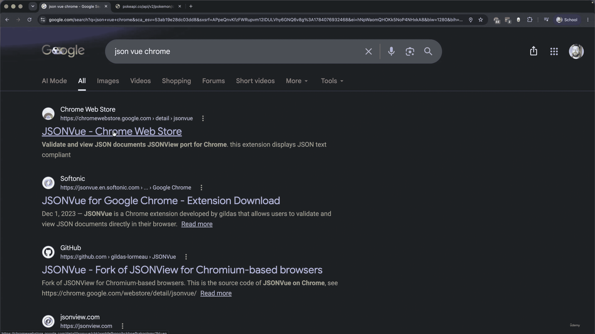
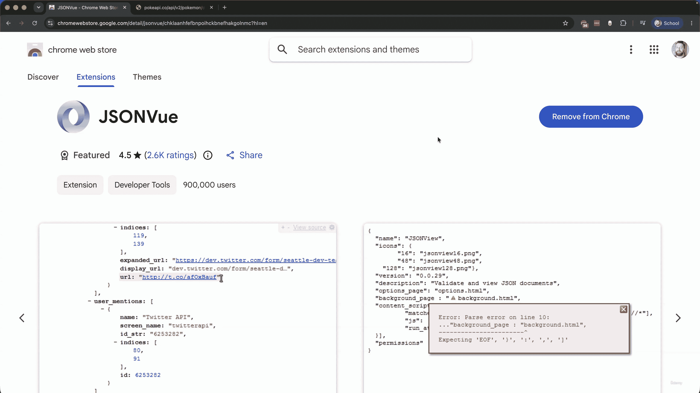
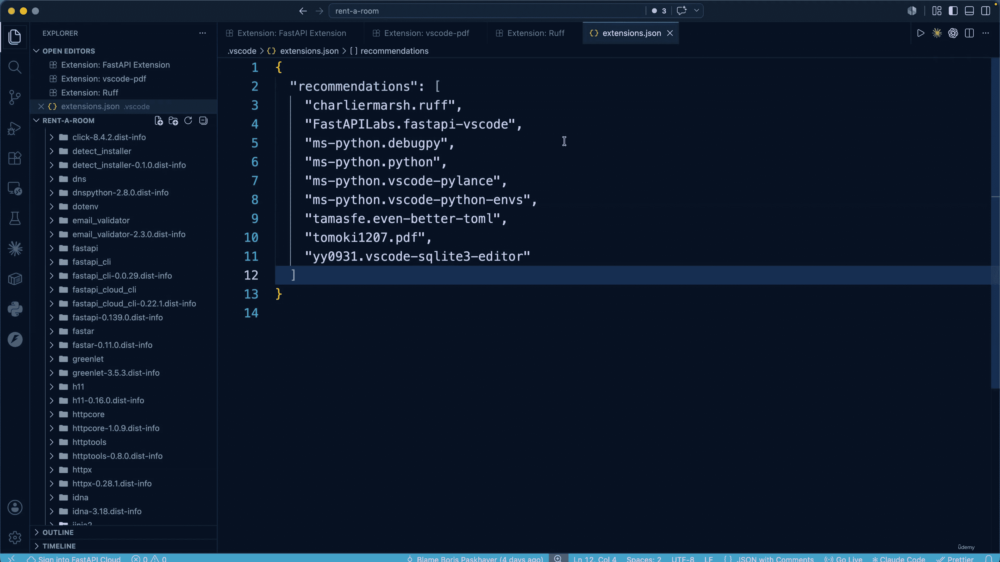

## 📚 FastAPI 大师课：第 6 节：课程概述

在本节课中我们将要学习如何安装一些额外依赖，这些依赖会在后续课程中帮助我们更顺畅地开发 API。除了安装依赖，我们还会介绍浏览器中查看 JSON 的工具、VS Code 的推荐扩展，以及在 VS Code 中选择项目内 Python 解释器的方法。这些准备工作看起来不涉及业务代码，但它们能让后续开发、调试和阅读数据都更轻松。

上一节我们介绍了项目环境的基本准备，本节中我们先从浏览器和 JSON 数据格式开始看起，然后再进入 VS Code 的扩展配置。

## 🌐 FastAPI 大师课：第 6 节：浏览器与 JSON 数据格式

首先，我会使用 Google Chrome 浏览器来和我们的 API 交互。如果你第一次接触后端或服务器端应用，需要先理解 FastAPI 的基本思路：我们会构建一个 Web 服务器，这个服务器包含多个不同的端点或路由，可以像访问互联网上的 URL 一样访问这些端点，而这些端点会把数据返回给我们。数据格式会是一种叫做 JSON 的东西，后面会详细讨论；JSON 是 JavaScript Object Notation 的缩写，它是一种受 JavaScript 编程语言启发的文本格式。

你可以在屏幕上看到一个 JSON 示例，不过这个示例是经过良好格式化的。默认情况下，当浏览器读取 FastAPI 服务器返回的 JSON 时，它看起来会朴素得多，基本就是黑白文本。例如，当数据也就是 payload 从我们要访问的 FastAPI 应用到达浏览器时，默认外观会很难阅读和解析，而像屏幕上这样格式化后的内容会更容易理解。JSON 的基本要点和 Python 对象中的字典、列表非常可比，可以用下面这个公式来理解：\(\text{JSON} \approx \text{Python 字典} + \text{Python 列表}\)。

```json
{
  "abilities": [
    "fast",
    "strong",
    "flexible"
  ]
}
```



这个 JSON 顶层实际上就是一个字典，在 JavaScript 的对象表示法里它叫对象，但本质相同，都是键值对集合。你可以看到顶层键 `abilities` 对应一个列表，用 JavaScript 的说法就是数组，里面包含多个条目。这里的关键点是：当 JSON 排版整齐、带颜色高亮并缩进时，会更容易理解；但浏览器默认不会用这种方式显示。

因此，我推荐在 Chrome 浏览器中安装一个类似 JSONView 的扩展。下面用几个步骤说明如何安装和使用这个浏览器扩展：

- 打开 Google 搜索 `JSONView Chrome`，然后点击 Chrome Web Store 页面。
- 在扩展页面中会看到安装按钮，点击安装。
- 安装后，浏览器收到任何 JSON 数据时都会添加良好的格式化显示。

浏览器扩展方面到这里就足够了，这一步能减少后续查看接口返回数据时的视觉负担。



浏览器扩展准备好后，上一节我们介绍了 JSON 的阅读方式，本节中我们转到 VS Code，它是本课程使用的文本编辑器。

## 🧩 FastAPI 大师课：第 6 节：在 VS Code 中安装推荐扩展

接下来进入 Visual Studio Code，也就是本课程使用的文本编辑器。我会回到终端，当前位于 Rent a Room 应用目录中，这是课程里的第一个项目。正如上一课提到的，我希望直接在具体项目目录中打开 VS Code，而不是在顶层的 FastAPI Masterclass 文件夹中打开。所以我在 Rent a Room 目录中执行下面的命令，用 VS Code 打开当前目录：

```bash
code .
```

这正是我们想要的方式。打开 VS Code 后大约一两秒，你应该会看到一个弹窗，它提供安装课程材料中推荐扩展的能力。点击安装后，VS Code 会自动安装我包含的多个扩展，这些扩展会增强 VS Code 的功能，帮助后续开发。

如果这个弹窗没有出现，也可以按屏幕上的方式操作：进入扩展标签，也就是那些方块图标的集合，然后输入 `@recommended`，这样就能看到这个项目的所有推荐扩展。我放置这些扩展的位置在 `.vscode` 目录中的 `extensions.json` 文件里。这个文件也是 JSON 格式，和刚才在浏览器里讨论的 JSON 形状相同，在 VS Code 中会被良好地格式化和高亮显示。这个文件的内容就是我推荐为 VS Code 安装的扩展，它们会增强编辑器功能，满足课程中需要的特性。

以下是我在课程材料中推荐的扩展示例，它们各自负责不同的辅助功能：

- Python 扩展：确保 Python 代码具有正确的语法支持。
- FastAPI 扩展：显示应用中的所有路由，并允许你快速从一个文件中的定义跳转到另一个文件中的定义。
- PDF 预览器：允许在编辑器内查看 PDF 文件，后续课程会用到。
- Ruff：一个格式化器，可以把 Python 代码排版得视觉上更舒适。

你不需要强制安装这些扩展，但我强烈推荐安装。这些扩展是我开发课程时使用的扩展，安装后你屏幕上的内容会更可能和我的屏幕一致，剩余课程也会更顺利。所有项目中的扩展配置相同，所以在 VS Code 中设置一次后，未来所有项目都可以使用。

推荐扩展安装完成后，上一节我们配置了编辑器扩展，本节还要完成一个关键设置：让 VS Code 认识项目内本地安装的 Python。

## 🐍 FastAPI 大师课：第 6 节：选择项目内的 Python 解释器

本课结束前还有一件事要做：告诉 VS Code 识别上一课用 `uv sync` 设置的本地 Python 版本。这样做是为了防止你的电脑上安装了多个 Python 版本，例如一个文件夹里是 Python 3.10，另一个地方是 Python 3.11。我们的项目中有自己本地可用的 Python 版本，我希望 VS Code 能识别它，因为这样 VS Code 也会注册项目本地可用的依赖和额外库，例如 FastAPI。

在 VS Code 中，macOS 可以按 `Command + Shift + P`，Windows 可以按 `Control + Shift + P`，这会打开命令面板。命令面板本质上是一个输入框，我们可以在里面向 VS Code 发出命令。在这里搜索 `Python: Select Interpreter`，这个选项只有在安装了 Python 扩展后才可用，而 Python 扩展已经包含在推荐扩展中。看到这个选项后按回车，VS Code 会显示电脑上它能识别的所有 Python 版本。默认情况下它应该选择当前项目内的 Python 版本，你可以在高亮行看到 `./.venv`，这表示当前目录下的虚拟环境，Python 就安装在那里。如果它没有自动选中，你需要手动导航到本项目对应的 Python 版本，也就是忽略其他文件夹和其他 Python 安装，在列表中选择显示本项目及其 Python 版本的条目，然后按回车锁定。这个操作是一次性的，以后再次用 VS Code 打开这个项目时，VS Code 会自动知道要使用 `.venv` 文件夹中的这个 Python 版本，而该文件夹也会包含所有扩展。

下面用几个步骤概括选择解释器的过程：

- 在 macOS 按 `Command + Shift + P`，在 Windows 按 `Control + Shift + P`，打开命令面板。
- 搜索 `Python: Select Interpreter`。
- 在列表中选择显示本项目 `.venv` 的 Python 条目。
- 按回车确认，让 VS Code 锁定这个解释器。

例如，展开 `Lib` 目录后，你可以看到这个项目里下载的所有依赖，其中会包括 `fastapi` 这样的库。到这里，本课的内容就覆盖完了。

## ✅ FastAPI 大师课：第 6 节：本课总结



本节课中我们一起学习了如何安装额外依赖相关的准备工作：了解了 FastAPI 返回的 JSON 数据格式和浏览器中安装 JSONView 的方法，配置了 VS Code 的推荐扩展，并让 VS Code 选择项目内 `.venv` 中的 Python 解释器。完成这些设置后，后续开发时查看数据、跳转代码和管理依赖都会更方便。本课内容就到这里，下节课见。

