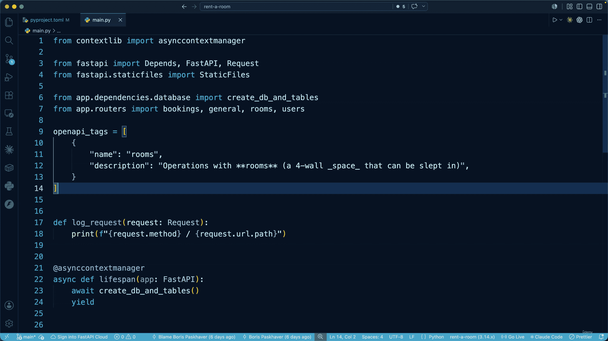
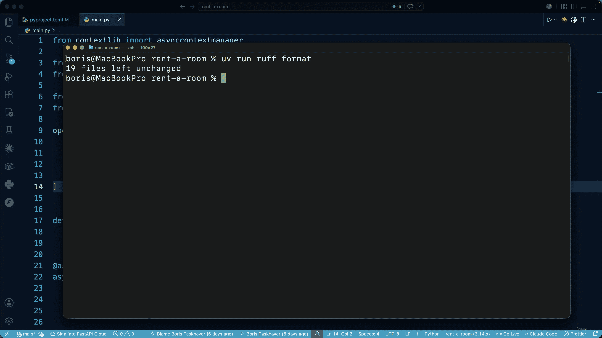

# 🐍 FastAPI Masterclass part1 p06：第7章：Ruff 格式化工具


在本节课中我们将要学习 Ruff 格式化工具，它在原文里也被写成 rough format。Ruff 是我们通过 `uv sync` 命令下载到项目里的开发者依赖，可以在顶层 `pyproject.toml` 文件里看到它的声明，课程里的所有项目也都列出了这个依赖。为了不让你觉得突然，这里先说明本教程会按照“开发者依赖是什么、Ruff 做什么、保存时如何自动格式化、遇到问题怎么办、命令行如何兜底”的顺序展开，尽量用大白话把每个概念讲清楚。下面先从开发者依赖这个概念开始。


## 📦 FastAPI Masterclass part1 p06：第7章：开发者依赖是什么


上一节我们知道了本节课的主角是 Ruff，本节中我们来看看为什么它被叫作开发者依赖。开发者依赖是一种最终用户不需要的库；这里说的最终用户，是指真正会与我们的 FastAPI 应用交互的人。也就是说，开发者依赖不是为了最终用户而存在的，而是为了开发者的利益而存在的，这个开发者就是编写代码的 Python 开发者。为了更直观地理解，可以把这个关系记成一个简单公式：


```text
最终用户不需要 + 开发者需要 = 开发者依赖
```


这个公式说明，Ruff 这类工具不会出现在最终用户的使用场景里，它服务的是写代码、维护代码的人。理解这一点之后，我们就可以继续看 Ruff 到底是一个什么样的工具。


## 🛠️ FastAPI Masterclass part1 p06：第7章：Ruff 是什么格式化器


上一节我们介绍了开发者依赖，本节中我们来看看 Ruff 的具体角色。Ruff 具体来说是一种格式化器（formatter），它由构建 uv 工具的同一个团队开发。格式化器会自动重写你的代码，让代码遵循一套可预测、一致并且最重要的是美观的风格规则。Ruff 会替我们做出一系列决定，例如 Python 代码应该长什么样，它会格式化缩进、空格、行长度、导入顺序等细节。换句话说，Ruff 不负责判断业务逻辑，它负责把代码外观整理得整齐一致。下面是 Ruff 会关注的一些典型内容：


- 缩进和空格

- 行长度

- 导入顺序

- 不同代码结构之间的换行和距离


这些内容看起来是小事，但项目变大以后，统一的格式能减少很多无谓的差异。下一节我们看看在 VS Code 里保存文件时，Ruff 如何自动完成这些整理工作。


## 💾 FastAPI Masterclass part1 p06：第7章：保存时自动格式化演示


上一节我们知道了 Ruff 会整理代码外观，本节中我们来看看保存文件时的自动格式化过程。我已经设置好 VS Code 的设置，让你在项目里每次保存 Python 文件时自动运行 Ruff；本课就要展示这个过程。现在课程里还没有代码，不过你可以跟着我的屏幕看。我会进入 `main.py`，这个文件里有课程后面才会写到的很多代码，它目前是常规的 FastAPI 代码。我会快速给这个文件添加一些奇怪的风格修饰，例如打乱导入顺序，把导入随机排列；还会添加额外的换行；你还能看到一个包含字典的 Python 列表，我会在开大括号处添加随机缩进，可能再多加一些缩进。然后注意保存文件时会发生什么：Ruff 会自动运行，让文件看起来整洁美观。它会处理大括号缩进，甚至不同文本行之间的距离。以下是我添加混乱内容后，Ruff 在保存时会处理的几个方面：


- 打乱的导入会被重新组织，不仅按字母顺序，还会按导入类型分类

- Python 标准库的导入会放在最前面

- 第三方库（例如 FastAPI）的导入会按字母顺序排序

- 项目内文件的导入也会按字母顺序排序

- 大括号缩进、行与行之间的距离、导入顺序和换行数量都会被整理


即使涉及导入顺序，或者文件中不同结构之间的换行数量，Ruff 也会把它格式化得美观，并让不同项目之间保持一致。到这里，保存自动格式化的流程就演示完了；不过实际写代码时还会遇到两种情况，下一节我们集中说明两个注意点。


## ⚠️ FastAPI Masterclass part1 p06：第7章：两个注意点


上一节我们演示了保存时自动格式化，本节中我们来看看课程结尾要补充的两个快速注意点。第一个注意点与语法错误有关：如果你的代码包含语法错误，换句话说，如果你写的不是有效的 Python 代码，Ruff 就无法解析文件内容，也就无法格式化。如果你发现保存某个文件时没有看到格式化发生，很可能是因为代码里有错误，特别是格式错误。例如，你写了一个 Python 列表却忘记写闭合方括号，这种情况下 Ruff 在保存时根本不会运行；不过通常这类违规会显示红色波浪线和 Python 扩展给出的各种高亮提示，告诉你某处出了问题，就像屏幕里看到的那样。你可以快速定位问题，然后再次保存文件，这时 Ruff 就会运行。第二个注意点是：如果因为某些原因 VS Code 里的 Ruff 扩展没有正确运行，文件没有被格式化，你也可以直接从命令行运行 Ruff。以下是我在课程结尾想补充的两个注意点，方便你遇到问题时排查：


- 第一，代码有语法错误时，Ruff 无法解析文件，因此不会格式化；典型例子是 Python 列表忘记闭合方括号，保存时 Ruff 不运行，但编辑器通常会给出红色波浪线和高亮提示，修正后再次保存即可。

- 第二，VS Code 的 Ruff 扩展没有正常工作时，可以在终端进入项目，直接用命令行运行 Ruff；命令是 `uv run ruff format`，其中 `uv` 命令行工具会用本地可用的 Python 版本执行命令，`ruff` 之所以能在本地 Python 虚拟环境里使用，正是因为它在 `pyproject.toml` 中被列为开发者依赖，最后的 `format` 是交给 Ruff 的实际命令。




这两个注意点能帮你判断问题出在代码本身，还是出在编辑器扩展或运行方式上。下一节我们具体看看命令行方式如何作为备用方案。


## ⌨️ FastAPI Masterclass part1 p06：第7章：从命令行运行 Ruff


上一节我们提到了扩展不工作时的备用方案，本节中我们来看看命令行运行 Ruff 的具体做法。在终端里打开我的项目，你可以运行下面的命令：


```bash
uv run ruff format
```


这条命令的含义可以拆开理解：`uv run` 使用 uv 命令行工具，并用本地可用的 Python 版本执行某个命令；`ruff` 能在本地 Python 虚拟环境里使用，正是因为它被列在 `pyproject.toml` 的开发者依赖中；最后给 Ruff 的实际命令是 `format`，默认情况下它会以当前文件夹内的所有文件为目标，并直接格式化这些文件。在完整项目里，你可以看到我一共有 19 个文件可以被 Ruff 格式化，不过当前没有违规，所以所有内容都保持不变；如果存在需要格式化的内容，Ruff 就会直接从命令行执行并格式化所有文件。命令行方式很适合在扩展没有正常工作时作为兜底，也适合在终端里批量处理项目文件。


## ✅ FastAPI Masterclass part1 p06：第7章：课程总结




前面几节我们分别了解了开发者依赖、Ruff 的作用、保存自动格式化、注意点和命令行用法，本节中我们对整节课做一次总结。本节课中我们一起学习了 Ruff 格式化工具。我们知道了 Ruff 是通过 `uv sync` 下载的开发者依赖，最终用户不需要它，它服务于写代码的 Python 开发者；Ruff 由构建 uv 的同一团队开发，是一种格式化器，会自动重写代码，让缩进、空格、行长度、导入顺序和换行等内容变得可预测、一致且美观；我们还演示了 VS Code 保存 Python 文件时自动运行 Ruff 的过程，并说明了两个注意点：代码有语法错误时 Ruff 无法解析和格式化，Ruff 扩展不工作时可以用 `uv run ruff format` 从命令行运行。整体来看，Ruff 是一个强大且快速的 Python 格式化工具，掌握它能让代码风格更统一，也能减少项目之间的格式差异。

