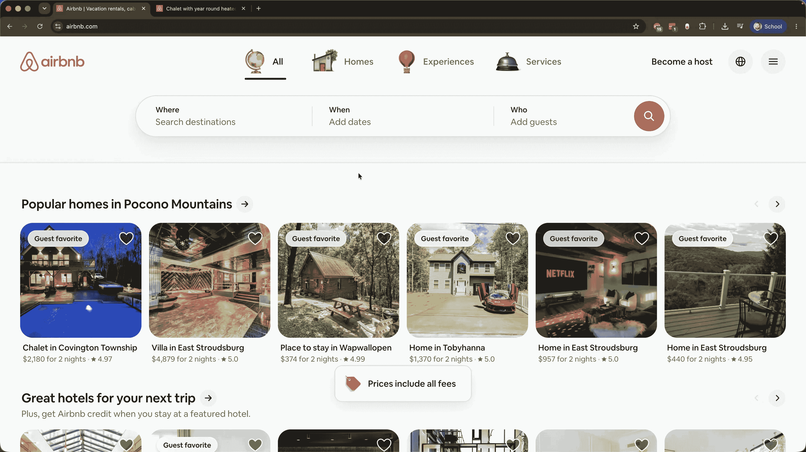
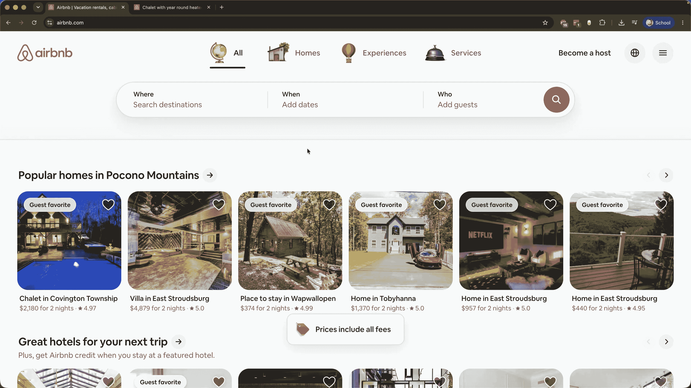

# FastAPI Masterclass：07：Rent a Room 应用介绍 🏠

## FastAPI Masterclass：07.1：课程概述 📚

在本节课中我们将要学习 rent room 应用的整体设想，以及它在课程中的位置。到这一步，好消息是技术环境搭建已经完成。接下来要讨论的是课程前 10 节左右要构建的第一个项目。我们将创建一个名为 rent room 的 API 或 Web 应用。你可以把它理解为一个简化版的 Airbnb 类平台，用户能够浏览并预订短期住宿房间。我们的 FastAPI API 将帮助管理房间。每间房都有名称、每晚价格、卧室数量和浴室数量等细节。为了更直观地理解房间数据，先看下面的基本结构。

$$

\text{Room} = \{\text{name}, \text{nightly\_price}, \text{bedrooms}, \text{bathrooms}\}

$$

这个结构是后续所有功能的基础。当前阶段先关注数据长什么样，以及 API 如何把数据返回给用户。下面进入项目定位部分。

## FastAPI Masterclass：07.2：项目定位 🏡

在课程概述中，我们明确了本课要学习的项目方向。本节中我们来看看 rent room 的项目定位。这个应用可以看成简化版 Airbnb 类平台，用户能够浏览房间，也能够预订短期住宿房间。我们的 FastAPI API 将帮助管理房间，每间房都有名称、每晚价格、卧室数量和浴室数量等细节。

这个应用面向用户的核心行为，主要有以下内容。

- 浏览房间

- 预订短期住宿房间

从业务关系看，平台一边是用户，一边是房东，平台负责把双方连接起来。下一节我们来看看最简 MVP 如何落地。

## FastAPI Masterclass：07.3：MVP 与硬编码数据 🧱

上一节我们介绍了 rent room 的定位，本节中我们来看看最简 MVP 与硬编码数据。我们会从最简单的 MVP 开始，MVP 指最小可用产品，也就是当前能构建出的最小可用版本。

$$

\text{MVP} = \text{Minimum Viable Product} = \text{最小可用产品}

$$

在最简 MVP 中，第一步要完成的内容包括以下项目。

- 定义基础的硬编码房间数据

- 设置用户可以访问的多种路由

- 在响应中返回这些硬编码房间

硬编码的意思是，房间数据直接写在代码里，而不是从数据库读取。下面是一个简化的房间数据示例。

```python
rooms = [
    {
        "name": "Cozy Room",
        "nightly_price": 80,
        "bedrooms": 1,
        "bathrooms": 1,
    }
]
```

这个示例保留了房间的核心字段，也方便后续逐步替换成真实数据来源。下一节我们来看看这些数据如何通过路由返回。

## FastAPI Masterclass：07.4：路由与响应 🔀

上一节我们介绍了 MVP 和硬编码房间数据，本节中我们来看看路由与响应。路由可以理解为用户访问的网址路径，用户通过路由查看房间信息。当前阶段要设置多种路由，让用户能看到单个房间，也能看到房间集合。响应中返回的仍然是硬编码房间数据。

在这个阶段，路由至少覆盖以下两类查看方式。

- 查看房间集合


- 查看单个房间



可以用下面的路由形式来描述。


```python
GET /rooms
GET /rooms/{room_id}
```



响应过程可以用下面的公式表示。


$$

\text{Response} = \text{Route}(\text{Request}) \rightarrow \text{Hardcoded Rooms}

$$


> 提示：当前阶段返回的是硬编码房间，后续会接入真实数据库。


下一节我们来看看如何从硬编码走向真实功能。

## FastAPI Masterclass：07.5：从硬编码走向真实功能 🚀

上一节我们看了初始路由，本节中我们来看看从硬编码走向真实功能的路线。回到用户视角，再一点一点把硬编码值替换成真实能力。替换内容包括真实数据库、真实过滤、创建房间时的数据验证，以及更多后续功能。这样做能让每一步都保持在可理解、可验证的范围内。

后续迭代会逐步把硬编码方案替换成以下能力。

- 真实数据库

- 真实过滤

- 创建房间时的数据验证

- 更多后续功能

这个演进过程是循序渐进的，不会一次性引入全部复杂度。下一节我们来看看为什么选择 Airbnb 作为示例。

## FastAPI Masterclass：07.6：为什么选择 Airbnb 作为示例 🧭

上一节我们介绍了后续演进方向，本节中我们来看看为什么选择 Airbnb 作为示例。Airbnb 的一个优势是提供了真实业务领域，基础业务逻辑相对容易理解。Airbnb 本质上是一个服务，把想租房间的用户和愿意出租房间的房东连接起来。

$$

\text{Airbnb} \approx \text{用户} \leftrightarrow \text{房东}

$$

这个示例的业务关系可以用以下角色来理解。

- 用户想租房间

- 房东愿意出租房间

- 平台连接双方

基础业务逻辑简单，适合作为学习 API 结构的起点。下一节我们来看看生产级 API 会涉及什么。

## FastAPI Masterclass：07.7：生产级 API 会涉及什么 🛠️

上一节我们解释了 Airbnb 示例的业务逻辑，本节中我们来看看生产级 API 会涉及什么。实际 Airbnb 应用是十亿美元级公司，复杂度显著更高。真实应用要处理数百万用户和房源、复杂搜索算法、支付处理、信用卡、用户评论等内容。我们不会构建所有这些功能，而是构建足够多的功能，用来理解生产 API 的结构。

$$

\text{Production API} = \text{Servers} + \text{Routes} + \text{Cookies} + \text{Headers} + \text{Validation} + \text{Transformation}

$$

课程会覆盖的主题包括以下内容。

- 服务器

- 路由

- cookies

- headers

- 进入服务器的数据验证

- 返回客户端的数据转换

- 更多相关主题

再次说明，如果完全不熟悉 FastAPI、后端，甚至不清楚 API 这个术语，不用担心，后续会随着课程推进深入讲解这些主题。

> 提示：当前目标是理解生产 API 的结构，不是一次实现 Airbnb 的全部功能。

下一节我们来看看如何通过观察 Airbnb 建立直觉。

## FastAPI Masterclass：07.8：观察 Airbnb 并建立直觉 👀

上一节我们了解了生产 API 的复杂点，本节中我们来看看如何通过观察 Airbnb 建立直觉。现在要确保理解我们正在构建的核心应用，也就是 Airbnb 这个参照对象。如果从未使用过这个服务，可以花几分钟访问 Airbnb 查看。观察时可以做以下动作。

- 点击四处浏览

- 查看页面如何工作

- 访问不同页面

- 搜索不同房源

- 修改日历日期

- 观察价格如何更新

- 获得这个应用的总体感觉

这个应用的想法容易理解，但底层复杂性很高，观察页面变化有助于看到这些复杂性。下一节我们来做本节总结。

## FastAPI Masterclass：07.9：本节总结 📝

在前面几个小节中，我们介绍了 rent room 的定位、MVP、路由、演进方向、Airbnb 示例和生产 API 涉及面。本节中我们来做总结。本节课中我们一起学习了 rent room 应用是 Airbnb 的简化版，用户能够浏览并预订短期住宿房间。我们认识了每间房的核心字段，包括名称、每晚价格、卧室数量和浴室数量。我们明确了从最简 MVP 开始，先定义硬编码房间数据，设置查看单个房间和房间集合的路由，并在响应中返回硬编码房间。后续会把硬编码值逐步替换成真实数据库、真实过滤、创建房间时的数据验证等功能。我们还理解了 Airbnb 示例的业务逻辑，以及真实 Airbnb 应用在生产环境中的复杂性。课程后续会覆盖服务器、路由、cookies、headers、数据验证和数据转换等主题。本课内容到此结束，下一节开始构建 rent room 应用。

$$

\text{下一步} = \text{开始构建 RentRoom 应用}

$$

