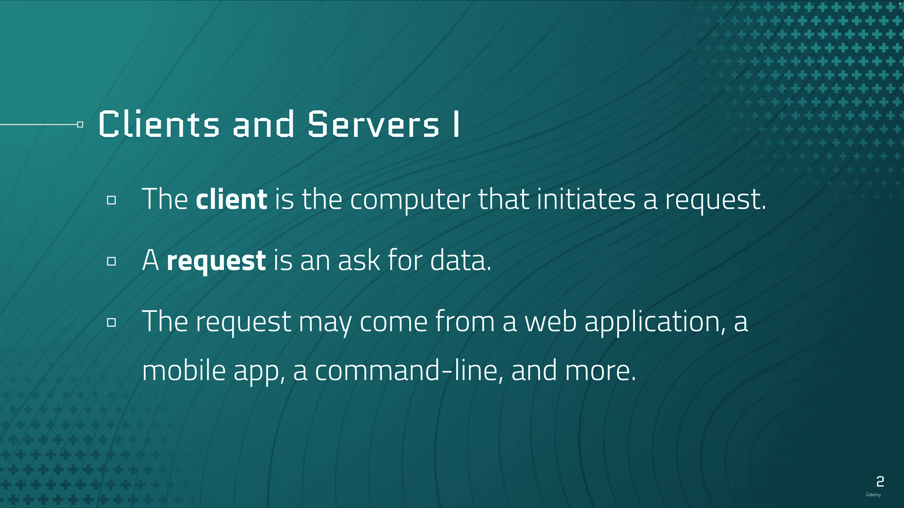
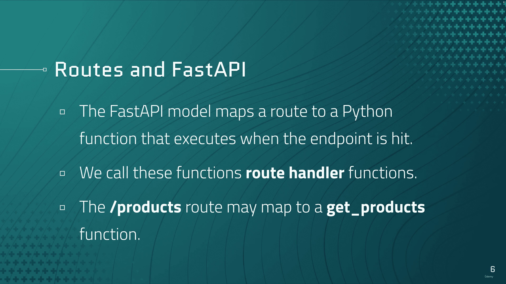

# 🌐 FastAPI 大师课：Part 1 第 8 课：客户端、服务器与路由

欢迎来到课程的下一部分。在本节课中，我们将要学习客户端、服务器和路由这三个基础概念，为后续构建租客房间 FastAPI 应用、定义第一批应用路由做好准备。虽然这节课偏概念，但这些术语会贯穿后面的全部开发过程，所以需要先在高层次上把它们讲清楚。本节会覆盖客户端、服务器、路由，以及 FastAPI 如何把请求映射到 Python 函数。

## 🧭 FastAPI 大师课：Part 1 第 8 课：本课要解决的问题

在课程下一部分中，我们将开始构建租客房间 FastAPI 应用，并定义第一批应用路由。不过在真正动手之前，需要先确保覆盖所有技术术语和概念，并且是在较高层面上理解它们。因此在这节短课中，我们将覆盖客户端、服务器和路由。理解这些概念后，后面写代码时就能知道每个 URL、每个函数和每个返回值分别处在什么位置。

## 🖥️ FastAPI 大师课：Part 1 第 8 课：客户端



了解了本课目标后，本节先看客户端。每当你在浏览器中输入一个 URL 并按下回车，实际上有两台计算机在相互通信。第一台计算机叫客户端，它是发起请求的计算机。请求就是向另一方索要某种数据或信息。这个请求可能来自 Chrome 或 Firefox 这样的 Web 浏览器，也可能来自移动应用，例如 iPhone 或 Android 上安装的应用。你下载的很多应用也可能向服务器发起请求来获取数据。以下是客户端常见的来源：


- Web 浏览器，例如 Chrome、Firefox
- 移动应用，例如 iPhone 或 Android 上下载的应用
- 其他会向服务器请求数据的程序

因此，以上这些都属于客户端的例子。客户端就是发起数据请求的那台计算机。可以用一个简单公式表示这种关系：

```text
客户端 -> 请求 -> 服务器
```

## 🗄️ FastAPI 大师课：Part 1 第 8 课：服务器

认识了客户端后，本节来看与它配合的服务器。与客户端对应的是服务器，服务器是响应请求的计算机，通常它会返回一份数据载荷。客户端发送请求、服务器返回响应，这种一来一回的循环是全世界每个 Web 应用的基础。你在线看视频、提交表单、下订单、滚动浏览社交媒体信息流时，客户端都在幕后与服务器通信：它发出请求，拿回数据，然后对数据做一些处理。可以用下面的公式概括服务器的作用：

```text
响应 = 服务器处理(请求)
```

使用 FastAPI 时，我们构建的是服务器端逻辑。我们构建的服务器会响应客户端请求，这再次称为后端开发。FastAPI 是 Python 生态中构建后端的一种选择，但它不是唯一选择。除此之外，还有很多其他编程语言，它们有自己的库和框架，也能帮助构建服务器端或后端逻辑。选择 FastAPI 只是进入后端开发的一条路线，理解客户端和服务器之间的关系才是更基础的事情。

## 🛣️ FastAPI 大师课：Part 1 第 8 课：路由

知道请求和响应双方后，本节来看 FastAPI 如何用路由区分不同请求。应用到 FastAPI 上的心智模型是：把每个请求映射到对应的路由。那么什么是路由？路由是服务器能够识别的特定路径或 URL，并把它映射到一个过程。这里的“过程”指按顺序执行的一串代码。可以用引用形式记住这个定义：

> 路由：服务器能够识别的特定路径或 URL，并映射到一段按顺序执行的代码。

服务器需要知道客户端请求的是哪个资源或哪些资源，因为资源可能有很多。客户端可能想了解用户，也可能想了解财务交易，或者可用房间。服务器需要知道客户端到底在请求什么，期望提供什么数据。端点只是路由的另一个说法，意思完全一样。每次你在浏览器中导航到 `/rooms` 或 `/payments` 这样的地址，它们都是路由或端点的例子。可以把 FastAPI 应用想成拥有一大堆端点或路由，它们各自负责获取不同类型的数据。

以下是路由和端点的一些例子：

- `/products`：返回产品列表给客户端
- `/products/42`：返回标识符为 42 的单个产品详情
- `/cart`：返回用户购物车中商品的详情
- `/rooms`：处理房间相关请求
- `/payments`：处理支付相关请求

例如，一个 `products` 端点会向客户端返回产品列表；一个互补的端点如 `products/42` 可能返回单个产品的详情，也就是标识符为 42 的那个产品；类似地，FastAPI 服务器上的 `/cart` 端点或路由会返回用户购物车中商品的详情。不同 URL 对应不同数据，这就是路由在应用中的实际作用。

## 🧩 FastAPI 大师课：Part 1 第 8 课：路由到 Python 函数

理解了路由概念后，本节从代码角度看 FastAPI 如何做映射。从实际代码本身来看，FastAPI 模型会把每个路由，例如 `products`，映射到一个对应的 Python 函数，当该端点被命中时，这个函数会被调用或执行。我们称这些函数为路由处理函数，因为它们是基本过程，职责是处理该路由、处理该端点的逻辑。以下是一段简化代码，用来说明路由和处理函数的连接方式：

```python
from fastapi import FastAPI

app = FastAPI()

# /products 路由映射到 get_products 函数
@app.get("/products")
def get_products():
    # 这里可能执行数据查询，构建产品列表
    return [{"id": 1, "name": "示例产品"}]
```

例如，`/products` 路由可能映射到一个对应的 `get_products` 函数，这个函数很可能执行一些数据获取操作，构建要返回给客户端的产品。路由处理函数的实际名称完全由开发者决定，你可以随意命名。关键点是，这个函数会连接到它负责表示的路由或端点。整个映射关系可以用下面的流程表示：

```text
请求 URL -> FastAPI 路由匹配 -> 对应路由处理函数 -> 返回响应
```

## 🔄 FastAPI 大师课：Part 1 第 8 课：整体心智模型

前面分别介绍了客户端、服务器和路由，本节把它们串起来。我们有客户端发起请求，有服务器用某种数据响应请求。为了区分不同类型的请求，我们会有不同的端点或路由，每一个端点或路由都会映射到一个对应的 Python 函数。这就是理解 FastAPI 需要的基本心智模型。下一节课，我们将初始化第一个 FastAPI 应用，把这些概念真正落到代码里。

## 📌 FastAPI 大师课：Part 1 第 8 课：总结



本节课中，我们一起学习了客户端、服务器和路由。客户端发起请求，服务器响应请求并返回数据，路由把不同请求映射到对应的 Python 路由处理函数。掌握这个基本模型后，后续构建租客房间 FastAPI 应用时，就能理解每个 URL 如何找到对应函数，以及服务器如何向客户端返回数据。下一节将初始化第一个 FastAPI 应用。

