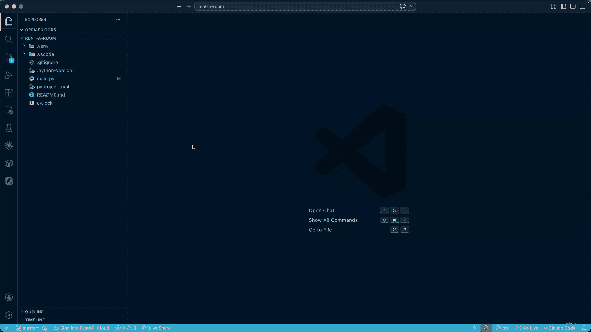
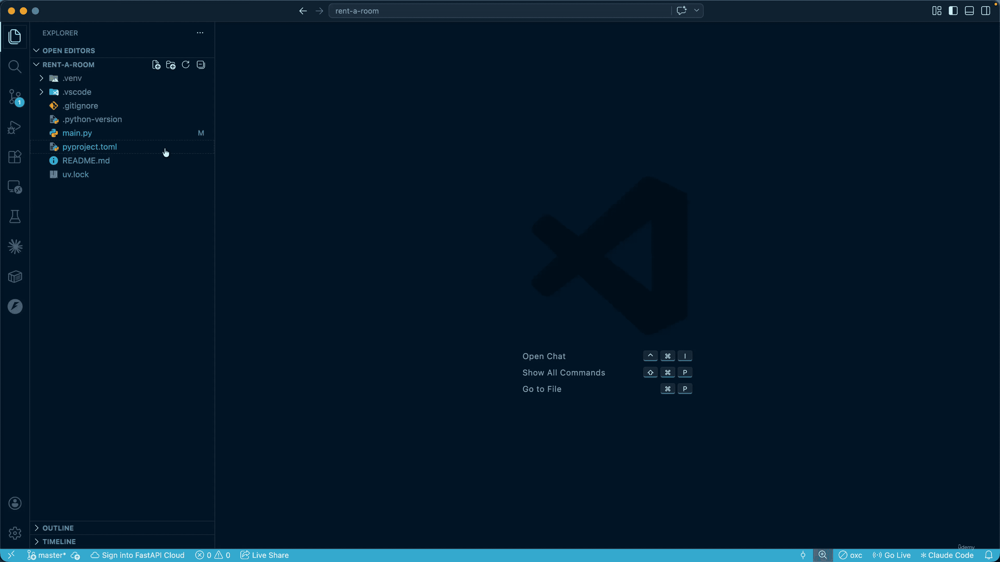
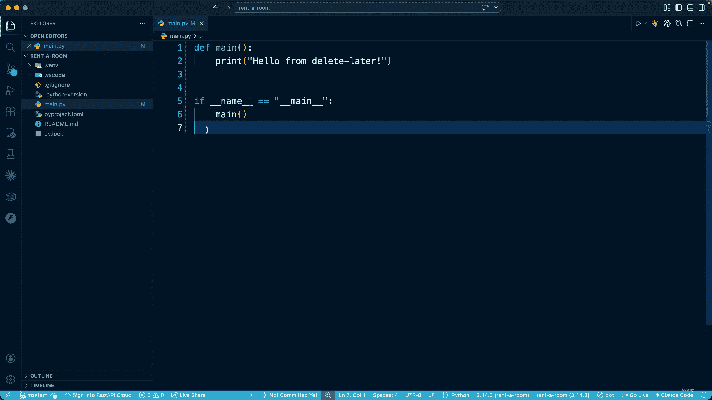
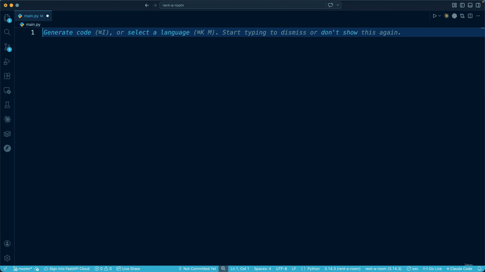
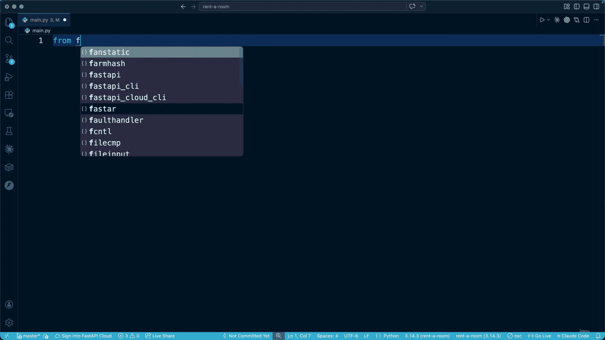
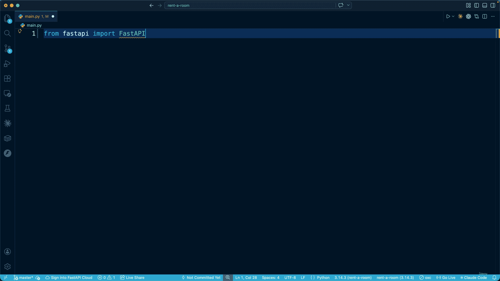
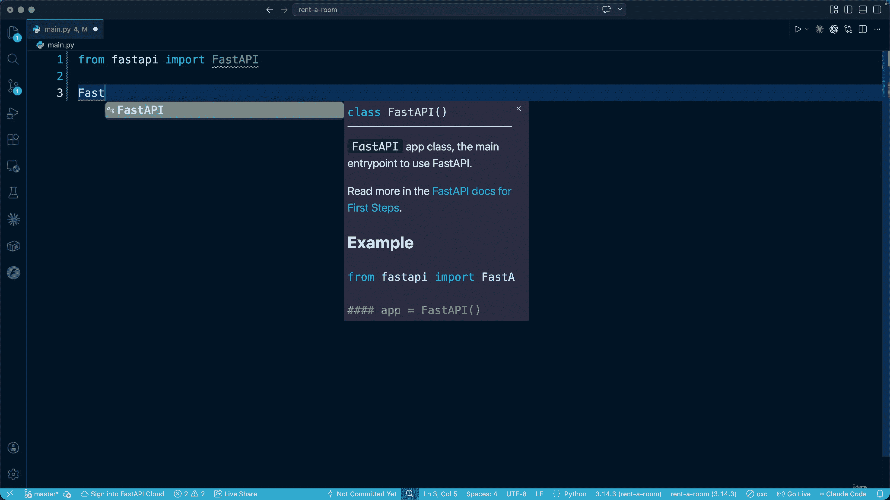
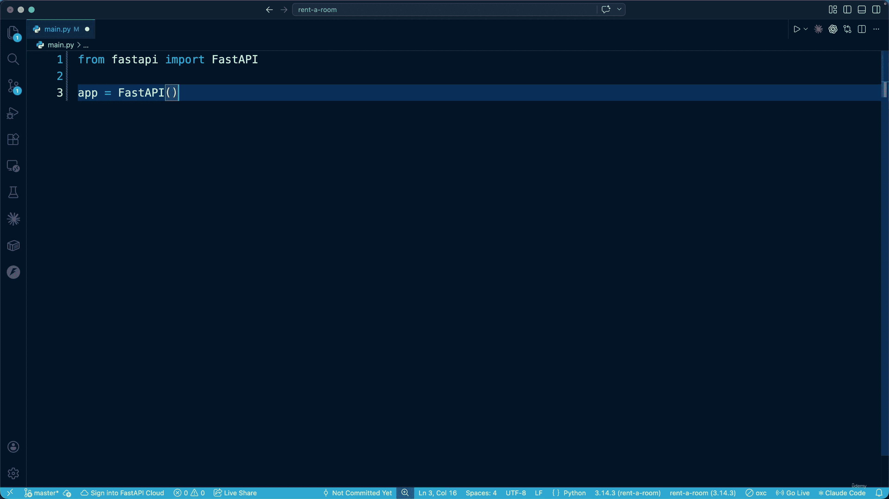

# 🚀 FastAPI 大师课：P09-10：创建 FastAPI 服务器

在本节课中我们将要学习创建 FastAPI 应用程序，并理解 FastAPI 应用本质上是一个 Web 服务器。我们会先说明服务器为什么需要持续运行，再清理 `main.py` 文件，然后导入 `FastAPI` 类并创建应用实例，最后认识“路由”这个核心概念。整个过程会从最基础的概念讲起，让初学者也能一步一步看懂。

## 🧠 FastAPI 大师课：P09-10：理解服务器与 FastAPI 应用

在进入代码之前，需要先建立一个基本认识。FastAPI 应用从根本上说就是一个 Web 服务器，而服务器是计算机上持续运行的程序。服务器启动之后，会监听来自客户端的请求，并用数据对这些请求作出响应。我们的 Web 应用和服务器应当保持 7×24 小时在线，因此可以把 FastAPI 应用看成一个持续运行的 Python 程序。

可以用下面的公式来理解这个关系：

`FastAPI 应用 = Web 服务器`

`服务器 = 持续运行并监听请求的程序`

举例来说，如果打开 `main.py` 文件并单独运行这个文件，Python 会执行到文件末尾然后终止程序，程序也随之结束。相比之下，服务器会持续运行，这正是 FastAPI 服务器能够持续接收请求，并在任何时候响应来自不同客户端请求的原因。理解这一点之后，下面进入 `main.py` 文件，看看如何开始编写应用。

## 🧹 FastAPI 大师课：P09-10：清理 main.py 文件

上一节我们理解了 FastAPI 应用和服务器之间的关系，本节中我们来看看 `main.py` 文件里需要做什么。在 `main.py` 中，原先有 Uv 填充进文件的内容，这里不需要任何内容，因此会删除全部内容。随后在 `main.py` 中开始编写后面的代码。

以下是清理 `main.py` 时对应的操作顺序。

- 打开 `main.py` 文件。

- 查看 Uv 填充进文件的内容。

- 删除文件中的全部内容。

- 在 `main.py` 中开始编写后续代码。

完成清理后，`main.py` 就是一个干净的起点，接下来的工作就是在这个文件中导入 FastAPI 并创建应用实例。

## 📦 FastAPI 大师课：P09-10：导入 FastAPI 类并创建应用实例

上一节我们清理了 `main.py` 文件，本节中我们来看看如何导入 FastAPI 类并创建应用实例。通过从 `fastapi` 库中引入 `FastAPI` 类，也就是从小写 `fastapi` 中导入大写 `FastAPI` 类，可以开始构建应用。可以看到 `FastAPI` 中的 A 和 I 都是大写。在下面，会使用构造语法，也就是类名后面的括号，创建这个类的实例，然后把返回值赋给一个变量，这个返回值就是实际的 FastAPI 应用。这个变量会命名为 `app`。

核心代码可以写成下面的形式：

```python
from fastapi import FastAPI

app = FastAPI()
```



以下是导入并创建应用实例的步骤说明。





- 从小写 `fastapi` 库中导入大写 `FastAPI` 类。



- 使用类名后面的括号创建 `FastAPI` 实例。

- 把创建出来的实际 FastAPI 应用赋给变量 `app`。

创建过程就是如此简单。完成这一步后，实际上已经有一个将要运行的 FastAPI 服务器，不过它当前还没有路由，因此下一步需要定义路由。

## 🛣️ FastAPI 大师课：P09-10：理解路由与下一步

上一节我们创建了 `app` 实例，本节中我们来看看路由的作用和下一步工作。现在实际上已经有一个将要运行的 FastAPI 服务器，但当前没有路由。下一步是定义路由，路由表示一个端点，FastAPI 服务器可以通过这个端点用数据作出响应。换句话说，路由就是服务器对外提供响应数据的入口，后续定义接口时会围绕它展开。

核心概念可以写成下面的公式：

`路由 = 端点`

`端点 = FastAPI 服务器响应数据的入口`

以下是当前状态和下一步要点的梳理。



- FastAPI 应用实例已经创建。



- 该实例实际上就是一个将要运行的 FastAPI 服务器。



- 当前服务器还没有路由。

- 下一步需要定义路由。

- 路由表示一个端点。

- 端点用于让 FastAPI 服务器响应数据。

理解路由之后，就具备了继续编写接口的基础，后续可以在 `app` 实例上定义具体路由。

## ✅ FastAPI 大师课：P09-10：课程总结



本节课中我们一起学习了创建 FastAPI 服务器的基础步骤。我们先理解了 FastAPI 应用本质上是一个 Web 服务器，服务器是持续运行的程序，会监听客户端请求并用数据响应。然后清理了 `main.py` 中由 Uv 填充的内容，从小写 `fastapi` 库导入大写 `FastAPI` 类，并通过 `app = FastAPI()` 创建了应用实例。最后认识到当前服务器还没有路由，下一步需要定义路由，而路由表示一个端点，服务器可以通过端点响应数据。掌握这些内容后，就可以继续进入后续课程，为 FastAPI 应用添加具体路由和接口。

