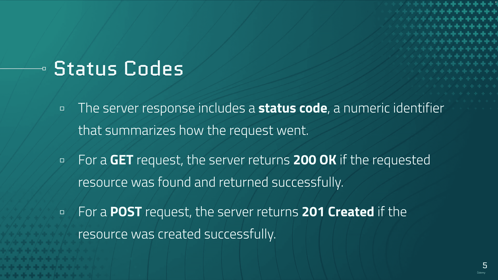
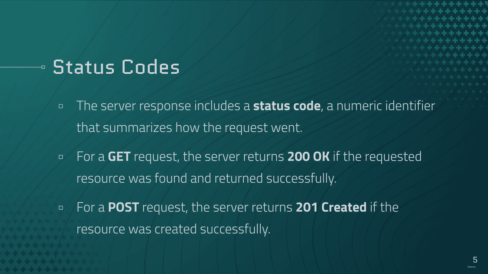
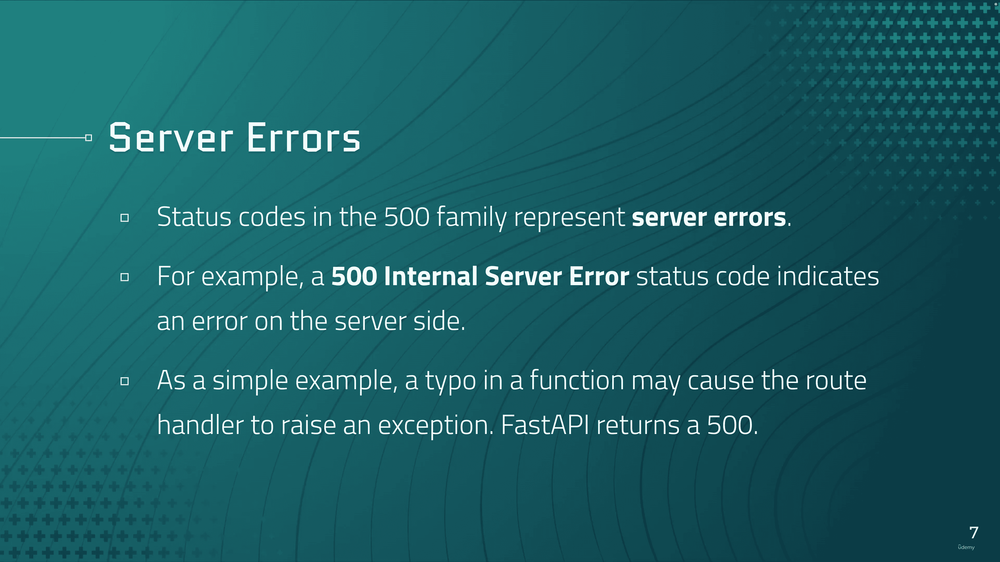

# 🚀 FastAPI 实战教程：第 1 章：GET 与 POST 请求及状态码详解

## 📋 本节概述

在本节课中，我们将详细讨论 HTTP 协议中的两种核心请求方法——GET 请求与 POST 请求，以及与之密切相关的 HTTP 状态码。我们会从最基础的协议概念讲起，逐步深入到具体的请求类型和响应状态码，帮助初学者建立起对客户端与服务器交互过程的完整认识。

## 🌐 理解 HTTP 协议基础

每当客户端向服务器发出请求时，它都在遵循一种被称为超文本传输协议（Hypertext Transfer Protocol）的规则，这个协议通常被缩写为 HTTP。说到这里，你可能已经在自己浏览器的地址栏里见过这个缩写无数次了，每当你访问任何网站，地址栏里都会显示这个熟悉的字样。

HTTP 是一种网络标准，通俗地说，它就是一套开发人员共同约定好的规则，规定了客户端和服务器之间应该如何进行交互。具体来说，这个协议要解决的问题是：客户端应该如何发送数据？服务器又应该如何做出回应？

要知道，如果没有这样一套统一的协议和规则序列，每个开发人员都会用各自不同的方式去请求数据和返回数据，那整个互联网就会陷入一片混乱。所以必须有某种共同的约定，让所有的客户端和服务器都能用同一种“语言”交流。

除了像 `/products` 这样的实际路由或端点之外，来自客户端的 HTTP 请求还会包含一个被称为 HTTP 动词（HTTP Verb）或 HTTP 方法（HTTP Method）的信息。这个“方法”或“动词”描述的正是请求的类型。有意思的是，同一个端点（比如 `/products`）可以同时容纳不同类型的请求，也就是说，同一个 URL 路径可以根据不同的 HTTP 方法做出不同的响应。

## 📥 GET 请求：获取数据

最常见的 HTTP 请求类型就是 GET 请求。它表示客户端向服务器请求获取数据。也就是说，服务器在处理 GET 请求时，会返回一条或多条记录作为响应。

我们用最简单的大白话来说，GET 就是“我要拿东西”。客户端向服务器说“把某某数据给我”，服务器就把对应的数据返回给客户端。这种“获取”的行为，正是术语 GET 这个词的来源。

不过，有一点需要特别注意：客户端使用 GET 方法请求某个资源，并不意味着服务器就一定能找到这个资源。如果服务器找不到客户端所请求的资源，它可能会抛出一个错误。所以，GET 请求的本质是，客户端向服务器发出“我想要这些数据”的信号，但能不能真的拿到，还得看服务器那边的情况。

## 📤 POST 请求：创建数据

与 GET 请求形成互补的是 POST 请求，也就是 POST HTTP 方法。它表示的是客户端向服务器发出的“创建一条记录”的请求。

总结一下这两个方法的核心区别：GET 表示我们在获取数据，而 POST 表示我们在服务器上创建数据。这是一个非常简单但又至关重要的区分。举个例子，向 `/orders` 端点发送一个 POST 请求，可能表示客户端想要创建一个新的订单记录——比如在一个电商网站上提交订单。等到订单创建完成之后，同一个客户端可以再向 `/orders` 端点发送一个 GET 请求，这时它就变成了一个请求获取那个订单数据的操作了。所以记住：GET 用于获取，POST 用于创建。

每当客户端发送 POST 请求来创建数据时，它通常会附带一个“负载”（Payload），这个负载也叫“请求体”（Body）。这个请求体中包含了服务器创建记录所需的字段或数据。

我来给你举一个更具体的例子：假设你正在创建一个新用户。前端页面上可能会有一个 `/users` 端点，你的客户端会向这个端点发送一个 POST 请求。然后，在请求的负载（即请求体）中，客户端会把用户的信息放进去，比如用户在网页表单里填写的名字、邮箱地址和密码等等。所有这些数据都会包含在 POST 请求中发送给服务器。

简单来说，POST 请求的数据流向是“从客户端到服务器”，目的是让服务器能够创建一条新记录；而 GET 请求的数据流向是“从服务器到客户端”，目的是让客户端获取某些数据。

## 🏷️ 状态码：服务器对请求的回应

接下来我们要讨论的下一个主题是状态码。状态码是服务器返回的一个数字标识符，它用简短的方式总结了这次请求的处理结果。

我们来看几个具体的例子。对于 GET 请求，如果服务器成功定位并返回了所请求的资源，它就会返回 200 这个状态码。每一个数字状态码都会有一个与之对应的名称，200 状态码对应的名称是 OK。为什么叫 OK 呢？因为一切都进行得很顺利，没有任何问题。

再举一个 POST 请求的例子。如果服务器成功创建了客户端所请求的资源，客户端会收到一个 201 状态码。201 这个状态码对应的名称是 Created，它反映了一个事实——这个请求在服务器上成功创建了一个资源。

用最直白的话来说，状态码就是服务器向客户端汇报操作结果的一种方式。它会告诉客户端：“你这个请求办得怎么样、结果是成功还是失败、成功的话好到什么程度、失败的话又是哪个环节出了问题。”

上面提到的 200 和 201 都属于表示成功场景的状态码，也就是说，服务器完成了客户端请求它做的事情。除了这些成功码之外，还有一些表示错误的状态码，它们说明在请求处理过程中出了某些问题。

## ⚠️ 错误状态码分类

错误状态码可以大致分为两大类：客户端错误和服务器错误。我们分别来看一下这两种情况的区别。

### 4xx：客户端错误

如果请求本身出了什么问题，这属于客户端的过错。在这种情况下，你会看到 400 范围内的状态码。也就是说，任何以 4 开头的状态码都表示客户端错误。

最常见的客户端错误就是 404，也就是 Not Found（未找到）。我相信几乎所有人都见过这个错误页面。404 表示的含义是：客户端请求了一个根本不存在的资源。当出现这种情况时，服务器会在响应中返回这个状态码，但服务器真正想要传达的信息是：“喂，客户端，你搞错了。你请求的那个东西在我的系统里根本不存在。”

再举一个客户端错误的例子：你可能遇到过 401 状态码，它的名称是 Unauthorized（未授权）。这个状态码表示客户端没有被授权或者没有权限访问所请求的资源。想象一下这样的场景：一个客户端发送 GET 请求去访问别人的订单，一个不属于它的订单。在这种情况下，服务器绝对不会返回 200（因为那表示“没问题”），相反，服务器会返回 401 Unauthorized。这个状态码清楚地表示这是一个客户端错误——请求本身有问题，或者存在某种原因导致服务器无法完成原始的请求。

### 5xx：服务器错误

与客户端错误相对的自然是服务器错误，它表示服务器这一侧出了某些问题。最常见的就是 500 状态码，它的名称是 Internal Server Error（内部服务器错误）。不用多说，从名字就能看出来，这只是意味着服务器内部出了问题。

我来举一个非常简单的实际例子：假设我们已经构建好了 FastAPI 应用，并且设置好了一个路由。我们把应用部署到了生产环境，结果不小心在 Python 函数里打错了一个字，或者引用了一个不存在的变量。这些都是会触发 Python 中的错误或异常的典型代码问题。当我们在路由处理器（也就是与某个端点对应的那个函数）中遇到这类错误或异常时，FastAPI 会自动为这个请求返回一个 500 状态码。简单地说，500 就是服务器在对客户端说：“兄弟，我这边出问题了。”

## 📝 总结

本节课中，我们一起学习了 HTTP 协议的基础概念，了解了 GET 和 POST 两种最核心的 HTTP 方法——GET 用于从服务器获取数据，POST 用于在服务器上创建数据。我们还详细讨论了 HTTP 状态码的含义：200 OK 表示成功定位资源，201 Created 表示成功创建资源，404 Not Found 和 401 Unauthorized 是典型的客户端错误，500 Internal Server Error 则是服务器内部出错的表现。这些都是搭建 Web 应用时必须掌握的基础知识。在下一节课中，我们将动手实作，为我们的 FastAPI 服务器创建第一个真正的端点。
