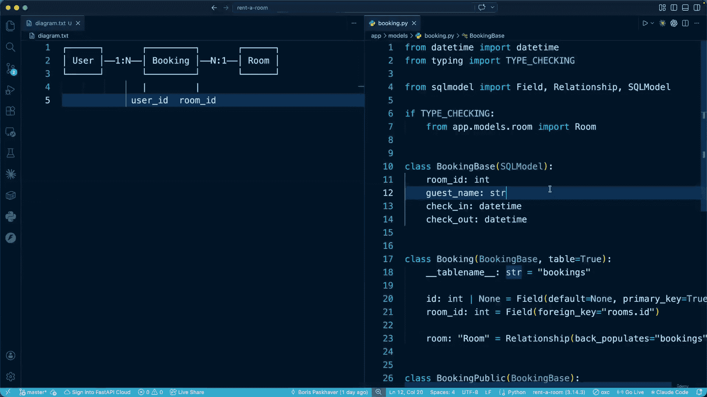
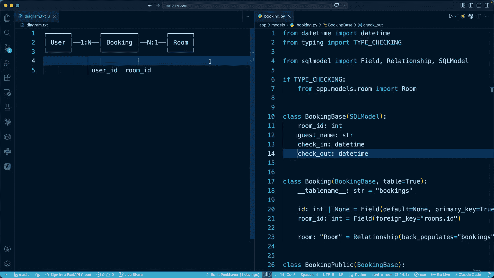

# 🧩 FastAPI实战大师课：第100-101节：连接表（Join Table）



在本节课中，我们将要学习为什么预订模型里的 `guest_name` 字段只是临时方案，以及如何引入用户表、用户模型，并让 `Booking` 表通过外键连接用户和房间。课程重点会放在“连接表”这个概念上，也就是 `bookings` 表为什么站在用户表和房间表中间，以及 `1:N` 关系应该如何理解。对初学者来说，这一节的目标不是马上写完所有代码，而是先把数据库结构想清楚，再进入代码实现。

## 🧱 FastAPI实战大师课：第100-101节：为什么 `guest_name` 不够用

上一节我们介绍了 `Booking` 模型的基础写法，本节中我们来看看最初定义 `Booking` 模型时为什么要加入 `guest_name` 字段。最初定义预订模型时，我们添加了 `guest_name` 字段，用来保存发起预订的客人信息。这样写可以快速让预订模型跑起来，也能把“谁订了房间”这件事先记录下来，所以在学习阶段它是一个很直观的字段。

但在类似 Airbnb 这样的真实应用里，这种做法无法扩展。我们不可能长期靠一个简单字符串保存人名，例如 `"Alice"` 或 `"Boris"`，因为字符串只能保存一个名字，不能承载更多用户信息。最终，我们需要迁移到正式的用户记录，也就是一张用户表。这样用户才能保存邮箱、密码等重要信息，用户还可以连接到支付方式，例如用于预订的信用卡。

从代码角度看，原来的临时方案可以理解为下面这样：

```python
# 临时方案：只能保存名字字符串
class Booking:
    guest_name: str  # 例如 "Alice" 或 "Boris"
```

这段代码是一段不错的临时丢弃代码，它的作用只是确保我们可以先把预订模型写出来。接下来，我们要扩展到完整用户表，并引入配套的用户模型。为了让数据库结构更清楚，我们想先画出 schema，也就是数据库将来长什么样，然后再继续实际写代码。这样做的好处是，后面写模型、写外键、写关系时不容易迷路。

## 🗺️ FastAPI实战大师课：第100-101节：先画数据库结构图

上一节我们说明了字符串存客人姓名只是过渡方案，本节中我们来看看新的数据库结构应该怎样设计。接下来，我们会添加用户表以及配套的 `User` 模型，然后扩展当前的 `Booking` 模型，让预订同时保存用户外键和房间外键。这里的“外键”可以先理解为一个指向另一张表主键的编号，它让两张表产生关系。

在当前图解的右侧，`bookings` 表其实已经完成了一部分：它有一个 `room_id` 外键，连接回 `rooms` 表的 `id` 列。我们会把完全相同的原则应用到用户这一侧：数据库里的每一条预订都会在一个新的 `user_id` 列中保存用户编号，这个 `user_id` 同样是外键，但它指向另一张独立的用户表。这样一来，一条预订就能把某个用户和某个房间连接起来；如果存在多条预订，同一个用户也可以入住许多不同房间。

目标结构可以用下面的代码示意：

```python
class User:
    id: int
    email: str
    password: str


class Room:
    id: int


class Booking:
    id: int
    user_id: int   # 外键 -> users.id
    room_id: int   # 外键 -> rooms.id
```

## 🔗 FastAPI实战大师课：第100-101节：连接表与额外字段

上一节我们画出了用户、房间、预订三张表的基本关系，本节中我们来看看中间这张 `bookings` 表为什么叫连接表。位于中间的 `bookings` 表通常被称为连接表，因为它存在的目的就是连接关联关系中的相关外键。一条预订记录会保存一个 `user_id`，并连接到 `room_id`，所以它把用户和房间连在了一起。

这并不意味着 `bookings` 连接表不能保存额外信息。它当然可以保存额外信息，而且实际项目里一定会保存。例如，对任意一条预订来说，它需要保存入住时间和退房时间，因为每一条预订的这两个时间都可能不同。即使同一个用户想预订完全相同的房间五次，这五次预订也会发生在不同的开始日期和不同的结束日期；开始日期就是入住时间，结束日期就是退房时间。也就是说，`Booking` 不只是关系的连接点，也可以承载这次关联自己的属性。

因此，`bookings` 表放在中间，负责连接或链接另外两张表，它实际上就在执行“连接”动作，这也是它被称为连接表的原因。这种设计在拥有多个用户、多个房间以及它们之间多条预订时，会很好地扩展。可以用下面的关系图表达：

```text
users.id   <---  bookings.user_id
rooms.id   <---  bookings.room_id

User 1 ──< N Booking N >── 1 Room
```

## 1️⃣ FastAPI实战大师课：第100-101节：一对多关系

上一节我们解释了连接表和额外字段，本节中我们来看看图中的 `1:N` 语法表示什么。补充说明，图中这种带冒号的语法，只是用来标记每条记录的数量，尤其是在描述表与表之间的关系时。这里的 `1:N` 表示一个用户可以拥有任意数量的预订，字母 `N` 就表示任意数量。

`1:N` 中的 `1` 对应左侧的模型或表，表示一个用户；后面的 `N` 表示这个用户可以拥有任意数量的预订。类似地，一个房间也可以拥有任意数量的预订。因此，同一个用户可以在 Airbnb 上产生很多条预订，同一个房间也可以被许多不同的预订使用。

从用户角度看，或者从房间角度看，这都是“一对多”关系，也就是“一对 N”关系。可以用下面的公式表示：

```text
User(1) : Booking(N)
Room(1) : Booking(N)
```

```text
一个用户  ->  多条预订
一个房间  ->  多条预订
```

## 🚀 FastAPI实战大师课：第100-101节：接下来构建什么

上一节我们理解了一对多关系，本节中我们来看看接下来具体要搭建什么。这里是即将构建的快速 schema 概览：我们会开始扩展 `Booking` 模型，开始引入配套的 `User` 模型，然后把所有这些结构关联在一起。到这里，数据库结构图已经能帮助我们看清用户、房间和预订三者之间的关系，也为后续写代码打下基础。

下面是本阶段要完成的构建清单，每一步都围绕“让预订连接用户和房间”这个目标展开：

- 扩展当前 `Booking` 模型，让它保存 `user_id` 和 `room_id` 两个外键。

- 新增 `User` 模型，用来保存邮箱、密码等信息，并作为预订的关联对象。

- 把用户、房间、预订这些结构通过外键和关系关联起来，使同一个用户可以产生多条预订，同一个房间也可以对应多条预订。



本节课中我们一起学习了 `guest_name` 为什么只是临时字段、正式用户表为什么必要、`Booking` 如何通过 `user_id` 和 `room_id` 连接用户与房间，以及连接表和 `1:N` 关系的含义。最终要记住的核心结构是：`User 1 ──< N Booking N >── 1 Room`，而 `bookings` 表就是这个关系中的连接表。

