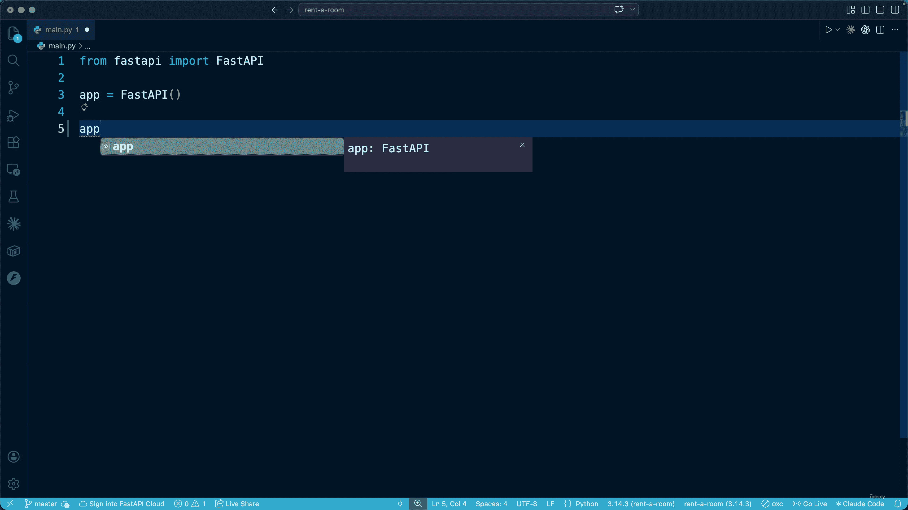
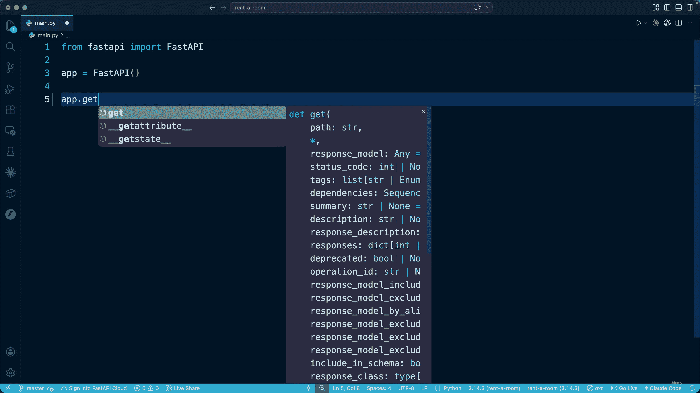
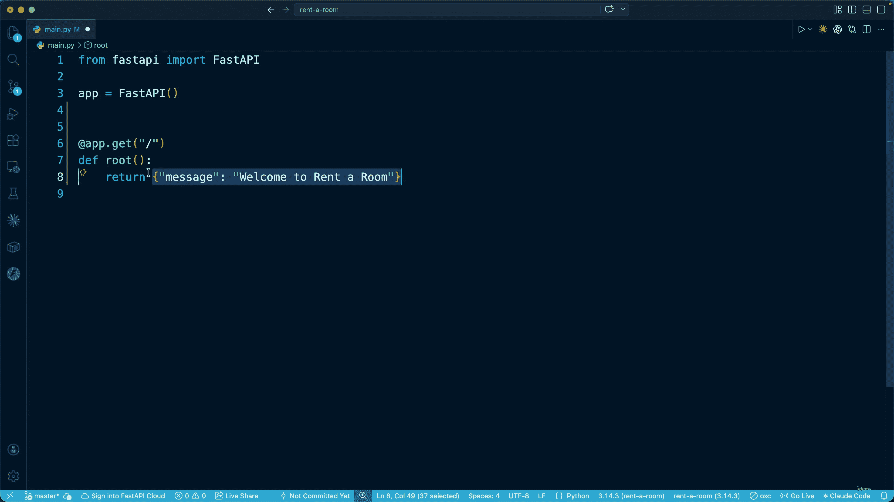

# FastAPI 大师课：第11节：定义路由 🚦

在本节课中我们将要学习怎样在已经创建好的 FastAPI 应用上定义路由。上一节我们已经有了一个 FastAPI 应用对象，本节要做的下一件事，就是给这个应用定义一个或多个路由。路由可以理解成浏览器或其他客户端访问的具体路径，也可以叫端点。FastAPI 会把这个路径和某个 Python 函数匹配起来，然后执行这个函数。为了更直观，可以把核心关系写成下面这个公式。

```text
HTTP 方法 + 路径 → FastAPI 匹配到路由处理函数 → 执行函数
```

上面这个公式就是本节的主线。接下来我们先看看 FastAPI 应用对象上怎样调用 HTTP 方法，再看看路径字符串怎样写，随后解释装饰器和路由处理函数，最后说明返回字典后 FastAPI 怎样自动把它变成 JSON。

**🧭 在 app 对象上调用 HTTP 方法**

上一节我们介绍了 GET 请求和 POST 请求，本节中我们来看看这些请求在 FastAPI 应用对象上怎样使用。一个 FastAPI 应用对象，也就是 FastAPI 实例，上面会有每一种 HTTP 请求类型对应的方法。也就是说，GET 请求有对应的 `get` 方法，POST 请求有对应的 `post` 方法，这些方法都可以在表示 FastAPI 应用的 `app` 对象上调用。下面列出原文中提到的两个方法，帮助初学者建立对应关系。





以下是 `app` 对象上常见 HTTP 方法与请求含义的对应关系：

- `app.get(...)`：对应 GET 请求，通常表示向服务器请求数据。
- `app.post(...)`：对应 POST 请求，通常表示向服务器提交数据。

最简单的一个例子是 GET 方法，它代表客户端向服务器请求数据。这里我们调用 `get` 方法，并且传入一个字符串，这个字符串表示路径，也就是路由或端点。路径可以写成 `products`、`orders`、`rooms` 这类名字。为了让例子保持非常简单，原文这里先写一个斜杠 `/`，它表示根路由，也可以理解成主页路由。等到下一节启动 FastAPI 服务器后，在浏览器里访问这个路由，地址中就是一根斜杠，没有更复杂的内容。下面用代码形式展示这个基本调用。

```python
@app.get("/")
def root():
    return {"message": "Welcome to Rent A Room"}
```

如果这里定义的是 `rooms`，那么浏览器地址栏里访问的路由就会变成 `/rooms`。也就是说，传给 `get` 方法的字符串参数，就是我们正在定义的路由路径。为了把概念讲清楚，下面列出几个路径字符串的例子。

以下是路径字符串与访问地址的对应示例：

- `"/"`：根路由，也可以叫主页路由，浏览器访问地址末尾就是 `/`。
- `"/rooms"`：房间路由，浏览器地址栏中会导航到 `/rooms`。
- `"/products"`：商品路由，适合表示商品相关端点。
- `"/orders"`：订单路由，适合表示订单相关端点。

**🧩 装饰器与路由处理函数**

前面我们调用了 `app.get` 并传入路径，本节继续看它返回的内容。`get` 方法有意思的地方在于，它会返回一个叫装饰器的东西。装饰器是 Python 里的高级概念，但可以先简单理解成：装饰器是一个函数，它接收另一个函数作为参数，并且返回一个函数作为返回值。Python 附录里会更深入地讲装饰器，屏幕上会给出链接，那节课会补充装饰器如何工作的更多背景。现在先跟着语法写就可以。我们需要在 `get` 方法返回的装饰器前面加一个 `@` 符号。所以写法总是 `@` 后面跟着 `app` 对象上表示 HTTP 动词的方法名，用来表示你正在处理哪一种 HTTP 请求。紧接着的下一行，我们定义路由处理函数，它就是一个普通的 Python 函数。函数名字可以自己取，这里叫 `root`，也可以叫 `home`，但理想情况下，函数名应该描述这个函数实际在做的事情。这里就使用常规的 Python 函数语法。下面的代码展示了装饰器和处理函数的完整写法。

```python
@app.get("/")
def root():
    return {"message": "Welcome to Rent A Room"}
```

为了看清楚每一部分的用途，下面把这段代码拆开解释。以下是装饰器与路由处理函数中各部分的含义：

- `@`：装饰器语法符号，放在 `app.get` 返回的装饰器前面。
- `app.get`：表示在 FastAPI 应用对象上处理 GET 请求。
- `"/"`：传给 `get` 方法的字符串参数，表示根路由或主页路由。
- `def root():`：路由处理函数，名字可以自定义，这里用 `root` 描述根路由。
- `return {...}`：函数最终返回的数据，会作为响应内容发送给客户端。

在这个处理函数里，我们返回一个基本的 Python 字典。可以返回多种不同的值，但字典是一个很好的起点。这里提供一个键值对，键是 `message`，值是类似 `Welcome to Rent A Room` 的内容。原文的意思就是，定义到这里就完成了。这里再强调一次它的工作方式：当客户端向这个端点发起请求时，FastAPI 会识别出 `root` 就是匹配的、对应的路由处理函数，然后执行这个函数的完整函数体，最后得到这个返回值。我们在这里返回的内容，代表将要发送回发起请求的客户端的数据。

**📦 从 Python 字典到 JSON 响应**

上一段提到返回的是 Python 字典，本节中我们来看看这个字典怎样变成客户端能理解的数据。这里有一个值得注意的点：我们写下的 Python 字典，是一种只在 Python 环境里有意义的结构，比如在 Web 服务器里面可以这样写。但 Web 上真正用来发送和接收数据的语言，或者说数据格式，叫 JSON，全称是 JavaScript Object Notation。FastAPI 很好的地方在于，它会自动把这个字典转换成对应的 JSON 表示。下一节课我们就会在浏览器里看到这个转换结果。为了直白地理解，可以把它写成下面这个转换关系。

```text
Python 字典 → FastAPI 自动转换 → JSON 响应
```

下面列出这个转换过程中需要记住的关键点，方便初学者抓住重点。以下是返回字典与自动 JSON 转换的关键点：

- 路由处理函数可以返回 Python 字典。
- 这个字典只在 Python 环境中有意义。
- Web 上发送和接收数据常用的格式是 JSON，全称 JavaScript Object Notation。
- FastAPI 会自动把字典转换成对应的 JSON 表示。
- 下一节课可以在浏览器中看到转换后的响应。

到这里，这个返回字典并自动转成 JSON 的流程就讲完了。

**✅ 当前应用状态**

前面已经讲完返回值和 JSON 转换，本节最后来看看当前应用的整体状态。现在我们已经有了一个有效的 FastAPI 应用，原文说它在第 3 行。这个应用目前只支持一个路由，也就是斜杠 `/`。这个路由会返回一个字典，或者返回与字典等价的 JSON 表示，里面只有一个键值对。下一节课我们会启动 FastAPI 服务器，并以客户端身份向这个端点发起请求。到那时，前面讲的路由、函数执行、字典返回和 JSON 转换就会在浏览器里连起来。下面用代码再次展示当前这个最小可用结构。

```python
from fastapi import FastAPI

app = FastAPI()

@app.get("/")
def root():
    return {"message": "Welcome to Rent A Room"}
```

**📝 本节总结**



到这里，定义路由的关键步骤已经走完，下面做本节总结。本节课中我们一起学习了 FastAPI 中怎样定义路由。我们先理解了路由是路径或端点，FastAPI 会把它匹配到对应的 Python 函数并执行。然后我们看到 FastAPI 应用对象上有与 HTTP 请求类型对应的方法，例如 GET 对应 `get` 方法，POST 对应 `post` 方法。接着我们调用 `app.get("/")` 传入路径字符串，并理解了 `@` 装饰器和下一行的路由处理函数。随后我们让处理函数返回一个 Python 字典，并说明 FastAPI 会自动把字典转换成 JSON 响应。最后我们确认当前应用只有一个根路由 `/`，下一节课会启动服务器并向这个端点发起请求。

