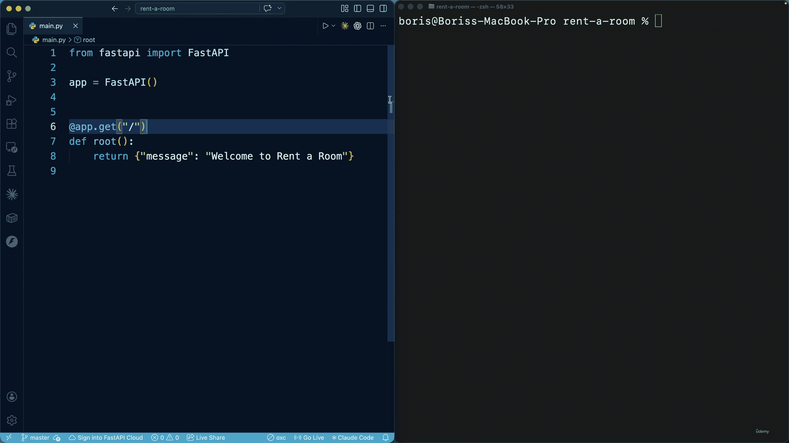
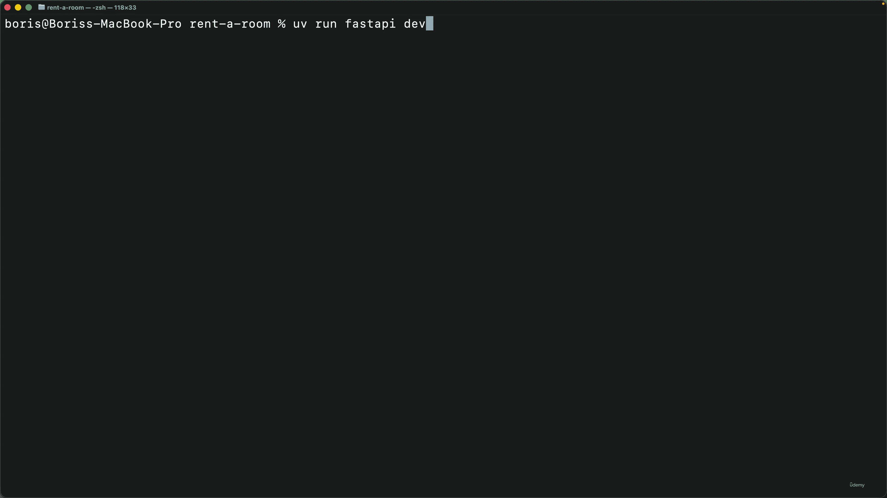
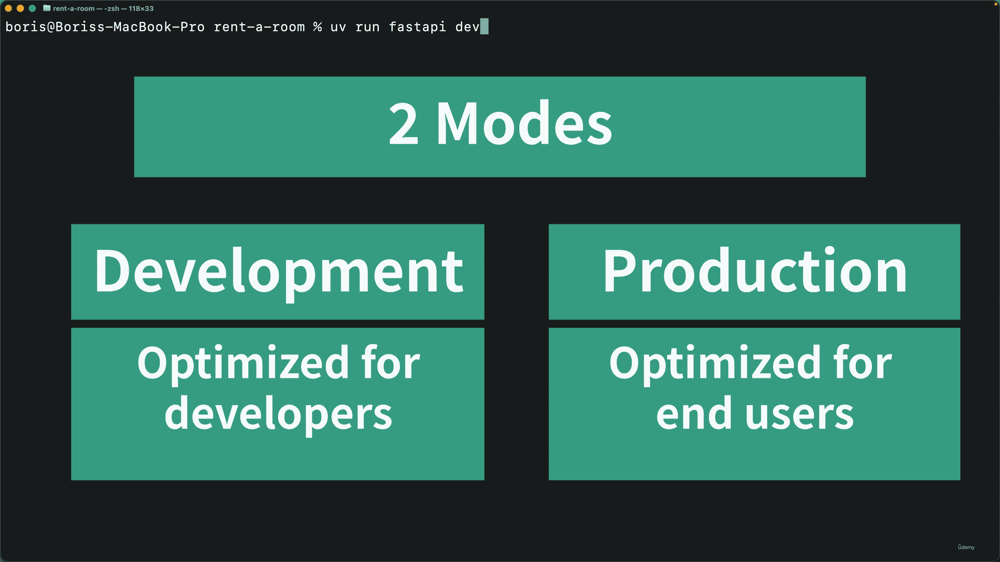
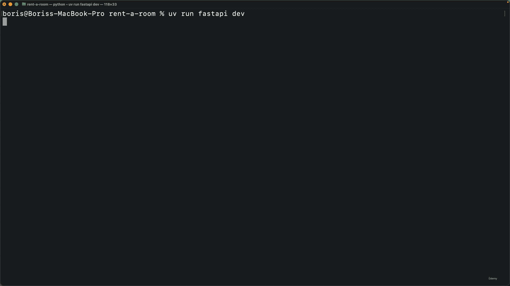

# 🚀 FastAPI 大师课：12：启动 FastAPI 服务器并发出请求


在本节课中我们将要学习如何把已经写好的 FastAPI 代码真正运行起来，并从一个客户端向服务器发出请求、接收响应。到目前为止，`main.py` 里的代码只是创建了一个 FastAPI 应用，并且这个应用只支持一个路由，也就是斜杠路由或根路由 `/`。不过，这些内容目前还只是文件里的 Python 代码，服务器并没有运行。因此，下一步要做的事情就是实际启动 FastAPI 服务器，并通过浏览器观察完整的请求响应过程。本节课还会解释开发模式和生产模式的区别、`uv run` 命令的作用、服务器为什么是持续运行的进程，以及如何指定 FastAPI 应用的入口文件。




## 🧭 FastAPI 大师课：12.1：从代码到运行中的服务器


上一节我们说明了当前代码只是静态的 Python 文件，本节中我们来看看如何把它变成正在运行的服务器。此时，`main.py` 中的代码已经创建了一个 FastAPI 应用，并支持一个路由，即 `/` 根路由。问题在于，这个应用还没有被启动，所以浏览器无法访问它。要启动服务，需要打开终端或命令行工具，展开终端窗口，并导航到 `rent-a-room` 项目的顶层目录。然后在这个目录下运行下面的命令。


```bash
uv run fastapi dev
```


这条命令里的 `fastapi` 需要使用全小写形式，最后的 `dev` 表示开发模式。下面把这条命令拆开说明，帮助理解每一部分在做什么。以下是命令各部分的含义。


- `uv run`：使用当前项目虚拟环境中本地安装的 Python 来执行后面的命令。

- `fastapi`：调用项目依赖中列出的 FastAPI 工具。

- `dev`：让 FastAPI 服务器以开发模式启动。




换句话说，`uv run` 负责用项目自己的 Python 环境执行命令，而 `fastapi` 工具负责启动 FastAPI 服务器；最后的 `dev` 则指定服务器运行在开发模式下。理解这一点很重要，因为同一个项目在不同机器上可能使用不同的 Python 环境，而 `uv run` 可以保证命令使用的是当前项目虚拟环境里的 Python。接下来我们进一步看看开发模式和生产模式之间到底有什么区别。


## ⚙️ FastAPI 大师课：12.2：开发模式与生产模式


上一节我们介绍了启动命令的组成，本节中我们来看看其中的 `dev` 到底代表什么。启动 FastAPI 服务器时，可以使用两种模式：开发模式和生产模式。开发模式面向本地开发，主要服务对象是实际编写代码的工程师。在开发模式中，只要代码库里的任意 Python 文件发生变化，服务器就会注册这些变化并自动重启。这个功能非常方便，因为如果没有自动重启，每次修改代码后都必须手动关闭服务器再重新启动，才能让修改生效。开发模式会自动识别变化，并把变化应用到服务器上。


可以用一个简单公式来理解这种差异：`开发模式 = 自动重载 + 本地开发体验`。生产模式则不需要这种能力，生产模式是在把应用部署到互联网或 Web 上时使用的模式。最终用户并不需要频繁经历代码变更导致的服务器重启，实际部署时通常一次只部署一个项目版本。生产模式会针对最终用户和发出请求的客户端进行优化，因此服务器可能运行得更快或更高效，因为它优化的变量集合与开发阶段优化的变量集合不同。以下是两种模式的主要对比。


- 开发模式：适合本地开发，代码变化后服务器会自动识别并重启。

- 生产模式：适合部署到互联网，面向最终用户和客户端进行优化，不追求自动重载。


`uv run` 的作用是使用此项目虚拟环境中本地安装的 Python 来执行命令，而这条命令使用的 FastAPI 工具已经列在项目依赖中。因此，整个命令的含义就是：使用本地 Python 运行开发模式下的 FastAPI 服务器。理解模式差异之后，下一步就是实际按下回车启动服务器，并观察它作为一个持续运行进程的行为。




## 🖥️ FastAPI 大师课：12.3：启动、停止与持续运行进程


上一节我们说明了开发模式的特点，本节中我们来看看服务器启动后如何停止，以及它为什么不会像普通 Python 脚本那样自动结束。按下回车键后，服务器就会启动。这里需要再次强调，服务器是一个持续运行的进程，它会一直运行，直到手动关闭。它不像普通的 Python 文件那样执行完就结束。如果直接用 Python 命令运行一个普通文件，程序执行完毕后会回到终端，因为程序已经结束。服务器不是一次性执行，它是一个持续运行的程序，会监听来自客户端的请求。因此，服务器本身不会自行关闭，除非手动关闭它；关闭方式是按下 `Ctrl+C`。按下 `Ctrl+C` 后，就会回到终端。


下面是启动和停止服务器时需要记住的关键点。以下是服务器进程相关要点。


- 启动服务器：运行 `uv run fastapi dev`。

- 停止服务器：在终端中按下 `Ctrl+C`。

- 服务器特性：持续运行并监听请求，不是一次性脚本。

- 重启服务器：再次运行 `uv run fastapi dev`。


停止服务器后，可以再次运行 `uv run fastapi dev` 来重启服务器。这里还需要澄清一个容易混淆的地方：开发者编写代码是为了让最终用户使用，但开发过程中也需要测试自己的工作是否有效。因此在本地开发时，自己的电脑会同时充当客户端和服务器。终端中保持 FastAPI 服务器运行，然后从浏览器或终端向它发出请求；不同客户端发出请求的方式有很多种。关键点是，在本地开发阶段，自己的电脑同时承担服务器和客户端两个角色。接下来就可以真正从浏览器发出请求，并观察 localhost 和端口的作用。


## 🌐 FastAPI 大师课：12.4：localhost、端口与请求响应


上一节我们说明了本地电脑同时充当客户端和服务器，本节中我们来看看浏览器如何找到本机上的 FastAPI 应用。为了便于观察，可以把终端折叠到屏幕一侧，然后在 Google Chrome 浏览器中打开地址栏，从 `localhost` 这个词开始输入。`localhost` 是一个特殊词，它指的就是自己的电脑。再次说明，这并不是运行在互联网上的应用，其他人看不到它，它只在本机运行。`localhost` 指代的就是我们自己的电脑。接着需要输入冒号，再输入端口号。可以把端口理解为电脑上的一个编号通道，类似电视上的频道。不同的服务器和应用程序可以同时运行在自己电脑的 `localhost` 上，而端口相当于唯一标识，让浏览器能够找到特定的应用。


在这个例子中，`127.0.0.1` 基本就是 `localhost` 的别名或替代名称。冒号后面的端口号是 FastAPI 团队做出的设计决定，服务器运行在 `8000` 端口。因此，可以在地址栏中写 `localhost:8000`，然后在后面提供常规路由或端点。路由或端点的写法是先写一个斜杠，再写类似 `products`、`orders` 或自己定义的其他端点。在本例中只有一个路由，也就是斜杠路由 `/`，所以只需要写 `localhost:8000/`。执行这个地址后，就会看到服务器返回的响应。这里发生的事情很重要：浏览器作为客户端，向 `/` 路由发出请求，这个请求到达 FastAPI 服务器；FastAPI 服务器把请求的路由端点匹配到对应的路由处理函数，函数执行后返回一个字典，作为函数的返回值；FastAPI 再把这个字典转换成 JSON，也就是 JavaScript 对象表示法；浏览器最终渲染出这个 JSON。


可以用下面的流程来理解完整的请求响应循环。


```text
浏览器（客户端） --请求 /--> FastAPI 服务器
FastAPI 服务器 --匹配路由--> 路由处理函数
路由处理函数 --返回 dict--> FastAPI
FastAPI --转换为 JSON--> 浏览器（客户端）渲染
```


这里看到的已经不再是 Python 字典，而是对象的 JSON 表示；它仍然是键值对的组合。关键点是，我们已经完成了一个完整的请求响应循环：从客户端开始，请求到达服务器，服务器返回响应，响应回到客户端，也就是 Web 浏览器，Chrome 作为客户端渲染了响应。基本上整个流程就是这样。以下是请求响应循环中的几个关键角色。


- 客户端：例如 Chrome 浏览器，负责发出请求并渲染响应。

- 服务器：FastAPI 应用，负责接收请求并匹配路由。

- 路由处理函数：执行具体逻辑并返回字典。

- JSON：FastAPI 把字典转换后的响应格式，仍然是键值对组合。


理解这个循环之后，再回到终端关闭并重启服务器，就可以继续了解一个有趣的小细节：FastAPI 是如何找到应用入口的。


## 📍 FastAPI 大师课：12.5：指定应用入口文件


上一节我们完成了浏览器请求服务器的完整流程，本节中我们来看看 FastAPI 是如何定位应用入口文件的。关闭并重启服务器后，可以观察到一个有趣的小点：FastAPI 之所以能够识别我们的应用，是因为 `main.py` 文件位于项目的直接顶层目录。除了依赖这种默认查找方式，也可以明确指定 `main.py` 文件所在的目录或位置。例如，可以运行 `uv run fastapi dev main.py`，其中 `main.py` 当前就是 `rent-a-room` 项目顶层文件。当前这样做没有额外优势，因为服务器不需要额外帮助就能定位这个文件。


不过，如果创建 FastAPI 应用的启动点文件位于其他地方，例如嵌套在 `app` 目录中，那么指定完整目录和嵌套文件位置的语法就会很有帮助。万一服务器无法定位 FastAPI 应用的起点，可能会抛出错误；这时就可以用这种语法指定文件的准确位置。入口文件不一定必须叫 `main.py`，但它必须包含 FastAPI 类的创建代码。这种语法允许明确指定应用从哪里开始。下面是指定入口文件时的要点。以下是入口文件语法的关键说明。


- 默认情况：`main.py` 位于项目顶层时，直接运行 `uv run fastapi dev` 即可。

- 显式指定：可以运行 `uv run fastapi dev main.py` 指定根目录下的入口文件。

- 嵌套目录：入口文件位于 `app` 等子目录时，可以指定类似 `app/main.py` 的路径。

- 文件名要求：入口文件不必叫 `main.py`，但其中必须创建 FastAPI 应用实例。


例如，下面的命令展示了显式指定入口文件的写法。


```bash
# 入口文件在项目根目录
uv run fastapi dev main.py

# 入口文件嵌套在 app 目录时的示意
uv run fastapi dev app/main.py
```


最后，可以回到正在运行的服务器，继续使用 `fastapi dev` 启动应用。本节课到这里就覆盖了全部内容。


> 核心记忆：`uv run fastapi dev` 启动开发服务器；`Ctrl+C` 停止服务器；浏览器访问 `http://localhost:8000/`；FastAPI 会把路由处理函数返回的 `dict` 转换成 JSON 返回给客户端。




本节课中我们一起学习了如何从 `main.py` 中的 FastAPI 应用代码出发，使用 `uv run fastapi dev` 启动开发服务器；理解了开发模式和生产模式的区别，以及开发模式下的自动重载机制；认识了服务器是持续运行进程，需要用 `Ctrl+C` 手动停止；还通过 `localhost:8000` 和根路由 `/` 完成了浏览器到 FastAPI 服务器的完整请求响应循环，并了解了如何显式指定 FastAPI 应用的入口文件。掌握这些内容后，就可以在本地启动 FastAPI 服务，并通过浏览器或终端验证接口是否正常工作。

