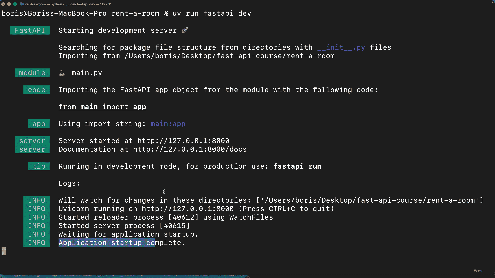
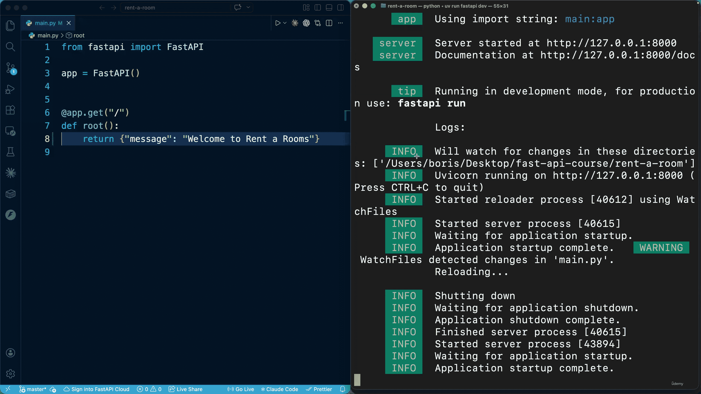
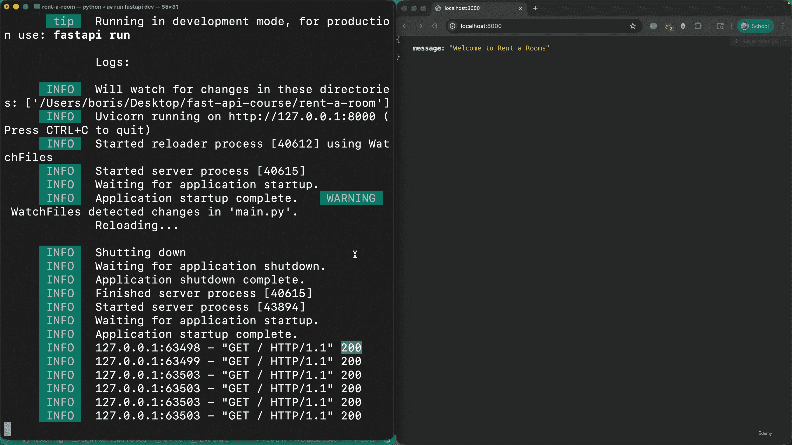

# 🚀 FastAPI 大师课：第13-14节：逐步解读服务器输出


在本节课中，我们将一起学习 FastAPI 开发服务器启动后在终端里输出的内容，并借这些输出理解 FastAPI 在背后替我们做了哪些事情。上一节课里，我们已经在开发模式下启动了 FastAPI 服务器，然后用浏览器作为客户端向服务器发出请求，并收到了响应。这一节我们会从终端输出出发，逐项看启动信息、自动文档、开发模式与生产模式、文件监视、Uvicorn 与 ASGI，以及浏览器刷新后服务器日志的变化。为了让初学者更容易理解，下面会把每个关键点拆开说明，并尽量用直白的话解释，让你看到终端输出时不再觉得这些文字只是“启动成功”之类的提示，而是能明白每一行分别在告诉我们什么。


## 🧭 重新启动开发服务器


为了观察服务器输出，我们再次进入顶层的 `rent a room` 项目，然后执行下面的命令：


```bash
uv run fastapi dev
```


上一节课运行的服务器我已经关闭了；如果你本地还开着服务器，不需要特意关闭，我这里只是从零开始演示。执行命令后，FastAPI 会告诉我们它正在启动开发服务器，并开始寻找应用程序真正的启动点，也就是 `FastAPI` 类实例化出来的那个对象。这个启动点可以简单理解成下面这段代码所代表的东西：


```python
app = FastAPI()
```


接着，FastAPI 会定位项目顶层的 `main.py` 文件，识别其中的 `app` 应用对象，本质上相当于说：我正在导入这个 FastAPI 的 app 对象，因此可以启动服务器了。可以把启动关系简单记成下面的公式：


```text
main.py 中的 app = FastAPI() -> 服务器启动入口
```


然后，FastAPI 会告诉我们服务器运行在哪里。这里的 `127.0.0.1` 指的是 localhost，也就是本机；更具体地说，服务器运行在 `8000` 端口，所以浏览器里需要在 localhost 后面加上冒号和 8000。地址关系可以写成：


```text
http://127.0.0.1:8000
```


## 📚 自动文档、开发模式与生产模式


上一节我们看到了服务器启动位置，本节中我们来看看启动输出里关于文档和运行模式的信息。启动 FastAPI 服务器时，FastAPI 还会自动生成文档，这份文档会包含应用中的所有路由。我们会在后面的课程里专门查看这份文档，但这里终端会提示：文档可以在同一个 `8000` 端口上访问，只是路径换成了一个自定义路由 `/docs`。访问地址可以写成：


```text
http://127.0.0.1:8000/docs
```


终端还会告诉我们当前运行在开发模式，这个模式针对开发者体验做了优化。当我们准备把 FastAPI 应用部署到真正的互联网生产环境时，终端会提示应该改用 `fastapi run`。它是与开发命令配套的生产命令，也就是 `uv run fastapi run`，用生产模式启动服务器。下面把这两类启动方式放在一起对照，方便你记住命令差异：


- 开发模式：使用 `uv run fastapi dev`，适合本地开发，优化开发者体验。
- 生产模式：使用 `uv run fastapi run`，适合部署到实际互联网生产环境。


命令差异清楚后，我们继续看开发模式下的文件监视信息。终端还会告诉我们，它会监视下面这些目录中的文件变化，这里的目录就是 `rent a room` 项目。只要我们在编辑器里修改了内容，程序就会立刻发现变化，自动关闭服务器，然后重新启动。后面马上会演示这个动作。


## 🔁 文件变化与自动重启演示




终端这里会显示服务器已经完整启动，应用启动完成，并且正在监听变化。为了让你并排看到效果，我会把终端移到右侧，左侧是编辑器里的 `main.py` 文件。然后我做一个小改动，比如把某个字符换成另一个字符，再保存文件。保存之后，正在运行的服务器会自动检测到变化，自动关闭，等待应用真正结束，然后再重新启动服务器。重启完成后，服务器就会带上刚才改动的代码。这种自动重启并不是所有后端库都一定能保证，具体要看所用的后端库；在 FastAPI 开发模式里这个体验很方便，因为保存代码后服务器就会重启。


现在可以看到输出里出现了 `welcome to rent of rooms`，如果我现在在浏览器里访问这个页面，页面会显示 `rent rooms`，说明内容会自动更新。接着我会刷新这个页面几次：在 Mac 上按 `Command + R`，在 Windows 上按 `Control + R`，每次刷新都会向服务器发出一个全新的请求。我大概刷新了五次左右，之后就能看到每个请求都出现在服务器日志里。


## 🧱 Uvicorn 与 ASGI 的关系


在继续看日志之前，我们先补充启动输出里提到的底层服务器信息，因为这部分对理解 FastAPI 的生态很重要。终端会告诉我们，FastAPI 在幕后使用了 Uvicorn。Uvicorn 是真正的底层服务器，FastAPI 构建在它之上。Uvicorn 遵循一个叫 ASGI 的标准，这个标准基本上就是一组规则和规范，用来约定 Python Web 服务器应该如何工作；FastAPI 再在这些规则之上提供更上层的功能。可以简单记成下面的层次：


```text
FastAPI 应用 -> Uvicorn 服务器 -> ASGI 标准
```


需要说明的是，使用 FastAPI 时并不是强制必须使用 Uvicorn，它只是一个标准实现；类似地，除 FastAPI 之外的其他后端库也可能构建在 Uvicorn 之上。这也说明 Python 后端开发生态里有很多不同的库一层一层地构建起来，很多开发者会组合、聚合这些库，为 Python 社区构建新的解决方案。


## 🧾 浏览器刷新与服务器日志




上一节我们了解了 Uvicorn 和 ASGI 的底层关系，本节中我们来看看浏览器刷新时终端里的服务器日志。刷新浏览器时，终端右侧的服务器日志会逐条出现。这里的 `127.0.0.1` 仍然指 localhost，也就是我们自己的电脑。每条服务器日志通常包含 HTTP 方法或动词、请求的路由或端点、HTTP 版本以及状态码。为了方便对照，下面把一条典型日志拆开说明：


- HTTP 方法：这里是 `GET` 请求。
- 路由或端点：这里一直命中根路由 `/`。
- HTTP 版本：`HTTP/1.1`，表示请求使用的 HTTP 标准版本。HTTP 有多个版本，1.1 算是较老的版本，Web 正在慢慢向 2.0 迁移。
- 状态码：`200`，表示 OK，也就是服务器成功返回了响应。GET 请求成功，服务器返回了正确或预期的响应，浏览器里看到的就是这个结果。


把一条日志压缩成公式，可以写成：


```text
GET / HTTP/1.1 -> 200 OK
```


这就是对服务器日志和整体服务器输出的快速概览。以后每当我们在终端里运行 `uv run fastapi dev`，都可以用同样的方式观察启动信息和请求日志。


## ✅ 本节总结




本节课中我们一起学习了 FastAPI 开发服务器启动后的终端输出，包括启动入口、运行地址、自动文档地址、开发模式与生产模式、文件监视与自动重启、Uvicorn 与 ASGI 的关系，以及浏览器刷新后服务器日志的含义。简单回顾一下，启动时 FastAPI 会找到 `main.py` 里的 `app` 对象并启动服务器，默认地址是 `http://127.0.0.1:8000`，自动文档在 `/docs`；开发模式用 `uv run fastapi dev`，生产模式用 `uv run fastapi run`；开发模式会监视文件变化并自动重启；底层使用 Uvicorn，Uvicorn 遵循 ASGI 标准；刷新浏览器后，终端日志会显示类似 `GET / HTTP/1.1 -> 200 OK` 的记录。掌握这些输出后，再看 FastAPI 的运行过程就会清楚很多。

