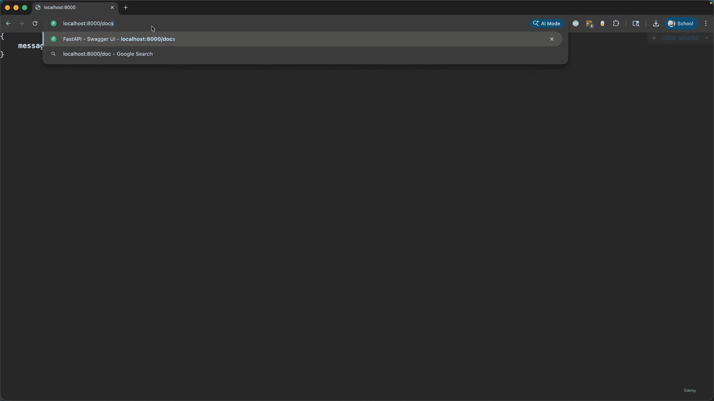
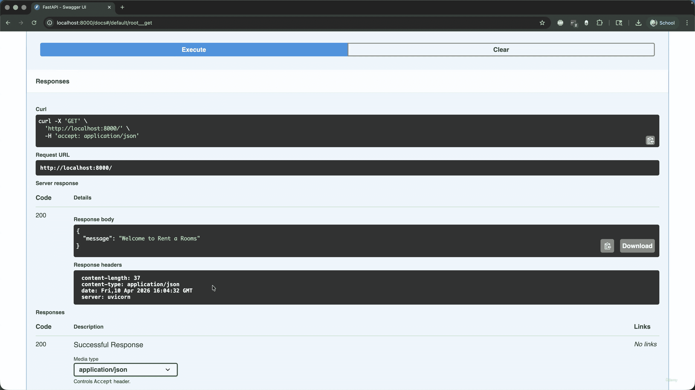

## FastAPI Masterclass：14：Swagger 文档 📘

  



在本节课中，我们将学习FastAPI中一个非常实用且炫酷的功能——Swagger文档。我们会了解什么是Swagger文档，如何访问它，以及如何使用它的“Try it out”功能直接测试我们的API接口。此外，我们还会第一次接触HTTP响应头（headers），并解释这些头部信息到底代表什么含义。通过这节内容，你会对FastAPI自动生成文档的能力有一个清晰的认识。

  

在上一节课中，当我们浏览FastAPI服务器输出时，我们注意到有一个页面是由FastAPI自动生成的，它看起来像是文档页。实际上，我们可以通过访问一个FastAPI自动添加的特定路由来打开这个网页，这个路由就是 `/docs`。你可以直接在浏览器地址栏里输入 `http://127.0.0.1:8000/docs` 访问它，这是FastAPI提供给我们的一条默认路径，不需要我们自己手动编写任何页面代码。

  

那么，当我们打开 `/docs` 之后，我们会进入一个叫做Swagger文档的界面。Swagger是什么呢？简单来说，Swagger是一个独立于FastAPI的程序，它的作用就是能够自动生成我们的API文档。换句话说，Swagger并不是FastAPI自带的内部模块，而是一个各司其职的独立工具，但FastAPI把它巧妙地集成起来了，让我们可以直接使用。那么，这里的“文档”到底指什么呢？其实，文档就是关于服务器上所有可用路由的元数据和信息的集合。我们可以用公式来理解：

  

```text
API文档 = 元数据 + 路由信息
```

  

其中，元数据可以理解为“描述数据的数据”，它本身并不包含业务逻辑，而是给我们展示这个接口长什么样、该怎样调用。而路由信息则包括这个接口的HTTP方法、请求路径、请求参数、响应格式等等。随着后续我们不断扩展并添加更多路由，这份文档也会跟着扩容。比如，文档会记录服务器期望客户端发送什么样的请求负载（也就是我们常说的request payload），同时也会记录服务器希望返回给客户端的响应是什么样子的，也就是说，响应的数据形状（response shape）是怎样的。所以，当你添加了新路由后，Swagger文档会自动更新，这个特性非常节省人力。

  

现在，由于我们目前只编写了一个最简单的接口，所以Swagger文档看起来非常简洁，可以说是“精简版”，但它已经能够列出我们所有可用的路由了。例如，你看这里，我们有一个唯一的根路由，也就是 `/`。页面会告诉你说，这个路由是一个GET请求。我们可以通过点击右侧的箭头来展开这个路由对应的方框，展开之后，页面会显示关于这个路由的更多详细文档。我继续往下滚动页面，就能看到一些可用的响应状态码，也就是服务器可能会返回的各种结果。页面会告诉我们，一个成功的响应会返回 `200` 状态码，并且服务器会以JSON的格式来传递负载或者说响应体。你可以把JSON想象成一种结构化的数据格式，它和HTML文件这种格式截然不同，JSON主要用于数据交换。

  

在Swagger文档中，最酷的功能大概就是“Try it out”按钮了。这个按钮就在每个路由的旁边，点击它之后，你就能够直接从当前这个文档页面发起一个真实的HTTP请求到对应的端点，也就是我们说的路由。这样一来，我们就不需要另外使用Postman或是curl这样的工具了，直接在浏览器里就能测试接口。接下来，我们看到点击“Try it out”之后，会弹出一个“Execute”按钮，我们点击这个“Execute”按钮，就相当于实际上对根路由发起了一次请求。在发起请求的过程中，我会继续向下滚动，跳过了当前这一段展示区域，这块区域的内容我们留到下一节课再回来细看。不过，这里我们能看到实际的请求URL，以及服务器返回给我们的响应——在这里，我们自己就是客户端，而Swagger文档这个页面则在扮演客户端的角色。我们可以预测到，响应体里包含我们之前在路由处理函数中定义的那条消息，以及一个`compliment`值。除了响应体，我们还会看到响应头（response headers），这就把我们引向了下面要说的重点内容。

  

这可能是我们第一次在课程中遇到“响应头”这个概念。那就让我们花点时间来准确解释一下它到底是什么。所谓headers，其实就是一些键值对（key-value pairs），它们既可以由客户端发出，也可以由服务器发出。因此，它们在请求中可能出现，在响应中也可能出现。换一个角度来看，我们可以把headers理解成一组元数据，它们用来携带关于某个请求或某个响应的额外补充信息。例如，服务器返回的headers就会告诉我们这个响应的总长度是多少字节、内容是什么类型等等。

  

我们用一个代码块来展示这种键值对的形式，方便你形成直观印象：

  

```text
headers = {
  "content-length": "127",
  "content-type": "application/json",
  "date": "Wed, 11 Nov 2026 12:00:00 GMT",
  "server": "uvicorn"
}
```

  

上面这些只是示例值，实际开发中会根据请求和响应的不同而变化。现在，来看看FastAPI服务器实际返回的headers具体包含哪些内容。这些headers是一些从FastAPI服务器传回来的键值对，它们通常包括下面这几项信息：

  

- `content-length`：这个键告诉我们响应的总字节数，也就是整个响应体的大小。比如某个响应体是127字节，就可以看到`content-length: 127`。了解这个数值对性能调试和网络传输都会有帮助。

- `content-type`：这个键设置为`application/json`，告诉我们响应的数据格式是JSON。这代表FastAPI默认会把Python对象序列化成JSON字符串返回；如果内容是一个HTML文件，那么这个键的值就会是`text/html`之类的，所以通过它我们可以非常清楚地知道当前的响应是什么类型。

- `date`：这个键记录的是响应的日期和时间，表示服务器在什么时候生成了这个响应。你可能会好奇，为什么客户端会需要知道这个？因为不同的系统时间可能不同，带上服务器时间能帮助调试和同步。

- `server`：这个键表示的是FastAPI底层所使用的服务器，在我们这个项目中就是 `uvicorn`。因此，当你看到这个响应头时，你就能知道后端实际是由uvicorn这样的ASGI服务器来托管的。

  

这里的关键结论是：headers只是附加在核心响应旁边的一堆元数据。真正的核心内容，是服务器返回给客户端的实际数据负载（payload）。也就是说，浏览器实际收到的那一整个HTTP响应中，headers虽然必不可少，但它们起着辅助说明的作用，而负载部分才是真正被我们业务代码使用的信息。这些headers由FastAPI自动添加到实际响应上，然后由浏览器接收。它们依然是一些带有补充信息的键值对，用来描述刚刚发生的这次事件或这次响应。理解这些之后，我们基本上就完成了对FastAPI自动生成的Swagger文档的快速介绍。

  



最后来总结一下。本节课中，我们一起学习了FastAPI中自动生成的Swagger文档：我们先回顾了如何访问 `/docs` 路径，然后了解了Swagger文档的本质是API元数据，接着我们看到了当前文档展示的根路由以及对应的GET请求和200状态码，然后体验了“Try it out”按钮这个强大的交互功能。最后，我们详细解释了响应头的概念，看到了 `content-length`、`content-type`、`date`和 `server` 这些常见的键值对。这些都是FastAPI自动完成的工作，也是工具的一个主要卖点：它能够自动为你生成好看且实用的API文档。在后面的课程中，我们还会学习多种自定义路由、端点以及文档的方法，所以关于Swagger的内容远不止这些。希望你已经掌握了今天的内容，我们下一节课再见。
