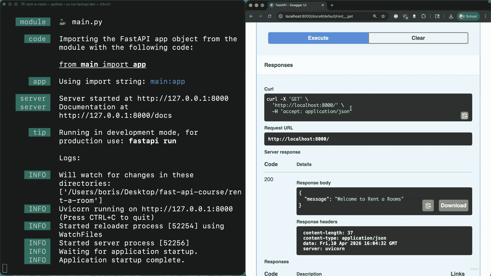
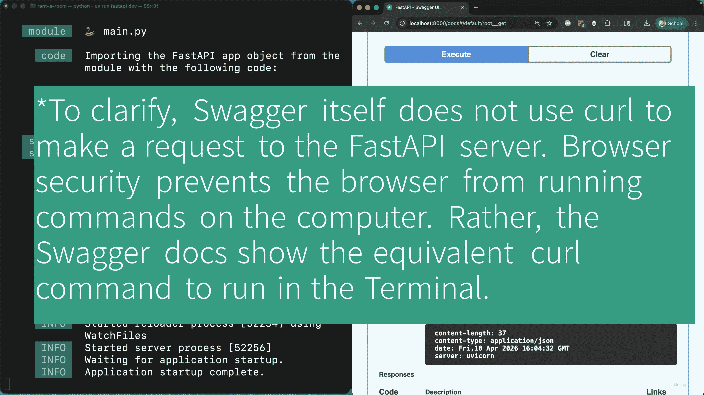
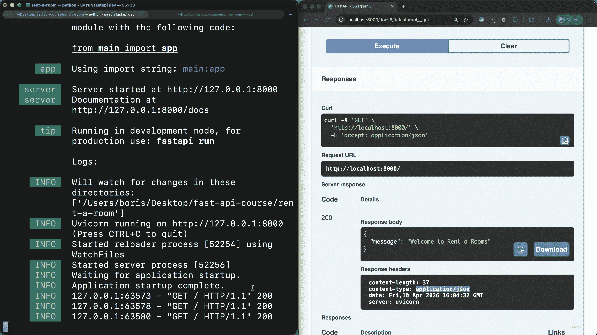

# 🚀 FastAPI 大师课：第15-16节：curl 命令

## 📚 FastAPI 大师课：第15-16节：课程概述

在本节课中我们将要学习 FastAPI 文档页面里出现的 curl 命令，以及如何使用它在终端中发起 HTTP 请求。上一课我们通过 Swagger 文档页面向根路由发出请求时，页面中出现了一段以 curl 开头的区域，本节课就把这段内容讲清楚。curl 看起来像一条普通命令，但它背后连接的是客户端、服务器、请求和响应这一整套流程。为了让初学者更容易理解，我们会把命令拆开，用大白话解释每个部分的作用。

有了这个整体印象之后，下一节我们来看看 curl 到底是什么工具，以及它为什么在终端里也能发起 HTTP 请求。

## 🧰 FastAPI 大师课：第15-16节：curl 是什么

上一节我们说明了本节课的学习目标，本节中我们来看看 curl 的基本定位。curl 是一个命令行工具，也就是一段在终端里运行的软件，它可以替我们发出 HTTP 请求。这个工具在 macOS、Linux 和 Windows 上通常已经预装，在现代版本的 PowerShell 里也可以使用。换句话说，curl 不是浏览器专属的功能，它本身就是一种客户端工具。

从核心概念上看，可以这样理解 curl 和请求响应流程：

```text
curl = 在终端中发起 HTTP 请求的命令行工具
客户端 --HTTP 请求--> 服务器 --HTTP 响应--> 客户端
```

在 Swagger 文档页面里看到的那段 curl 内容，就是与浏览器中发出的请求相对应的实际命令。浏览器点击按钮能发请求，curl 在终端里也能发请求，只是使用的入口不同。明白了 curl 的定位之后，下一节我们看看怎样把 Swagger 页面里的 curl 命令复制到终端里执行。





## 🖥️ FastAPI 大师课：第15-16节：复制 curl 命令并在终端执行

上一节我们认识了 curl，本节中我们来看看如何复制命令并在终端中运行。Swagger 文档页面里有一个按钮，点击它会把 curl 文本复制到剪贴板，之后就可以打开另一个终端窗格来执行。在 Mac 上可以用 Command+T 打开新的终端窗格，在 Windows 上可以打开新的 PowerShell 窗口，或者使用你正在使用的其他终端应用。

在终端里复制并执行 curl 命令时，可以按下面几个步骤操作。以下是具体步骤：

1. 在 Swagger 文档页面点击复制按钮，把 curl 命令复制到剪贴板。

2. 在 Mac 上按 Command+T 打开新的终端窗格，在 Windows 上打开新的 PowerShell 窗口或终端应用。

3. 保持 FastAPI 服务器在后台继续运行，因为服务器才是响应客户端请求的一方。

4. 让服务器运行在一个终端标签页或窗格里，然后在另一个窗格里粘贴刚才复制的 curl 命令。

5. 执行命令后，终端会显示与浏览器请求相同的响应内容。

执行完成后，我们会看到相同的响应消息，其中包含“欢迎来到租房服务”这样的内容。这里的重点是，curl 命令会向同一个端点发出请求，所以返回结果与 Swagger 页面里的请求一致。成功执行命令之后，下一节我们把这条命令拆开，看看每个部分分别负责什么。

## 🔍 FastAPI 大师课：第15-16节：拆解 curl 命令

上一节我们已经把 curl 命令跑起来了，本节中我们来看看命令的组成。一条 curl 命令虽然看起来有点长，但可以拆成几个清晰的部分。下面给出一个结构类似的示例，帮助理解原文中提到的各个参数：

```bash
curl -X GET "http://localhost:8000/" \
  -H "Accept: application/json"
```

下面把这条 curl 命令拆成几个部分来看。以下是各部分的含义：

1. `-X` 用来设置 HTTP 动词，也就是请求的类型，这里可以看到字符串形式的 GET 请求。

2. 反斜杠 `\` 允许命令在终端里换行，因为终端默认会把回车键理解为命令结束，使用反斜杠表示同一条命令还在继续。

3. URL 中的 `localhost` 表示本机，也就是我们自己的电脑，后面跟着端口和实际路径，示例中的路径是根路径 `/`。

4. `-H` 是 header 的缩写，表示请求头，它附加在请求上，而不是附加在响应上。

5. 请求头里的 `Accept: application/json` 表示客户端希望服务器以 JSON 格式返回数据。

6. 命令结尾还可以继续使用反斜杠换行，把更多参数接在同一条命令后面。

搞清楚命令结构后，下一节我们重点看看请求头和响应头这对搭档，以及它们如何配合完成数据格式的约定。

## 🧾 FastAPI 大师课：第15-16节：请求头与响应头

上一节我们拆解了 curl 命令，本节中我们来看看请求头和响应头。上一课提到过，header 是键值对，也可以理解为一段元数据，它用来描述请求或响应的一些附加信息。在 curl 命令里，`-H` 添加的是请求头，它附着在客户端发出的请求上，而不是服务器返回的响应上。

为了更清楚地理解头部字段，下面把它们的作用列出来。以下是请求头与响应头的关键点：

1. 请求头的基本形式是键值对，可以写成 `键: 值`。

2. `Accept: application/json` 是客户端在说，自己愿意接受 JSON 格式的响应数据。

3. `Content-Type: application/json` 是响应头，它在说服务器确实以 JSON 格式返回数据。

4. 这两个头部是互补关系，一个表达客户端希望接收什么格式，另一个表达服务器实际返回什么格式。

可以用下面的公式概括头部字段：

```text
请求头 = 键: 值
Accept: application/json
响应头 Content-Type: application/json
```

curl 命令还有很多定制方式，例如加入请求体 payload、修改 HTTP 动词、配置各种请求设置。理解了请求头与响应头之后，下一节我们回到更宏观的客户端与服务器关系，看看谁在发请求、谁在回响应。

## 🔄 FastAPI 大师课：第15-16节：客户端与服务器的关系

上一节我们看了头部信息，本节中我们来看看客户端和服务器的分工。关键点是，客户端可以是很多种不同的应用，它可以是网页浏览器，可以是手机应用，也可以是终端里的 curl 命令。无论客户端长什么样，本质都一样：客户端是发起请求的一方，它向某个服务器的某个端点发出请求，服务器再针对这个请求返回响应。

客户端并不只限于浏览器，它可以有多种形态，下面列出几种常见形态。以下是客户端的常见例子：

1. 网页浏览器，例如打开 Swagger 文档页面并点击请求按钮的浏览器。

2. 手机应用，它同样可以向服务器端点发起请求。

3. 终端工具，例如 curl，它在命令行里完成 HTTP 请求。

这些客户端做的事情本质一致，都是向服务器发起请求并等待响应。可以用下面的公式表示这个过程：

```text
客户端（浏览器/手机应用/终端） -> 请求 -> 服务器（FastAPI 路由处理函数） -> 响应 -> 客户端
```

明白了客户端和服务器的关系后，下一节我们回到 FastAPI 服务端，看看请求如何出现在服务器日志里。

## 📝 FastAPI 大师课：第15-16节：在服务器日志中观察请求

上一节我们建立了客户端与服务器的整体认识，本节中我们看看服务器端日志如何记录请求。在终端里按上方向键，可以重复执行刚才的 curl 请求多次，然后回到运行 FastAPI 的服务器窗格，就能看到这些请求都被列了出来。这个现象说明，请求无论来自哪里，服务器都会接收并处理。

当请求到达 FastAPI 服务端时，服务端会按照下面的大致流程处理。以下是服务端处理请求的关键步骤：

1. 服务器接收所有到达的流量，不管客户端是浏览器、手机应用还是终端。

2. 服务器把请求路由到合适的路由处理函数。

3. 路由处理函数执行完成后，服务器返回合适的响应。

4. 这些请求也会出现在服务器日志里，方便观察请求是否到达。

可以用下面的代码形式概括日志中看到的结果：

```text
GET / -> 200 OK
```

也就是说，客户端来自哪里并不重要，请求来自哪里也不重要，服务器会接收流量、进行路由、调用对应的处理函数，并把响应发回去。到这里，curl 命令和请求响应流程已经串起来了，下一节我们做一个小结。

## ✅ FastAPI 大师课：第15-16节：课程总结

前面几节我们分别看了 curl、命令结构、头部信息和服务器日志，本节中我们对整节课做一个总结。本节课中我们一起学习了 curl 是一个在终端里发起 HTTP 请求的命令行工具，它通常预装在 macOS、Linux 和 Windows 上，在现代 PowerShell 中也可以使用。我们还学习了如何从 Swagger 文档页面复制 curl 命令，在另一个终端窗格中执行，并看到与浏览器请求相同的响应。



同时，我们拆解了 curl 命令中的 `-X`、反斜杠换行、URL、`-H` 请求头等部分，理解了 `Accept: application/json` 与响应头 `Content-Type: application/json` 的配合关系。最后我们回到客户端与服务器的整体流程，明确了客户端可以是浏览器、手机应用或终端，服务器负责接收请求、路由到处理函数并返回响应。通过服务器日志还能看到，所有请求都会被记录和处理，客户端来源不会改变这套基本流程。

