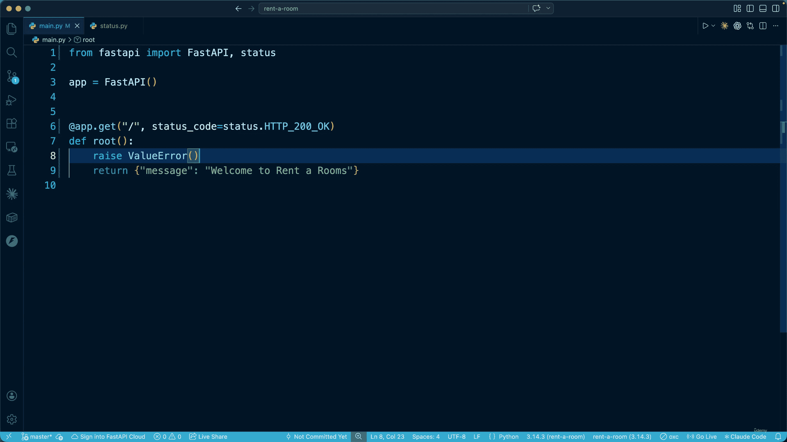
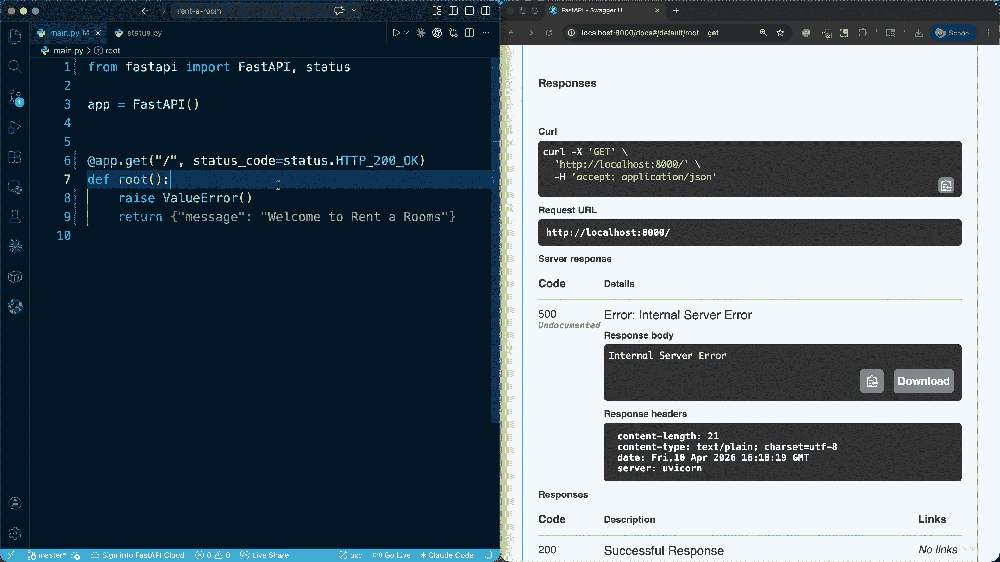
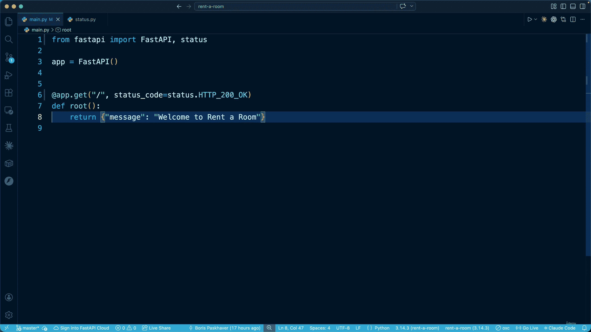

# 🚀 FastAPI 大师课：17：声明路由状态码

在本节课中我们将要学习 FastAPI 中如何声明路由状态码。一个成功的 GET 请求应该返回状态码 `200`，而 FastAPI 对使用 `@app.get(...)` 创建的路由会自动返回这个 `200`。我们还会学习如何通过 `status_code` 参数把成功预期状态码显式写出来，如何用 `status` 模块里的常量代替直接写数字，最后通过一个刻意构造的错误示例观察服务器返回 `500` 内部服务器错误的过程。整节课从默认行为讲到显式声明，再到错误响应，最后清理示例并恢复根路径返回内容。

**✅ 成功响应的默认状态码**

先看 FastAPI 的默认行为。一个成功的 GET 请求应该返回状态码 `200`，这正是 FastAPI 为使用 `get` 方法创建的路由自动返回的状态码。也就是说，在最简单的写法里，我们不需要额外声明状态码，框架已经帮我们处理了成功响应的默认值。可以把它理解为下面这段代码背后的默认约定：

```python
@app.get("/")
def root():
    ...
```

上面的路由在成功执行时，响应状态码就是 `200`。理解了这个默认行为之后，下一步我们来看看如何把预期成功状态码显式写到路由声明中。

**📌 显式声明成功状态码**

如果希望把成功响应的预期状态码写清楚，可以在 `@app.get` 的第一个字符串参数后面加一个逗号和一个空格，再添加名为 `status_code` 的参数，并把值设为 `200`。代码形式如下：

```python
@app.get("/", status_code=200)
def root():
    ...
```

这里的 `status_code` 表示一切正常、成功执行时预期的状态码。需要注意，一个路由也可能失败，因此它可能返回多个不同状态码；我们在这里提供的是成功情况下的状态码。简单说，这个参数描述的是“事情顺利时应该返回什么”，而不是所有可能情况的状态码集合。理解了显式写数字的方式后，本节我们来看看如何避免记忆这些数字。

**🧩 使用 status 模块提升可读性**

如果不想记住所有状态码数字，可以从 FastAPI 导入一个补充模块 `status`。导入写法如下：

```python
from fastapi import FastAPI, status
```

按住 Command 点击进入这个模块，会看到名为 `status.py` 的文件。这个文件并不原本位于 FastAPI 中，而是位于 Starlette 中，Starlette 是 FastAPI 的底层依赖。向下滚动会看到大量已经声明好的常量。这些常量可以按下面的规则理解：

- 常量都以 `HTTP_` 开头。
- 后面跟具体状态码和名称，例如 `HTTP_200_OK`。
- `200` 对应的常量值就是实际的数字状态码 `200`。
- 常量名称提供了额外上下文，说明状态码代表什么含义。

这样做的价值在于可读性更好。回到 `main.py` 后，可以把原来的 `200` 换成 `status.HTTP_200_OK`，代码形式如下：

```python
@app.get("/", status_code=status.HTTP_200_OK)
def root():
    ...
```

这个常量等价于数字 `200`，可以写成：

```python
status.HTTP_200_OK == 200
```

使用常量是一种方便的简写方式，能够实现与直接写数字完全相同的结果。状态码声明部分已经清楚，接下来我们通过一个构造示例观察失败响应。

**⚠️ 观察失败响应：500 内部服务器错误**

这里借机展示失败或错误在服务器上是什么样子。我们会在根函数体里构造一个示例：使用 Python 的 `raise` 关键字，后面跟语言中可用的错误类 `ValueError`，并用一对括号实例化它。代码形式如下：

```python
@app.get("/", status_code=status.HTTP_200_OK)
def root():
    raise ValueError()
```



这段代码手动且故意触发一个异常。保存后服务器会重启，然后回到浏览器。通常不需要刷新实际文档页面，但如果看不到预期结果，建议不时刷新一次以防万一。再次点击根路由的 Try it out，再点击 Execute 执行，会在第 8 行遇到问题。向下滚动可以看到，返回的不是预期中表示成功或 OK 的 `200` 状态码，而是 `500` 响应，表示服务器错误。`500` 称为内部服务器错误代码，表示服务器端出现了问题。现实世界中，代码逻辑错误、拼写错误、变量不存在或其他问题都可能导致这种情况。这个构造示例说明了 `status_code` 参数表示的是成功情况下的预期状态码；当前我们还不去声明所有错误情况的状态码，但确实有方式提供这些信息，而且这些信息也会进入右侧生成的 Swagger 文档。演示完成后，我们回到代码清理示例并恢复正式名称。

**🧹 清理示例并恢复根路径返回**

回到代码后删除 `raise ValueError()` 这一行，同时借这个机会把根路由返回内容改回 `Welcome to rent room`，因为这是 startup 的官方名称。最终代码可以写成：

```python
from fastapi import FastAPI, status

app = FastAPI()

@app.get("/", status_code=status.HTTP_200_OK)
def root():
    return {"message": "Welcome to rent room"}
```

到这里，本课主体内容覆盖完成。接下来用一份简短清单回看重点。

**📝 总结**

本节课中我们一起学习了 FastAPI 中声明路由状态码的完整流程。在收尾部分，用一份简短清单回看本课要点：

- FastAPI 对 GET 路由的成功响应默认返回 `200`。
- 可以通过 `status_code` 参数显式声明成功预期状态码。
- 使用 `status.HTTP_200_OK` 常量可以替代数字 `200`，其值为 `200`。
- 手动触发异常可以观察服务器返回 `500` 内部服务器错误。
- `status_code` 描述成功情况，错误状态码信息可以在后续用其他方式声明，并进入 Swagger 文档。
- 最后删除演示异常，并把根路径返回恢复为 `Welcome to rent room`。





以上就是本课全部内容，本课从默认 `200` 状态码讲到显式声明、状态码常量、失败响应和代码清理，覆盖了声明路由状态码的主要知识点。

