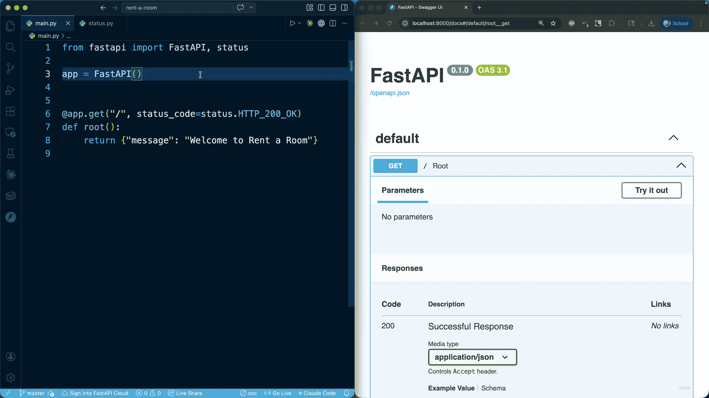
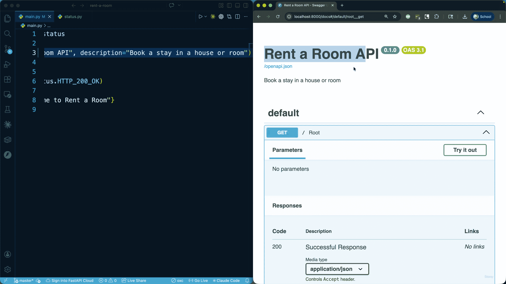
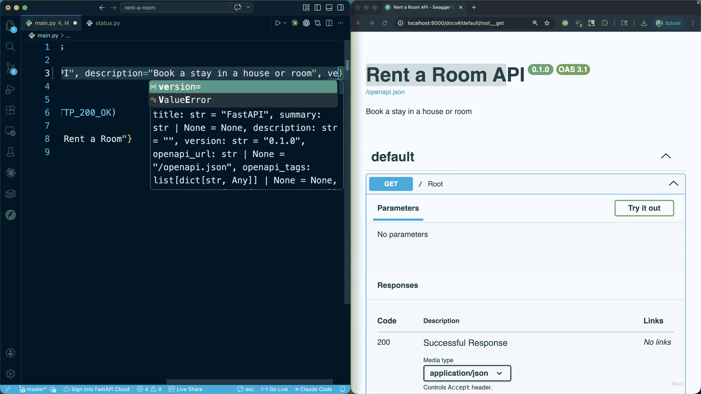
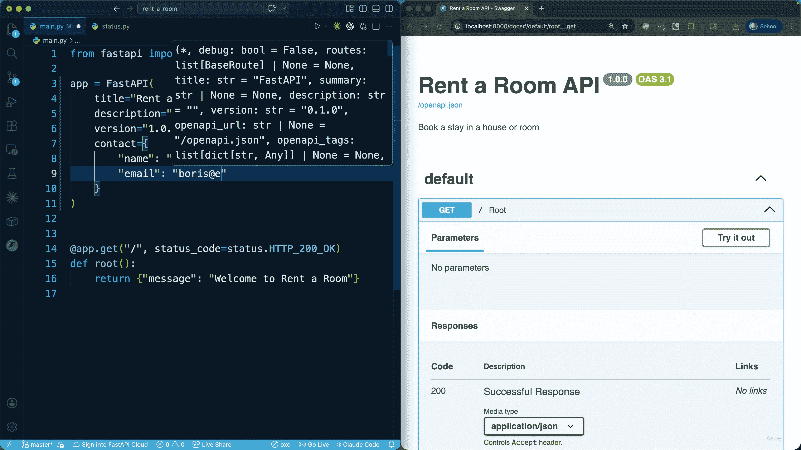
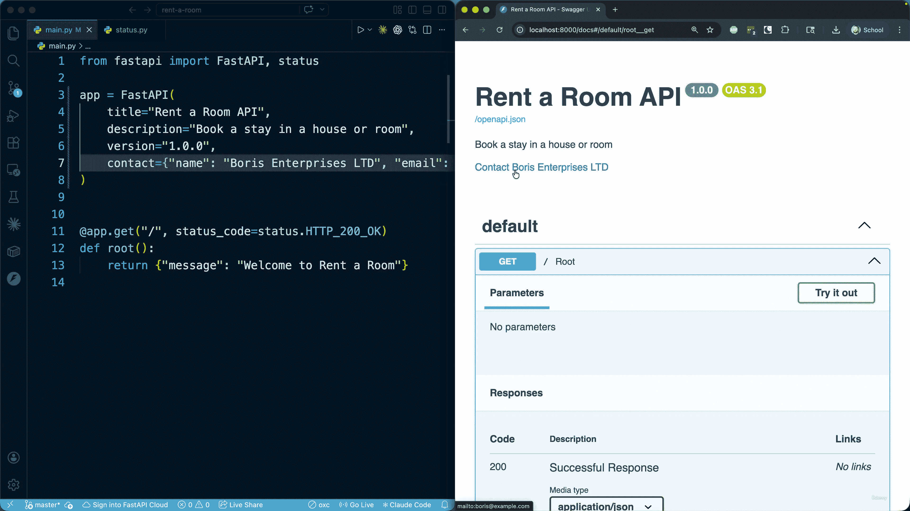

# FastAPI 大师课：第17节：自定义 Swagger 文档 🛠️

在本节课中，我们将要学习如何给 FastAPI 构造函数传入一些附加参数，从而自定义 FastAPI 自动生成的 Swagger 文档。整体思路可以用下面的公式概括：

`Swagger 文档信息 = FastAPI(title=..., description=..., version=..., contact=...)`



这些参数主要影响文档的展示信息，不会改变接口本身的业务逻辑。真实项目中，Swagger 文档常常是外部调用方了解接口的第一入口，因此把项目名称、说明、版本和联系人信息写清楚，可以减少沟通成本。下面先列出本节课会用到的四个常用参数，方便后续逐一说明。

- `title`：修改 API 文档右上角显示的文本。

- `description`：在文档标题下方显示描述。

- `version`：修改文档中显示的版本号。

- `contact`：提供 API 运行者的联系信息，值是一个 Python 字典。

## FastAPI 大师课：第17.1节：参数入口与整体效果 🚪

上一段我们列出了四个参数，本节中我们来看看它们传入的位置以及整体效果。原文的做法是直接在 FastAPI 构造函数中提供关键字参数，先写 `title`，再补充其他参数。下面是一段集中示例代码，后面会分别解释每个参数。

```python
from fastapi import FastAPI

app = FastAPI(
    title="我的租房 API",
    description="在这里住一间房或一套房",
    version="1.0.0",
    contact={
        "name": "Boris Enterpris LTD",
        "email": "Boris@exle.com",
    },
)
```



这段代码展示了所有参数放在一起的样子。实际使用时可以一次传入全部参数，也可以按需只传其中一部分。接下来我们按照原文顺序，先看标题和描述带来的页面变化。



## FastAPI 大师课：第17.2节：自定义标题和描述 📝

上一节我们看到了参数入口，本节中我们来看看 `title` 和 `description` 这两个最直观的参数。`title` 会改变 API 文档右上角看到的文本，原文示例把标题设置为“我的租房 API”。`description` 则用于提供描述，原文示例把它设置为类似“在这里住一间房或一套房”的内容。这样刷新文档页面后，标题会显示在顶部右上区域，描述会紧接着显示在标题下方。

需要说明的是，当修改这些参数并保存代码后，FastAPI 服务器会自动注册变化并重启服务器。不过，文档页面本身仍然需要手动刷新，因为要重新向 docs 页面发起一次请求，才能看到新的输出。刷新之后，页面顶部可以看到“我的租房 API”，标题下方可以看到刚才设置的描述。这个步骤不复杂，但很容易被忽略，尤其是在本地开发时看到服务器自动重启后，仍要记得刷新浏览器页面。



## FastAPI 大师课：第17.3节：自定义版本号 🔢

标题和描述设置完成后，文档上还有版本号可以调整，本节中我们来看看 `version` 参数。版本号就是文档页面中显示的那个数字，原文示例继续添加一个 `version` 参数，并把它的值设置为字符串 `"1.0.0"`。这个值完全可以根据项目需要任意设置，不必局限于原文示例。刷新页面后，文档中就会显示 `1.0.0`。

版本号的作用是让文档阅读者快速知道当前接口文档对应的版本。虽然原文示例使用的是任意值，但在正式项目中通常会按照团队的版本管理规则填写。这里的重点不是版本号的具体数字，而是知道可以通过 `version` 参数控制文档中的版本显示。

## FastAPI 大师课：第17.4节：联系人信息与公开 API 场景 📬

版本号之后，文档还可以展示联系人信息，本节中我们来看看 `contact` 参数以及它适合的使用场景。`contact` 用来提供运行 API 的人的联系信息，它的值是一个 Python 字典，这个字典支持多种不同的键值对。原文示例使用了两个键：`name` 和 `email`。其中，`name` 表示创建 API 的人或公司名称，示例写为“Boris Enterpris LTD”；`email` 表示联系邮箱，示例写为 `Boris@exle.com`。这些值都可以替换成任意需要的内容。

保存这些信息并查看页面后，文档中会出现一个“contact Boris Enterpris LTD”按钮。点击这个按钮，会打开用户默认的邮件客户端，例如 Gmail 或 Outlook，并自动创建一封草稿邮件，草稿邮件的收件人会填为 Boris 的示例邮箱。这个功能适合把 Swagger 文档公开出去的场景：如果你的 FastAPI 服务器要作为公共 API 暴露这些端点，而不是只供公司内部应用或内部产品使用，那么通常希望把联系信息放在文档上。这样公司外部的不同客户端在请求 FastAPI 服务器并获取数据时，遇到问题就可以联系你，告诉你哪里出错、哪里效率不高，或者反馈其他情况。

## FastAPI 大师课：第17.5节：总结与回顾 ✅

到这里，本节课的主要参数已经介绍完毕，本节我们对整节课的内容做一个收束。本节课中我们一起学习了如何自定义 Swagger 文档信息：只需要给 FastAPI 构造函数提供附加参数，就可以修改文档标题、描述、版本号和联系人信息。核心做法仍然是下面这行代码所表达的结构：

`FastAPI(title=..., description=..., version=..., contact={...})`



回顾整个过程，`title` 控制文档右上角标题，`description` 控制标题下方的说明，`version` 控制文档显示的版本号，`contact` 通过 Python 字典提供联系人和邮箱。修改参数后，FastAPI 服务器会自动注册变化并重启，但 docs 页面需要手动刷新才能看到最新输出。如果 API 面向公司外部公开，联系人信息尤其有用，因为外部调用方可以通过文档中的按钮快速发邮件反馈问题。以上就是自定义 Swagger 文档信息的完整做法。

