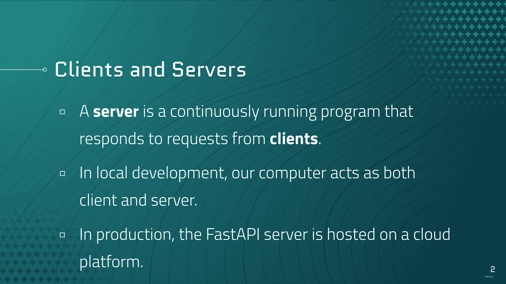
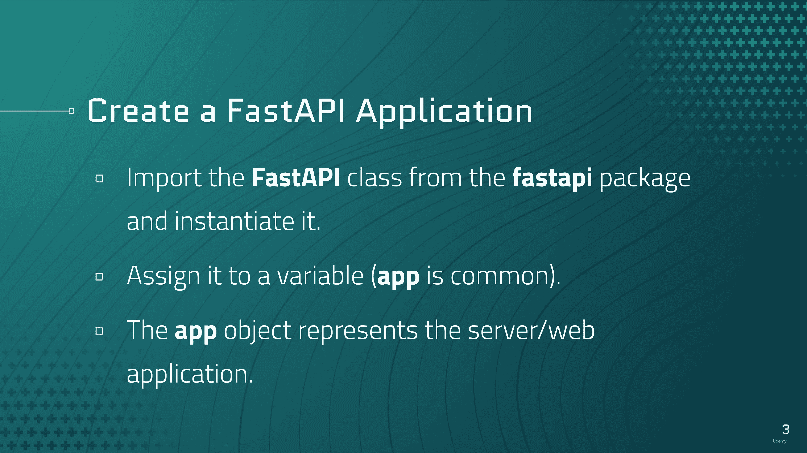
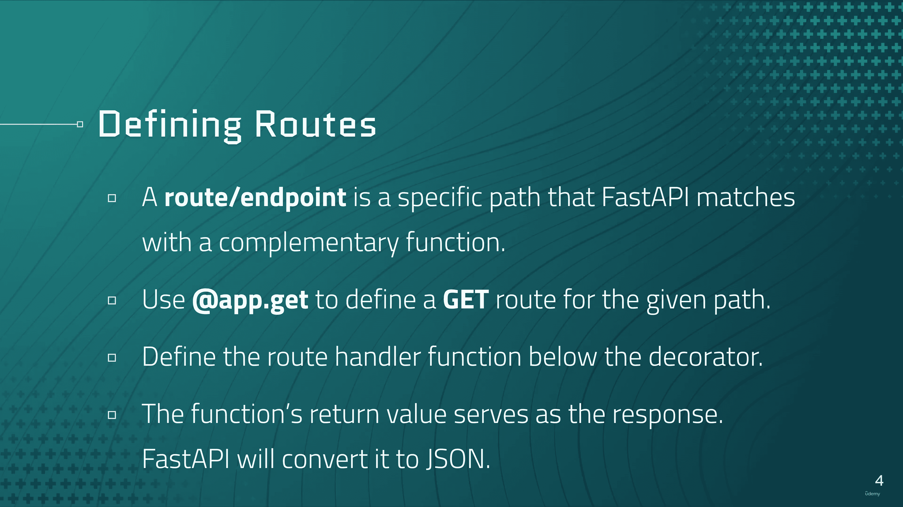
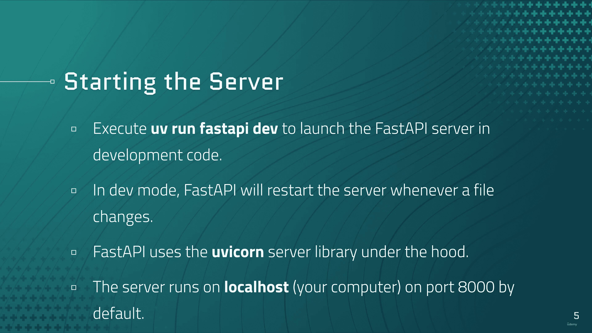
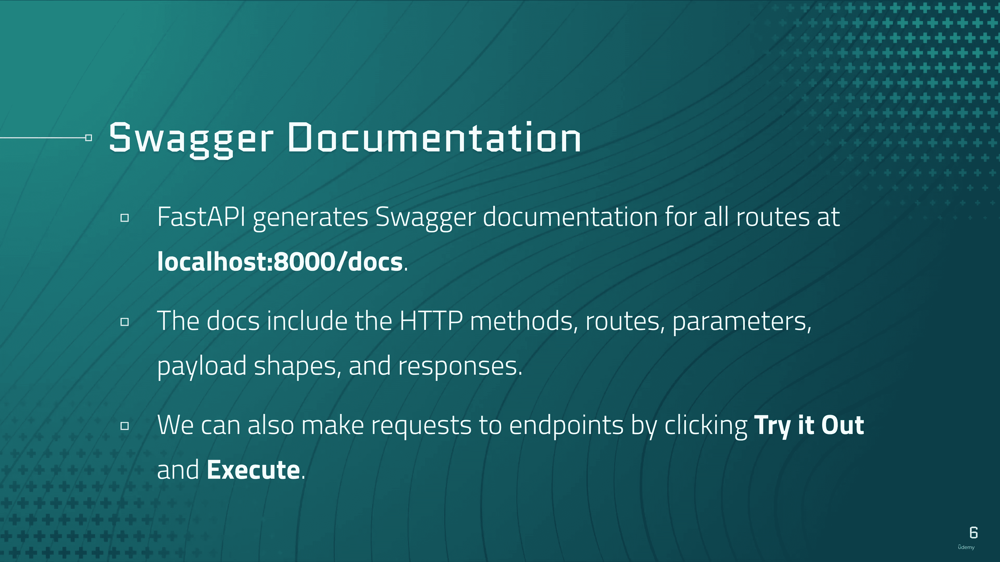
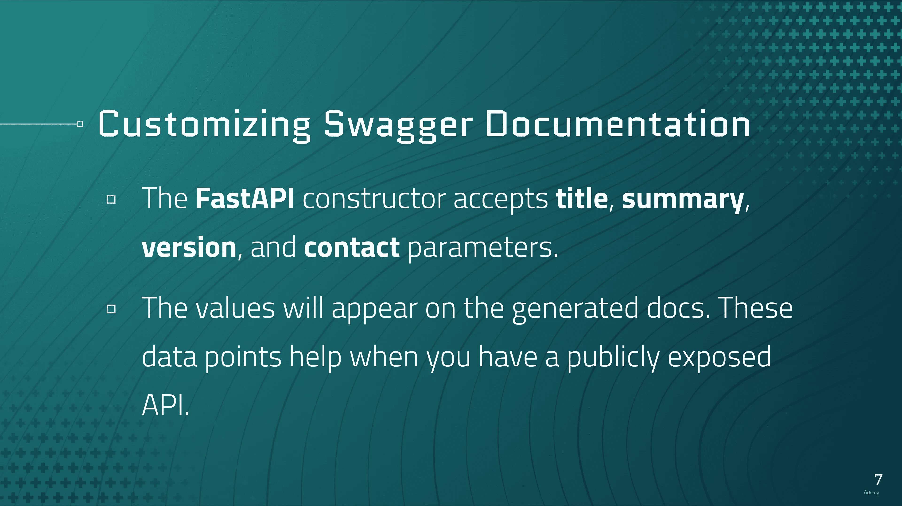
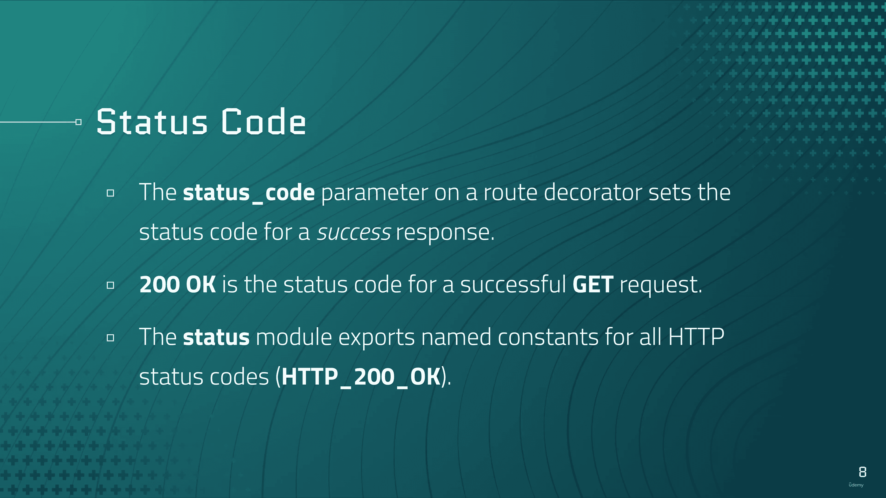

# 🚀 FastAPI 大师课：第一部分：章节复习


在本节课中我们将要学习 FastAPI 大师课第一部分的章节复习。欢迎来到课程第一部分的章节复习。这些复习视频位于每节末尾，完全可选，作用是把前面介绍过的概念做一次快速总结。如果你已经掌握主题，可以跳过；如果想快速复习，可以继续阅读。复习不会引入新内容，而是把服务器、路由、应用创建、启动方式、Swagger 文档和状态码串起来，帮助初学者形成整体图景。这些概念看起来基础，但它们是后面所有接口代码的骨架，先建立清晰模型能减少很多困惑。下面从服务器与客户端开始。


## 🖥️ FastAPI 大师课：第 1.1 节：服务器与客户端


上一段概述了复习范围，本节中我们来看看服务器与客户端。我们先从最基础的角色开始。服务器和客户端不是抽象名词，它们本质上都是计算机，只是承担不同职责。为了直白理解，可以把二者关系写成下面的代码形式。


```
客户端  --请求-->  服务器
客户端  <--响应--  服务器
```


服务器是持续运行的程序，本例中用 Python 编写，始终在线并响应客户端请求。客户端是发出请求的一方，可能是本地电脑，也可能是手机或手机后台应用。服务器在互联网上接收请求并返回数据。开发应用时，本地电脑通常同时充当客户端和服务器；部署到生产环境时，FastAPI 应用会托管在 AWS 或 GCP 等云平台，并响应来自全球的客户端。以下是本节需要记住的服务器与客户端要点。


- 服务器是持续运行的程序，用 Python 编写，始终在线响应客户端请求。
- 服务器和客户端本质上都是计算机，通过请求和响应进行通信。
- 客户端可以是本地电脑、手机或手机后台应用，负责发出请求。
- 服务器在互联网上接收请求并返回数据。
- 开发应用时，电脑通常同时充当客户端和服务器。
- 部署生产环境时，应用托管在云平台，并响应全球客户端。


这些角色区分在后续写接口时很重要，因为每次访问接口都对应一次客户端请求和服务器响应。理解了角色后，下一步就是创建 FastAPI 应用。


## 🧱 FastAPI 大师课：第 1.2 节：创建 FastAPI 应用




上一节我们介绍了服务器和客户端，本节中我们来看看如何创建 FastAPI 应用。创建应用的基础步骤很直接：在一个普通 Python 文件 `main.py` 中导入 `FastAPI` 类，实例化后赋给变量 `app`。代码如下。


```python
from fastapi import FastAPI

app = FastAPI()
```




这里的 `app` 是很常见的变量名，可以把它理解为完整的 FastAPI 服务器或 Web 应用对象。后续路由、文档配置和启动命令都围绕它展开。以下是创建应用时需要记住的要点。


- 从 `fastapi` 包中导入 `FastAPI` 类。
- 在 `main.py` 这类普通 Python 文件中实例化 `FastAPI`。
- 把实例赋给变量 `app` 是常见写法。
- `app` 对象代表完整的 FastAPI 服务器或 Web 应用。


应用对象准备好后，还需要给它定义访问路径，也就是路由和端点，所以下一步进入路由部分。


## 🛣️ FastAPI 大师课：第 1.3 节：路由与端点


上一节我们创建了 `app` 对象，本节中我们来看看路由与端点。路由或端点是一个具体路径，例如 `/product` 或 `/users`，FastAPI 会把它与一个普通 Python 函数匹配。定义 GET 请求时，在 `app` 对象上调用 `get` 方法，会得到装饰器，再用 `@` 放在路由处理函数上方。代码如下。


```python
@app.get("/products")
def get_products():
    return {"message": "产品列表"}
```


GET 请求用于获取资源。装饰器参数是字符串，表示实际路由或端点。客户端请求该端点时，FastAPI 会执行对应函数，函数返回值会作为响应发回客户端。默认情况下，FastAPI 会把返回值转换为 JSON。可以返回普通 Python 字符串、数字、列表或字典，FastAPI 都会转换为等价的 JSON 表示。以下是路由与端点的关键点。




- 路由或端点是 `/product`、`/users` 这样的具体路径。
- FastAPI 会把路径与普通 Python 函数匹配。
- GET 请求用于获取资源，通过 `app.get` 定义。
- `app.get` 返回装饰器，用 `@` 放在处理函数上方。
- 装饰器参数是表示实际路由或端点的字符串。
- 客户端请求端点时执行函数，返回值作为响应。
- 默认把返回值转换为 JSON；字符串、数字、列表、字典都会转换为等价 JSON。


路由让应用有了可访问入口，但代码写完后还要启动服务器，所以下一节看启动方式和开发与生产模式。


## ▶️ FastAPI 大师课：第 1.4 节：启动服务器与开发生产模式


上一节我们定义了路由，本节中我们来看看如何启动服务器以及开发模式与生产模式的区别。代码写好后，进入项目并执行下面的命令。


```bash
uv run fastapi dev
```


`uv run` 会使用项目虚拟环境中本地安装或可用的 Python 版本来运行 `fastapi` 命令，从而启动服务器，关键字 `dev` 表示开发模式。生产模式对应的命令如下。


```bash
fastapi run
```


开发模式针对软件开发者优化：在编辑器中修改并保存代码后，运行中的服务器会观察变化并自动重启，使修改在访问端点时立即生效。生产模式针对最终用户或客户端优化，目标是提供更高效的响应等。底层上，FastAPI 建立在 Python 生态的多种库之上，其中 Uvicorn 是实际的底层服务器，FastAPI 是其上的附加层，可以表示为下面的结构。


```
FastAPI（应用层）
        ↓
Uvicorn（底层服务器）
```


本地开发时，服务器运行在本机，本机称为 `localhost`。在浏览器中访问 `localhost`，再写冒号和端口。端口可以理解为计算机上某个应用的设计标识，因为同一台计算机可能同时运行多个持续运行的服务器。FastAPI 服务器默认运行在 8000 端口，因此常见地址是 `localhost:8000`。以下是启动与运行要点。


- 使用 `uv run fastapi dev` 在开发模式启动服务器。
- `uv run` 使用项目虚拟环境中的 Python 运行 `fastapi` 命令。
- `dev` 表示开发模式；生产模式使用 `fastapi run`。
- 开发模式优化开发者体验，保存代码后自动重启。
- 生产模式优化最终用户或客户端体验，追求高效响应。
- FastAPI 底层使用 Uvicorn 作为实际服务器，FastAPI 是其上层。
- 本地开发服务器在本机 `localhost` 运行，端口是应用标识。
- 默认端口是 8000，地址通常为 `localhost:8000`。


服务器启动后，FastAPI 还会带来一个很实用的功能，即自动生成 Swagger 文档，下一节详细看。


## 📚 FastAPI 大师课：第 1.5 节：Swagger 自动文档




上一节我们启动了服务器，本节中我们来看看自动生成的 Swagger 文档。自动生成文档是 FastAPI 的主要卖点之一：写代码后，文档会自动生成。访问 FastAPI 添加的特殊路由 `/docs` 即可查看。


```
http://localhost:8000/docs
```


在文档页面可以看到所有端点、对应 HTTP 方法、路由、端点接受的参数，以及预期的数据载荷，包括发往服务器的数据和返回客户端的数据。这些内容会在后续章节详细讲。最有趣的功能是可以从 Swagger 文档直接请求任意端点：找到端点，点击 Try it out，再点击 Execute，文档会直接向该端点发请求。以下是 Swagger 文档要点。


- 自动生成 Swagger 文档是 FastAPI 的主要卖点之一。
- 写代码即可自动生成文档。
- 访问 `/docs` 特殊路由查看文档。
- 文档展示端点、HTTP 方法、路由、参数和预期数据载荷。
- 数据载荷包括发往服务器的数据和返回客户端的数据。
- 可从文档中点击 Try it out 和 Execute 直接请求端点。




文档还可以定制。以下代码展示如何把标题、描述、版本号和联系信息传给 FastAPI 类实例化。


```python
app = FastAPI(
    title="我的 API",
    description="API 说明",
    version="1.0.0",
    contact={"name": "维护者", "email": "dev@example.com"},
)
```


以下是文档定制与公开 API 的要点。


- 可定制标题、描述、版本号和联系信息。
- 这些参数直接传给 FastAPI 类实例化，并显示在生成文档中。
- 如果构建公开 API，这些信息对客户或外部使用者很有帮助。
- 还可用更高级方式修改配色和文字颜色，本课程不深入。
- 可以用 FastAPI 和 Swagger 按业务与品牌进行定制。


文档配置让接口更易用，而响应中还有状态码用于概括结果，下一节看状态码。


## 🏷️ FastAPI 大师课：第 1.6 节：状态码


上一节我们看了 Swagger 文档，本节中我们来看看状态码。状态码是响应上的数字标识，概括请求处理结果。例如发起 GET 请求，服务器想表达成功找到请求资源并返回，状态码是 200，对应名称 OK。公式如下。




```
GET 请求成功 + 找到资源 + 返回资源 => 200 OK
```


开发者说返回 200、返回 OK 或返回 200 OK，意思完全相同，都是服务器响应的数字状态。为了不手写数字，可以从 `fastapi` 导入 `status` 模块；它实际上是 `starlette` 中某个文件的再导出。`status` 模块列出各种状态码常量，数量有几十个。以下是常见状态码与使用方式。


- 200 表示 OK，请求成功。
- 201 表示 Created，资源已创建。
- 500 表示 Internal Server Error，服务器内部错误。
- `status` 模块提供这些常量，不必记住具体数字和名称。


使用 `status` 模块的代码示例如下。


```python
from fastapi import FastAPI, status

app = FastAPI()

@app.get("/items", status_code=status.HTTP_200_OK)
def read_items():
    return []
```


这样写可以直接引用常量，所有状态码都在模块中整齐列出。状态码让客户端快速理解响应结果，是接口设计中需要养成的习惯。到这里，本节复习的主要概念已经串联起来。


## ✅ FastAPI 大师课：第一部分：总结




本节课中我们一起学习了 FastAPI 第一部分的核心内容：服务器与客户端、创建应用、定义路由与端点、启动服务器、开发与生产模式、Swagger 自动文档以及状态码。现在我们已经有一个基本 FastAPI 应用和一个运行中的路由。下一节会在这个基础上继续扩展复杂度。复习视频本身完全可选，作用是把前面概念快速串起来；如果已经掌握可以跳过，如果刚刚开始可以把它当作检查清单。通过这些内容，后续写更复杂接口时会更清楚每个对象和命令的用途。
