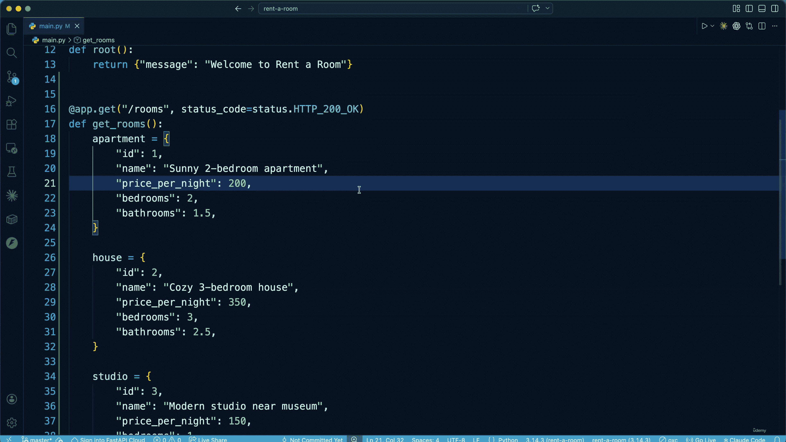
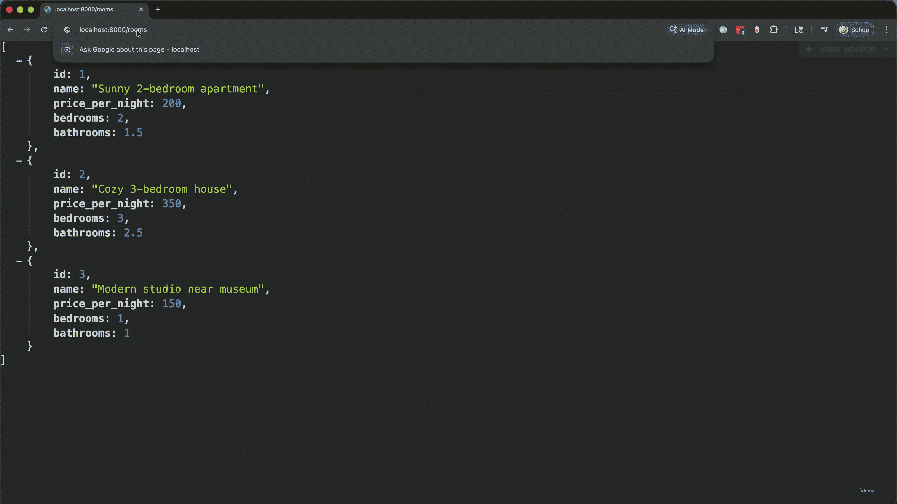
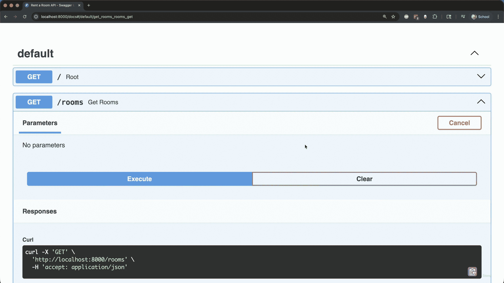
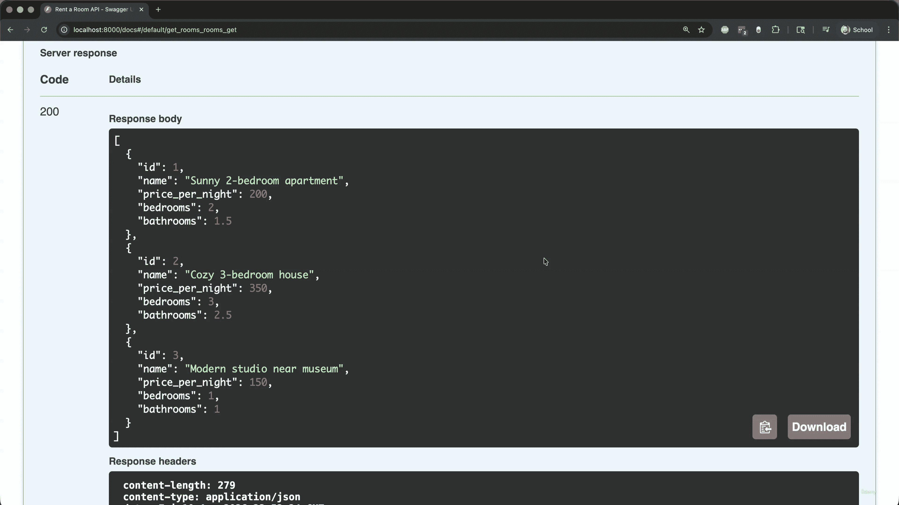

# 🏠 Udemy - FastAPI Masterclass part1：第 19/20 节：为房间定义索引路由

欢迎来到课程的下一节。在本节课中我们将要学习 FastAPI 中关于路由的更多内容，并接触错误处理、静态文件以及路径参数。路径参数可以理解成路径中的自定义片段，也就是路径里可以变化的那一段。本节课的直接目标是给应用再添加一个路由，让它返回房间列表。下面先说明整体目标，再逐步进入代码。

## 🧭 Udemy - FastAPI Masterclass part1：第 19/20 节：本节目标与资源概念

上一部分概述了本节方向，本节中我们来看看“索引路由”和“资源”这两个概念。返回同一类资源多个条目的路由，有时被称为索引路由。可以写成：

```text
GET /rooms → [房间1, 房间2, 房间3]
```

“资源”这个词听起来抽象，说白了就是业务领域中有价值的实体。下面用几个例子说明资源在业务里的含义：

- 在 Airbnb 这类网站中，资源可以是房间、用户或支付方式。
- 通常会有索引端点，用来返回这些资源的集合。

因此，一个返回房间集合的 `/rooms` 路由，就符合索引路由的典型形态。理解这一点后，接下来我们进入代码层面，看看如何把新的 GET 路由挂到应用上。

## 🛠️ Udemy - FastAPI Masterclass part1：第 19/20 节：添加 GET /rooms 路由

上一节我们介绍了索引路由和资源概念，本节中我们来看看怎样新增 `/rooms` 路由。在第一个路由处理器后面加一个换行，然后再次访问 `app` 对象，调用 `get` 方法添加另一个 GET 路由。这个路由可以指向新路径 `/rooms`。同时可以提供 `status_code` 参数，表示响应成功时合理预期返回 200。下面是添加路由时需要做的几个动作：

- 访问 `app` 对象并调用 `get` 方法。
- 把路径写成 `/rooms`。
- 传入 `status_code`，从 `status` 模块取 `HTTP_200_OK` 常量。
- 在装饰器前加 `@` 符号，因为这里返回的是一个装饰器。
- 在装饰器下方定义实际函数，函数名可以叫 `get_rooms`。

核心代码骨架如下：

```python
@app.get("/rooms", status_code=status.HTTP_200_OK)
def get_rooms():
    ...
```

函数名由我们自己决定，FastAPI 会自动把 `/rooms` 这个路由和 GET 请求动词关联到对应函数。函数名最好直接描述函数要做的事情，这样代码更清楚。路由骨架有了，下一步是准备它要返回的数据。本节中我们来看看如何用三个字典模拟房间记录。

## 🧱 Udemy - FastAPI Masterclass part1：第 19/20 节：构造三个模拟房间字典

上一节我们添加了路由骨架，本节中我们来看看函数体里的模拟数据。函数体里要定义三个基本 Python 字典。真实项目中，房间数据通常从数据库获取，数据库是数据长期存放的地方；现在先保持简单，用内联字典充当模拟房间或假房间。后面会过渡到更真实的方式，用配套数据库保存房间再读取。先定义三个变量，第一个是 `apartment`，把它设为一个 Python 字典。每个房间都有五个属性。下面是每个房间字典包含的字段：

- `id`：每个房间唯一的数字标识，这里可以设为 1，反正是任意假数据。
- `name`：房间名称，例如 `"sunny two bedroom apartment"`。
- `price_per_night`：每晚价格，也就是房客支付给房东的费用，例如 200 美元/晚。
- `bedrooms`：卧室数量，例如 2。
- `bathrooms`：浴室数量，例如 1.5。

这些数字和值都可以自由修改，全部是假数据。其他房间的结构相同，属性也一致，所以可以复制 `apartment` 定义两次，再调整记录。第二个变量叫 `house`，`id` 设为 2，名称可以叫 `"cozy three bedroom house"`，每晚价格设为 350，卧室数量为 3，浴室数量为 2.5。第三个变量叫 `studio`，`id` 设为 3，名称可以叫 `"modern studio near museum"`，价格便宜一些，设为 150，卧室数量为 1，浴室数量为 1。到这里，三个房间数据就定义好了。示例字典如下：

```python
apartment = {
    "id": 1,
    "name": "sunny two bedroom apartment",
    "price_per_night": 200,
    "bedrooms": 2,
    "bathrooms": 1.5,
}

house = {
    "id": 2,
    "name": "cozy three bedroom house",
    "price_per_night": 350,
    "bedrooms": 3,
    "bathrooms": 2.5,
}

studio = {
    "id": 3,
    "name": "modern studio near museum",
    "price_per_night": 150,
    "bedrooms": 1,
    "bathrooms": 1,
}
```

需要说明的是，这种内联写法只是示例。服务器关闭或重启后，这些数据只是内存里的 Python 数据，会消失；更准确地说，路由处理函数完成并把数据返回给客户端后，这些局部数据也会结束生命周期。它们不是持久化数据，所以后面才需要数据库。三个字典准备好后，本节中我们来看看如何把它们组成列表返回，并到浏览器和 Swagger 文档中验证接口。

## 🔁 Udemy - FastAPI Masterclass part1：第 19/20 节：返回房间列表并测试接口

上一节我们构造了三个房间字典，本节中我们来看看如何指定响应内容。在函数下方使用 `return` 关键字，创建一个 Python 列表，把上面的 `apartment`、`house`、`studio` 三个条目放进去。保存代码后，应用就应该有一个新的 `/rooms` 端点。返回列表的核心写法如下：

```python
return [apartment, house, studio]
```

完整函数可以写成：

```python
@app.get("/rooms", status_code=status.HTTP_200_OK)
def get_rooms():
    apartment = {
        "id": 1,
        "name": "sunny two bedroom apartment",
        "price_per_night": 200,
        "bedrooms": 2,
        "bathrooms": 1.5,
    }
    house = {
        "id": 2,
        "name": "cozy three bedroom house",
        "price_per_night": 350,
        "bedrooms": 3,
        "bathrooms": 2.5,
    }
    studio = {
        "id": 3,
        "name": "modern studio near museum",
        "price_per_night": 150,
        "bedrooms": 1,
        "bathrooms": 1,
    }
    return [apartment, house, studio]
```

接下来测试。可以缩小 VS Code 窗口，切换到浏览器，并确保页面放大。导航到新路由 `/rooms`，会看到 JSON 响应。这个响应是一个数组，相当于 Python 列表，数组里存三个对象，每个对象都是 Python 字典转换成的 JSON。另一种访问同一端点的方式是打开 `/docs`，也就是 Swagger 文档。下面按顺序验证新接口：

- 在 Swagger 文档中找到新的 `/rooms` 路由。
- 点击展开箭头，再点击 `Try it out`。
- 点击 `Execute`，从文档页面发出同样的请求。
- 查看响应体，内容和浏览器中一致。

接口返回始终一致。现在服务器上多了一个 `/rooms` 端点，这是应用里在原有路由之后新增的又一个 GET 端点。把它做成 GET 请求，是因为这里仍然是在获取数据，而不是创建数据；当前返回的是一组假房间集合。到这里，接口的新增和验证已经完成。下面进入总结，把本节课的要点收拢一下。

## ✅ Udemy - FastAPI Masterclass part1：第 19/20 节：本节总结







上一节我们完成了接口测试，本节中我们对整节课做总结。本节课中我们一起学习了索引路由和资源的概念，给 FastAPI 应用新增了 `/rooms` GET 路由，用三个内联字典模拟房间数据，并通过 `return [apartment, house, studio]` 返回房间列表。随后在浏览器和 Swagger 文档中验证了同一个端点，确认 JSON 响应包含三个房间对象。核心收获可以归纳为以下几点：



- 索引路由用于返回同一类资源的集合，例如 `GET /rooms`。
- 资源是业务领域中有价值的实体，例如房间、用户、支付方式。
- 使用 `@app.get(...)` 装饰器可以把路径和 GET 请求关联到处理函数。
- `status_code=status.HTTP_200_OK` 表示成功响应预期返回 200。
- 内联字典只是模拟数据，服务器重启或函数结束后不会永久保存。
- GET 请求适合获取数据，当前接口返回的是假房间集合。
- Swagger 文档 `/docs` 可以用来发起同样的请求并检查响应。

