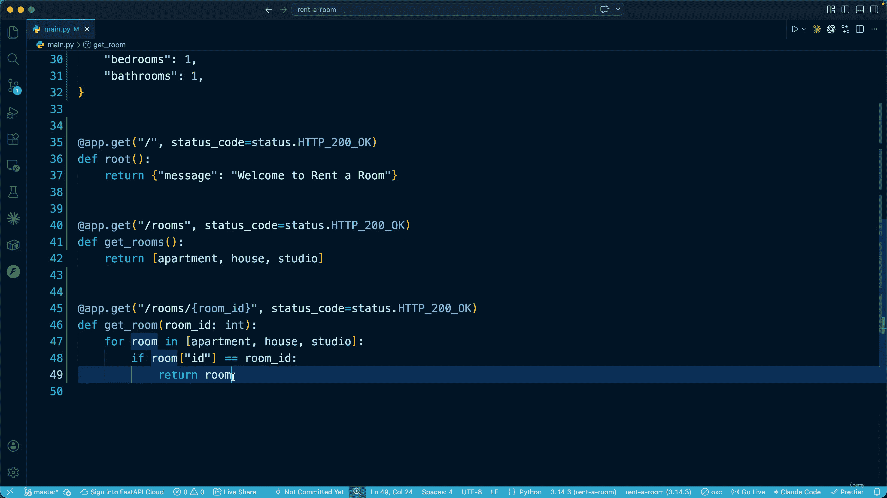
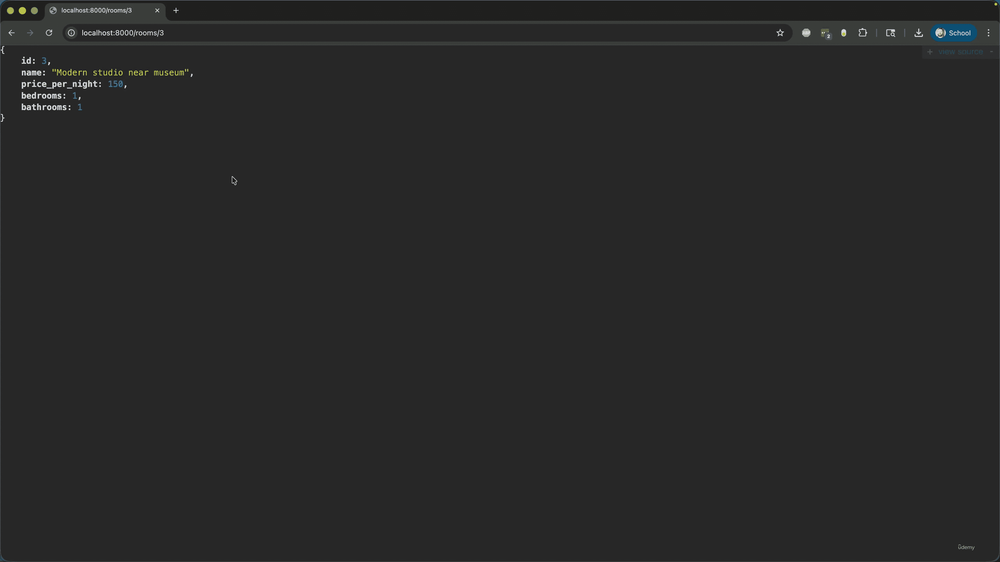

# 🚀 Udemy - FastAPI Masterclass part1：p20 21：路径参数（Path Parameters）

在本节课中，我们将要学习如何在 FastAPI 中定义一个用于获取单个房间的路由，并理解什么是路径参数。我们会从问题背景出发，先说明为什么不能为每个房间都手写一条独立路由，再引入路径参数这个概念，然后一步步改造代码，最后在浏览器中验证效果。整个过程围绕一个核心目标展开：让同一个路由能够匹配不同的房间标识符，并把标识符自动解析成我们需要的数据类型。

## 🧩 问题背景：为什么需要动态路径

在理解了课程目标之后，我们先来看问题背景：为什么不能直接为每个房间写一条路由。接下来，假设我们想定义一个路由来获取单个房间。当前一共有三个房间，每个房间都有一个唯一标识符，也就是数据中 `id` 键对应的值。可以想象，如果我们写 `/rooms/1` 这样的路由，应用就会获取第一个房间，也就是 `id` 为 1 的公寓。类似地，我们还可以写 `/rooms/2`，用来获取 `id` 为 2 的房间，也就是这栋房子。

但真实世界中的 Airbnb 这类应用会有数百万条房源，因此也会有数百万个房间 `id`。显然，我们不能为每一个数字都定义一条独立路由。这个做法完全不可扩展，路由数量会随数据量增长而爆炸，维护起来也不现实。所以，我们需要让 URL 路径中有一段是动态的，可以匹配任意值。

## 🧠 路径参数是什么

上一节我们说明了硬编码路由不可扩展，本节中我们来看看路径参数如何解决这个问题。换句话说，如果可以在 FastAPI 中定义一个路由，让它的公共前缀是 `/rooms`，然后告诉 FastAPI：在 `/rooms` 后面还会有一个标识符，这个标识符就是路径参数。路径参数是 URL 中动态的一部分或一段，它的值就是 `/rooms` 后面跟着的内容。

路径参数在概念上相当于函数参数。函数参数是函数中由输入或动态数据填充的一部分；路径参数则是路径中由动态值填充的一部分。两者的核心思路相同：我们希望获得灵活性，不在路由中硬编码某个具体数字，而是允许它匹配任意值。可以把它理解为 URL 里的占位符，下面用公式表示这种模式：

```text
GET /rooms/{room_id}
```

## 🛠️ 先重构数据：把房间字典移到全局

在正式定义动态路由之前，我们需要先把房间数据放到多个函数都能访问的位置。上一节介绍了路径参数的概念，本节中我们先重构数据结构。在开始之前，我知道这些字典会在多个不同函数中使用。因为 `get_rooms` 可以返回一批房间中的公寓，而 `/rooms/1` 这样的端点可以单独返回公寓。为了让文件中的任何函数或任何路由处理器都能引用这些变量，先把它们移出 `get_rooms` 函数。

具体做法是把这段代码剪出来，粘贴到文件顶部、应用初始化之后，然后反缩进，确保没有报错。接着删除原来的注释，也删除不再需要的多余空行。下面展示重构后的数据结构示例：

```python
rooms = [
    {"id": 1, "name": "apartment"},
    {"id": 2, "name": "house"},
    {"id": 3, "name": "studio"},
]
```

## 🛣️ 定义新的单房间路由

数据准备好后，上一节我们完成了数据重构，本节中我们来看看如何在 FastAPI 中声明带路径参数的路由。接下来定义新函数，把它放在 `rooms` 路由下面。再次使用 `@app.get`。路由以 `/rooms` 开头，然后加一个斜杠。假设写 `room_id`，因为它用作房间标识符。这个语法不能直接工作，因为这样会字面创建一条名为 `/rooms/room_id` 的路由，它只是一条单一路由。

因此，需要一种方式告诉 FastAPI：路径中的这一段是动态的。做法是把这个名字用一对花括号包起来。在 `room_id` 前后加一对花括号。这个名字完全由我们决定，可以写 `room_id`，也可以写 `id`，重要的是它必须包在花括号里，这样 FastAPI 才会把它识别为路径参数，也就是路径中的动态部分。之后添加常用的状态码参数，这个参数不是严格必需，但如果成功获取单个房间，就应该返回 `200`，所以这里指定 HTTP 200。下面是路由定义示例：

```python
@app.get("/rooms/{room_id}", status_code=200)
def get_room(room_id: int):
    ...
```

## 📚 REST 约定：先资源集合，再唯一标识符

在定义路由时，我们会遵循一种常见的 API 设计约定。上一节我们写出了动态路由的雏形，本节中我们来看看 REST 约定如何组织路径。这里遵循的约定叫 REST，全称是 Representational State Transfer，它是一组设计 Web API 和路径的约定。

例如，`rooms` 是资源的复数名称，我们可以有这样一个路径。类似地，如果想从集合中获取一个实体或一个资源，REST 约定是先写完整资源，比如 `/rooms`，然后写一个斜杠，再写这个资源的唯一标识符。应用中会一直遵循这个模式。路由名称完全由我们决定，也可以用 `single_room` 这样的名字，但仍然需要有一个实际组件来指定房间是谁；这里遵循 RESTful 约定：先写复数资源，再写实际资源的唯一标识符。

```text
/rooms/{room_id}
```

## ⚙️ 路由处理函数与自动参数传递

上一节我们确定了 URL 模式，本节中我们来看看 FastAPI 如何把路径参数自动传给处理函数。在下面定义路由处理函数，命名为 `get_room`，使用单数形式。这里有一个自动机制：我们声明的每一个路径参数，都会自动成为函数参数，FastAPI 会自动把它传进来。因此这里写 `room_id`。

这个名字必须与花括号中的名称完全匹配。FastAPI 通过这个名称关联路径参数，并自动解析它，再传给 `get_room` 路由处理函数。下面是函数签名示例：

```python
def get_room(room_id: int):
    ...
```

## 🔢 使用类型注解自动转换类型

上一节我们让函数接收到了路径参数，本节中我们来看看类型注解如何自动转换类型。还有一个很强大的功能，使用起来简单到只需要声明类型注解。这里写一个冒号，把 `room_id` 声明为 `int`。

解释一下这里发生的作用：默认情况下，路径中的每一段都会被解释为字符串。当我们把它声明为整数时，FastAPI 在执行这个路由处理函数时，会取出路径中的这一段，并自动尝试把它转换或强制转换为等价的整数。如果转换失败，FastAPI 会抛出错误，`get_room` 函数体根本不会执行。如果转换成功，那么函数体运行时就可以保证 `room_id` 是整数，也可以假定它是整数。

因此，仅仅声明类型注解，FastAPI 就会自动把数据类型转换成目标类型，并带有合适的错误处理。类型转换可以简单表示为：`"1" -> 1`，而 `"abc" -> 抛出错误`。代码中的核心写法如下：

```python
def get_room(room_id: int):
    ...
```

## 🔁 在内存字典中查找房间

上一节我们完成了参数接收和类型转换，本节中我们来看看怎样根据 `id` 在内存字典中找到房间。下一步是让函数返回单个房间。再次强调，这里没有使用数据库，而是使用内存中的字典。下面模拟一个类似例子：创建 `for` 循环，遍历与上面相同的集合。可以把这个列表想象成数据库，它是服务中所有房间的集合，其中包括公寓、房子和工作室。

查找流程可以概括为以下几步：

1. 遍历 `rooms` 列表中的每一个房间字典。
2. 读取当前房间字典中 `id` 键对应的值。
3. 把这个值与传入函数的 `room_id` 参数进行比较。
4. 如果匹配，就说明遍历到了正确的房间，直接返回它。

例如访问 `/rooms/2` 时，代码会检查当前房间的 `id` 是否等于 `2`。如果匹配，就返回这个房间。这样无论访问 `/rooms/1`、`/rooms/2` 还是 `/rooms/3`，都会在某个时刻让 `if` 判断为真，并返回对应房间。核心查找代码如下：

```python
for room in rooms:
    if room["id"] == room_id:
        return room
```

这样就可以了，查找逻辑已经完成。

## 🧪 浏览器验证 happy path

上一节我们写好了查找逻辑，本节中我们来看看浏览器中的实际效果。现在还没有讨论所有可能出错的方式，例如提供了一个不存在的 `id`，或者提供了一个不是数字的 `id`。这些错误情况会在未来课程中讨论。当前先看浏览器中的正常路径。

导航到 Chrome，访问新路由，例如 `/rooms/1`。可以看到应用提取出了单个房间。我们遍历了集合，并匹配 `id` 为 1 的房间；FastAPI 借助花括号路径参数语法和 `int` 类型注解，自动把 `1` 解析成整数，然后匹配列表中的第一个房间并返回它。类似地，访问 `/rooms/2` 时，`main.py` 中匹配的是同一条路径或路由，仍然只有一条路径，但 URL 中的这一段是动态的，所以它会匹配 `2`，查找 `id` 为 2 的房间。最后访问 `/rooms/3` 时，会找到 `id` 为 3 的房间。

下面列出三个验证请求：

- `GET /rooms/1`：返回 `id` 为 1 的房间。
- `GET /rooms/2`：返回 `id` 为 2 的房间。
- `GET /rooms/3`：返回 `id` 为 3 的房间。

再次说明，这就是路径参数：它是路径中可以定义的动态段或动态部分，FastAPI 能够识别并解析它，还能自动转换它的数据类型。



## 📝 总结

到这里，我们已经完成了主要流程，本节中我们对本节课内容做总结。本节课中，我们一起学习了如何在 FastAPI 中定义获取单个房间的路由，并理解了路径参数的含义。我们知道了不能为百万级数据手写百万条路由，因此需要在 URL 路径中加入动态段；也学习了用花括号声明路径参数，例如 `/rooms/{room_id}`，并让函数参数名与花括号中的名称完全匹配。



我们还学习了类型注解的作用：把 `room_id` 声明为 `int` 后，FastAPI 会自动把路径字符串转换成整数，并在转换失败时抛出错误。随后，我们通过 `for` 循环在内存字典集合中查找匹配 `id` 的房间，并在浏览器中验证了 `/rooms/1`、`/rooms/2` 和 `/rooms/3` 都能返回正确结果。这些内容为后续处理错误情况打下了基础。

