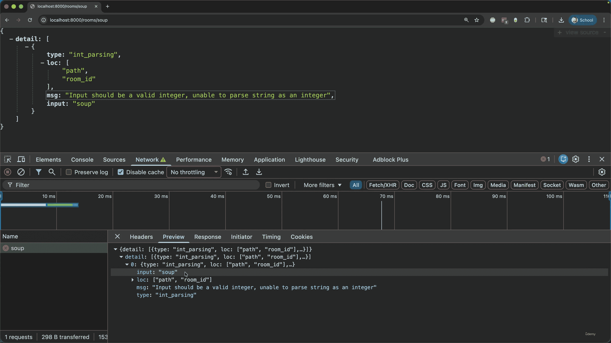
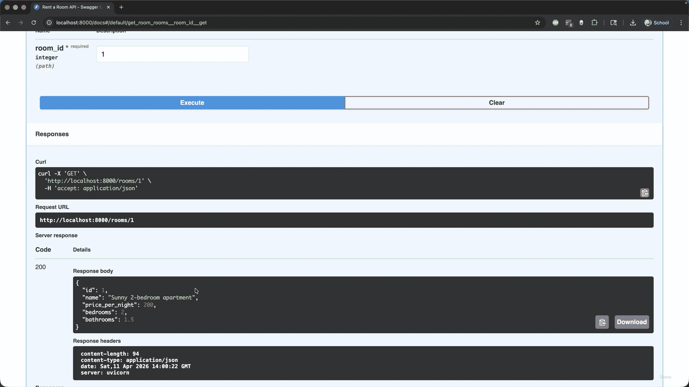

# 🧭 FastAPI 大师课：第 21 节：错误响应

在本节课中，我们将学习 FastAPI 中的错误响应，也就是当请求没有成功时，服务器会返回什么内容。课程会从浏览器的 Network 面板开始，观察一次成功请求和一次失败请求的差异，然后解释 200、404、422 这些状态码分别代表什么，最后还会在 Swagger 文档中测试路径参数的错误输入。通过这一节，我们不仅能看懂浏览器里返回的 JSON，还能理解 FastAPI 为什么要用不同的状态码来表达不同的问题。

在正式进入错误响应之前，我们需要先有一个观察请求的工具。下面我们来看看如何使用浏览器的 Network 面板，它是理解客户端和服务器通信过程的基础。

## 🌐 FastAPI 大师课：第 21.1 节：打开浏览器网络面板

上一节我们还没有涉及具体请求观察，本节中我们来看看浏览器里的 Network 面板。Network 面板会显示浏览器这个客户端发往服务器的所有请求。在 Chrome 中打开任意网页后，可以右键点击页面，然后选择“检查”，你的浏览器里也会有类似选项。如果你使用的是 Firefox 或 Opera，也会有相近的开发者工具入口。这个面板通常出现在页面底部，也可能弹在右侧，这些外观差异只是自定义配置，后面可以调整，不需要担心。

为了方便观察，我们可以把面板放大一些，然后找到 Network 标签页。这个标签页会展示网站发出的全部请求。以下是使用 Network 面板观察请求的基本步骤。

- 右键点击页面并选择“检查”，打开开发者工具。
- 找到并点击 Network 标签页。
- 刷新页面，让面板重新记录请求。
- 在请求列表中找到目标请求并点击它。
- 查看请求地址、请求方法、状态码、响应头和响应体。

刷新之后，可以在下方看到单个请求。点击这个请求并把面板拖上来，可以看到它访问的是 `localhost:8000`，也就是我们的 FastAPI 服务器。这个请求访问的路径是 `/rooms/3`，方法是 GET，服务器返回的状态码是 200。继续往下看还能看到 headers，headers 是包含元数据的键值对，服务器响应里有 headers，浏览器发出的请求里也有 headers。

如果在请求详情里点击 preview，可以看到服务器返回的响应内容，这正是页面上实际渲染出来的同一份内容。点击 response 也会看到非常相似的内容，不过 response 给出的是 JSON 成功解析之前更基础的字符串版本。这个例子展示的是 200，因为这是一次成功请求，服务器上确实能找到 ID 为 3 的资源。理解了成功请求的样子之后，下一步我们就要看看请求一个不存在的资源时会发生什么。

## 🕳️ FastAPI 大师课：第 21.2 节：请求不存在的房间

上一节我们观察了成功请求，本节中我们来看看请求一个不存在的房间时会出现什么结果。假设把路径里的 3 换成 5，也就是访问 `/rooms/5`。当 `get_room` 函数执行时，里面的 for 循环和嵌套的 if 判断永远不会变成 true，于是 for 循环结束，函数没有返回任何内容。Python 函数如果没有显式返回值，就会隐式返回 `None` 对象，而 `None` 是 Python 表示“空”或“缺失”的方式。

因此，服务器实际上会把 `None` 返回给客户端。客户端收到的就是 Python `None` 在 JSON 里的等价表示，也就是 `null`。JSON 里的 `null` 和 Python 里的 `None` 表达的是同一个现实概念，即空或者缺失。虽然这是两种不同的语言，但它们都在描述同一种“没有东西”的状态。可以用下面的公式概括这个现象。

```text
room_id = 5
函数执行结束 -> 隐式返回 None
None 转成 JSON -> null
HTTP 状态码仍然是 200
```

这里需要注意的是，请求仍然返回 200，因为服务器上从技术角度看没有发生错误，代码也没有失败。但这种情况并不理想。代码没有报错，不代表请求就真的成功了。用户请求的是 ID 为 5 的房间，服务器却告诉用户“一切成功”，同时没有返回 ID 为 5 的房间，这显然不合适。更合理的做法是返回类似 404 的状态码，404 表示 Not Found，也就是没有找到。技术上这是一个错误，因为请求的 ID 为 5 的房间不存在。

不过在这个场景里，服务器确实返回了内容，因为函数体运行了。函数体能运行，是因为 FastAPI 成功解析了路径参数 5，并把它转换成了整数，`get_room` 函数才有机会执行。这个解析过程并不总是保证成功。例如，如果给路径参数提供一个完全无法解析为整数的字符串，比如随便写一个 `soup`，FastAPI 就没有办法把它转换成整数，这时会得到一种完全不同的响应。下面我们来看看这种路径参数解析失败的情况。

## 🧩 FastAPI 大师课：第 21.3 节：路径参数无法解析

上一节我们看到资源不存在时仍然返回了 200，本节中我们来看看路径参数本身无法解析时 FastAPI 会怎么处理。假设访问的路径参数是 `soup`，它不可能被转换成整数。这时 FastAPI 会返回一种与前面完全不同的响应，这种响应也是 FastAPI 错误响应的通用结构。

这个结构本质上是一个 Python 字典，随后会被转换成 JSON 对象。它有一个顶层的 `detail` 键，值是一个数组，对应 Python 里的列表。数组里的每一个嵌套对象都会描述一个错误，或者描述一件出错的事情。以下是错误响应中常见字段的作用。

- `type` 表示错误类型，这里表示整数解析失败。
- `loc` 表示错误发生的位置，这里是一个路径参数，更具体地说是 `room_id`。
- `msg` 表示 FastAPI 自动生成的消息，这里说明输入应该是一个合法整数，但字符串无法被解析为整数。
- `input` 表示客户端实际传入的内容，例如这里的 `soup`。

可以用下面的代码描述这个错误响应的核心结构。

```json
{
  "detail": [
    {
      "type": "integer_parsing",
      "loc": ["path", "room_id"],
      "msg": "Input should be a valid integer, unable to parse string as an integer",
      "input": "soup"
    }
  ]
}
```

此时状态码不再是前面看到的 200，而是 422。422 这个状态码叫做 Unprocessable Content，也就是无法处理的内容。它的基本含义是：服务器理解客户端正在发起请求，也理解这个请求匹配到了某个路由，但是服务器无法处理这个请求，无法处理客户端给出的实际内容。任何 400 系列的错误都表示客户端错误。这里是客户端给出了无效的数字标识，所以问题在客户端。服务器相当于在说：这不是我的错，这是你的错，我无法处理你给的内容。

在 Network 面板里可以看到这些详细信息。点击 preview 之后，仍然会看到和上方相同的输出，也就是同一个 `detail` 对象，里面的每个条目都代表一个错误或一个错误点。理解了浏览器中的错误响应之后，我们再到 FastAPI 自动生成的 Swagger 文档里看看同样的接口会如何表现。



## 🧪 FastAPI 大师课：第 21.4 节：在 Swagger 文档中测试

上一节我们通过浏览器 Network 面板看到了错误响应，本节中我们来看看 Swagger 文档中的表现。关闭当前页面后，访问 `localhost:8000/docs`，可以看到新路由出现，例如 `rooms/{room_id}`。这里的 `room_id` 是一个独立的路径参数。展开这个接口后，文档会显示参数区域，并列出所有参数。路径参数就是客户端可以向服务器发送的输入或数据的一种例子。

在这里，参数名和代码里定义的名字完全一致，叫做 `room_id`，类型是整数，并且属于 path parameters。以下是使用 Swagger 文档测试接口的基本步骤。

- 展开 `rooms/{room_id}` 接口。
- 点击 Try it out 进入试用模式。
- 在 `room_id` 输入框中填入一个示例值，例如 3。
- 点击 Execute 发送请求。
- 查看生成的 curl 请求、完整请求 URL、状态码和响应体。

执行后可以看到 curl 请求，这段代码可以直接复制到终端，从命令行发起同一个请求。页面上还会显示完整的请求 URL。这里确实会得到 200 OK，响应体和之前在另一个标签页里看到的完全一样，也就是 ID 为 3 的房间数据。

如果把 `room_id` 改成 5，从技术角度看仍然不会失败，仍然会得到 200 状态码，这还不理想，后面会修复这个问题。此时响应体类似 `null`。和另一个标签页不同的是，Swagger 文档不会允许我们提交完全无效的输入。例如在输入框里写 `soup` 再执行，它甚至不会真正发出请求，而是直接在页面上提示 `room_id` 参数存在验证错误：你给的是一个字符串，但值必须是整数。Swagger 在这里帮助了最终用户，在请求到达服务器之前就告诉用户需要修正输入，改成真正有效的 ID，这样才能成功发起请求并拿到响应。

到这里，我们已经完成了 FastAPI 错误响应的基础介绍。下面我们对本节课的内容做一个总结。

## ✅ FastAPI 大师课：第 21.5 节：本节总结

本节课中我们一起学习了 FastAPI 中的错误响应，以及如何通过浏览器和 Swagger 文档观察这些响应。以下是本节课的核心知识点回顾。



- Network 面板可以观察浏览器发往服务器的请求、状态码、headers 和响应体。
- 成功请求会返回 200，preview 和 response 可以帮助查看服务器返回的内容。
- 请求不存在的房间时，函数可能隐式返回 `None`，JSON 中显示为 `null`，但状态码仍是 200，这不理想。
- 资源不存在时，更合适的状态码是 404 Not Found。
- 路径参数无法转换成整数时，FastAPI 会返回 422，并给出包含 `detail` 数组的错误结构。
- 400 系列状态码表示客户端错误，问题通常出在客户端提供的输入上。
- Swagger 文档会在发送请求前做输入验证，帮助用户修正无效参数。
- 后续我们需要把 `get_room` 接口接到正确的 404 Not Found 状态码上。

