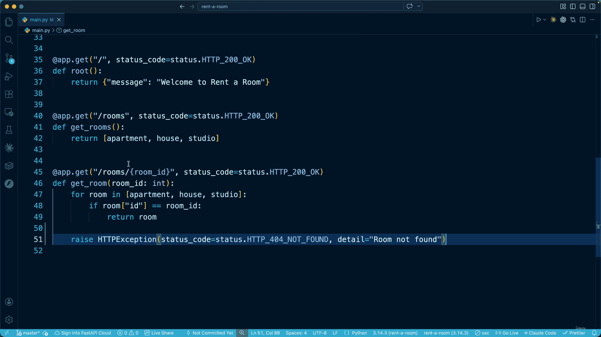
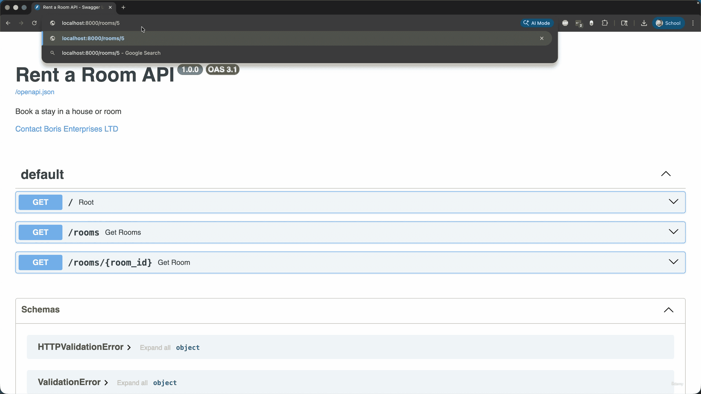
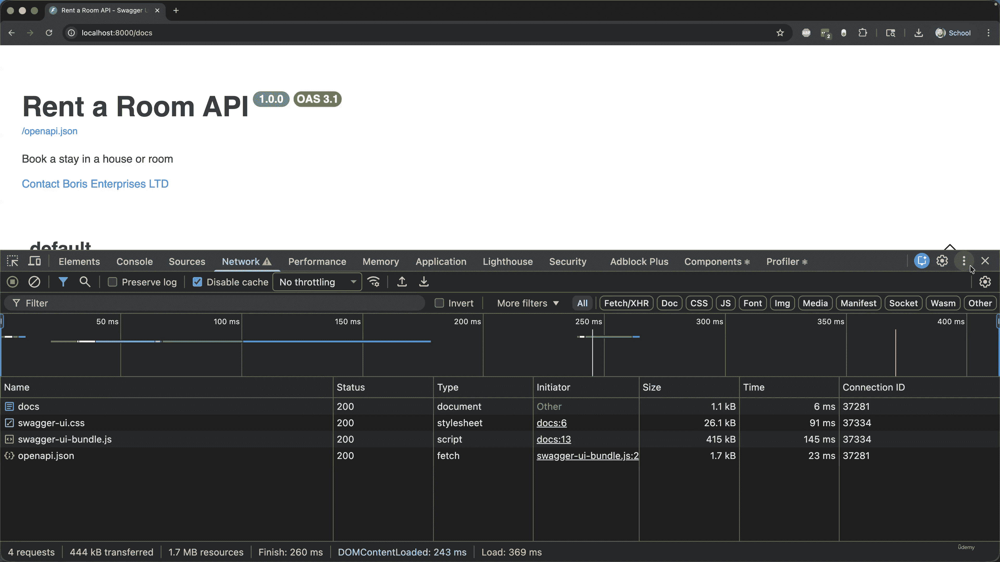
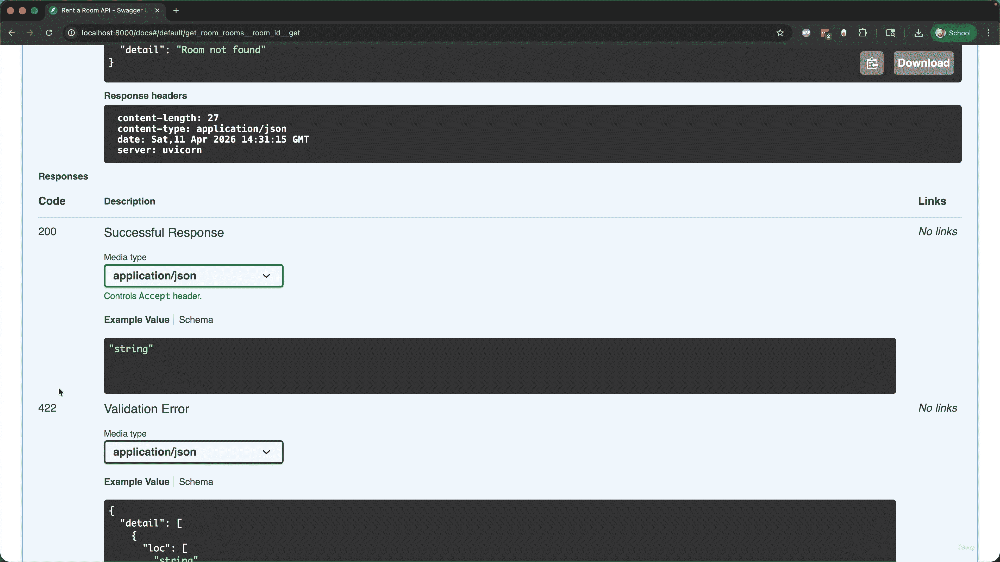

# 🧭 FastAPI 大师课：第 23 节：404 Not Found 状态码


在本节课中我们将要学习如何在 FastAPI 中正确返回 `404 Not Found` 状态码。上一节我们尝试访问一个不存在的房间，结果浏览器里显示的是 `null`，这会让客户端误以为请求成功。本节课会先回顾这个问题产生的原因，再引入 `HTTPException` 来主动触发错误响应，然后分别在浏览器、开发者工具和 Swagger 文档中验证效果，最后解释为什么 Swagger 文档不会自动显示 `404` 这个可能的状态码。下面我们按步骤展开。


## 📌 FastAPI 大师课：第 23.1 节：问题回顾：为什么返回 null


上一节我们尝试访问一个不存在的房间。例如，当我们导航到 `/room/5` 时，浏览器里看到的是 `null`。这个现象本身不复杂，但它暴露了一个接口设计上的问题：服务器没有明确告诉客户端“资源不存在”。


这里发生的事情是：当 `get_room` 路由处理函数运行时，`for` 循环完整跑完却没有返回任何房间，因为没有任何房间匹配给定的 ID。这个循环没有找到结果，函数自然也就没有拿到要返回的房间对象。


在 Python 中，只要一个函数没有显式返回值，它就会隐式返回 `None`，而 `None` 是 Python 表示“缺失值”或“空值”的对象。这个 Python 的 `None` 值随后会被转换成 JSON 中对应的 `null`。可以用下面这个简化关系来理解：


```text
函数没有显式 return  ->  Python 隐式返回 None  ->  JSON 中变成 null
```


这个转换本身没有错，但它不是一个好的接口标准，因为这个端点返回的是 `200 OK`，表示请求成功，即使请求的资源根本没有找到。也就是说，客户端会看到一个成功状态码，却拿到一个空值，这不利于调用方判断真实情况。既然问题已经清楚了，下一节我们来看看如何正确返回错误状态码。


## 🛠️ FastAPI 大师课：第 23.2 节：用 HTTPException 返回 404


上一节我们看到了返回 `null` 的问题，本节我们来看看如何让接口返回更明确的错误状态码。更具体地说，我们要返回 `404`，表示给定资源未找到。这个错误你在互联网上很可能已经见过很多次，它通常就是“页面或资源不存在”的意思。


我们需要做的是在 `get_room` 函数体内部手动触发一个错误，这样 FastAPI 才能返回不同的状态码和不同的响应体。首先滚动到文件顶部，从 FastAPI 中导入一个特殊类 `HTTPException`。HTTP 是超文本传输协议，是客户端和服务器之间发起请求的 Web 标准；exception 是 Python 中表示“错误”的词，所以这个类基本上是在建模一种 HTTP 错误。导入代码如下：


```python
from fastapi import HTTPException, status
```


接下来在 `get_room` 函数体中使用 Python 的 `raise` 关键字。`raise` 用在实例化错误类之前，这里我们 `raise` 的就是 `HTTPException` 类。代码大致如下：


```python
raise HTTPException(
    status_code=status.HTTP_404_NOT_FOUND,
    detail="Room not found"
)
```


这会触发一个错误，但不会让程序崩溃。它只是让 FastAPI 识别出“有地方出错了”，从而返回一个不同于常规 `200` 的响应。这里第一个可以提供的参数是 `status_code`，它很像路由装饰器里的状态码，用来指示错误响应的状态码。我们要的是 `404`，表示资源未找到。你可以访问此前导入的 `status` 模块，并定位到具体常量 `status.HTTP_404_NOT_FOUND`，这个写法更具描述性，所以通常更推荐。






除此之外，还可以提供 `detail` 参数，它会组成错误响应真正的 body。响应里会有一个顶层键 `detail`，值就是我们提供的字符串。通常这个字符串应当具有描述性，用来描述具体错误，例如可以写成 `Room not found`，当然具体内容完全由我们决定。还要注意，路由装饰器这里使用的是 `HTTP 200 OK`，这完全没问题。`get` 装饰器上的状态码代表成功情况，也就是没有出错时返回的状态码；而这里我们会故意抛出 `HTTPException`，所以还要指定失败情况下的状态码，两者可以同时存在。代码写好后，下一节我们回到浏览器验证实际效果。


## 🧪 FastAPI 大师课：第 23.3 节：在浏览器和开发者工具中验证 404


上一节我们写好了 `HTTPException`，本节我们来看看它在浏览器中的表现。保存代码后回到浏览器，访问一个不存在的示例房间，例如再次访问 `/room/5`。现在接口不再返回 `200` 和 `null`，而是会看到我们为 `detail` 参数指定的错误消息 `Room not found` 显示在页面里。


下面列出在浏览器中验证时值得观察的几个点：


- 打开开发者工具：右键检查，进入 Network 网络面板。
- 刷新页面发出新请求，能看到请求填充在列表里。
- 请求旁有 X 标记和红色高亮，表示出错。
- 点击请求进入 Headers，仍然是 GET 请求。
- 响应状态码现在是正确的 `404 Not Found`，表示给定房间未被定位到。


这些现象说明错误响应已经按预期返回。Swagger 文档中也会看到同样的响应。进入 `http://localhost:8000/docs`，关闭当前面板，进入这个路由。上节课我们看到这里不能提供像 nonsense 这样的无效字符串，但完全可以提供一个不存在资源的标识符。这里填写 `5`，点击 Execute，下方就会得到 `404`，表示资源未找到。这也表明这是一个客户端错误，因为服务器是在说：客户端给了一个不存在的标识符，或者请求了一个不存在的资源。这里还会看到我们在 `detail` 参数中指定的同样内容。浏览器验证通过后，下一节我们再看 Swagger 文档为什么没有显示 `404`。




## 📚 FastAPI 大师课：第 23.4 节：为什么 Swagger 文档不显示 404


上一节我们在 Swagger 中验证了 `404`，本节我们来看看文档为什么没有把这个状态码列出来。向下滚动页面，不会看到 `404` 作为可能选项出现在文档中。原因在于，Swagger 并不会读取函数体内部的内容，也不会处理我们在 `get_room` 函数里写的代码。


Swagger 只会看装饰器，以及一些可以用来定制文档的额外参数，但它不会直接分析代码本身。它更像一个解析工具，而不是代码逻辑工具。因此，Swagger 文档不理解 `404` 其实是这个端点可能返回的错误响应码。课程后面开始使用 Pydantic 模型时，我们可以指定它们，并让 Swagger 文档自动更新或自动生成，从而把 `404` 的可能性也包含进去。目前这样就可以了。理解这一点后，我们进入本节总结。


## ✅ FastAPI 大师课：第 23.5 节：本节总结




本节课中我们一起学习了如何把“资源不存在却返回 `null` 和 `200`”的问题改成标准的 `404 Not Found` 响应。我们回顾了函数没有显式 `return` 时会隐式返回 `None`，再被转成 JSON 的 `null`；也学习了从 FastAPI 导入 `HTTPException`，在 `get_room` 函数体中用 `raise` 主动触发错误，并通过 `status_code` 和 `detail` 参数指定错误状态码与错误信息。随后我们在浏览器、开发者工具和 Swagger 中验证了 `404` 的效果，并理解了 Swagger 只看装饰器和文档参数、不分析函数体逻辑，所以不会自动显示 `404`。本课内容到此覆盖完毕，下节课再见。

