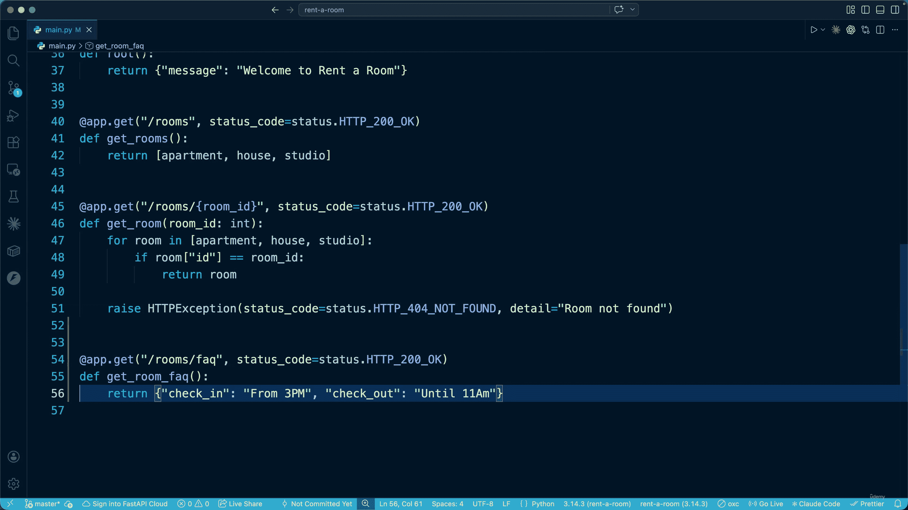
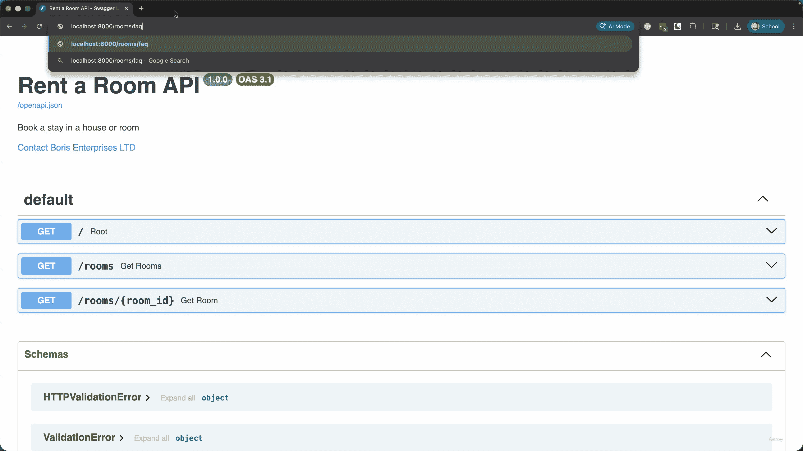
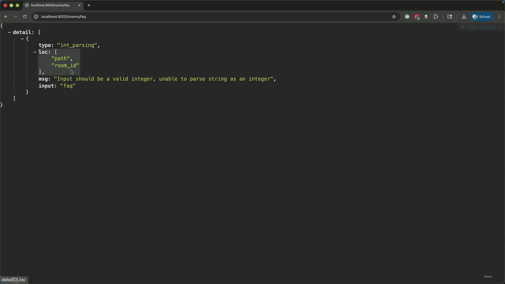
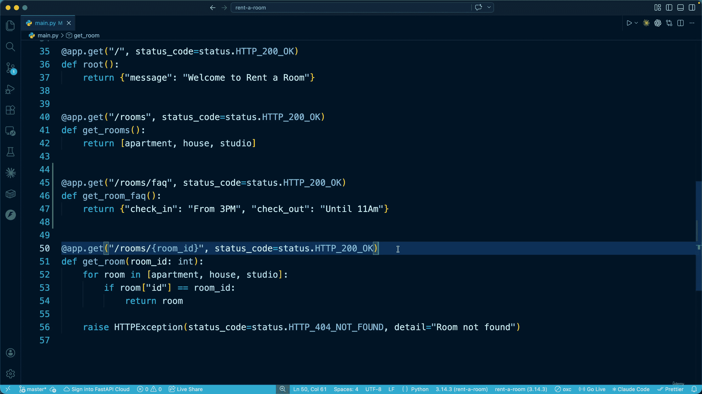
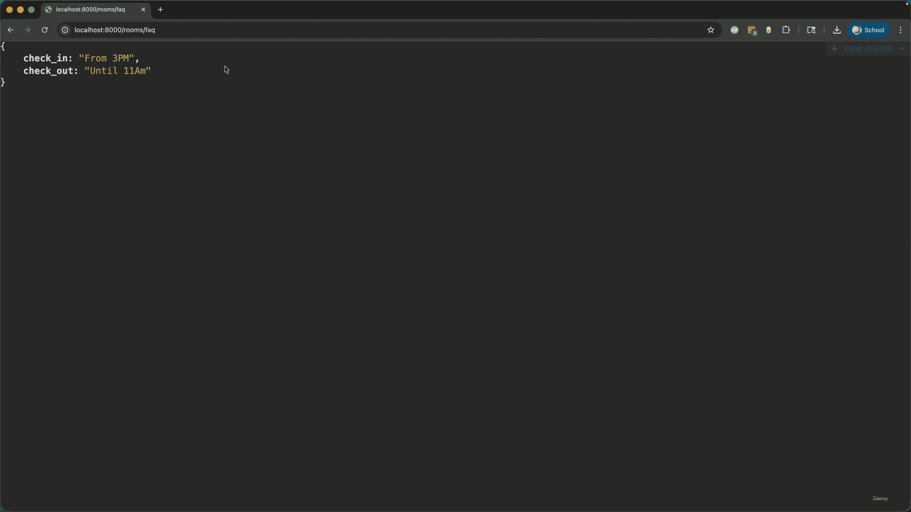

# FastAPI Masterclass：第23课：路由顺序 🚦

在本节课中，我们将会学习一个关于 FastAPI 路由顺序的重要注意事项。在之前的学习中，我们已经掌握了如何定义基本的 GET 路由、使用路径参数以及让 FastAPI 自动把字符串转换成整数。但是，当我们的应用里同时存在静态路径（比如 `/rooms/faq`）和动态路径（比如 `/rooms/{room_id}`）时，声明路由的先后顺序会直接影响到请求是否能被正确匹配。这节课我们用一个具体的场景来演示这个坑，并且给大家一个清晰的解决办法。

## 一、产品经理的新需求 📋

在某些情况下，你必须非常小心地安排 FastAPI 路由的声明顺序。为什么这么说呢？因为 FastAPI 在收到一个请求后，会按照你在代码里声明路由的先后顺序，从上往下依次去尝试匹配。如果先声明的路由已经匹配上了，后声明的路由就根本没机会被执行。所以，当多个路由的路径形状比较接近时，顺序就显得特别重要了。

假设我们的产品经理跑过来，让我们给网站添加一个“常见问题”页面。他要求这个页面的路由是 `/rooms/faq`。这个路由可以返回一个简单的字典，字典里的键名是一些常见的问题标题，值就是对这些问题给出的答案。为了保持简单，我们就用“入住时间”和“退房时间”这两个问题来举例。那么，这个路由返回的内容大概就是下面这样：

```python
{
    "check_in": "from 3pm",
    "check_out": "until 11am"
}
```

这里面的实际返回值并不重要，重要的是我们想要访问的路径是 `/rooms/faq`。于是你打算去实现这个需求，你打开了你的主文件 `main.py`，然后对自己说：“好的，我要定义一个新的路由。”这个路由同样是从服务器获取数据，所以我们会把它定义成一个 GET 请求。接下来，你在这个文件里添加了下面这段代码：

```python
@app.get("/rooms/faq", status_code=status.HTTP_200_OK)
def get_room_faq():
    return {
        "check_in": "from 3pm",
        "check_out": "until 11am"
    }
```

注意，这里我们使用了 `@app.get` 装饰器，路径是 `/rooms/faq`，并且显式地指定了成功时的状态码是 200。函数名叫做 `get_room_faq`，函数体非常简洁，直接返回一个字典。现在你觉得这一切看起来很完美，你的应用里多了一个新的路由，你迫不及待地想去浏览器里访问一下这个路由，看看它是否正常工作。

## 二、访问时遇到错误 😱



于是你回到浏览器，在地址栏里输入 `localhost:8000/rooms/faq`，按下回车。结果，你并没有看到预期的 JSON 数据，反而看到了一个错误页面。请你稍微停顿一下，尝试自己分析一下这里到底发生了什么。其实，答案的线索就在你看到的错误响应里。

看一下错误信息，你会发现它写着“无法解析 room_id 参数”（error parsing room ID parameter）。这就很奇怪了，因为你的 FAQ 路由里压根就没有 `room_id` 这个参数，这个路由的路径是 `/rooms/faq`，没有花括号包裹的动态段。那么，哪个路由里面才有 `room_id` 参数呢？显然是我们之前定义的那个用于获取单个房间信息的路由，很可能叫做 `get_room`。现在，咱们回到代码里，看看路由声明到底是什么样子的。

## 三、原因分析：路由匹配顺序 🧐

这里发生的事情是这样的：你声明路由的顺序，就是 FastAPI 尝试匹配请求路径的顺序。换句话说，FastAPI 拿着浏览器请求的路径 `/rooms/faq`，从你代码里第一个声明的路由开始，逐个去比较。当然，`/rooms/faq` 不会匹配 `/rooms` 这样的静态路径，因为它后面还多了 `/faq`。它也不会匹配 `/rooms/xxx` 这样完全不同的静态路径。但是，它却会匹配到后面那个带有路径参数的路由。



我们假设你的动态路由是这样声明的：



```python
@app.get("/rooms/{room_id}")
def get_room(room_id: int):
    ...
```

这个路由的声明里只说了一件事：这是一个 GET 请求，路径前缀以 `/rooms/` 开头，然后在 `/rooms/` 后面会跟着一个叫做 `room_id` 的标识符。而当请求的路径是 `/rooms/faq` 时，这个路径完全符合“以 `/rooms/` 开头 + 后面有一段字符串”的模式。于是，FastAPI 就认为 `/rooms/faq` 匹配上了这个动态路由，并且把字符串 `"faq"` 当作 `room_id` 的值传给了路径参数。

虽然我们知道 `room_id` 应该是数字，而且我们在代码里也告诉 FastAPI 应该把这个字符串表示的数字转换成整数。但是，FastAPI 并不知道你的业务逻辑，它不会聪明到说：“这个 `faq` 不是数字，所以这个请求应该匹配 FAQ 路由。”FastAPI 只是机械地认为：`/rooms/faq` 这个路径确实匹配了 `/rooms/{room_id}` 这个模式，然后把 `faq` 作为 `room_id` 提供给转换器。接下来，把字符串 `"faq"` 转成整数的操作就会失败。我们在几节课之前已经见过完全一样的错误。这个转换异常会被抛出，于是你的代码执行流程根本走不到后面的 FAQ 路由那里，更不可能返回任何成功响应。

用公式来表达路由匹配的规则，可以写成：

```text
匹配顺序 = 代码中路由装饰器的出现顺序
```

也就是说，FastAPI 是“先声明，先匹配”。一旦某个路由的路径模式与请求路径匹配成功，就会立刻调用对应的处理函数，后面的路由全部被忽略。

## 四、解决方案：把更具体的路由放在前面 ✅

解决这个问题的方法非常简单：把这个更具体的路由（也就是 `/rooms/faq`）拖动到带有路径参数的那个动态路由之前。为什么这样做有效呢？因为 `/rooms/faq` 是一个静态路由，它的路径是固定的；而 `/rooms/{room_id}` 是一个动态路由，它可以匹配任意一段字符串。从匹配的约束条件来看，静态路由更具体、更严格，因此我们应该让 FastAPI 先检查这个具体的路由。只有当 `/rooms/faq` 这不匹配时，才继续向下匹配动态路由。

调整后的代码如下：

```python
@app.get("/rooms/faq", status_code=status.HTTP_200_OK)
def get_room_faq():
    return {
        "check_in": "from 3pm",
        "check_out": "until 11am"
    }

@app.get("/rooms/{room_id}")
def get_room(room_id: int):
    ...
```

这样，当请求 `/rooms/faq` 时，FastAPI 首先看到 FAQ 路由，发现路径完全一致，就直接匹配成功，永远也不会走到动态路由那一步。而对于像 `/rooms/3` 这样的路径，FastAPI 先检查 FAQ 路由，发现路径不匹配，于是继续往下走，碰到动态路由，此时路径匹配成功，并且路径参数 `room_id` 会被正确地赋值为整数 `3`。

如果你把路由顺序改好，保存文件，回到浏览器重新请求 `/rooms/faq`，这次你就能正确访问到那个返回字典的端点了。服务器会正常返回你定义的 JSON 数据，状态码也是 200。所以，请大家务必牢记：在某些情况下，你声明的路由顺序真的会决定一切。

## 总结 🎯





本节课中我们一起学习了 FastAPI 中路由顺序的重要性。我们用一个真实的例子展示了：当你同时拥有静态路由 `/rooms/faq` 和动态路由 `/rooms/{room_id}` 时，如果你先把动态路由写在前面，那么访问 `/rooms/faq` 时，FastAPI 会把 `faq` 当成 `room_id` 去解析，从而引发类型转换错误。这个问题的根源在于 FastAPI 按照代码中路由的声明顺序依次进行匹配，只要先声明的路由匹配上了，就不会再往下继续。解决办法也很简单：把更具体的静态路由放在动态路由之前。希望你以后在写自己的 FastAPI 应用时，能够留意路由声明的顺序，避免掉进这个陷阱。
