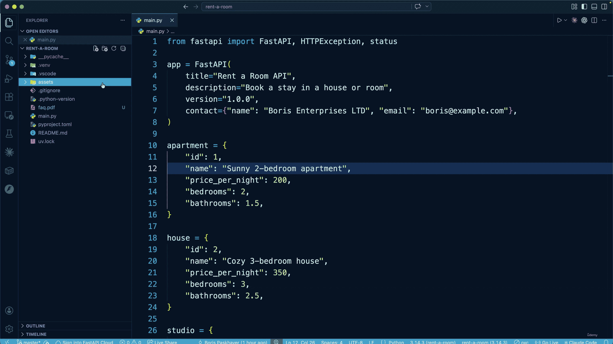
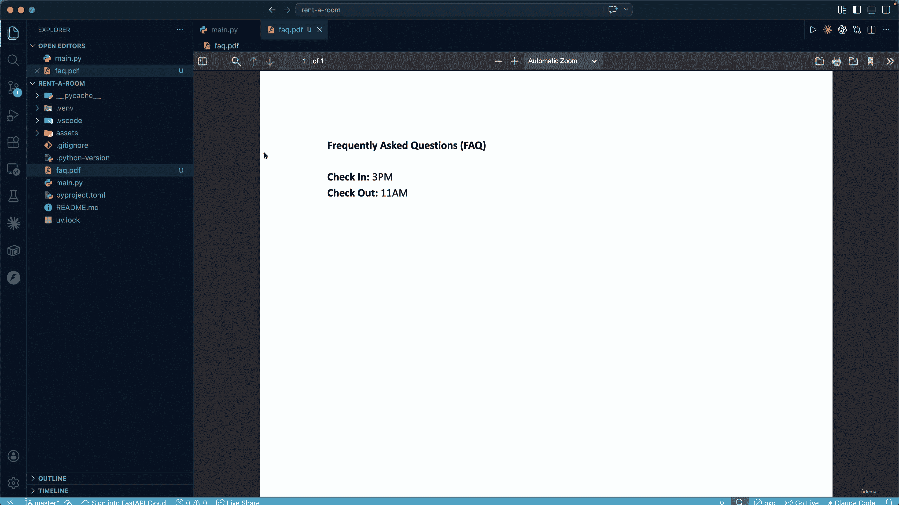
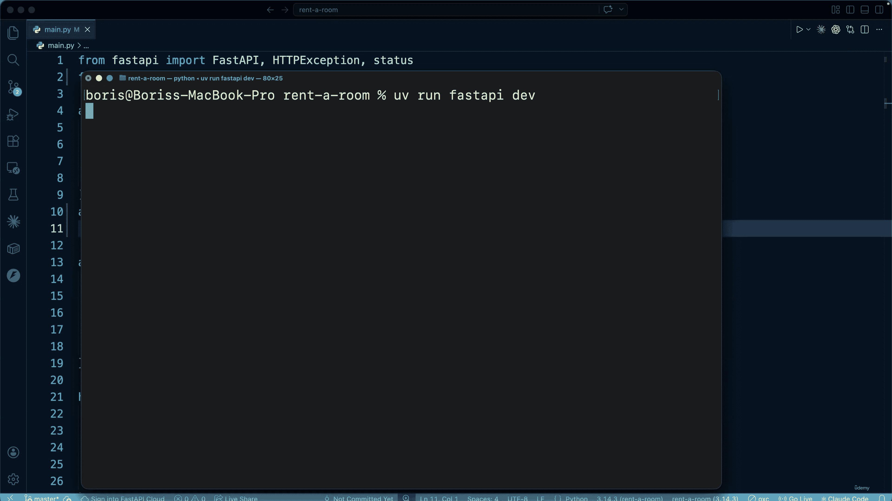
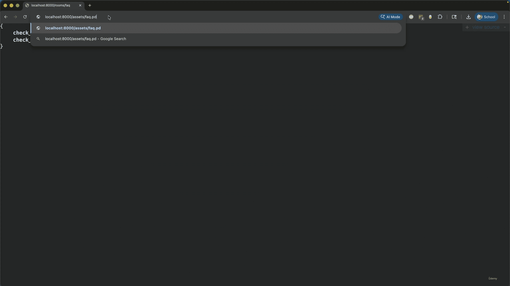
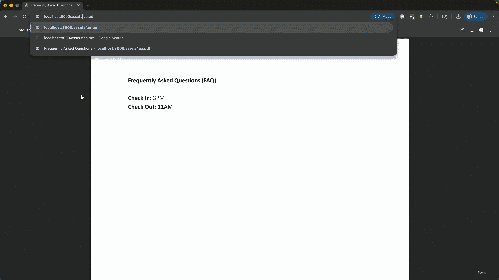
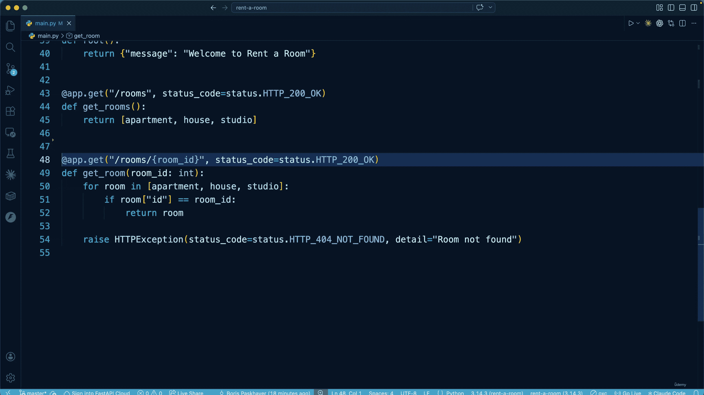

# 🚀 FastAPI 大师课：第24-25节：从端点提供静态文件

在本节课中，我们将要学习如何在 FastAPI 中定义一种用于下载静态文件的端点，让用户可以从应用里下载一个或多个文件。核心做法是先在代码库中创建一个专门存放文件的目录，再让 FastAPI 为这个目录中的每个文件生成对应的路由；最后通过挂载静态文件目录，让浏览器里的访问路径能够映射到项目目录中的实际文件。整个过程并不复杂，但对初学者来说，理解目录、URL、挂载方法和下载测试之间的关系非常重要，因此下面会一步一步展开说明。

## 📁 FastAPI 大师课：第24-25节：准备静态文件目录

在开始配置代码之前，我们需要先把要公开下载的文件准备好。换句话说，只有先有文件，FastAPI 才有内容可以对外提供。以下是准备静态文件时要做的事情：





- 在项目顶层创建一个新目录，命名为 `assets`，这个目录用来存放需要通过接口公开下载的文件。
- 本课附带的资源是一个 FAQ PDF 文件，但文件内容本身并不重要，你可以选择任意 PDF、文本文档或其他类型的文件，这里只是用一个示例来说明流程。
- 把这个 FAQ PDF 文件拖到 `assets` 目录中，它的作用是替换原来的 FAQ 端点，让用户可以从新定义的端点下载这份虚构的问题集。

完成上述准备后，我们只是拥有了文件，还没有告诉 FastAPI 应该如何把这些文件暴露出去。下面我们来看看 FastAPI 对这个目录中的文件会做出怎样的路径安排。

## 🔗 FastAPI 大师课：第24-25节：理解静态文件的 URL 映射

仅仅创建文件夹是不够的，我们还需要配置 FastAPI，让它理解要为这个文件夹中的每个文件创建一条访问路径。可以把这件事理解为：目录中的每个文件都会自动拥有一条对应的下载路由。浏览器路径和文件系统路径之间的映射关系如下：

```text
http://localhost:8000/assets/faq.pdf
        ↓ 映射
项目根目录/assets/faq.pdf
```

这种映射还是递归的，也就是说，FastAPI 会沿着目录层级向下查找任意层级的子目录。例如，如果 `assets` 下面有目录 `A`，`A` 下面还有目录 `B`，`B` 中有一个 PDF 文件，那么访问路径可以写成下面这样：

```text
http://localhost:8000/assets/A/B/some-file.pdf
        ↓ 映射
项目根目录/assets/A/B/some-file.pdf
```

也就是说，目录层级会对应成 URL 中的斜杠路径，只要浏览器里的路径写对了，就能下载到对应文件。理解这个映射规则之后，我们就可以进入应用代码，把这个规则真正配置到 FastAPI 中。

## ⚙️ FastAPI 大师课：第24-25节：用 mount 挂载静态文件

在应用代码中，我们需要取出 FastAPI 的 `app` 对象，并调用它的 `mount` 方法。`mount` 的作用是在服务器内部声明一个可以理解为嵌套应用的东西，这个嵌套应用专门负责从项目中的某个目录提供静态文件。下面是配置静态文件目录的核心代码：

```python
from fastapi import FastAPI
from fastapi.staticfiles import StaticFiles

app = FastAPI()

app.mount(
    "/assets",
    StaticFiles(directory="assets"),
    name="assets",
)
```

这里需要从 `fastapi.staticfiles` 导入 `StaticFiles` 类；这个模块可以理解成 FastAPI 内部的一个子模块，类似一个存放额外功能的文件夹，而 `StaticFiles` 就是其中的类。调用 `mount` 时，第一个参数是浏览器中要创建的 URL 路径，这里设置为 `/assets`，它不一定要和实际文件夹同名，但为了清楚，我们让两者保持一致。第二个参数是 `StaticFiles` 类的实例，它的 `directory` 参数用来指定实际的文件夹位置，这里写 `assets`，表示相对于项目顶层目录的 `assets` 文件夹。`StaticFiles` 还需要一个 `name` 关键字参数，这里同样设置为 `assets`；这个参数主要用于 FastAPI 内部记录，具体底层技术细节不必深究，但它是配置所必需的内容，文档中通常也会让它与目录名保持一致。需要特别说明的是，浏览器中的 URL 路径和实际目录名并不需要相同，例如 URL 可以叫 `files`、`resources` 或 `static`，然后映射到项目里的 `assets` 目录，这完全由你的配置决定。代码写好后，下一步就是重启服务器并实际测试下载效果。

## 🔄 FastAPI 大师课：第24-25节：重启服务并测试下载

因为我们刚刚挂载了一个用于提供静态文件的次级应用，这属于比较大的改动，所以建议重启 FastAPI 服务器。可以在终端中按 `Ctrl+C` 关闭当前服务，然后重新启动：

```bash
uv run fastapi dev
```





服务器重启后，就可以在浏览器中测试静态文件下载。访问 `http://localhost:8000/assets/faq.pdf` 时，浏览器会向 FastAPI 请求这个资源，FastAPI 会把请求映射回 `assets` 目录中的 `faq.pdf` 文件，并把实际文档返回给用户。若有多个嵌套目录和多个文件，也只需要在 URL 中写出正确的目录结构，FastAPI 就会为对应文件提供路由。还需要注意，通过这种方式提供的文件是公开可访问的，因此不要把敏感数据或敏感文件放进这个目录，这里只应该存放允许公开的信息。测试通过后，我们就可以回到编辑器，清理不再需要的旧端点。

## 🧹 FastAPI 大师课：第24-25节：移除旧端点并总结





功能验证完成后，可以回到编辑器，把旧的 FAQ 端点删除，因为现在用户已经可以通过静态文件路径下载 FAQ PDF 文件。到这里，静态文件功能就已经完成。本节课中我们一起学习了如何在 FastAPI 中启用静态文件：先在项目顶层创建 `assets` 目录并放入文件，再通过 `app.mount`、`StaticFiles(directory="assets")` 和 `name="assets"` 把 URL 路径映射到实际目录，随后重启服务器并访问 `/assets/faq.pdf` 完成下载测试。最后还删除了旧端点，并记住了静态文件目录是公开访问的，不能存放敏感内容。这样，服务器就可以允许用户下载项目专用目录中的请求文件。

