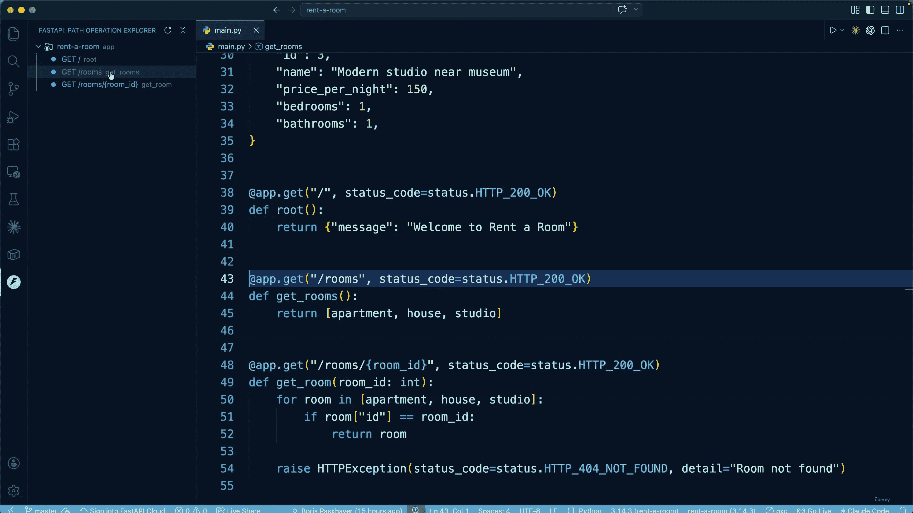
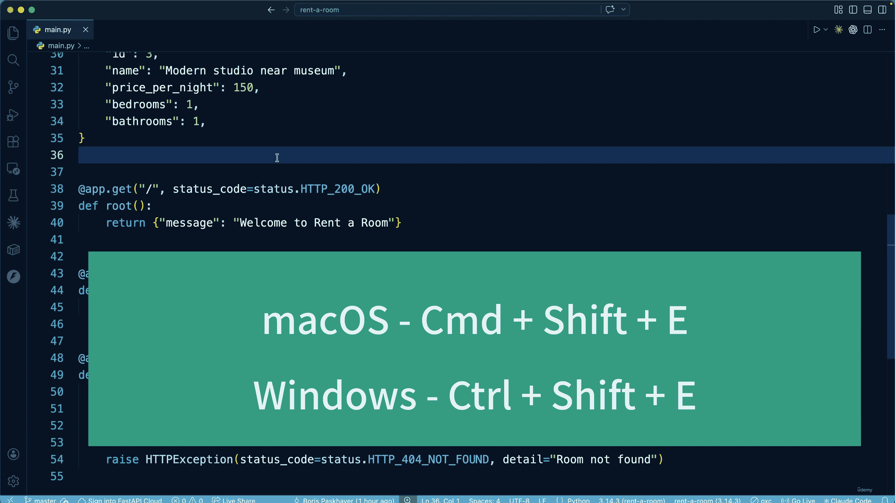
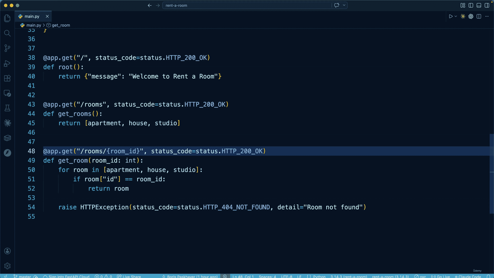

# 🧭 FastAPI大师课：第26节：FastAPI VS Code 扩展

在本节课中我们将要学习官方 VS Code FastAPI 扩展的基本用法。这个扩展在课程第一部分已经安装，现在我们已经定义了几条路由，它开始变得有用。先说明，这个扩展还在比较早期的发展阶段，所以以后可能逐步增加功能；不过现在最主要的好处，是帮助我们在应用里导航到任意路由定义，并从较高层面查看所有路由。

## 🧩 FastAPI大师课：第26节：扩展概览

上一部分说明了这节课的目标，本节来看看安装扩展后会出现什么。安装官方 FastAPI 扩展后，左侧导航栏会出现一个图标，这个图标就是扩展入口。它的用法很简单，主要作用是列出应用中的所有路由。这个列表会包含 HTTP 动词、实际的路由路径（例如 `/` 或 `/rooms`），以及对应的、有名字的 Python 路由处理函数。核心关系可以写成：

```text
路由条目 = HTTP 动词 + 路由路径 + Python 路由处理函数
```

下面用一个示例代码描述它想表达的三个部分，以下是路由定义的核心构成：

```python
@app.get("/rooms")          # HTTP 动词 + 路由路径
def list_rooms():           # 对应的 Python 路由处理函数
    ...
```

在扩展面板里，你可以点击任意一条路由，然后自动跳到代码中该路由处理函数所在的位置。目前我们的代码都放在一个文件里，所以这种跳转看起来很简单；但是当项目扩大到多个文件、多条路由和几十个端点时，查找路由位置就会变得更麻烦，而这个扩展能把所有路由整齐地列出来，点击后打开正确文件并定位到准确位置。

## ⌨️ FastAPI大师课：第26节：快捷导航与搜索

上面我们看了扩展面板中的路由列表，本节来看看不离开 VS Code 时的快捷操作。扩展还提供一个快捷键，可以在 VS Code 中直接完成同样的事情。这个快捷键在 Mac 上是 `Command + Shift + E`，在 Windows 上是 `Control + Shift + E`。按下快捷键后，会弹出一个面板，这个面板同样会列出所有操作。你可以使用方向键移动，按回车选择某一条具体的路由定义。这样就不用先在左侧点图标，再慢慢找，操作更直接。

下面介绍弹出面板里还能做什么，以下是这个快捷面板的几个重点：



- 会列出应用中的所有操作，方便集中查看。



- 可以用方向键选择，并按回车跳转到具体路由定义。

- 可以在弹窗内搜索特定操作，快速缩小范围。

除了列表和键盘选择，这个弹窗还支持搜索特定操作。当前项目里的路由种类不算多，所以搜索效果看起来不复杂；但是如果我搜索 `room`，它会把最匹配的结果放在前面，并限制或过滤搜索结果。这样就能快速找到想要的那条路由，并跳转到正确文件里的准确定义处。

## 📝 FastAPI大师课：第26节：本节总结



本节课中我们一起学习了官方 VS Code FastAPI 扩展的快速入门。我们了解了安装扩展后左侧导航栏的图标，知道了它会列出所有路由，包括 HTTP 动词、路由路径和 Python 路由处理函数。我们还看到点击路由可以跳转到代码定义处，并且可以使用 `Command + Shift + E`（Mac）或 `Control + Shift + E`（Windows）打开快捷面板，用方向键选择、回车确认，还可以搜索并过滤路由。这个扩展目前仍处于相对早期阶段，后续可能增加功能，但现在它已经能帮助我们在项目变大后更快地找到路由定义。
