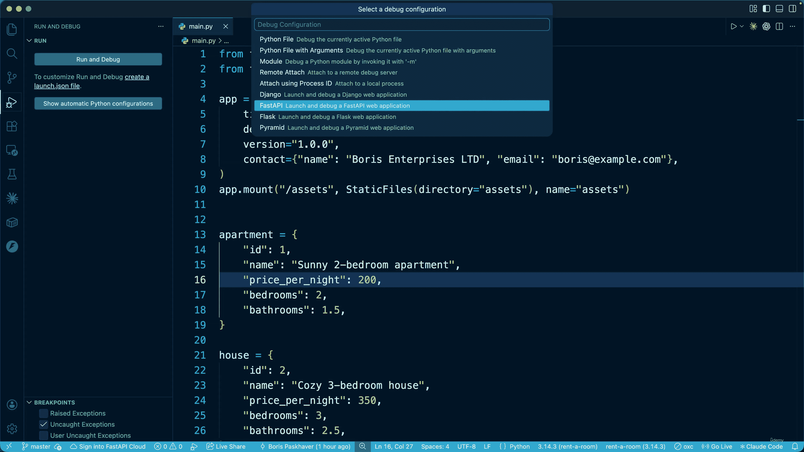
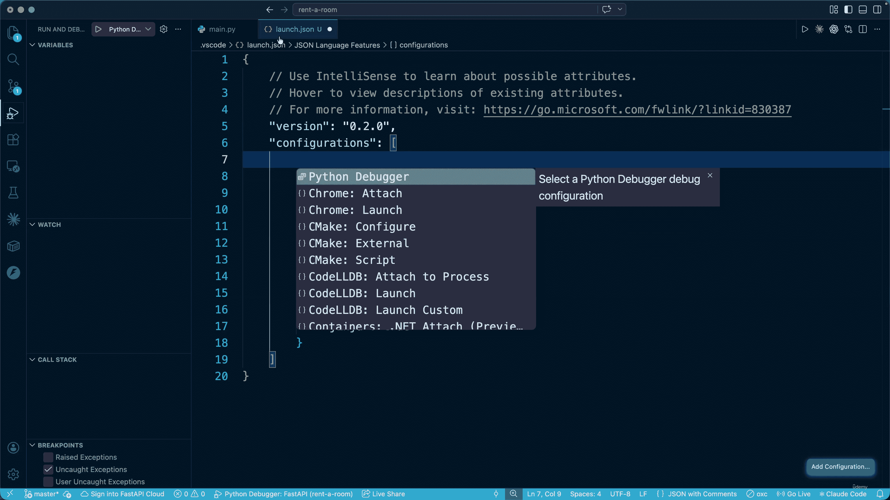
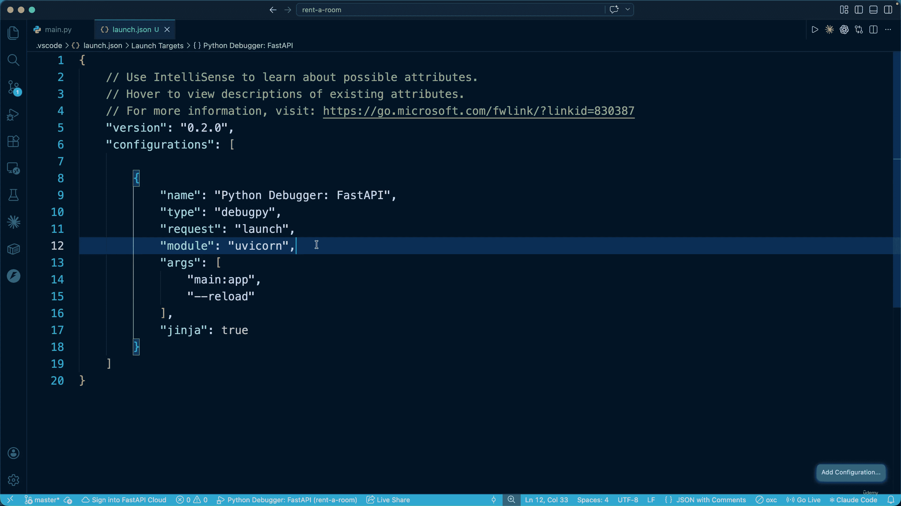
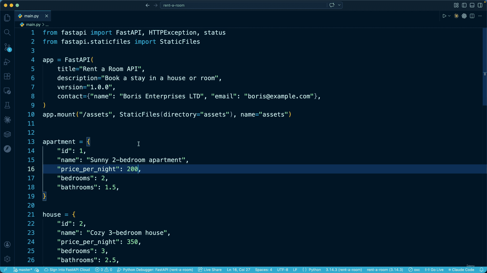
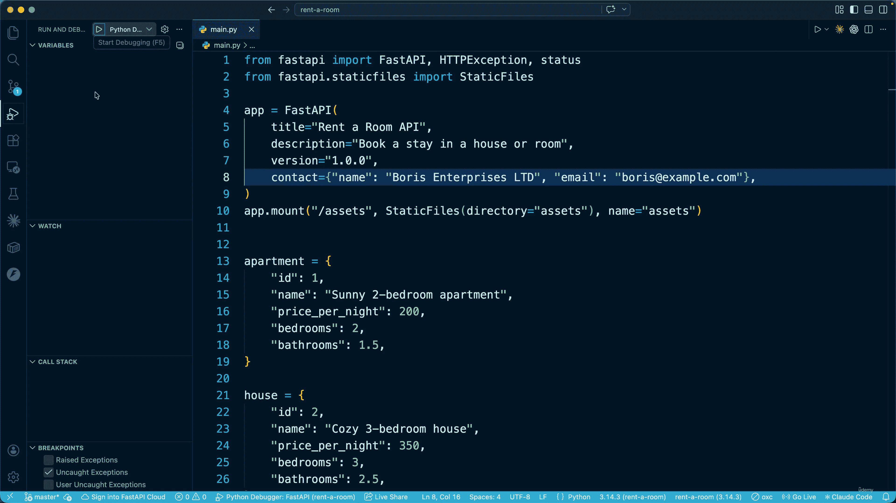
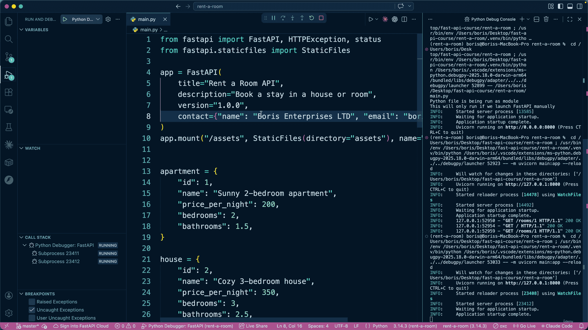
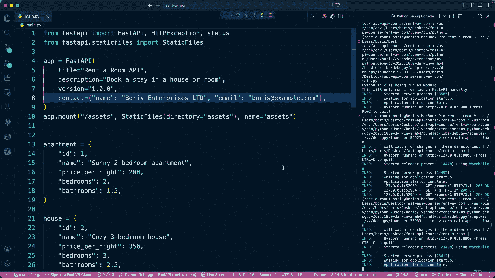

# 🛠️ FastAPI 大师课：p26：配置 VSCode 调试器

## 📌 本课概述

在本节课中，我们将要学习如何在 FastAPI 项目中配置 VS Code 调试器。调试器允许我们暂停路由处理函数的执行，然后一行一行地走代码，从而发现问题和 bug。这个能力对定位错误非常有帮助，因此课程希望在很早期就引入调试器，让后续开发遇到错误时有更直接的手段。VS Code 通过之前安装的 Python 扩展支持 Python 应用调试，我们只需要用一个启动配置文件告诉编辑器如何以调试方式启动 FastAPI 服务器。下面先从调试器的作用和使用场景开始。

## 🐞 调试器的作用与使用场景

上一节我们明确了本课目标，本节中我们来看看调试器到底能解决什么问题。调试器可以让路由处理函数暂停执行，然后逐行查看代码，帮助我们识别问题和 bug。这个功能会非常有帮助，所以课程在早期就介绍它。如果你遇到任何类型的错误，都可以在任意路由处理函数中暂停代码，再慢慢一行一行走完代码，观察程序在每一步的状态。为了方便理解，可以把调试的基本过程记成下面这个公式。

```text
暂停路由处理函数 -> 单步执行代码 -> 观察状态 -> 定位问题或 bug
```

以下是调试器适合处理的几类场景。

- 暂停某个路由处理函数的执行。

- 逐行查看代码的执行过程。

- 定位错误和 bug 出现的位置。

完成调试器作用的理解后，接下来需要确认 VS Code 用什么方式支持 Python 调试。

## 🧩 VS Code 的 Python 调试支持

上一节我们介绍了调试器的作用，本节中我们来看看 VS Code 如何支持 Python 调试。VS Code 通过之前安装的 Python 扩展内置支持调试 Python 应用，这一点可以减少额外工具的准备。我们只需要告诉编辑器如何用调试进程启动 FastAPI 服务器，具体方式是通过一个启动配置文件完成。这个配置文件会把“启动应用”和“进入调试模式”连接起来，概念可以用下面的代码表示。

```text
VS Code Python 扩展 + launch.json => 以调试模式启动 FastAPI
```

理解这个支持关系后，下一步进入 VS Code 界面创建启动配置文件。

## 🖱️ 创建 launch.json 启动配置

上一节我们介绍了 VS Code 的 Python 调试支持，本节中我们来看看如何创建启动配置文件。在 VS Code 左侧可以看到一个图标，它像一个带虫子的播放按钮，这个图标对应“运行和调试”面板。点击这个图标后，在面板中选择“创建 launch.json 文件”选项。这个操作会显示大量选项，具体选项取决于你在 VS Code 中使用的软件类型、语言类型以及已经安装的扩展。这里需要选择“Python 调试器”，随后会出现一个附加列表。在列表中向下滚动，找到 FastAPI 并按下回车键选择它。这样会在项目顶层的 `.vscode` 目录中创建 `launch.json` 文件，这个文件用于配置以调试模式启动应用。目录结构可以用下面代码描述。

```text
项目根目录/
└── .vscode/
    └── launch.json
```

以下是创建启动配置的操作步骤列表。

- 点击 VS Code 左侧带虫子的播放按钮，打开“运行和调试”面板。

- 选择“创建 launch.json 文件”。

- 在选项中选择“Python 调试器”。

- 在附加列表中向下滚动，找到 FastAPI 并按回车选择。

配置文件创建完成后，需要理解它底层启动的仍然是 Uvicorn 服务器，和运行 `uv run fastapi dev` 时使用的是同一个服务器，只是调试模式会手动帮你运行这个服务器。这里有一个关键注意点：不要在终端中运行应用服务器的同时，又在 VS Code 中运行调试服务器，两者只能二选一。可以用下面的公式表示这个关系。





```text
终端运行服务 + VS Code 调试运行服务 = 冲突
终端运行服务 XOR VS Code 调试运行服务 = 正确
```

掌握创建流程和二选一原则后，接下来看看调试启动和关闭终端服务的具体注意事项。

## 🔁 调试启动与关闭服务的注意事项

上一节我们完成了 `launch.json` 的创建，本节中我们来看看实际调试启动时的操作顺序。每当你想调试时，可以先关闭终端中正在运行的服务，然后在 VS Code 中启动实际的服务器。设置全部完成后，可以关闭 `launch.json` 文件。下一次想以调试模式启动 FastAPI 服务器时，再次点击左侧的“运行和调试”图标，然后在这个面板中点击播放按钮，就可以直接在 VS Code 中以调试模式启动 FastAPI 的 Uvicorn 服务器。启动后可以看到服务器输出，应用启动完成后，还能看到所有路由出现在面板中。以下是调试启动前的检查清单。

- 关闭终端中正在运行的应用服务器。

- 点击 VS Code 左侧的“运行和调试”图标。

- 在面板中点击播放按钮，以调试模式启动服务器。

- 观察服务器输出、应用启动完成信息以及路由列表。

这里再次强调运行方式的选择，避免同时启动两个服务造成冲突。

```text
需要调试：关闭终端服务 -> 在 VS Code 点击播放按钮
不需要调试：在终端运行 uv run fastapi dev
```





以上就是设置 VS Code 调试器的基础流程。





## ✅ 本课总结



本节课中我们一起学习了 FastAPI 项目中 VS Code 调试器的配置方法。我们了解了调试器可以暂停路由处理函数并逐行执行代码，从而识别问题和 bug。我们知道了 VS Code 通过 Python 扩展支持 Python 调试，并通过创建 `.vscode/launch.json` 文件配置 FastAPI 的调试启动方式。我们还明确了终端服务和 VS Code 调试服务只能二选一，调试时需要先关闭终端服务，再点击“运行和调试”面板中的播放按钮启动服务器。下一节课将看看如何在这个 VS Code 界面中实际进行调试。

