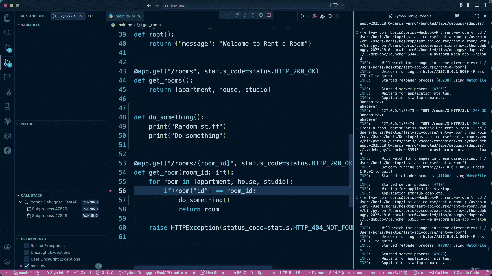
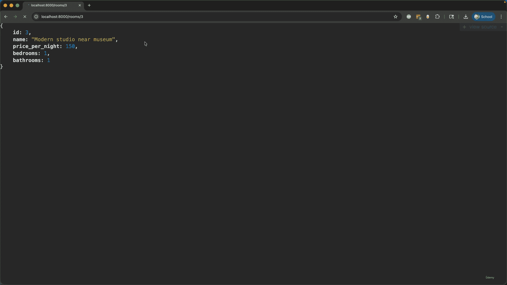
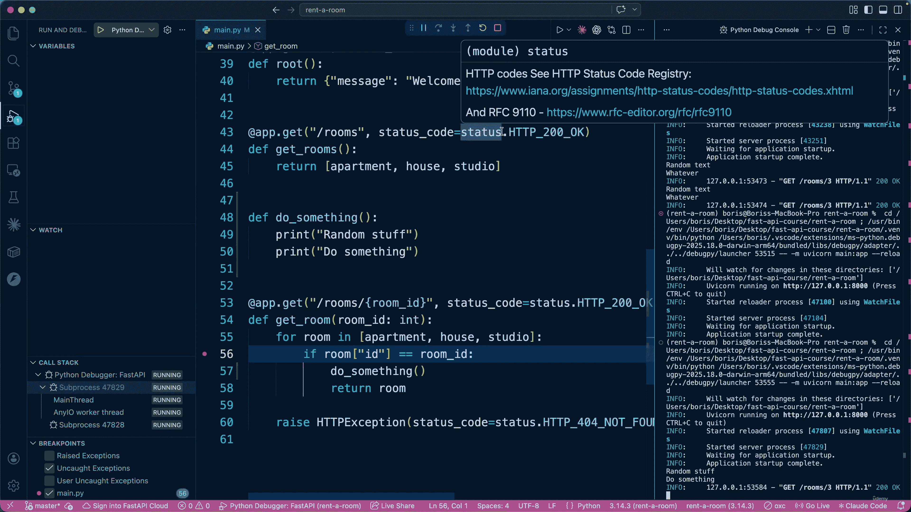
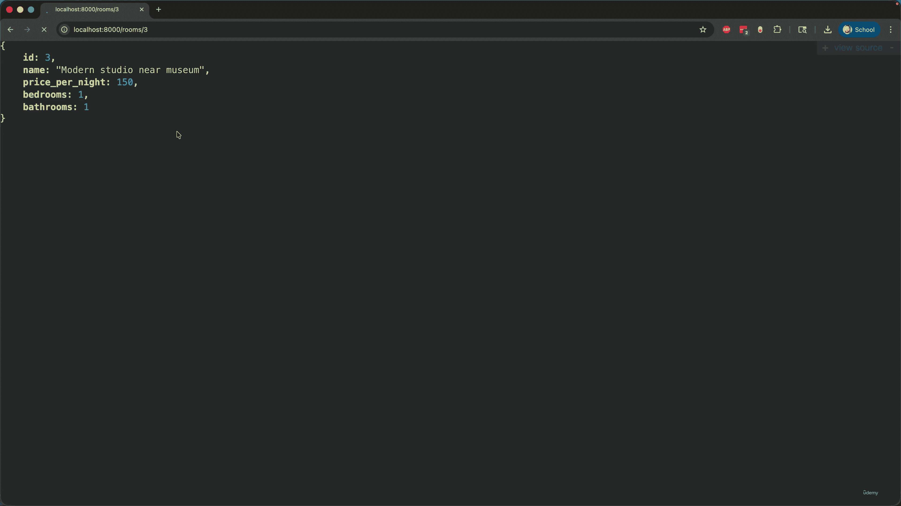
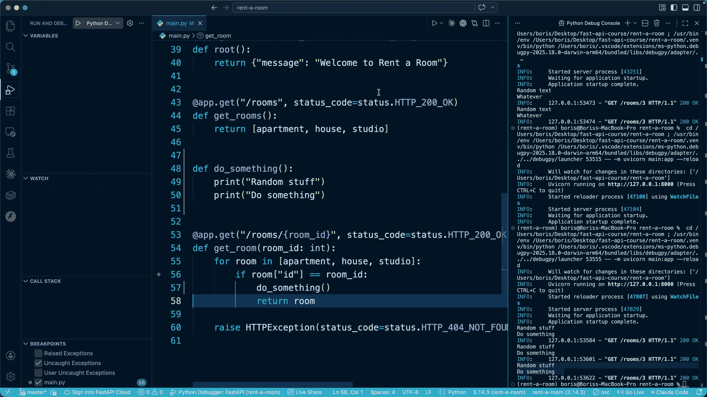

# 🐞 FastAPI大师课：第27-28节：在VS Code中使用调试器

在本节课中我们将要学习如何在VS Code中使用Python调试器，在真正以调试模式启动庞大的FastAPI服务器之前，先走查单个路由处理函数和单个端点。为了让调试器的各种选项更容易解释，我们会临时添加一小段代码，这段代码会在课程结束时删除。

上一段我们说明了本节课的目标和临时代码的用途，本节来看看如何准备临时函数以及如何放置断点。

## 🧪 FastAPI大师课：第27-28节：准备临时函数与断点

先在单个房间的处理函数上方定义一个任意函数，名字叫`do_something`。函数体里使用两次`print`，内容可以随意，例如打印`random stuff`，再打印一次类似内容，具体内容不重要。

```python
def do_something():
    print("random stuff")
    print("do something one more time")
```

然后在这个处理函数中，当根据ID匹配路径参数`room_id`、并且在把房间作为响应返回给客户端之前，调用`do_something`函数。这样只是多加一行代码，更重要的是我们有一个可以进入的函数，后面会用到。

```python
do_something()
return room
```

下一步是定义断点。断点是调试器会暂停的行。我们可以在浏览器中命中一个端点，例如`rooms/3`；代码运行到断点时就会暂停，此时可以检查应用状态和请求状态。

定义断点的方法是在所有行号左侧的gutter区域操作：鼠标悬停时会出现红点，点击任意行即可添加。示例中我们在`if`语句所在行添加断点。如果`if`语句在不同行，或者因为换行格式不同导致行号不同，可以忽略确切行号，重点是瞄准`if`语句行。断点不限于一个，可以添加多个，但这里先从一个开始。

现在断点的含义是：客户端命中服务器端点，代码运行到这一行时，VS Code请暂停代码，方便调试。

> 断点 = 代码执行到指定行时暂停的位置。



以上我们准备好了临时函数和断点，本节来看看如何以调试模式启动FastAPI服务器并命中断点。

## 🚀 FastAPI大师课：第27-28节：启动调试模式与命中断点



点击“运行和调试”图标进入面板，按绿色播放按钮以调试模式启动服务器。如果想关闭服务器，使用红色矩形停止按钮，它会终止服务器。你会看到与常规`uv run`命令完全相同的服务器输出，只是现在输出被包含在VS Code右侧终端中。

按绿色播放按钮就等于启动FastAPI服务器。不要让它和终端里的常规服务器同时运行；如果终端里正在运行FastAPI服务器，先用`Ctrl+C`关闭，然后这个命令会在VS Code内启动同一个服务器或应用，并额外支持调试。

最重要的是调试面板。现在这些按钮是禁用的，但命中断点后就会启用。浏览器访问示例端点`rooms/3`会触发断点。在Chrome中访问`rooms/3`并按回车发起新请求，浏览器会进入pending状态，可以通过旋转动画看出来；客户端正在等待服务器响应，而服务器因为断点进入暂停状态。

回到VS Code，带断点的行会高亮。此时这一行还没有执行，我们位于该行开头，但代码本身尚未运行。这个断点放在`for`循环内，所以下一次命中会是循环第二次迭代访问列表中的`house`元素时；第三次迭代会访问`studio`，假设代码会返回，那么还会再次命中该断点。断点不只命中一次，Python每次运行到这一行都会暂停。

左侧变量区会显示所有已定义变量。当前是第一次迭代，位于`apartment`，因此可以看到`room`变量，以及`for`循环声明的迭代器变量，对应第一个房间字典对象，可以看到它的ID、name等属性。也能访问所有函数参数。`room_id`是这里声明的路径参数，因为浏览器请求了`/rooms/3`，所以这个值会显示为3。

```text
请求: GET /rooms/3
room_id = 3
第一次迭代: room = apartment
```

我们已看到第一次暂停和变量状态，本节来看看Continue按钮如何工作。

## ⏩ FastAPI大师课：第27-28节：Continue按钮：跳到下一个断点

第一个按钮是Continue，它会继续运行到下一个断点。如果只有一个断点，而且不在`for`循环内，那么Continue会一直运行到执行结束，服务器返回有效响应。本例中我们会命中下一个断点，实际上还是同一个断点，现在位于`for`循环第二次迭代的`house`。

第二次暂停时，左侧数据会更新，现在是列表中的第二个房间，ID为2；`room_id`路径参数仍然对应路径，所以保持为3。调试目标是在关键点查看应用状态，确认状态是否符合预期。这里知道房间ID为2，不匹配期望的3，所以预期继续到下一个断点时不会提前返回，而会进入下一个`if`语句检查列表最后元素。

按Continue，第三次暂停在`studio`，房间ID为3并匹配。再按Continue，后面没有额外断点，路由处理函数执行完成，没有行高亮，服务器返回常规响应。右侧面板输出`GET rooms/3`和200 OK。这样就能暂停请求并逐行分析。

```text
Continue = 运行到下一个断点
第二次暂停: room_id = 3, room["id"] = 2 -> 不匹配
第三次暂停: room_id = 3, room["id"] = 3 -> 匹配
```

Continue适合快速跨断点，本节来看看Step Over如何逐行执行但不进入函数。

## 👣 FastAPI大师课：第27-28节：Step Over：逐行执行但不进入函数

要再次进入断点模式，需要从浏览器再发一个新请求。此时浏览器不再pending，显示上一请求响应；再发起请求后，浏览器再次暂停，说明VS Code也再次暂停在第一次迭代。

下一个按钮是Step Over，它会导航到下一个逻辑执行行，而不是下一个断点。示例中`if`语句会计算为false，执行这一行会回到原来的`for`循环，因为这是迭代从`apartment`推进到`studio`的内部逻辑。Step Over更细粒度，因为按行导航而不是按断点导航。





再点击一次，会到下一个`if`语句检查，针对ID为2的房间，结果为false。再点一行，回到`for`循环；再点一次，进入`if`语句；再点一次，落到`if`的嵌套内容，也就是`do_something`函数。这个按钮叫Step Over，是因为遇到嵌套函数时，它会跨过该行代码，继续按行推进。再按Step Over不会进入`do_something`，只会执行它，然后到下一逻辑行`return`并高亮。此时右侧终端仍成功运行`do_something`，可以看到print函数输出，但我们是跨过它执行的。因此它叫Step Over：不深入任何函数，只跨过该行。最后在`return`语句按Step Over，后面没有可导航行，因为路由处理函数结束，响应返回客户端。

```text
Step Over = 执行当前行；若当前行调用函数，不进入函数体
```

Step Over不进入函数，本节看看Step Into如何进入嵌套函数内部。

## 🔍 FastAPI大师课：第27-28节：Step Into：进入嵌套函数内部

互补按钮是Step Into，它会进入嵌套函数。再次触发断点：回到浏览器重新执行请求，VS Code停在第一个断点。使用几次Step Over，穿过前两次迭代，到达第三次迭代。现在位于`do_something`行，高亮行即将执行但尚未运行。此时选择Step Into，调试器会进入该执行，逻辑会从函数内部重新逐行应用。

如果这时按Step Over，我们会处在另一个函数的上下文中逐行导航。普通行上Step Over和Step Into效果相同；但如果`do_something`还调用另一个嵌套函数，Step Over会跨过那个函数调用，Step Into会再深入一层。

```text
Step Into = 进入当前行所调用函数的函数体，并逐行执行
```

进入函数后需要退出，本节看看Step Out如何完成当前函数并返回上层。

## 🚪 FastAPI大师课：第27-28节：Step Out：执行完当前函数并返回上层

互补按钮是Step Out，用于逃离当前上下文。想象`do_something`有100行，你意识到已经看够了，不想继续用Step Over或Step Into逐行走，只想完成当前函数的运行，Step Out就是做这件事。按Step Out会完成当前嵌套函数`do_something`的运行，右侧可以看到所有print调用输出，然后回到最后执行点。

需要澄清：此时`do_something`实际上已经运行；我们先Step Into进入，再按Step Out完成执行并回到这一行。高亮可能让人误以为`do_something`还没运行，但实际已经运行，右侧有输出。之后无论按Step Into还是Step Over，点击到下一行，再查看状态；再执行一次就回到正常起点。

```text
Step Out = 执行完当前函数，并返回上层调用点
```

断点不限于一个，可以放多个；用Continue到下一断点；用Step Over逐行；用Step Into进入嵌套函数执行；用Step Out回到更高层函数执行。核心目的是在VS Code中逐行导航代码，检查状态、变量、参数是否符合预期。这里还有更多功能，在更高级Python教程中介绍；这些是快速了解路由处理函数执行方式的基础。

以上我们掌握了基本调试按钮，本节来看看如何结束调试并恢复常规服务器。

## 🛑 FastAPI大师课：第27-28节：结束调试与总结

完成后点击红色矩形停止按钮关闭调试服务器。随后可以在终端用`uv run fastapi dev`重启常规FastAPI服务器。需要调试模式时，先在终端关闭服务器，再在VS Code启动调试服务器并执行同样逻辑。这就是在VS Code中使用Python调试器调试FastAPI应用。

本节课中我们一起学习了：添加临时函数和断点，以调试模式启动服务器，命中断点观察请求状态和变量，使用Continue跳到下一个断点，使用Step Over逐行但不进入函数，使用Step Into进入嵌套函数，使用Step Out执行完当前函数回到上层，以及调试结束后停止服务器并恢复常规启动方式。以下是本节课涉及的核心操作清单：

- `断点 = 代码执行到指定行时暂停的位置`。

- `Continue = 运行到下一个断点`。

- `Step Over = 执行当前行，但不进入被调用函数`。

- `Step Into = 进入当前行调用的函数体`。

- `Step Out = 执行完当前函数并返回上层调用点`。



这些操作组合起来，就能在VS Code里逐行查看FastAPI路由处理函数的执行过程，并确认变量、参数和请求状态是否符合预期。

