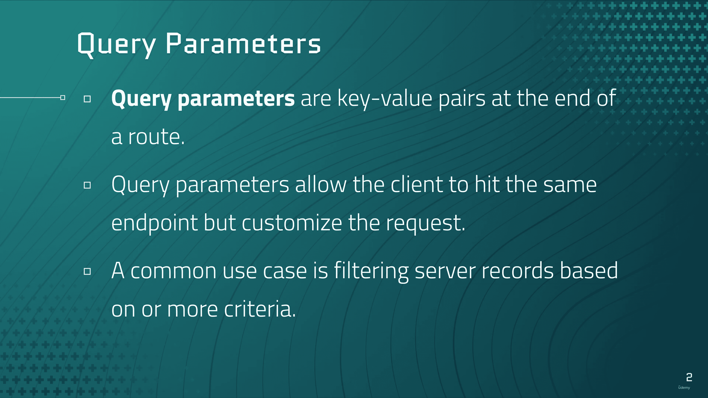
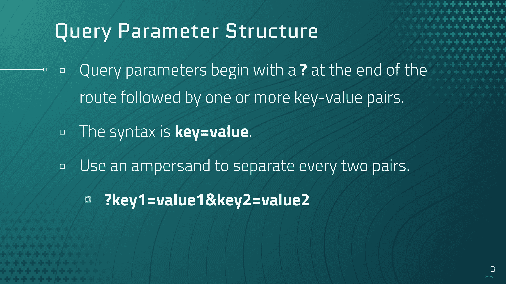
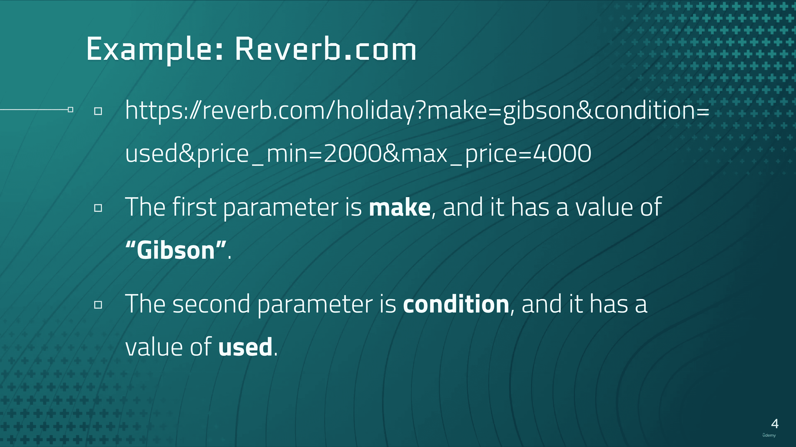
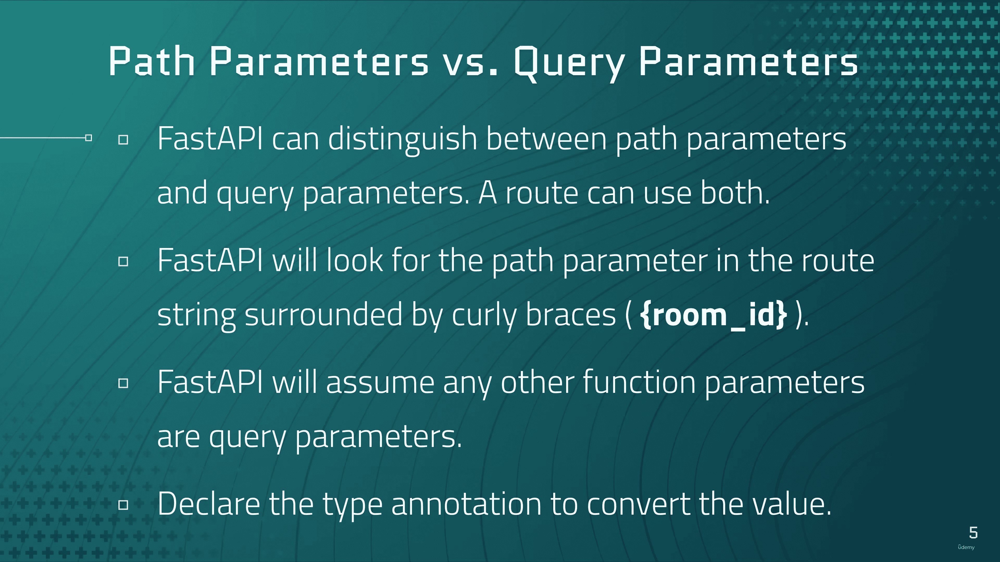

# FastAPI Masterclass：01：查询参数与验证 🧭

欢迎来到本课程下一节。本节覆盖查询参数，并进一步扩展验证。在本节课中，我们将要学习如何要求查询参数、如何允许可选查询参数、介绍关键的 `Annotated` 类型，还会介绍 Pydantic 数据验证库，FastAPI 正是构建在它之上。下面先做一个简短的技术讨论，从查询参数的基本概念开始。

## FastAPI Masterclass：01.1：查询参数是什么 🔑

在概述之后，本节中我们来看看查询参数的技术定义。查询参数本质上是附加在路由末尾的键值对。键值对最接近 Python 字典中的条目：键是标识或标签，值是对应内容。这个思路完全一样，只是应用在实际路由末尾。查询参数允许客户端命中同一个基础端点，同时通过附加信息来自定义请求。一个很常见的用途是过滤，客户端提供键值对，要求服务器只返回总记录中的子集或较小集合。换句话说，同一个接口可以通过不同查询参数返回不同筛选结果，这也是它很实用的原因。

查询参数在 URL 中有固定结构。下面用代码表示这个结构。

```text
/route?key1=value1&key2=value2
```

具体来说，在给定路由或路径末尾先放一个问号，表示查询参数部分开始；然后写键、等号和该键对应的值。查询参数不限于一个，可以有很多个；每两个键值对之间用 `&` 分隔，这个符号在键盘上按 Shift+7 输入。下面是一个结构示例，第一组是 `key1=value`，然后用 `&` 连接第二组 `key2=value`。



```text
/path?key1=value&key2=value
```

理解查询参数的结构和用途后，下一节我们来看真实世界示例。

## FastAPI Masterclass：01.2：真实世界示例与接收方式 🌍

上一节我们了解了查询参数的 URL 结构，本节中我们来看一个真实世界示例，并说明 FastAPI 如何接收这些参数。有一个叫 Reverb.co 的网站，是在线乐器市场。这里有一个我找到的实际 URL 示例，网站核心路径是 `holiday`，末尾带有一串查询参数。这个网站会在用户选择界面上的各种复选框时自动更新 URL，因此 URL 可以复制粘贴并发给别人，用来重建完全相同的结果集。可以看到 `holiday` 后面有问号，表示查询参数开始，然后有几个查询参数：第一个叫 `make`，值是 `Gibson`；第二个叫 `condition`，值是 `used`；第三个叫 `price_min`，值是 `2000`；最后一个叫 `max_price`，值是 `4000`。这些查询参数都可以在路由处理函数中作为参数接收。和路径参数很像，FastAPI 会自动从每个客户端请求中解析它们，然后我们可以在路由处理函数体中使用这些数据点和值。



以下是该 URL 中四个查询参数的键值对，方便初学者逐项对照：

- `make` = `Gibson`
- `condition` = `used`
- `price_min` = `2000`
- `max_price` = `4000`

从列表可以看出，这些键值对就是客户端附加在 URL 末尾的额外信息；FastAPI 会自动把它们解析成路由处理函数参数。下面用代码表示这个真实 URL 的查询参数结构。



```text
/holiday?make=Gibson&condition=used&price_min=2000&max_price=4000
```

看完真实示例后，下一节我们对比路径参数和查询参数。

## FastAPI Masterclass：01.3：路径参数与查询参数的区别 🧩

上一节我们看到了真实 URL 中的查询参数，本节中我们来看看路径参数和查询参数的区别。两者可以同时存在。例如，可以使用路径路由 `/rooms/1`，仍然在末尾附加查询参数，FastAPI 路由处理函数可以响应。FastAPI 逻辑能够区分这两种构造，依据仍然是我们传给 `get` 方法的字符串。记住，声明路径参数时要用花括号包起来，就像 `room_id` 一样。因此，当我们在互补的路由处理函数中声明一个 `room_id` 参数时，FastAPI 明白它是路径参数，原因正是函数参数名匹配花括号内的路径参数名。相反，如果我们在路由处理函数中定义了一个 FastAPI 无法关联到互补路径参数的参数，那么 FastAPI 就会假设这些参数代表查询参数。它会自动从客户端获取实际查询字符串，也就是带问号、等号和 `&` 的那部分，并自动解析出键值对；函数中的每个参数对应一个键，值就是客户端提供的实际值。这样，在路由处理函数体中，我们既能使用路径参数的数据，例如具体的房间 ID，也能使用所有查询参数对应的值，并把它们用于程序逻辑。

下面用代码对比路径参数和查询参数在路由处理函数中的写法。

```python
@app.get("/rooms/{room_id}")
def get_room(room_id: int, make: str, condition: str):
    # room_id 来自路径参数
    # make 和 condition 来自查询参数
    ...
```

掌握两者区别后，下一节我们对本部分做总结。

## FastAPI Masterclass：01.4：本节总结 📌



上一节我们对比了路径参数和查询参数，本节中我们对查询参数做一个高层总结。查询参数是附加在路由末尾的键值对，使用问号开始，使用等号连接键和值，使用 `&` 分隔多个参数。客户端可以通过查询参数在命中同一基础端点的同时自定义请求，常见用途是过滤结果集。FastAPI 会根据路由处理函数参数是否匹配花括号中的路径参数，来判断参数是路径参数还是查询参数；无法匹配路径参数的函数参数会被当作查询参数，并从请求中自动解析。本节课中我们一起学习了查询参数的基本结构、真实 URL 示例、在路由处理函数中的接收方式，以及路径参数和查询参数的区别。下一课我们会在项目中详细构建查询参数，到时见。

