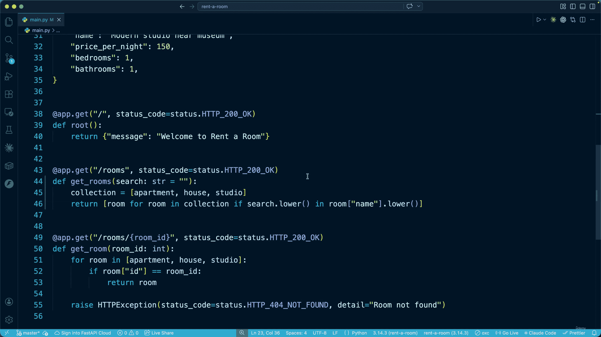
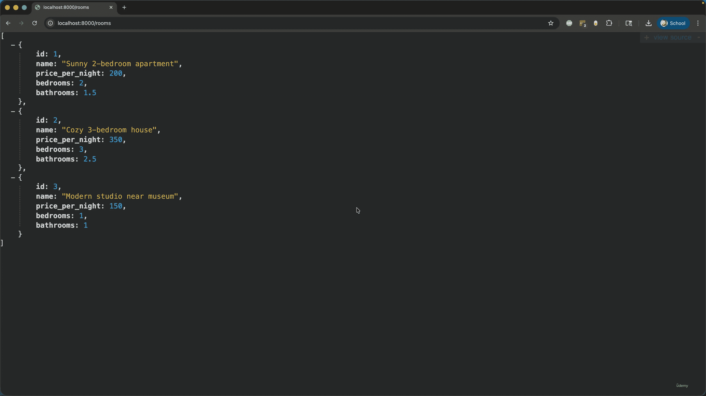
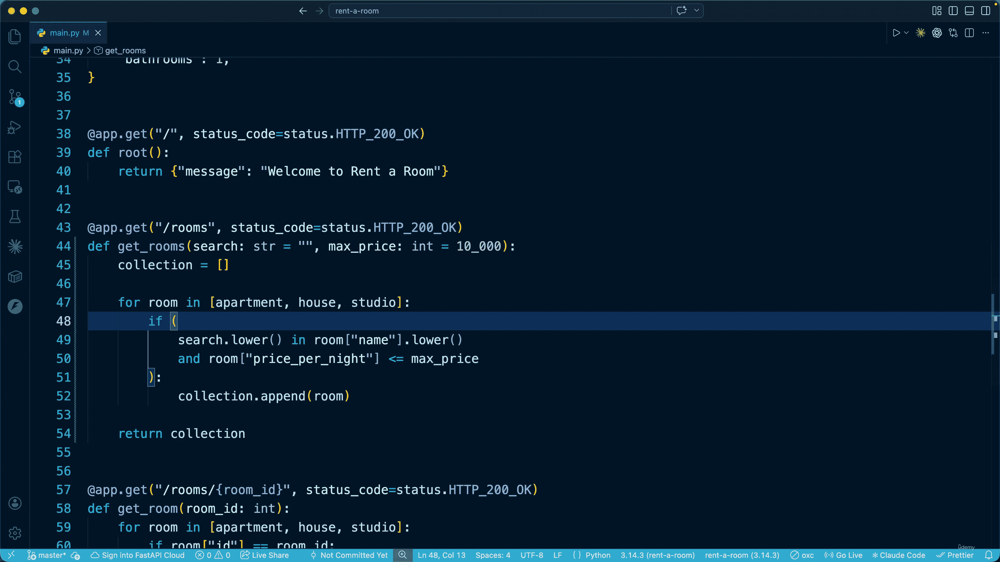
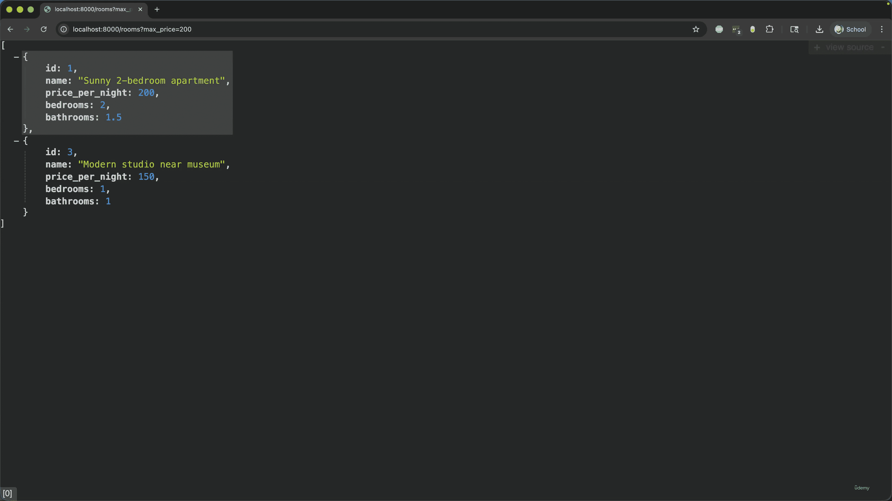

# FastAPI 大师课：第31讲：添加查询参数 🔍

在本节课中，我们将要学习如何给 FastAPI 的 `get_rooms` 端点添加查询参数（query parameter）。我们会先添加一个用于搜索的 `search` 参数，再添加一个用于价格过滤的 `max_price` 参数。通过这两个例子，你会理解查询参数在 FastAPI 中是如何被识别、解析和使用的，也会明白为什么默认值在查询参数设计中占据重要地位。

## 准备工作：清理上一节代码 🧹

上一节我们留下了一些调试用的断点，还有一个临时写的 `do_something` 函数。在开始新功能之前，我们先把这些清理干净，免得后面的演示被干扰。具体来说，我删除了代码左侧 gutter 区域的所有断点，也删除了那个只是为了举例而存在的 `do_something` 函数。清理完成后，剩下的代码就是实现房间列表功能的核心部分，结构非常干净。

现在，进入真正的 `get_rooms` 函数定义。我们要做的第一件事，就是让这个函数接受一个名为 `search` 的参数。在 Python 中，我们可以用冒号进行类型注解，所以我把 `search` 的类型声明为 `str`（字符串）。

这里的原理是这样的：FastAPI 在判断参数类型时，会看这个参数是否和路径参数匹配。之前我们学过，`room_id` 之所以被识别为路径参数，是因为它和路径里花括号包裹的 `{room_id}` 片段对应。而现在，我们的路由装饰器路径中没有任何 `search` 的路径组件，因此 FastAPI 就知道 `search` 只能是一个查询参数。这个判断过程完全自动，不需要额外配置。

## 添加第一个查询参数 search 🔎

接着，我们用普通 Python 语法给 `search` 参数一个默认值。写法是在类型注解后面加等号，再写默认值。这里我们让默认值为空字符串。

为什么要设成空字符串？因为空字符串有一个非常好的性质：在任何字符串里都能被找到。例如，在 `"room"` 里搜索空字符串，结果是 `True`；在 `"studio"` 里搜索空字符串，结果也是 `True`。甚至用空字符串去匹配空字符串，Python 依然会返回 `True`。这个性质非常有用，它意味着当客户端没有传 `search` 参数时，搜索条件退化成“所有房间都匹配”，我们就能返回完整的房间列表，不会因为缺少参数而出错。

```python
print("" in "room")   # True
print("" in "studio") # True
print("" in "")       # True
```

现在，在 `get_rooms` 的函数体里，我们真正执行搜索。原来的代码可能直接返回一个固定的房间列表。为了配合搜索，我们不再提前返回，而是先把这三个房间的列表保存到一个变量里，这个变量叫做 `collection`。然后，我们使用列表推导式来过滤数据。

列表推导式是 Python 中非常实用的语法，它可以让我们遍历列表中的每一个元素，并对每个元素执行同样的操作。我们要做的操作是：只保留那些名字里包含客户端搜索词的房间。具体写法是这样的：

```python
collection = [
    {"name": "Sunny 2 Bedroom Apartment", "price_per_night": 250},
    {"name": "Cozy 3 Bedroom House", "price_per_night": 300},
    {"name": "Modern Studio", "price_per_night": 150},
]

return [room for room in collection if search in room["name"]]
```

这里，Python 会先对 `collection` 做一次完整的遍历，接着在列表推导式后面的 `if` 条件里判断搜索词是否出现在房间名称中。通过这种方式，我们可以把大列表过滤成符合条件的子集。

不过，这里还有一个细节需要处理。用户输入的搜索词大小写可能五花八门，比如 `BEDROOM`、`Bedroom`、`bedroom` 都不一样。为了做到不管用户怎么输入都能匹配，我们要对搜索词调用 `lower()` 方法，把它统一转成小写。这实际上是在把文本规范化成一个可预测、一致的格式。与此同时，房间名称也要调用 `lower()`，让两边都在小写状态下进行比较。这样，`Cozy` 和 `cozy` 就能匹配上了。

```python
return [room for room in collection if search.lower() in room["name"].lower()]
```

总结一下这段逻辑：我们会遍历这个包含三个房间的集合，依次取出 `name` 键对应的值，比如 `Sunny 2 Bedroom Apartment` 或 `Cozy 3 Bedroom House`，然后在这个值中搜索查询参数。如果找到了，就把这个房间放进要返回给客户端的结果集。如果客户端没有提供查询参数，那么搜索空字符串的结果就是对所有房间都成立，于是返回完整的三条数据。



通常情况下，查询参数最好是可选的，因为我们要尽可能保持接口的灵活性。你不应该强制要求客户端提供某些数据，尤其是当这些数据对端点的实际功能并不关键的时候。所以，如果条件允许，让查询参数保持可选是个好习惯。我们这里正是这样做的。

## 在浏览器中测试 search 🧪

代码写好后，我们就可以在浏览器里实际验证一下这个逻辑。打开 Chrome，导航到我们的 `rooms` 端点，然后在 URL 后面附加查询参数。在 URL 中附加查询参数时，要记住以下几点：

- 用问号（`?`）标记查询参数的开始。
- 每个参数写成“参数名=值”的形式。
- 参数名必须与 FastAPI 函数中的参数名完全一致。

你甚至可以反过来理解：FastAPI 会自动解析客户端发来的请求，在 URL 中寻找所有查询参数，然后把它们一一映射到函数参数上。所以，如果我们的函数参数叫 `search`，FastAPI 就会去找名叫 `search` 的查询参数。我们在浏览器地址栏输入：

```
http://127.0.0.1:8000/rooms?search=bedroom
```

回车之后，返回结果里只剩下名称中包含 `bedroom` 的两个房间，而不是原来的三个。你再换成 `cozy` 试试，结果集就只剩一个房间，因为只有这个房间名称里包含 `cozy`。这说明搜索逻辑是有效的。

另外要注意，即使你输入 `CoZy` 这种大小写混合的词，依然能匹配成功。因为我们在服务端对搜索词和房间名都做了小写化处理，两边最终都在小写状态下比较。浏览器甚至可能自己也会做一层规范化，但我们在服务端仍然保持谨慎，确保万无一失。

还有一个重要事实：如果完全省略查询参数，也就是去掉 URL 中从问号开始的所有内容，那么 `search` 就会回退到我们设定的空字符串默认值。结果是，返回完整的三条房间数据。这也从侧面证明，我们的默认值设置得很合理，原有功能没有被破坏。



## 添加第二个查询参数 max_price 💰

学会了 `search` 之后，我们再练一个更有意思的：添加一个名为 `max_price` 的查询参数，用来设置价格上限。这个参数的作用是，只返回每晚价格小于等于该上限的房间。

操作方法和添加 `search` 完全一样。我们在 `get_rooms` 函数的参数列表中再加一个参数 `max_price`。因为 `max_price` 不是路径参数，FastAPI 会自动把它识别为查询参数。和 `search` 不同，我们希望 `max_price` 是一个整数。这里再说一遍，查询参数从网络传输过来时都是字符串，但 FastAPI 会根据类型注解尽力把它转换成我们想要的类型，也就是 `int`。

同样，我们也给 `max_price` 一个默认值，这样在技术上它就是可选的。客户端可以选择只传 `search`、只传 `max_price`、两个都传，或者两个都不传。为了兜底，我们需要选一个合理的大数字作为默认值。这里我选择 `10000`。顺便说一句，在 Python 中，大数字可以用下划线分隔来提高可读性，比如 `10_000` 和 `10000` 完全一样，但看起来清晰多了。

```python
def get_rooms(search: str = "", max_price: int = 10_000):
    ...
```

## 实现双条件过滤 ✂️

到了这一步，列表推导式已经不足以承载这么复杂的逻辑，我们就让它更展开一些：手动构建返回列表。我用一个 `collection` 列表来收集最终结果。遍历原始房间数据，在循环中对每个房间做两个条件判断。第一个条件和前面一样：检查 `search` 的小写形式是否出现在房间名的小写形式中。第二个条件需要额外检查价格：当前房间字典通过 `price_per_night` 键就能拿到每晚价格，我们判断它是否小于等于 `max_price`。

如果某个房间的价格高于 `max_price`，说明它超出了用户愿意支付的金额，就把它排除掉。这样，只有同时满足“名称匹配搜索词”和“价格不超过上限”这两个条件的房间，才会被追加到 `collection` 列表的末尾。最后，等遍历完所有房间，返回这个过滤后的 `collection` 即可。

```python
def get_rooms(search: str = "", max_price: int = 10_000):
    rooms = [
        {"name": "Sunny 2 Bedroom Apartment", "price_per_night": 250},
        {"name": "Cozy 3 Bedroom House", "price_per_night": 300},
        {"name": "Modern Studio", "price_per_night": 150},
    ]

    collection = []

    for room in rooms:
        if search.lower() in room["name"].lower() and room["price_per_night"] <= max_price:
            collection.append(room)

    return collection
```

这样做的好处是，逻辑一目了然。先通过搜索词过滤一遍，再通过价格上限过滤一遍，两个条件都满足才保留。虽然代码比列表推导式长一些，但可读性更强，对于初学者来说也更容易理解。

## 在浏览器中测试 max_price 🌐

写完代码，再到浏览器里测试。这次我们要同时提供两个查询参数，URL 的格式是先写问号，然后第一个参数名和值，接着用 `&` 符号连接第二个参数名和值。例如：

```
http://127.0.0.1:8000/rooms?search=bedroom&max_price=300
```

这里 `max_price` 的写法必须和服务器端定义的完全一致，即蛇形命名 `max_price`，不能写成 `maxPrice`。浏览器会把参数值作为字符串发送，FastAPI 会负责转换成整数。

执行上面的 URL，结果集只有一个房间。因为这个房间名称包含 `bedroom`，并且价格低于 300。为了证明过滤生效，我们可以去掉 `max_price` 再请求一次，结果会变成两个房间。这说明 `search` 和 `max_price` 可以独立工作。当然，我们也可以只传 `max_price`，或者两个都不传。



再举一个例子，如果只传 `max_price=200`，由于 `search` 回退为空字符串，而空字符串在房间名里永远能找到，所以所有房间都会通过搜索条件；再经过价格过滤，最终返回的就是所有价格小于等于 200 的房间。

大家可以自己动手试试不同的组合，把参数顺序调换一下，或者只删掉其中一个参数。查询参数的基本原理正是如此：它们是以键值对形式附加在 URL 中的额外信息，作用是让我们可以向服务器传递更多条件，通常被用来做数据过滤，比如从一个大列表中筛出一个小子集。

## 总结 🎯



本节课中，我们一起学习了如何在 FastAPI 中添加查询参数。我们从 `search` 参数开始，了解了查询参数与路径参数的区别，知道了如何用类型注解声明参数类型，以及用默认值让参数可选。然后，我们实现了大小写不敏感的搜索功能，并测试了效果。接着，又添加了 `max_price` 参数，学会了用 `&` 连接多个查询参数，并实现了“名称匹配 + 价格上限”的双条件过滤。最后，我们通过实际请求验证了各个参数组合的行为。希望各位课后能多试几组参数，加深理解。
