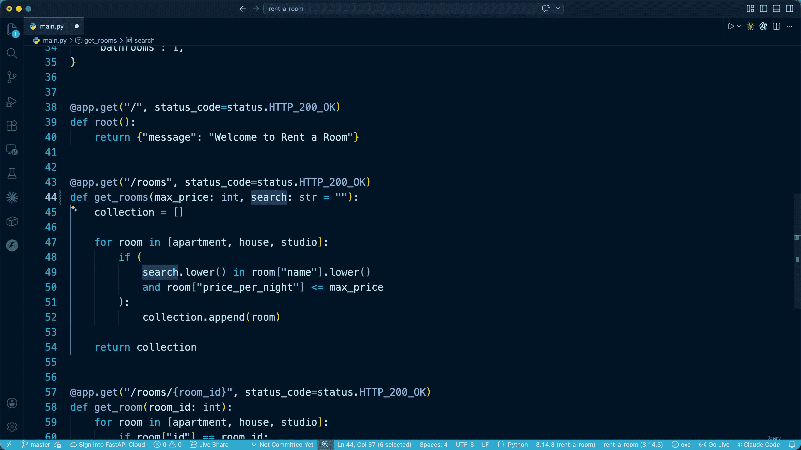
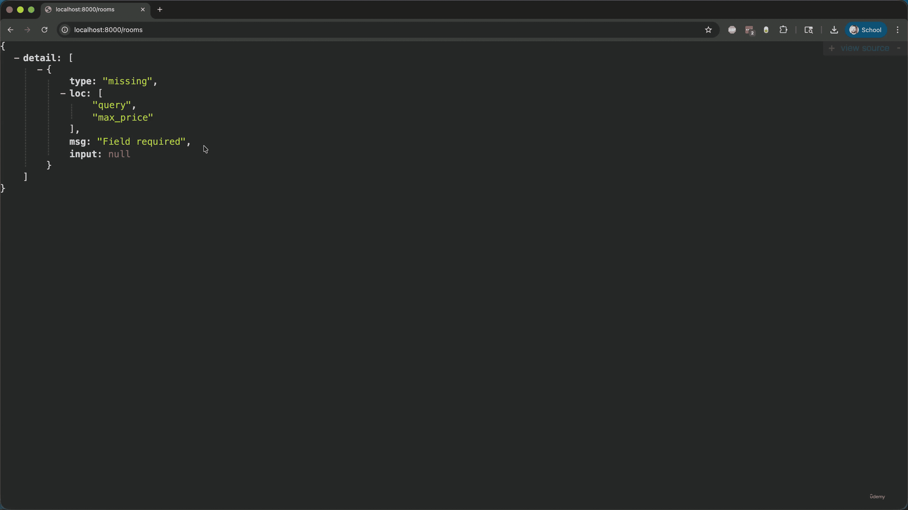
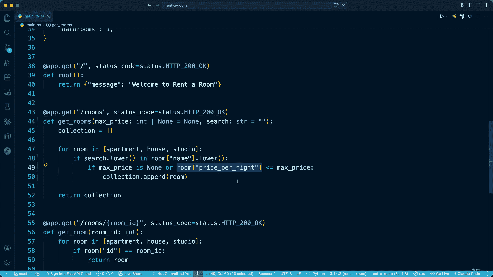
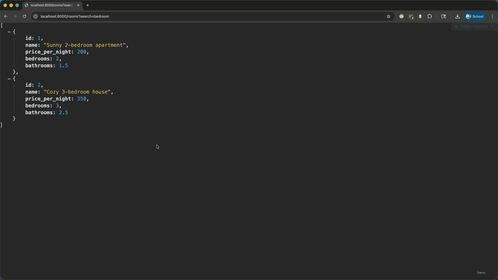
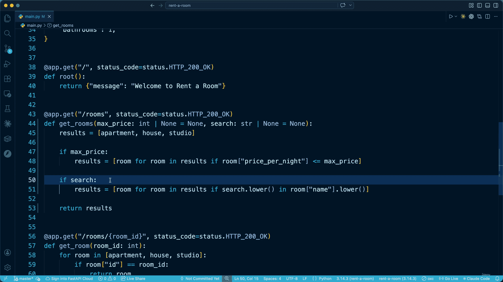
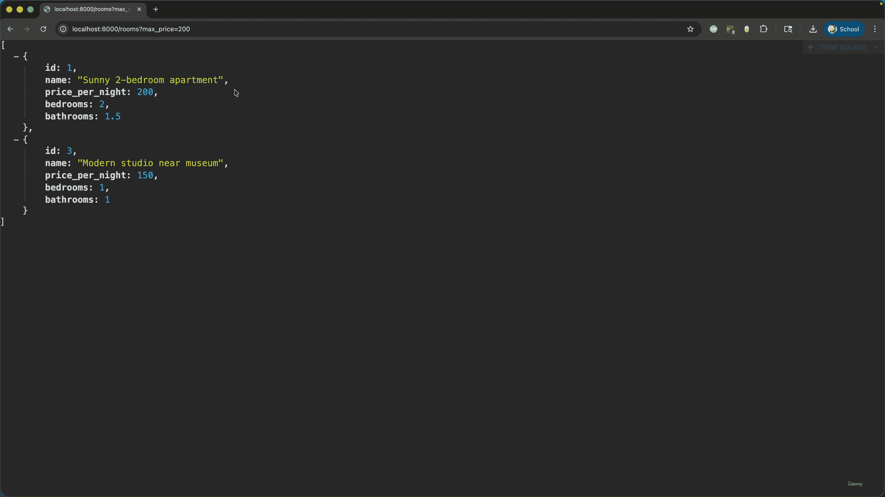

# 🚀 FastAPI 大师课（第一部分）：第32节：可选查询参数


在本节课中我们将要学习 FastAPI 中可选查询参数的核心机制，以及如何用默认参数、`None` 和类型注解来控制查询参数是否必填。我们会从上一节的代码出发，先看默认参数为什么能让参数变成可选，再演示把参数改成必填后会得到什么报错，最后用更常见的 `None` 模式实现灵活过滤。整个教程会尽量用大白话说明，让初学者也能跟上节奏，同时把每一步的逻辑讲清楚，避免只记住代码却不知道代码为什么这样写。


## 🧩 FastAPI 大师课（第一部分）：第32节：默认参数让查询参数变成可选


上一节我们介绍了查询参数的基本用法，本节中我们来看看“可选”到底是怎么实现的。简单说，给函数参数提供一个默认值，这个参数就变成可选参数。公式可以写成：


```python
def 函数(参数=默认值):
    ...
```


在上一节的代码里，`search` 和 `max_price` 都提供了默认参数，因此这两个查询参数都是可选的。客户端不需要一定提供它们，因为服务器总能回退到这两个默认值。也就是说，请求里带不带这两个查询参数，接口都能正常处理，这就是可选查询参数最直白的理解。只要服务器有默认值可以回退，客户端就少了一份必须传参的负担，接口使用起来也会更灵活。


## ⚠️ FastAPI 大师课（第一部分）：第32节：把查询参数改成必填会怎样


上一节我们知道了默认值让参数可选，本节中我们来看看反过来会怎样。我们也可以把查询参数做成必填，虽然不一定总是好的技术决策，但这里要演示这种写法，以及不提供该查询参数时 FastAPI 会返回什么错误。下面先看这一步的操作要点，方便把代码改动和报错原因对应起来。




- 删除 `max_price` 的默认参数 `10000`。
- 观察 VS Code 立刻报错。
- 理解 Python 的技术要求：没有默认值的参数必须放在函数定义的前面。
- 因此不能把 `max_price` 放在有默认值的 `search` 后面，需要剪切并粘贴到前面。
- 这两个参数仍然都是查询参数。


代码变化可以记成：


```python
# 修改前：两个参数都有默认值，都是可选
def read_rooms(search: str = "", max_price: int = 10000):
    ...

# 修改后：max_price 没有默认值，变成必填；search 仍有默认值
def read_rooms(max_price: int, search: str = ""):
    ...
```


这里补充一句，客户端在请求时可以提供任意顺序的查询参数，顺序不重要，因为 FastAPI 会按参数名称进行匹配。但现在 `max_price` 变成必填，而 `search` 仍然是可选。这个顺序调整不是 FastAPI 的特殊要求，而是 Python 函数定义本身的规则，所以写代码时要注意参数排列。




## 🛑 FastAPI 大师课（第一部分）：第32节：缺少必填查询参数时的报错


上一节我们把 `max_price` 改成了必填，本节中我们来看看实际请求会得到什么结果。保存代码并回到浏览器后，如果只请求 `/rooms` 本身，`search` 查询参数会使用默认的空字符串，但 `max_price` 不再有默认值，因此会因为必填而得到错误。这个错误信息包含以下关键信息，可以帮助我们快速定位问题。


- 错误类型是 `missing`。
- 错误位置是查询参数。
- 提示更具体地指向 `max_price` 查询参数。
- 返回消息是 `field required`，也就是字段必填。


可以把这个错误理解成：


```text
error_type = "missing"
location = "query"
prompt = "max_price"
message = "field required"
```


之前我们看到类似错误时，位置可能是路径参数，因为路径参数传了无效参数。这里的位置变成查询参数，并且更具体地说是 `max_price` 查询参数。这个报错机制能帮助客户端知道到底少了什么，也能帮助开发者理解 FastAPI 是如何区分路径参数错误和查询参数错误的。


## 🧱 FastAPI 大师课（第一部分）：第32节：用 None 表示客户端没有提供值


上一节我们看到了必填参数会报错，本节中我们来看看实际开发中最常见的处理方式。很多时候，我们不会用空字符串或一个具体数字作为默认值，而是使用 Python 的 `None` 对象。`None` 表示“什么都没有”或“缺失”，这正好可以用来表达“客户端到底有没有提供这个查询参数”。这里涉及的核心写法如下：


```python
def read_rooms(max_price: int | None = None):
    ...
```


具体来说，`max_price` 的类型注解扩展为联合类型：`int | None`，表示它既可能是整数，也可能是 `None`，同时默认参数设为 `None`。可以假设客户端不会主动发送 `None`，实际上也基本没有技术方式让它发送。这样逻辑就变成：如果客户端在查询参数里给了 `max_price` 整数，我们就用这个整数；如果客户端什么都没给，就回退到 `None`，而 `None` 也正好表示我们没有从客户端收到任何值。


反过来想，如果把默认值写成 `10000`，我们就无法区分到底是客户端真的发送了 `10000`，还是服务器回退到了 `10000`。因此，用 `None` 作为“查询参数未提供”的符号表示，是 FastAPI 代码里很常见的一种模式。这个模式的好处是语义清楚：`None` 不是业务数据，而是“没有值”的标记。




## 🔀 FastAPI 大师课（第一部分）：第32节：拆开条件逻辑处理可选参数


上一节我们用 `None` 表示未提供值，本节中我们来看看怎么把过滤逻辑写清楚。为了简单，可以把原本的条件拆成两个嵌套的 `if`。先提取原来的条件部分，然后在第一个 `if` 块里扩展判断。整理代码时，删除旧的条件片段，补上冒号并缩进，保证嵌套关系正确。先看第一层判断：


```python
if max_price is None or room.price_per_night <= max_price:
    # 还要继续检查 search
    ...
```


这里先检查 `max_price` 是否为 `None`。如果用户没有提供 `max_price` 查询参数，我们仍然希望把房间包含进来，因为要对结果集尽量灵活、尽量宽松。第一项条件就是：如果 `max_price is None`，就直接认为这个房间满足价格条件。然后用 `or` 检查客户端确实提供了 `max_price` 的情况，这时再执行原来那套逻辑，也就是比较房间每晚价格是否小于或等于 `max_price`。可以记成：


```python
if max_price is None or room.price_per_night <= max_price:
    if search.lower() in room.name.lower():
        ...
```




同时，`search` 之前有默认空字符串作为回退值。空字符串相对安全，因为默认空字符串会匹配每个房间。于是两种情况都被覆盖：客户端没提供 `max_price` 时，只要 `max_price is None` 成立，就不需要检查第二个价格条件，直接把房间加入集合；客户端提供 `max_price` 时，就比较房间每晚价格，确保价格小于或等于最大价格。这样 API 就变得更灵活了，没传价格也能查，传了价格也能按价格筛选。


## 🧹 FastAPI 大师课（第一部分）：第32节：对 search 参数使用同样的 None 模式


上一节我们处理了 `max_price`，本节中我们来看看怎么把完全相同的思路套到 `search` 查询参数上。回到编辑器，不再只写字符串并回退到空字符串，而是把注解改成 `str | None`，并提供一个 `None` 默认值。对应的代码模式如下：


```python
def read_rooms(
    max_price: int | None = None,
    search: str | None = None,
):
    ...
```


这是 FastAPI 代码里最常见的模式之一。这样一来，所有查询参数都通过 `None` 表示可选，同时仍然支持客户端传入有效值，并且这些值会借助类型注解被正确转换。不过类型检查器会不满意，因为 `lower()` 方法只存在于字符串上。现在 `search` 可能是字符串，也可能是 Python 的 `None` 对象，而 `None` 不支持 `lower()`。因此需要换一种更聪明的写法，让代码同时支持这两种数据类型。这个问题的本质是：可选参数让类型范围变宽了，代码就必须先判断类型或判断是否为空，再调用对应方法。


## 🏗️ FastAPI 大师课（第一部分）：第32节：先构建完整结果集再逐个过滤


上一节我们给 `search` 加了 `None`，本节中我们来看看另一种更清晰的实现方式。先回到一个完整的集合，把变量命名为 `results`，最后也返回 `results`。一开始用所有可用房间填充它，例如 apartment、house 和 studio。初始结果集可以写成：


```python
results = [apartment, house, studio]  # 这里代表三个房间对象
```


接着，对每个收到的查询参数进行检查：如果收到了，就对当前结果集合做过滤，只保留符合条件的条目。以 `max_price` 为例，它现在可能是 `None`，也可能是整数。先检查是否收到了 `max_price`：


```python
if max_price is not None:
    results = [
        room for room in results
        if room.price_per_night <= max_price
    ]
```


如果 `max_price` 是 `None`，说明客户端没有发送值，条件为假，直接跳过这个 `if`。进入这个 `if` 块时，我们已经确定 `max_price` 不是 `None`，所以它是有效整数，可以安全地进行数值运算。然后对现有 `results` 应用列表推导式，按价格条件过滤，并覆盖 `results`。这可能会把三条记录缩小成两条。接着对 `search` 应用完全相同的逻辑：


```python
if search is not None:
    results = [
        room for room in results
        if search.lower() in room.name.lower()
    ]
```




如果 `search is None`，说明客户端没提供搜索词，直接跳过这个检查。如果 `search` 不是 `None`，它就是字符串，可以应用同样的过滤逻辑。这样每个查询参数都单独检查、单独过滤，代码读起来很优雅，因为不同组件被隔离并分开了。每处理一个查询参数，结果集就可能进一步缩小，最后返回的就是经过一个或两个过滤过程后的集合。


## ✅ FastAPI 大师课（第一部分）：第32节：浏览器验证与总结


上一节我们把过滤逻辑拆成了逐个查询参数处理，本节中我们回到浏览器做最后验证。先请求 `/rooms` 本身，应该正常工作，返回所有房间。接着可以搜索 `cozy` 这样的搜索词，也可以提供 `max_price=500`，还可以只给 `max_price=200`，都能看到结果被过滤。也可以混合搭配，要么只给其中一个参数，要么两个都给，每个查询参数都是可选的，API 因此获得了最大的灵活性。可以将最终逻辑概括为：


```python
results = all_rooms

if max_price is not None:
    results = [room for room in results if room.price_per_night <= max_price]

if search is not None:
    results = [room for room in results if search.lower() in room.name.lower()]

return results
```




本节课中我们一起学习了 FastAPI 中可选查询参数的实现方式。可用默认参数作为解决方案，但更常见的实践是把默认参数设为 `None`，用 `None` 表示客户端没有提供值。这样也需要更新类型注解，因为参数现在可能是 Python 的 `None` 对象，也可能是实际的数据类型，比如整数或字符串。通过先构建完整结果集、再按每个查询参数逐个过滤，我们就能让每个查询参数都变成可选，同时保持代码清晰、接口灵活。
