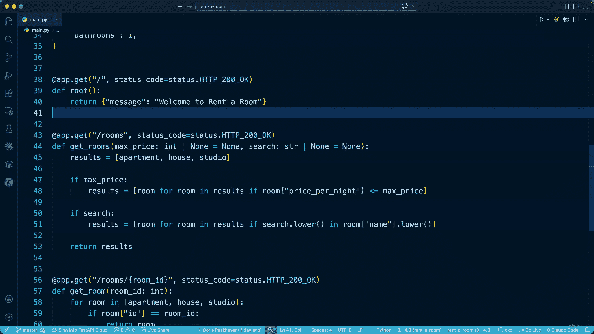
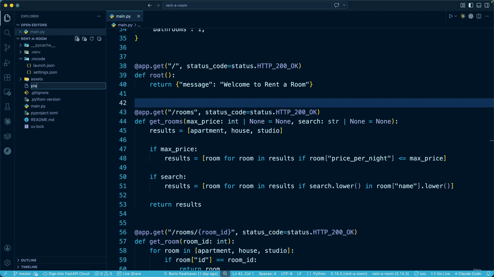
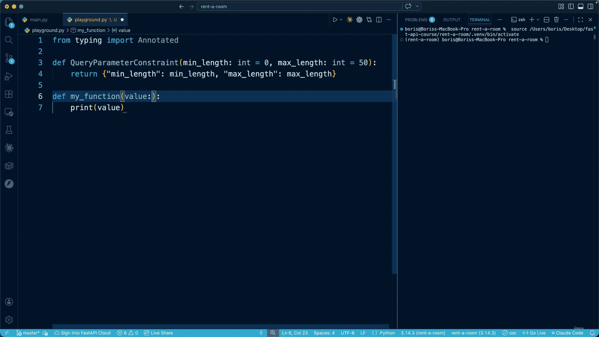
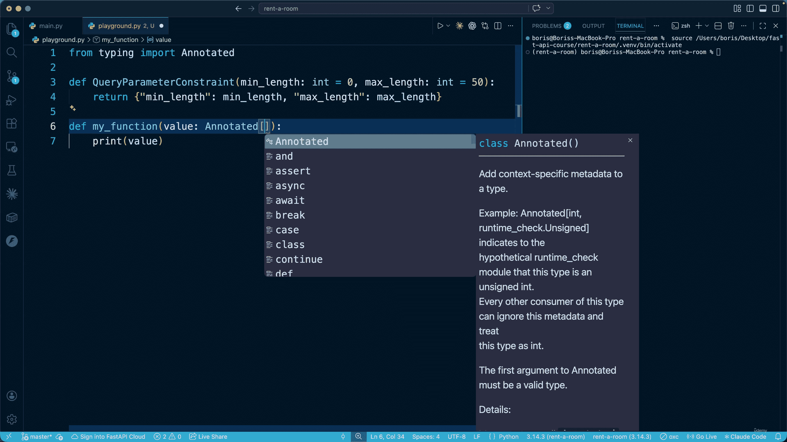
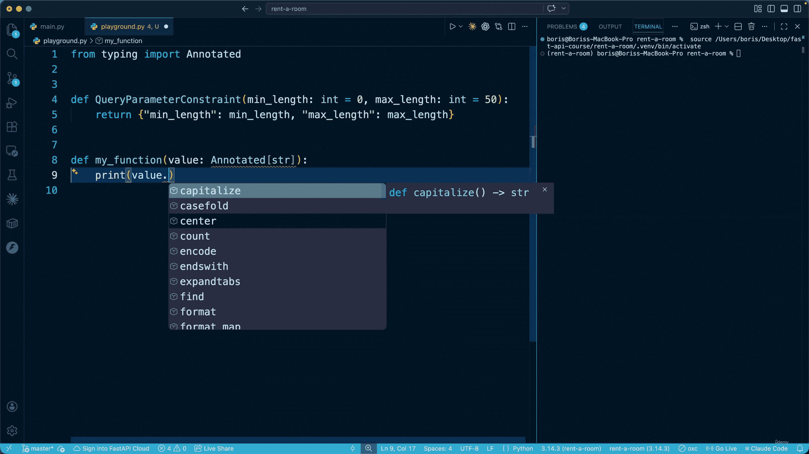
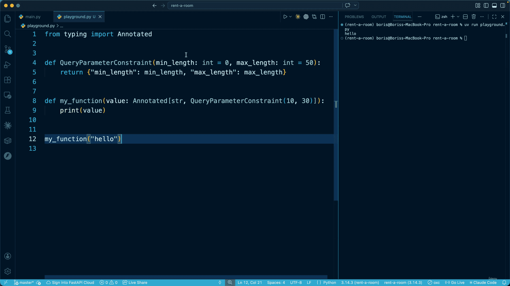
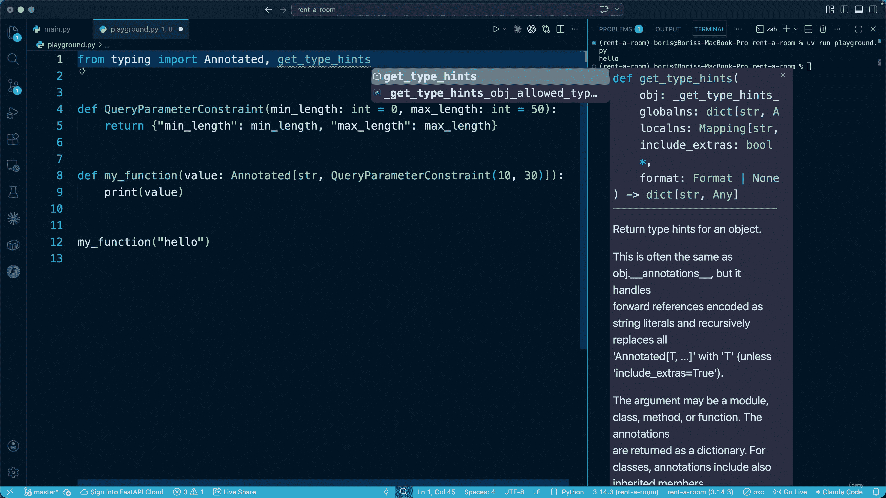
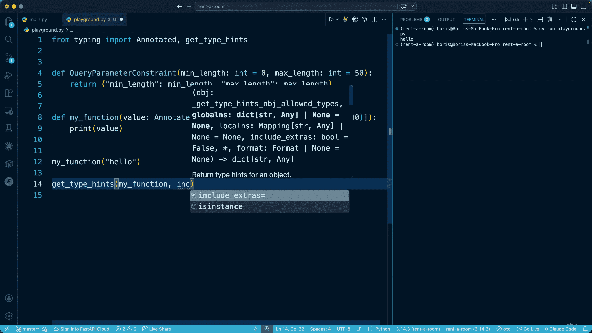
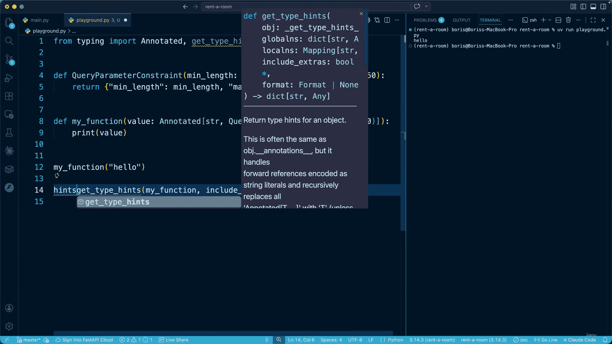
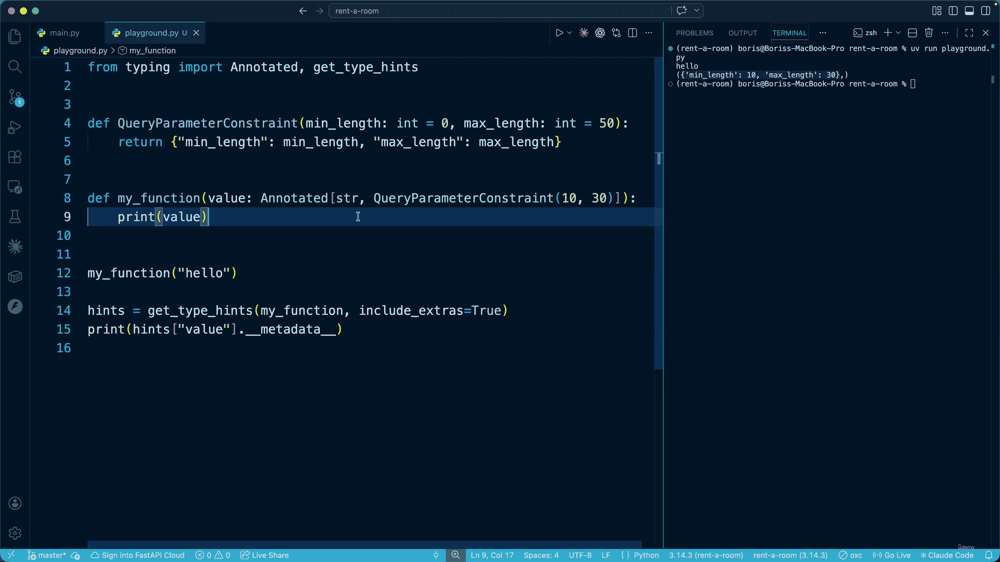

# FastAPI 实战大师课：第 32 节：深入理解 Annotated 类型 📌



## 课程概述

在本节课中，我们将一起学习 Python 中一个非常重要且特殊的类型 —— `Annotated`。FastAPI 在大量代码中都使用了这个类型，因此搞清楚它的工作原理，对于我们后续理解 FastAPI 的查询参数、路径参数以及各种校验逻辑，都会起到事半功倍的效果。我们会从 `Annotated` 的基本概念讲起，一步步分析它的语法结构，并通过一个实际的 Python 脚本来演示它如何在运行时被解析和使用。此外，我们还会看到 FastAPI 是如何利用这个类型来执行复杂的参数校验，而这一切的起点，就藏在这个看似简单的方括号语法中。让我们开始吧。

## 1. 什么是 Annotated 类型？🤔

### 1.1 从 typing 模块说起

`Annotated` 类型位于 Python 标准库的 `typing` 模块中。这个类型并不是 FastAPI 特有的功能，而是 Python 语言本身提供的一个核心特性。它的核心作用，就是给现有的类型附加一些额外的元数据。

这里我们提到的“元数据”，指的就是一些补充性的数据、额外的附加信息，这些信息可以对原有的类型做出更详细的描述。当我们说到“类型”的时候，我们指的不是一个具体的值，而是指一个类，一种数据类型，比如字符串（`str`）、整数（`int`），或者某个自定义的复杂对象。

有了 `Annotated`，我们就可以给这些类型附加额外的信息。类型检查器（比如 mypy、Pyright）能够利用这些信息，同时，FastAPI 也能在程序运行阶段（即运行时）获取并利用这些元数据。

### 1.2 一个直观的公式

如果我们用公式来表示 `Annotated` 的核心概念，可以写成下面这样：

`Annotated[基础类型, 附加元数据] = 基础类型 + 补充信息`

其中，`基础类型` 告诉我们这个变量本质上是什么类型，而 `附加元数据` 则是额外附加上去的辅助信息，它可以是任何东西：一个字符串、一个数字、一个字典，甚至是一个函数的返回值。

## 2. Annotated 的基本语法 📝

### 2.1 代码中的样子

假设我们有一个函数，里面有一个参数叫 `value`。我们通常会这样写类型声明：

```python
def my_function(value: str):
    pass
```



但使用 `Annotated` 后，代码会变成这样：

```python
from typing import Annotated

def my_function(value: Annotated[str, "这是附加的元数据"]):
    print(value)
```

这里最关键的一点就是：在 `Annotated` 后面的方括号中，**第一个条目**才是这个参数的真正基础类型。例如上面的 `str`，就表示 `value` 参数本质上还是一个字符串类型。而在第一个条目之后，我们用逗号分隔，写上第二个条目，这个条目就是我们要附加的互补元数据。

这个第二个条目实际上可以是一个具体的值，比如一个列表、一个字典，或者另一个字符串。重要的是，它是一段补充数据，被附加到了类型旁边，而 FastAPI 能够解析这段附加数据，并在自己的逻辑中加以利用。

### 2.2 类型检查器眼中的变化

当我们在代码中使用 `Annotated` 时，类型检查器会根据第一个类型参数来推断变量的类型。比如下面这段代码：

```python
from typing import Annotated

def my_function(value: Annotated[str, "some meta"]):
    print(value.upper())  # 类型检查器知道 value 是 str，所以能识别 upper 方法
```

在编写代码时，如果我们把鼠标悬停在 `value` 上，编辑器会立刻告诉我们它的类型是 `str`。这意味着，我们调用字符串方法时，类型检查器能够进行校验，避免写出无效的代码。如果没有 `Annotated`，类型检查器会认为 `value` 是未知类型，也就无法提供任何智能提示或错误检测了。

## 3. 实战演练：创建一个 Playground 文件 🛠️

为了让理解更透彻，我们来亲手操作一下。虽然你可以跟着做，但即使只是阅读也能明白原理。我们将创建一个独立的纯 Python 文件，把它当作一个游乐场，然后通过命令行运行它，看看 `Annotated` 到底做了什么。

### 3.1 创建文件并打开终端

我将创建一个名为 `playground.py` 的文件，它就是一个 Python 练习文件。然后我会手动用 `uv` 来运行它（`uv` 是一个快速的 Python 包管理器）。在 VS Code 中，直接打开终端，把它拖到右侧，方便查看。





### 3.2 定义一个辅助函数

我们首先定义一个违反传统命名规则（蛇形命名法）的函数，叫做 `queryParameterConstraint`。这个函数接收两个参数：`min_length`（整数类型，默认值为 0）和 `max_length`（整数类型，默认值为 50）。函数体非常简单，返回一个字典，把这两个参数作为键值对收集起来。

```python
def queryParameterConstraint(min_length: int = 0, max_length: int = 50):
    return {"min_length": min_length, "max_length": max_length}
```

这个函数看似普通，但等一下我们会把它当作附加元数据，用到 `Annotated` 中。

### 3.3 在函数签名中使用 Annotated

接下来，我们定义第二个函数，叫做 `my_function`。它接收一个参数 `value`。我们先不写类型，让类型检查器处于“未知”状态。然后，从 `typing` 模块导入 `Annotated`，并将 `value` 的类型声明为 `Annotated[str, ...]`。



注意，这里我们还需要提供第二个条目，否则会报错。我们先随便写一个字符串，比如 `"hello"`，让它满足语法要求。

```python
from typing import Annotated

def my_function(value: Annotated[str, "hello"]):
    print(value)
```

此时，类型检查器已经能够识别出 `value` 是字符串了。当我们输入 `value.` 时，会看到所有字符串方法都出现在提示列表中。

### 3.4 用函数返回值作为元数据

但这样直接写一个字符串，其实用处不大。`Annotated` 的真正威力在于，第二个条目可以是任何东西。我们可以把上面那个 `queryParameterConstraint` 函数的调用结果作为元数据！比如这样：

```python
def my_function(value: Annotated[str, queryParameterConstraint(min_length=10, max_length=30)]):
    print(value)
```

现在，`Annotated` 的第二个条目是 `queryParameterConstraint(10, 30)` 的调用结果，也就是一个字典 `{'min_length': 10, 'max_length': 30}`。虽然从类型检查器的角度看，`value` 仍然是字符串，但我们已经给这个类型绑定了额外的约束信息。

### 3.5 运行这个普通 Python 文件



我们直接运行一下这个文件。在命令行执行：

```bash
uv run playground.py
```



你会发现，代码正常输出了我们传入的字符串。从这里可以看出，`Annotated` 本身并不会改变程序的执行逻辑，它只是把元数据附加到了类型上，等待有需要的人（比如框架）去读取。

## 4. 运行时读取元数据 🔍



### 4.1 使用 get_type_hints 函数

你可能在想，这些附加的元数据到底是怎么被读取的？答案是：通过 Python 的运行时自省机制。Python 提供了一系列底层工具，让我们可以在程序运行时检查这些类型信息。其中就有一个函数叫 `get_type_hints`，它也来自 `typing` 模块。

这个函数在平时编写普通 Python 代码时几乎用不到，但如果你在开发一个库，并且需要大量操作类型，它就会非常有用。我们可以这样使用它：

```python
from typing import get_type_hints

hints = get_type_hints(my_function, include_extras=True)
```

这里的 `include_extras=True` 参数很关键，它告诉 Python 在返回的结果中也包含那些附加的元数据，而不仅仅是基础类型。



### 4.2 提取元数据

调用 `get_type_hints` 后，我们会得到一个字典，它的键是函数参数名，值就是对应的类型信息。在我们的例子中，键就是 `value`。然后，我们可以通过一个特殊属性来访问附加的元数据，这个属性的名字是 `__metadata__`（两个下划线开头，两个下划线结尾）。

看下面的代码：

```python
from typing import get_type_hints

def my_function(value: Annotated[str, queryParameterConstraint(10, 30)]):
    print(value)

hints = get_type_hints(my_function, include_extras=True)
print(hints["value"].__metadata__)
```

运行这个文件，你会看到，打印出来的结果是一个元组，元组里面包含着我们附加的那个字典 `{'min_length': 10, 'max_length': 30}`。

### 4.3 这意味着什么？

这有点底层，你可能平时用不到，但它揭示了一个重要的机制：在程序运行时，Python 代码是能够通过反射机制查看类型，并拉取出与类型关联的元数据的。这一点对于 FastAPI 来说至关重要，因为 FastAPI 本质上就是一个 Python 程序，它在处理请求时，可以检查路由函数的参数类型，读取这些元数据，然后根据元数据执行对应的逻辑。

## 5. FastAPI 如何利用 Annotated？⚡

### 5.1 从类型转换到数据校验

在之前的课程中，我们提到了 FastAPI 使用类型声明来尝试在路由处理函数执行之前进行类型转换。比如，如果参数声明为 `int`，FastAPI 就会尝试把传入的字符串转换成整数。现在，借助 `Annotated`，我们能做的不只是类型转换，还能附加更复杂的校验逻辑。

举个例子，假设一个查询参数是字符串类型，但我们要求它的最小长度是 10 个字符，最大长度是 30 个字符。我们当然可以在函数体里手动写代码来判断，但更优雅的做法是，利用 FastAPI 提供的预构建函数，比如 `Query`，将这些约束作为元数据添加到 `Annotated` 中。

```python
from typing import Annotated
from fastapi import Query

def read_items(q: Annotated[str, Query(min_length=10, max_length=30)]):
    return q
```

在这里，`Query(min_length=10, max_length=30)` 是 FastAPI 提供的一个函数，它返回一个对象，这个对象被作为 `Annotated` 的第二个条目。FastAPI 在运行时，会提取这个元数据对象，并执行与之相关的校验逻辑，而且这一切都发生在路由处理函数体执行之前。

### 5.2 丰富多彩的校验能力

通过这种语法，我们能做的校验远不止字符串长度。我们可以校验数字是否在上下界范围内，可以校验字符串是否匹配某个正则表达式，可以校验枚举值，还可以组合多个校验条件。所有这一切，都共享同一种 `Annotated` 语法。这意味着，你只需要学会这一种语法，就能应对绝大多数参数校验场景。

### 5.3 内部运作方式

当 FastAPI 服务器启动时，它会执行类似于我们前面演示的 `get_type_hints` 这样的内部代码，来获取所有路由处理函数参数的附加元数据。它会从每一个路由函数中提取这些信息，然后根据元数据知道：“这个参数在函数执行之前，需要做额外的校验，校验信息就在这些元数据里。”

比如，当请求进来时，FastAPI 会检查 `value` 参数的类型，发现它被 `Annotated` 包裹，并且第二个条目的元数据是一个 `Query` 对象，其中包含了最小长度和最大长度限制。于是，FastAPI 会在调用我们的函数之前，先对查询参数进行长度检查，如果不符合要求，就返回一个清晰的错误响应。

## 6. 总结 🎓

本节课我们一起深入探讨了 Python 标准库中的 `Annotated` 类型。我们了解到，它是 Python 的一个核心语言特性，并不属于 FastAPI，但 FastAPI 大量地使用了它。`Annotated` 的核心语法就是在方括号中提供两个条目，其中第一个条目是基础类型，它决定了参数在被类型检查器检查时的基本类型，例如我们的 `value` 本质上依旧是一个字符串。而第二个条目是附加的元数据，它可以是任意值，在 FastAPI 中，这个位置通常放置一个由 FastAPI 提供的校验函数（如 `Query`）的返回值，用于传递额外的校验规则和参数约束。

我们还通过编写一个简单的 Playground 文件，实际演示了如何用 `get_type_hints` 在运行时提取元数据。虽然这个操作比较底层，平时不太用得上，但它清楚地展示了 Python 反射机制的能力，也解释了 FastAPI 为什么能在服务器启动时读取到每一个参数的所有附加信息。在接下来的课程中，我们会频繁地看到 `Annotated` 这种语法。刚开始使用它时可能会觉得有点绕，但只要你多实践几次，就能立刻体会到它为 FastAPI 开发带来的便利。本质上，`Annotated` 就是“一个类型 + 一段绑定的额外信息”，而 FastAPI 则负责在恰当的时候，读取并执行这段信息所代表的校验逻辑。记住这一点，后面的一切都会变得顺理成章。



在下节课中，我们将进一步探索如何结合 `Annotated` 与各种 FastAPI 参数函数，来构建更加健壮和灵活的 API 接口，敬请期待。
