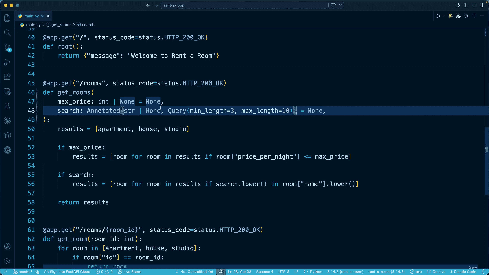
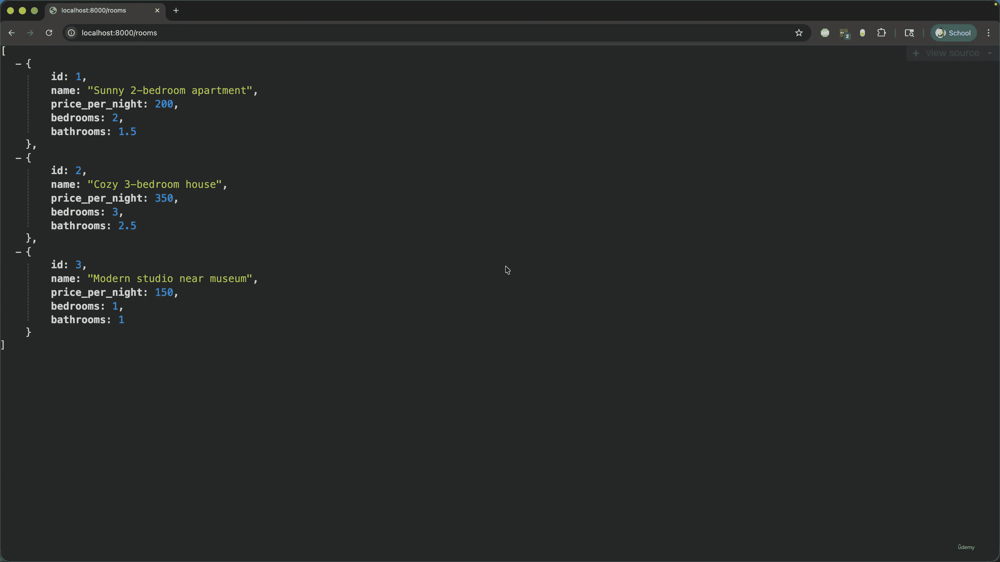

# FastAPI 大师课：第 33 节：Query 类型 🔍


在本节课中，我们将一起学习如何在 FastAPI 中利用 Python 的 `Annotated` 类型以及 FastAPI 自带的 `Query` 函数，为接口中的查询参数添加额外的约束条件。上一节课我们已经了解了 `Annotated` 类型的基本用法，知道它可以把额外的元数据附加到类型声明上。这一节我们就把这个能力真正应用到路由处理器中，以 `get_rooms` 接口的查询参数为例，让它们具备长度校验等规则。


## 为什么使用 Annotated 和 Query


先简单回顾一下背景。在 FastAPI 中，查询参数通常就是从 URL 问号后面读取的值，比如 `/rooms?search=xxx` 中的 `search`。如果没有约束，这些参数就会原样进入路由函数，再交由内部的业务逻辑去判断。这样的代码写起来很繁琐，而且容易遗漏边界情况。使用 `Annotated` 和 `Query`，我们就能在声明参数的同时，把校验规则直接写进去，让 FastAPI 自动帮我们处理。


## 导入必要的内容


首先，我们需要导入两个东西。`Annotated` 类型来自 Python 标准库中的 `typing` 模块；`Query` 函数则来自 FastAPI。具体代码如下：


```python
from typing import Annotated
from fastapi import Query
```


保存文件时，ruff 会自动将 `Annotated` 的导入语句移动到文件最顶部，因为对于 Python 标准库模块，ruff 会给它们更高的优先级，让它们排在 FastAPI 等第三方库之前。这是一种常见的代码组织方式，目的就是让导入顺序更清晰。


另外，注意这里的 `Query` 是大写字母 `Q`。在编辑器中，你可以点击这个函数名跳转到它的实现，能看到它确实是一个函数。它的作用和我们之前自己写过的约束函数非常相似，本质上就是生成一个元数据对象，用来告诉 FastAPI 应该如何校验某个查询参数。


## Query 中常见的验证参数


在 `Query` 函数的签名中，我们可以发现大量可以用来定制验证的参数。以下是一些常用的约束参数：


- `gt`：表示 greater than，适用于数值类型，要求参数必须大于指定值。
- `lt`：表示 less than，适用于数值类型，要求参数必须小于指定值。
- `le`：表示 less than or equal to，适用于数值类型，要求参数必须小于等于指定值。
- `min_length`：适用于字符串，用来定义查询参数最少允许的字符数。
- `max_length`：适用于字符串，用来定义查询参数最多允许的字符数。


这些参数都可以通过调用 `Query` 函数并传入对应值来使用。调用之后，`Query` 的返回值会作为附加的元数据，被放到 `Annotated` 方括号中的第二个位置。下面这个公式可以概括核心语法：


```text
Annotated[实际类型, Query(验证规则...)]
```


在实际编码中，`实际类型` 可以是 `str`、`int` 或者 `str | None` 等任意合法类型，`验证规则` 则是 `Query` 函数里传入的各个约束参数。


## 给 search 参数添加长度约束


接下来我们回到 `main.py`，从处理 `search` 参数开始。这里需要把参数类型 `str | None` 放入 `Annotated` 中，同时保留默认参数 `None`。先写出这样的代码：




```python
search: Annotated[str | None, ...] = None
```


注意这里的语法结构：`Annotated` 后面跟着方括号，方括号内第一个值是参数类型，第二个值是元数据，而默认参数则通过 `=` 直接赋值。类型检查器不会对这个写法提出任何抱怨，因为 `str | None` 作为 `Annotated` 的第一个参数是完全合法的。


现在 FastAPI 和 Python 都已经知道，`search` 参数既可以是字符串，也可以是 `None`。不过仅仅把类型包在 `Annotated` 里还不够，为了发挥它的完整能力，我们还需要在方括号内提供第二个值，也就是附加的元数据。在 FastAPI 中，这些元数据可以用来定义额外的约束。FastAPI 会在运行时读取这些附加信息，实际上它在应用启动时就会解析这些内容，然后在路由处理器执行之前应用全部验证逻辑。


我们在这里调用刚才导入的 `Query` 函数，并传入前面看到的约束参数。因为我们操作的是查询参数，所以必须使用 `Query` 来包装元数据，这样 FastAPI 才能把 `search` 参数与 URL 中的查询字符串关联起来。代码如下：


```python
search: Annotated[str | None, Query(min_length=3, max_length=10)] = None
```


这段代码的意思是：`search` 参数的类型是 `str | None`，默认值是 `None`，同时它必须满足长度在 3 到 10 个字符之间的条件。`min_length` 设置为 3，意味着客户端一旦提供了 `search` 查询参数，它的字符串长度至少要是 3 个字符；`max_length` 设置为 10，则代表长度最多不能超过 10 个字符。保存之后，这行声明代码可以整整齐齐地写在一行里，阅读起来非常直观。


## 在浏览器中验证约束效果


代码准备好之后，我们打开浏览器，像平时一样发起请求。为了验证效果，可以先去掉之前使用的 `max_price` 参数，只保留 `search` 参数。接着给 `search` 传一个超过 10 个字符的值，例如 `fancy apartment`。很明显，这个字符串的长度达到了 15 个字符，已经超过了我们设置的最大限制。


发出请求后，FastAPI 会返回一个错误响应。响应最外层的 `detail` 键是一个数组，数组里面放着错误对象。错误类型是 `string_too_long`，FastAPI 还会告诉我们这个错误发生在查询参数上，而不是路径参数。更精确地说，出错的查询参数名是 `search`。错误消息显示为 `string should have at most 10 characters`。再次强调一下，此时路由处理器完全没有执行。FastAPI 在调用路由函数之前就拦截了请求，执行了额外验证，验证失败后自动返回错误状态码。


我们可以再测试一下相反的情况。比如只输入两个字符，那么字符串就会低于最小长度限制，FastAPI 会返回一个互补的错误消息：`string should have at least 3 characters`。打开浏览器的网络标签页，重新发送请求，可以看到状态码确实是 422。422 是 Unprocessable Content 错误码，属于 4xx 家族。4xx 开头的状态码都表示客户端那边出了差错。但最重要的收获是：我们根本不需要运行路由处理器函数，验证完全发生在它之前。


这种设计非常优雅，因为我们要做的只是使用 `Annotated` 类型，并借助 `Query` 函数提供一份完整的类型注解和附加元数据，然后就能开箱即用地获得这些验证能力。另外，由于我们给 `search` 参数设置了默认值 `None`，客户端实际上可以不提供这个查询参数。如果客户端提供了字符串，那么长度验证就会生效；如果省略了它，FastAPI 就会回退到默认值 `None`，额外的查询验证逻辑也就不会触发。在浏览器中可以看到，没有提供 `search` 参数时，接口返回的是包含所有公寓信息的原始响应。


## 模式的总结与扩展


以上就是使用 `Annotated` 配合 `Query` 函数对查询参数进行调整、约束和验证的快速入门。在后续的代码中，这种模式会反复出现。我们不仅会用它验证查询参数，还会验证路径参数、Cookie 或请求头。无论验证哪一种参数，语法都是一样的：使用 `Annotated` 类型，方括号中的第一个条目是参数的实际类型，第二个条目是某些约束或验证规则，FastAPI 会在路由处理器运行之前自动把这些规则应用到对应参数上。


## 总结




本节课我们一起学习了如何在 FastAPI 中通过 `Annotated` 类型和 `Query` 函数为查询参数添加约束。我们首先导入了 `Annotated` 和 `Query`，然后认识了 `gt`、`lt`、`min_length`、`max_length` 等常见的验证参数，接着在实际的 `search` 参数中应用了这些约束，最后通过浏览器测试了错误响应和 422 状态码。希望你能记住这个统一语法：`Annotated[类型, 约束]`。它会让你今后编写的 FastAPI 接口更加健壮，也让路由处理器的代码更加简洁。
