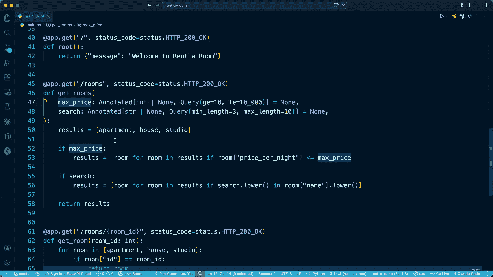
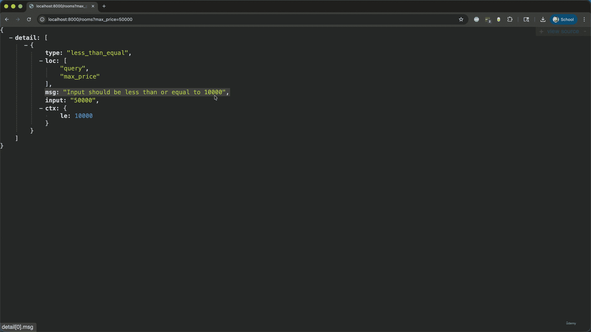

# FastAPI Masterclass：第34节：为价格添加查询参数验证  

  

在本节课中，我们将学习如何使用`Annotated`类型和`Query`函数，为`max_price`查询参数添加额外的验证约束。具体来说，我们会让这个参数只能接受一个范围内的数值，任何超出范围的值都会在请求处理之前被FastAPI拦截并返回错误。这个技巧在实际开发中非常常用，因为查询参数往往需要满足特定的业务规则，而不是随便传什么都行。  

  

上一节我们已经了解了`Annotated`类型和`Query`函数的基本用法，它们可以帮助我们声明参数的类型以及附加的验证规则。本节我们继续深入练习，看看如何组合使用它们来实现更复杂的约束条件。你会看到，整个过程并不复杂，但能显著提升API的健壮性和数据安全性。  

  

首先，我们来明确一下目标。我希望在`max_price`查询参数出现时，为它添加两个额外的约束：  

  

- 参数的值必须**大于等于10**，也就是不能低于10。  
- 参数的值必须**小于等于10000**，也就是不能高于10000。  

  

用数学公式表示就是：  

  

\[
10 \le \text{max\_price} \le 10000
\]  

  

换句话说，我们要分别设置一个下界和一个上界。这就像是在说：这个查询参数只能接受从10到10000之间的整数，任何小于10或大于10000的数值都是非法的。  

  

如果你愿意，可以随时暂停视频，自己尝试按照这个思路写代码。这是一个很好的练习机会，因为动手试过之后记忆会更深刻。这里也给你一个小提示：你可以按住`Command`键（Windows上是`Ctrl`键）点击`Query`函数，直接跳转到FastAPI库中的官方定义，查看它支持哪些参数，然后找到合适的那两个参数来应用约束。这一招对于探索库的功能非常有帮助，以后遇到不熟悉的函数都可以这么干。  

  

好的，那么现在开始动手。我们先在当前代码中找到`max_price`参数的位置，然后在它的类型声明中加上`Annotated`类型。具体做法是，把原本的`int`（这里是非联合类型）用方括号包起来，就像这样：左边加一个方括号，右边也加一个方括号。  

  

接着，我们仍然保留默认参数`None`，这样这个查询参数就是可选的，客户端不传也不会出错。关键的一步来了：我会在方括号内写上第二个值，这个值就是`Query`函数的调用结果。也就是说，我们不再只是写一个简单的`int`，而是写`Annotated[int, Query(...)]`这样的形式。  

  

这个`Query`函数会再次告诉FastAPI：这不仅仅是一个查询参数，而且是一个希望它添加额外约束的参数。对于数值类型的参数，FastAPI提供了两个非常合适的参数：一个是`ge`，表示“大于等于”（greater than or equal）；另一个是`le`，表示“小于等于”（less than or equal）。这里我们会把`ge`设置为10，把`le`设置为10000。  

  

下面就是完整的代码写法，注意数字中可以使用下划线来提升可读性，比如`10_000`看起来就比`10000`更清晰：  

  

```python  
from typing import Annotated  
from fastapi import FastAPI, Query  

app = FastAPI()  

rooms = []  # 假设这是房间数据  

@app.get("/rooms")  
def get_rooms(  
    max_price: Annotated[int | None, Query(ge=10, le=10_000)] = None  
):  
    # 函数体暂时省略  
    pass  
```  

  

这样写就搞定了。保存代码之后，我们已经为`max_price`查询参数提供了额外的约束。这些约束会在`get_rooms`函数体执行之前运行，也就是说，FastAPI会在进入函数内部之前先检查参数是否满足条件，不满足就直接返回错误响应，根本不会执行你写的业务逻辑。  

  



现在让我们回到浏览器，看看当传入无效参数时会发生什么。我先在地址栏里构造一个URL，加上`max_price`这个查询参数，并给它传入一个小于10的值，比如5。你会看到，FastAPI返回了一个类似之前的错误响应，状态码是422 Unprocessable Content。在响应体里，我们可以清楚地看到对于`max_price`这个查询参数，问题描述是“输入应该大于等于10”。  

  

接下来，我们换个方向继续测试。这次我们不传5了，改传一个很大的值，比如50000。你会发现情况完全反过来，我们违反了指定范围的上限。响应体里会显示“输入应该小于等于10000”，这个10000正是我们传给`Query`函数的`le`参数。  

  

整个过程就是这样。通过使用`Annotated`类型和`Query`函数，我们成功地为查询参数添加了额外的验证规则，而且这些验证会在路由处理器执行之前自动完成。这大大减少了我们手工编写校验逻辑的工作量，也让代码更加简洁和可靠。  

  



本节课我们一起学习了如何使用`Annotated`和`Query`来为查询参数添加约束，具体实践了设置数值的下界和上界。我们看到了如何利用`ge`和`le`参数来限制取值范围，也验证了不符合约束的请求会返回422错误。希望你能举一反三，尝试为其他参数添加类似的验证，比如字符串的长度范围，或者使用`gt`、`lt`等更多参数。掌握这些基础验证技巧，能让你的API接口更加健壮和用户友好。
