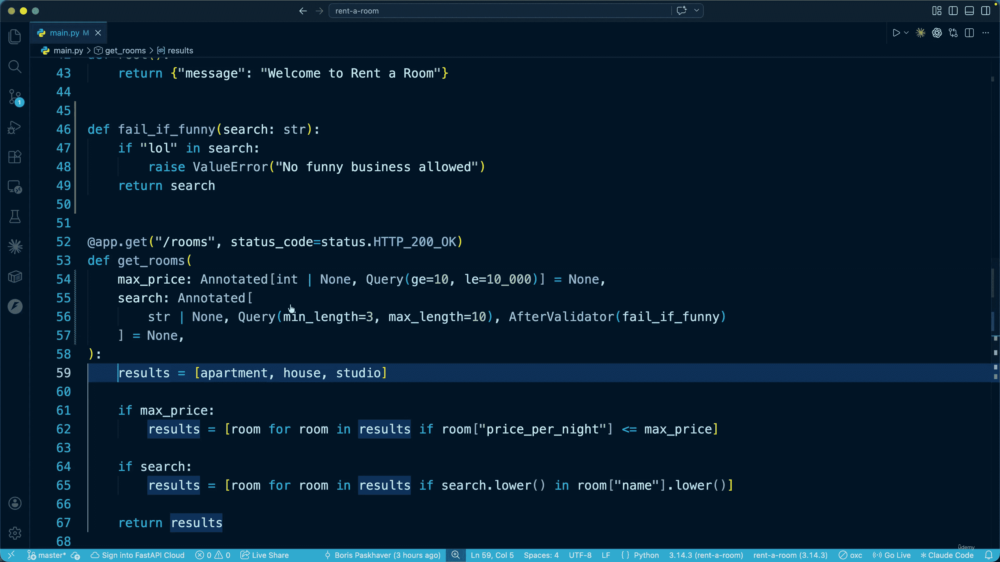
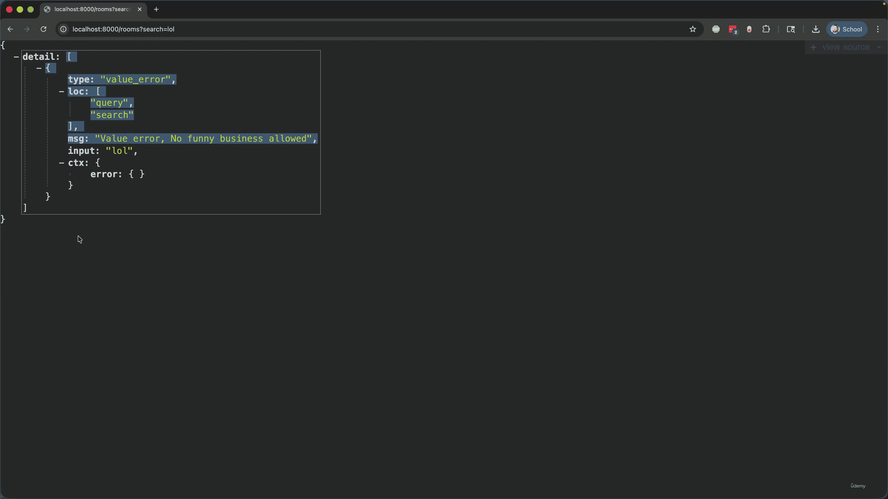

# FastAPI Masterclass：第35节：AfterValidator 函数

  

在本节课中，我们将一起学习 FastAPI 中一个非常实用的验证工具——`AfterValidator` 函数。我们会先搞清楚 FastAPI 与底层数据验证库 Pydantic 之间的关系，再搞清楚为什么有时候内置的验证器还会不够用。接下来，我们会实际动手写一个普通的 Python 函数作为自定义验证逻辑，并用 `AfterValidator` 把它串联到 `Query` 这样的主验证器后面。最后，我们还会到浏览器里实际跑一次请求，看看自定义验证失败时返回的错误长什么样。这个知识点特别适合那些需要对请求参数做复杂业务校验的场景，所以值得仔细掌握。

  

## 1. FastAPI 与 Pydantic 的关系

  

FastAPI 是构建在一个非常强大的数据验证库 Pydantic 之上的。我们可以用 Pydantic 验证来自很多不同地方的数据，比如路径参数、查询参数、Cookie、请求头、客户端发过来的请求体，还有我们返回给客户端的响应体等等。简单来说，只要数据需要在 API 的入口或出口经过，都可以交给 Pydantic 把关。更重要的是，Pydantic 在很多常见的 FastAPI 模式中都扮演着很重要的角色，例如参数校验、数据转换、错误提示等。实际上，你可能已经猜到了：我们现在代码里写的这个 `Query` 查询逻辑，底层就已经在悄悄使用 Pydantic 了。

  

为了证实这一点，我们可以按住 Command 键点击 `query` 函数，直接跳转到它的定义。定义里会看到大量参数和文档说明，我们一直往下滚动，滑到最底部，就能看到真正的实现代码。这个实现会返回一个 `Query` 类的实例。我们再点击这个 `Query` 类，发现它仍然在 FastAPI 库内部，而且继承自一个叫 `Param` 的类。接着我们按住 Command 键点击 `Param`，进入它所在的参数类，会发现这个参数类又继承自 `FieldInfo` 超类。于是我们继续点击进入 `FieldInfo`，最后终于看到，这个 `FieldInfo` 类正是来源自 Pydantic 数据验证库。

  

所以，当我们使用 `Query`，或者以后还会遇到的 `Path`、`Cookie`、`Header` 等配套函数时，底层其实都是在依赖 Pydantic 做真正的数据验证。FastAPI 本质上可以理解为是在核心数据验证功能上面又包了一层额外的壳。下面这张简单的继承链图可以让你看得更清楚：

  

```python
Query -> Param -> FieldInfo -> pydantic
```

  

也就是说，从 `Query` 出发，按着继承关系一路往上找，最终都会撞到 Pydantic 的 `FieldInfo`。搞懂这一点，我们就会明白为什么 FastAPI 的参数校验能力和 Pydantic 保持一致，以及为什么我们接下来要用的 `AfterValidator` 也需要从 Pydantic 导入。

  

## 2. 为什么需要 AfterValidator？

  

有时候，`Query` 函数或者其它等价的内置验证功能，并不能完全满足我们对某个参数的自定义业务验证需求。内置验证器擅长处理那些比较通用的约束，比如字符串长度、整数范围、格式对不对等等，但是如果你想让一个查询参数里不能包含某个特定的敏感词，那就需要自己写一些额外的规则了。因此，这节课我们来看看，如何用一个普通的 Python 函数来定义属于自己的验证逻辑，并且让它和已有的验证器一起工作。这也是我们第一次需要从 Pydantic 库中导入内容。

  

我们回到项目的主文件 `main.py`。在文件的最顶部，我们要从 Pydantic 库中导入一个叫 `AfterValidator` 的东西。Pydantic 是 FastAPI 的依赖，所以在这个项目里它已经自动可用，不需要我们再额外安装什么。不过，我依然在项目的 `pyproject.toml` 文件中显式地添加了 Pydantic 依赖，这样做是为了以防万一未来 FastAPI 发生大变化，底层不再使用 Pydantic，而是换成别的验证库。到那时候，Pydantic 也依然会在我们的项目环境中存在，这样代码就不会因为依赖缺失而挂掉。

  

导入代码很简单，只需要一行：

  

```python
from pydantic import AfterValidator
```

  

`AfterValidator` 的工作方式很直接：它允许我们定义一个自定义验证函数，让这个函数在一个“主验证器”运行完之后再执行。这里说的主验证器，指的就是像 `Query` 这样已经内置于 FastAPI / Pydantic 中的验证逻辑。例如，`Query(min_length=3, max_length=10)` 就是一个主验证器。而我们定义的函数，则会在这个主验证器确认数据合法后再接手。这样一层层处理，可以让我们在保证基础规则的同时，加入更灵活的业务规则。

  

## 3. 在 Annotated 类型中串联多个验证器

  

我们之前已经学过 `Annotated` 类型，当时可能只把它当成“类型 + 元数据”的组合。但实际上，这个类型比我们想象的强大得多。我们来看一下目前的代码，假设我们有一个 `search` 参数，它的声明方式是下面这样：

  

```python
search: Annotated[str, Query(min_length=3, max_length=10)]
```

  

这里方括号里的第一个值 `str` 表示 `search` 的类型，第二个值 `Query(...)` 是附加的元数据。现在我们知道了，我们可以在这个方括号里放置多个顺序执行的元数据片段，而 FastAPI 会按照顺序依次运行它们，并且还会把上一个验证器得到的结果自动传递给下一个验证器。这种感觉很像工厂里的流水线：一台机器处理完，就交给下一台机器继续处理，最后产出的才是最终被使用的数据。

  

具体怎么操作呢？我们在 `Query(...)` 后面、方括号结束之前，再加上一个逗号，然后放入 `AfterValidator`。这里有一个非常关键的运行前提：这段自定义逻辑只会在现有验证已经通过之后才运行。也就是说，当程序执行到 `AfterValidator` 时，我们已经可以确定，传进来的值是一个字符串，并且它的长度一定在 3 到 10 个字符之间。这个前提让我们可以放心地编写后续判断，不用担心数据格式不合预期。

  

`AfterValidator` 接受一个普通的 Python 函数，在运行的时候，它会自动执行这个函数，并使用这个函数作为验证另一个条件的基础。为了演示，我们会定义一个叫做 `fail_if_funny` 的函数。我们先把函数声明在文件上方，然后在 `AfterValidator` 中引用它。这个函数的核心目的，就是检查搜索词里有没有一些我们不想看到的“搞笑”内容，如果有，就直接让验证失败。

  

## 4. 定义自定义验证函数

  

现在，我们来写这个自定义函数。函数接收一个字符串参数，我们可以在定义时把它命名为 `search`。参数名不一定非得和外面声明的一致，但为了方便理解，保持一致当然是更好的。重点在于，这个参数接收到的值，就是上一个验证器传递过来的对象。在函数内部，如果输入的数据要顺利通过验证，我们必须把它原样返回。这与 `Query` 本身的行为是一致的：`Query` 校验完之后，也会把搜索词重新返回出去，好让它继续进入下一个验证器，最后再流入路由函数体。所以，我们在 `fail_if_funny` 里返回什么，最终就会成为路由处理函数里拿到的值。

  

如果希望验证失败，我们就要在函数里做一些逻辑判断。当条件不满足时，我们可以抛出一个 Python 异常，也就是一个具体的错误类。一旦抛出异常，请求就会在这里终止。因为我们的自定义验证失败了，所以 `get_rooms` 这个路由处理函数的函数体永远不会执行。与此同时，FastAPI 和 Pydantic 会自动把这个错误转换成响应，返回给客户端。也就是说，你不需要在这里写任何异常处理代码，框架会帮你完成剩下的事。

  

我们设计一个有点滑稽但足够说明问题的业务规则：如果搜索词中包含了子串 `"LoL"`，我们就认为用户在搜索一些无聊的东西，这在我们的 API 中属于数据违规，是不被允许的。于是，我们可以检查 `"LoL" in search` 这个条件。如果满足了，我们就不执行后面的 `return search`，而是抛出一个 `ValueError`，并且附带一条自定义错误信息，比如 `"No funny business allowed"`（不允许搞笑内容）。整个过程就是纯粹的 Python 代码，非常直白。

  

下面是这个自定义函数的代码：

  

```python
def fail_if_funny(search: str) -> str:
    if "LoL" in search:
        raise ValueError("No funny business allowed")
    return search
```

  

这段代码的意思是：如果 `search` 里面包含 `"LoL"`，就直接抛错；否则把 `search` 原样返回。因为它只是普通函数，你完全可以在任何地方单独测试这个逻辑，而不依赖 FastAPI 环境，这也让单元测试变得非常方便。

  

## 5. 组合：AfterValidator 与 Query 一起使用

  

接下来，我们把 `AfterValidator` 和 `Query` 放到同一个 `Annotated` 类型中一起使用。完整的代码大致是下面这个样子：

  

```python
from typing import Annotated
from fastapi import FastAPI, Query
from pydantic import AfterValidator

app = FastAPI()

def fail_if_funny(search: str) -> str:
    if "LoL" in search:
        raise ValueError("No funny business allowed")
    return search

@app.get("/rooms")
def get_rooms(
    search: Annotated[str, Query(min_length=3, max_length=10), AfterValidator(fail_if_funny)]
):
    return {"search": search}
```

  

我们来一步步拆解这段代码的执行过程。首先，FastAPI 会先执行第一个验证器 `Query`，对前端传过来的 `search` 参数做类型检查和长度检查。如果用户没传 `search`，或者传了一个长度只有 2 的字符串，又或者传了一个根本不是字符串的值，那么请求会在 `Query` 这一步就失败，`AfterValidator` 根本不会有机会运行。只有当你传入的字符串满足 `Query(min_length=3, max_length=10)` 这些规则时，这个字符串才会被当作参数，自动传给 `fail_if_funny` 函数。

  

进入 `fail_if_funny` 后，程序会检查字符串里有没有 `"LoL"`。一旦发现存在，就抛出 `ValueError`，请求立刻终止，客户端就会收到带错误消息的响应。如果字符串里没有 `"LoL"`，那么函数会把 `search` 原样返回。这个时候，搜索词才真正进入 `get_rooms` 的函数体，后续的业务逻辑才会继续执行。整个流程可以用下面这个简单的公式来表示：

  

```text
最终验证结果 = AfterValidator(Query(客户端输入))
```

  



换句话讲，客户端输入先穿过第一道门 `Query`，出来之后紧接着被 `AfterValidator` 包裹的函数再检查一遍。两道门都通过后，这个值才会被当成最终可用的参数。这种层层叠加的验证模式非常灵活，以后你还可以继续加第三道、第四道验证，只要它们在 `Annotated` 中按顺序排好即可。

  

## 6. 在浏览器中测试效果

  

理论部分讲得差不多了，我们到浏览器里实际看看效果。回到 Chrome 浏览器，我们还是像往常一样，在地址栏的请求路径后面加上 `search` 查询参数。这一次，我们特意输入 `"LoL"` 作为搜索词。你马上会看到，这个值能够顺利通过长度检查，因为 `"LoL"` 正好是 3 个字符，满足 `min_length=3` 的要求。但是紧接着，它会进入 `fail_if_funny` 函数，在这个函数里，我们检测到了 `"LoL"`，于是验证就失败了。浏览器页面中会显示出我们自定义的错误消息，这条消息来源于 `ValueError`，内容是 `"No funny business allowed"`。

  

还有一个地方值得注意：这个错误响应的整体结构，也就是顶层的属性，比如 `detail` 被设置为一个数组——以及各种字段的排放方式，和任意一个 Pydantic 内置验证错误是完全相同的。唯一的区别在于，这次触发错误的逻辑来自我们自己写的自定义验证器，而且它是在 Pydantic 的主检查结束之后才运行的。这也是个好消息：你不需要为自定义验证错误设计一套新的响应格式，因为 FastAPI / Pydantic 已经帮你统一了。你只需负责把异常抛出来，剩下的交给框架就好。

  

## 总结

  



本节课中，我们一起学习了 FastAPI 中 `AfterValidator` 函数的完整用法。我们首先了解到，FastAPI 底层是通过 Pydantic 来执行数据验证的，`Query`、`Path`、`Cookie`、`Header` 等工具最终都会依赖 Pydantic 的 `FieldInfo`。然后，我们明白了为什么有时候内置验证器不够用，以及如何从 Pydantic 导入 `AfterValidator`。接着，我们定义了自定义验证函数 `fail_if_funny`，并利用 `Annotated` 类型把 `Query` 和 `AfterValidator` 串联起来，让多个验证器按顺序执行。最后，我们在浏览器中实际测试了拒绝包含 `"LoL"` 的搜索词，看到了自定义错误响应。需要再次强调的是，`AfterValidator` 并不只适用于查询参数。它本质上适用于所有流入后端的数据，比如路径参数、Cookie、请求头等。在课程的后续部分，我们会看到更多这样的例子。希望你已经掌握了如何通过 `AfterValidator` 扩展 FastAPI 的验证能力，从而应对更复杂的真实业务需求。

