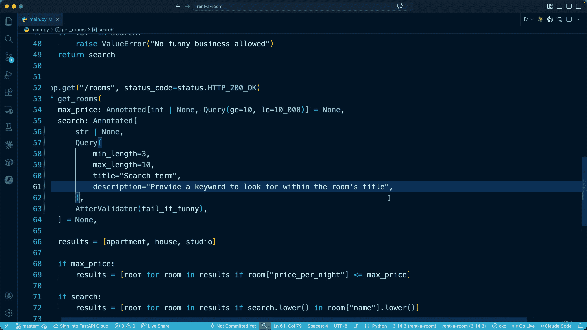
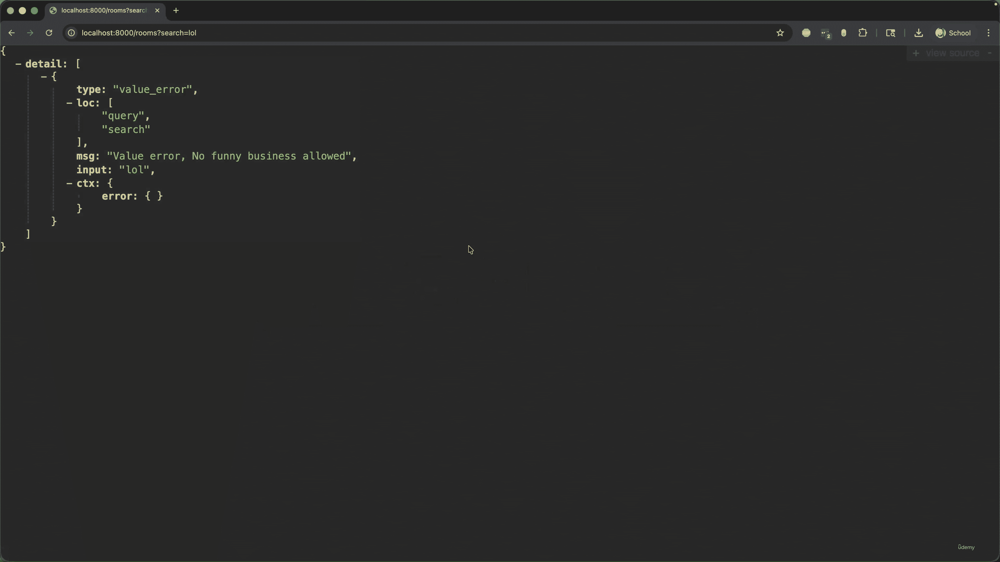
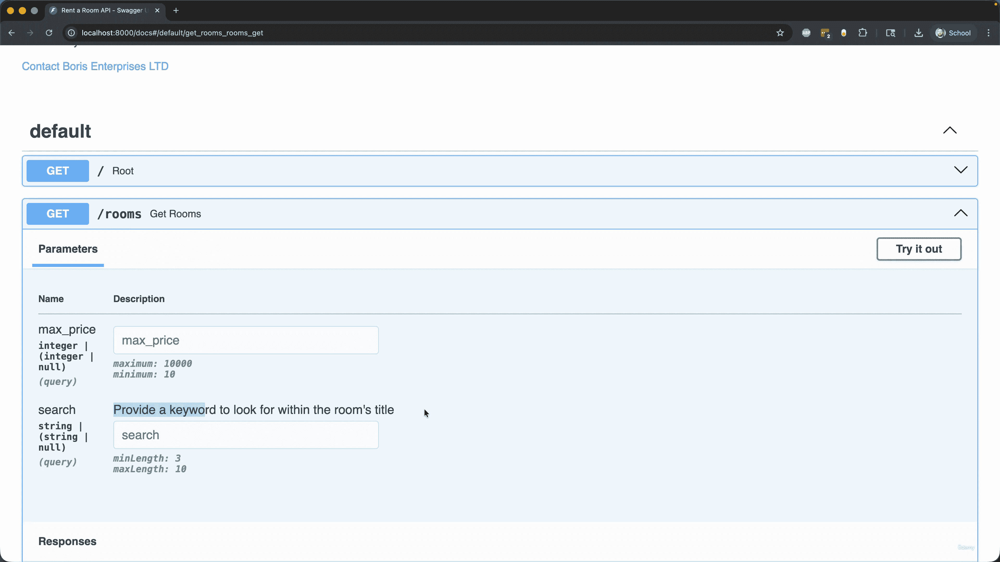

# 🚀 FastAPI Masterclass Part 1：第36-37节：title和description参数

在本节课中，我们要学习如何给FastAPI的查询参数添加额外的信息，也就是title和description这两个参数。通过它们，我们可以让Swagger文档变得更清楚，让调用你的人一看就懂这个参数是干什么用的。这些都是围绕查询函数（也就是Query）来展开的，理解起来并不难。

在上一篇教程中，我们已经知道了查询参数可以使用Query函数来设置一些约束，比如最大值、最小值、长度限制等等。但光有这些还不够，使用者看到这些约束，可能还是不太明白参数本身的意思。为了解决这个问题，FastAPI允许我们给查询参数添加一些说明性的信息，这就是本节要讲的title和description参数。

我们先来看一个简单的代码示例，感受一下这两个参数在代码中是怎么写的：

```python
from fastapi import FastAPI, Query

app = FastAPI()

@app.get("/rooms")
async def get_rooms(
    price: float = Query(..., ge=100, le=1000),
    search: str = Query(
        ...,
        min_length=3,
        max_length=50,
        title="search term",
        description="provide a keyword to look for within the rooms title"
    )
):
    return {"price": price, "search": search}
```

在这段代码里，我们给search这个查询参数同时加上了title和description。下面我们来分别说说这两个参数到底有什么作用，以及它们各自会在Swagger文档中表现出什么样的效果。

## 🏷️ title参数：藏在JSON里的名字

首先来看title参数。我们可以在查询函数里给某个字段提供一个title，就像上面代码中把search的title设置成了“search term”。这个title参数本身非常轻量，它不会对参数的实际功能产生任何影响，纯粹是用来做元信息标记的。

这个title参数并不会正式出现在Swagger文档的页面里。什么意思呢？也就是说，当你在浏览器中打开Swagger页面时，你不会看到这个title被单独显示出来，它不像description那样会直接展示在字段旁边。这一点容易让人误解，很多人第一次使用可能会以为它跟description一样直接显示，所以需要专门说明一下。

那么title参数跑到哪里去了？答案是它会出现在Swagger生成的JSON里。Swagger在描述你的API时，会生成一份JSON数据，这份JSON里包含了每个参数的各种属性，而title就会作为其中一个字段存在。虽然它不直接出现在文档页面上，却可以给其他工具或开发者提供额外的元数据，相当于在底层给参数加了一个别名或标签。

所以我们可以这样理解：title参数更像是一个给API描述文件用的名字标签，而不是给终端用户看的说明文字。比如，你可以把你查询参数叫做“search term”，这样在看JSON文件的时候，就能知道这个参数的含义。这也意味着，如果你有自动化工具在解析Swagger的JSON，title字段可以被它们读取到，从而帮助工具更好地理解你的API结构。

## 📝 description参数：直接写在文档里的说明

接着我们来看description参数。相比之下，description参数要直观得多。这个参数会实际出现在Swagger生成的文档中，也就是说，当你打开Swagger页面时，就能在参数的下方看到你写的这段说明文字。这个说明文字是给真正使用API的人看的，所以一定要写清楚。

在代码里我们可以写类似这样的描述：“provide a keyword to look for within the rooms title”。它的意思是“提供一个用来在房间标题中查找的关键字”。你可以根据实际情况随意修改这段文字，让它清楚地向使用者解释这个参数应该怎么填。比如这里我们想表达的是：这个查询参数接收一个关键词，这个关键词会用于在房间标题中进行搜索。

description参数对于API使用者来说非常重要，因为它直接告诉他们参数的业务含义。比如我们这里的search参数，光看名字你可能不知道要传什么，但有了description，你立刻就知道应该填一个关键词，而且这个关键词是用来匹配房间标题的。这样一来，使用者不需要去阅读源码，也不需要去猜，只要看一眼文档就能明白怎么用。





## 👀 在Swagger文档中查看实际效果

写好了代码之后，我们保存文件，并且在编辑器里把代码格式化一下。然后我们回到Chrome浏览器，在地址栏中输入“/docs”，就能打开FastAPI自动生成的Swagger文档页面。这个页面是FastAPI默认自带的交互式文档，里面列出了你所有的接口，并且支持在线调试，非常方便。

在文档页面里，我们来展开“get rooms”这个端点。你会注意到，刚才我们添加的那些额外参数都出现在这里了。这些信息依然来自查询参数的定义，也就是说，它们是直接从代码中的Query函数里读出来的，不需要你额外去手动维护文档。

我们可以在这个页面里看到许多内容，下面列出几个典型的信息：

- 价格参数的最大值和最小值，也就是我们之前设置的范围约束。这个约束可以让调用者知道，price字段只能传入100到1000之间的数值。

- 搜索词参数的最小长度和最大长度，也就是我们在Query里指定的长度限制。这个限制说明搜索词不能太短也不能太长，最少3个字符，最多50个字符。

- 我们刚才填写的description描述，也就是“provide a keyword to look for within the rooms title”这句原话。它被原原本本地展示在文档里，方便使用者理解search参数的用途。

这样一来，使用者就不需要去看源代码，只需要看Swagger文档，就知道每个参数的取值范围和含义了。对于接口的维护者来说，你也不需要额外编写文档，因为这些信息直接从代码中同步过来，不会出现代码与文档不一致的情况。

## 🌍 对公开API的好处

如果你开发的是一个面向公众的API，那么这些额外的参数就更有用了。因为别人不知道你的API内部是怎么实现的，他们只能通过文档来了解如何使用。通过title和description，你可以把参数的使用方法说清楚，帮助用户减少试错成本。同时，这些信息也会自动整合到Swagger生成的JSON里，方便那些使用自动化工具的人。

另外，良好的参数说明还可以减少你收到的开发者咨询问题。当大家都能从文档中轻易读懂参数含义时，你就不需要反复解答同样的问题了。所以，虽然title和description看起来只是两个简单的小参数，但它们对于提升API的可维护性和用户体验，有着不小的帮助。

## 📌 总结



本节课中，我们一起学习了FastAPI中title和description这两个查询参数的作用。我们了解到，title参数不会直接显示在Swagger文档页面上，但会出现在生成的JSON中，相当于一个字段的名字标签；而description参数会直观地显示在文档中，用来给使用者提供参数说明。我们也看到了在实际的Swagger文档中，这些参数以及之前设置的约束条件是如何展示出来的。最后我们还讨论了如果API是公开的，这些额外信息对于帮助用户理解API有着很重要的意义。希望你在自己的项目中也能用起来，让你的API文档更清晰。
