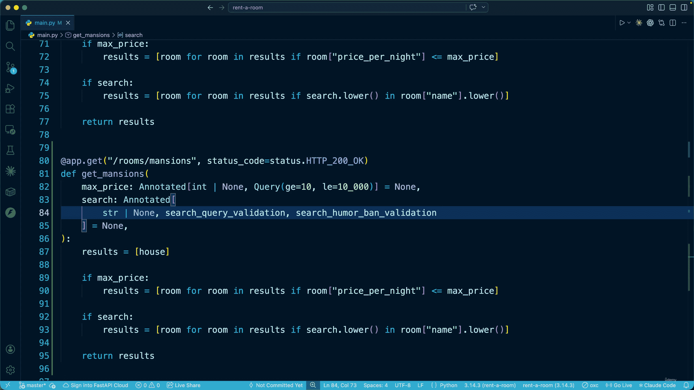
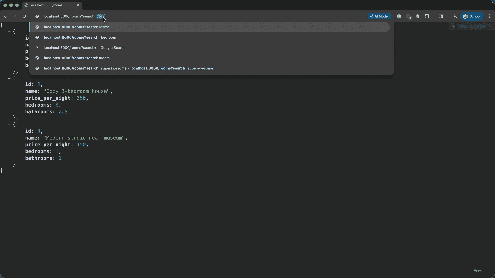
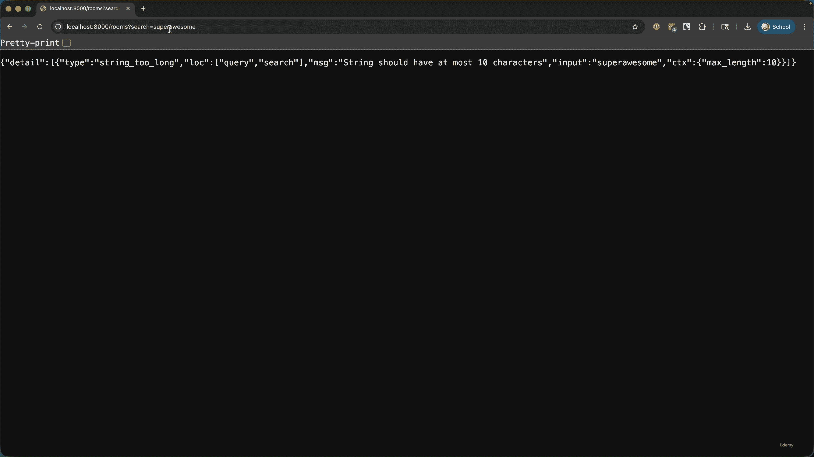
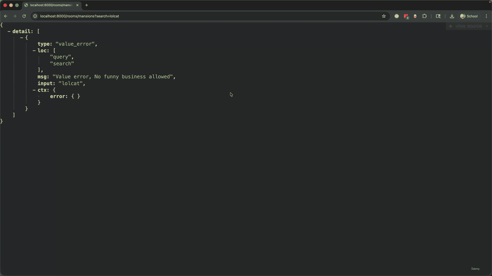
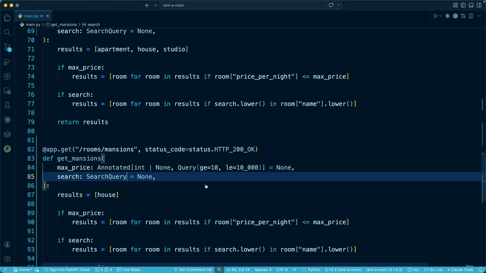
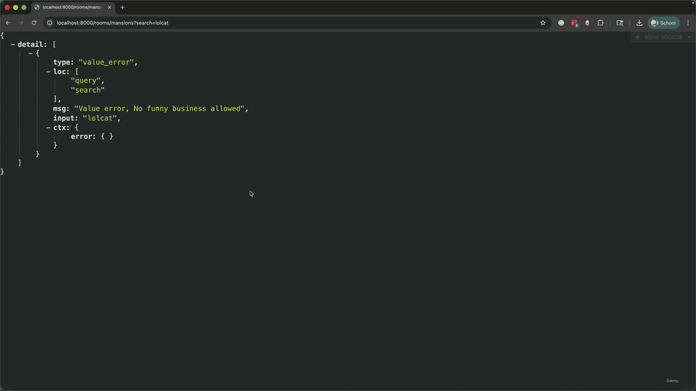

# 🚀 FastAPI Masterclass：第1部分：第37-38课：提取类型到变量

在本节课中，我们将学习如何把 FastAPI 路由处理函数中内联的验证逻辑提取成独立的变量，然后在多个路由处理函数之间复用。我们会从一个实际需求出发，先提取 `Query` 调用，再提取 `AfterValidator` 调用，最后把完整的 `Annotated` 类型也提取出来。整个过程会在浏览器中验证，确保重构前后行为完全一致。

FastAPI 最受好评的特性之一，就是它借助 Pydantic 让验证逻辑可以在不同的路由处理函数之间复用。例如，我们并不是只能在一个端点中使用某个查询验证器，而是可以把它提取成一个单独的外部变量，然后在多个路由处理函数中反复使用。这节课就来演示这个操作。

以下是本节课的主要步骤：

1. 提取 `Query` 调用到变量。
2. 提取 `AfterValidator` 调用到变量。
3. 提取完整的 `Annotated` 类型到类型变量。

## 📋 示例需求：新增 `/rooms/mansions` 路由

为了演示，假设产品经理来找我们，要求定义一个新路由 `/rooms/mansions`。这个端点基本上和现有的 `/rooms` 端点一样，只不过它要从一个更有档次、经过精选的房间集合中筛选，比如平台上的豪宅。为了简化问题，我们可以假装这两个端点的唯一区别是：新端点一开始筛选的结果集只包含豪宅，其他逻辑完全一致。产品经理还要求它支持完全相同的查询参数，比如搜索词和最高价格。

注意，新路由必须放在 `/rooms/{room_id}` 这样的路由上方，否则 `/rooms/mansions` 会被 `room_id` 参数捕获，从而匹配到错误的处理器。下面的代码展示了两个端点最开始的写法（省略了具体筛选逻辑，也省略了 `room_id` 路由）。

```python
from typing import Annotated

from fastapi import FastAPI, Query
from pydantic import AfterValidator

app = FastAPI()


def fail_if_funny(value: str | None) -> str | None:
    # 自定义业务逻辑校验：如果搜索词太“搞笑”，就抛出 ValueError
    if value and "loca" in value:
        raise ValueError("这个搜索词没有通过业务规则检查")
    return value


@app.get("/rooms")
def get_rooms(
    search: Annotated[str | None, Query(max_length=10), AfterValidator(fail_if_funny)] = None,
):
    # 从普通房间集合中筛选
    return {"rooms": [], "search": search}


@app.get("/rooms/mansions")
def get_mansions(
    search: Annotated[str | None, Query(max_length=10), AfterValidator(fail_if_funny)] = None,
):
    # 从豪宅集合中筛选
    return {"mansions": [], "search": search}
```

这里的 `fail_if_funny` 是一个自定义业务验证函数，具体实现可以根据业务需要调整，课程里只是用它来演示“在验证链中插入自定义逻辑”。

现在可以很清楚地看到主要问题：同样的验证逻辑在两个端点中重复出现了。例如，如果明天业务方决定把搜索词的最小长度改成别的值，我们就得同时修改两个端点，而不是只改一处。这显然会增加维护成本。所以我们需要把这段完整的验证逻辑提取出来，并且在这节课中会介绍几种不同层级的提取方式。

## 🔧 第一步：把查询验证提取成变量

先从最直接的 `Query` 调用开始。我们打算把整个 `Query(max_length=10)` 调用复制出来，放到所有路由的上方，确保路由处理函数和辅助变量之间有一个清晰的分隔。我们可以创建一个变量叫 `search_query_validation`，名字完全由自己决定，然后把复制的内容粘贴进去。

```python
search_query_validation = Query(max_length=10)
```

这里要特别小心一点：复制粘贴时，务必去掉原来末尾的逗号。保存后，我们就能看到这个变量被赋值为 `Query` 函数调用的返回值。其实，这正是 FastAPI 在初始化应用并看到注解类型中的这种元数据时，会自动替我们做的事情。除了让 FastAPI 自动处理，我们也欢迎直接在文件里调用 `fail_if_funny` 这个函数。趁这个机会，我把 `fail_if_funny` 函数稍微往上挪一点，让所有路由处理函数都能按顺序排列在下面，看起来更整齐。

接下来，对底部的 `AfterValidator` 也应用完全相同的逻辑。我们可以往下滚动，选择哪个端点都可以，因为它们声明的验证完全一样。复制这一行 `AfterValidator(fail_if_funny)`，同样省略末尾的逗号，然后在上面声明一个变量：

```python
search_humor_ban_validation = AfterValidator(fail_if_funny)
```

这个变量名看起来可能有点奇怪，但命名本来就是随意的，你可以换成任何有业务含义的名字。在这里，它被赋值为 `AfterValidator` 的返回值，并且依赖上面定义的 `fail_if_funny` 函数。

现在，我们有了这两个辅助变量。接下来我们可以在两个端点中复用它们。先从 `/rooms` 端点开始。原本那一长串 `Annotated[..., Query(...), AfterValidator(...)]` 逻辑，现在可以变得非常简洁：

```python
@app.get("/rooms")
def get_rooms(
    search: Annotated[str | None, search_query_validation, search_humor_ban_validation] = None,
):
    # 筛选逻辑
    return {"rooms": [], "search": search}
```

我们只需要写 `search_query_validation`，加一个逗号，然后再写 `search_humor_ban_validation`，就把原来所有的复杂度都替换成了上方的可复用变量。注意，后置验证器依然要放在第二个位置，因为我们希望它在前面的 `Query` 验证之后执行。



相应地，`/rooms/mansions` 端点也做一模一样的重构：



```python
@app.get("/rooms/mansions")
def get_mansions(
    search: Annotated[str | None, search_query_validation, search_humor_ban_validation] = None,
):
    # 筛选逻辑
    return {"mansions": [], "search": search}
```

你会发现，代码读起来轻松多了，因为逻辑不再横跨那么多行。这里最关键的一点是：我们获得了可复用性，因为完全相同的验证逻辑可以应用到下面的 `get_mansions` 函数。现在，`/rooms` 和 `/rooms/mansions` 两个端点都采用了完全相同的查询参数、验证和约束。

## 🌐 在浏览器里验证效果

说一千道一万，代码重构后还是要实际验证一下。我们回到 Chrome 浏览器，给 `/rooms` 端点加上查询参数。先加一个超长的搜索词，比如 `super awesome`，这个字符串超过了 10 个字符的限制。你会看到 FastAPI 返回了一个校验错误，提示字符串长度最多只能是 10 个字符。这正好是 `Query(max_length=10)` 在起作用。

接下来我们把端点改成 `/rooms/mansions`，也就是这节课新定义的路由。你会看到，我们得到了完全相同的验证错误。这说明复用的变量在两个端点上确实都生效了。





再来看后置验证器。如果我们在两个端点中传入类似 `loca` 这样的搜索词，就会看到一个 `ValueError`。这个错误来自 `AfterValidator(fail_if_funny)`，而现在它已经被封装到了上方的可复用变量中，所以在两个端点上同样能一致地工作。

## 🧩 第二步：把完整的 Annotated 类型提取出来

例子还可以更进一步。回到 VS Code，这次我们要提取完整的 `Annotated` 值。注意，这里不包括默认参数 `None`，因为默认参数是传统的 Python 默认参数赋值语法，不属于类型注解部分。我们可以把整个 `Annotated[...]` 片段，也就是从 `Annotated` 开始一直到最终右方括号结束的全部内容，赋值给它自己的独立变量。

我先复制这一段内容，然后粘贴到上面所有辅助变量的下面，因为这些变量需要在后面使用。为了表示这个变量是一个更重要的类型构造，我用大写字母开头，当然你也可以用任何自己喜欢的命名规则。这里我把它叫做 `SearchQuery`，以表达它是搜索词的查询参数类型：

```python
SearchQuery = Annotated[str | None, search_query_validation, search_humor_ban_validation]
```

注意右边的类型声明：我们用的是 Python 的 `Annotated` 类型，它声明了 `SearchQuery` 这个类型本质上表示 `str | None`。除此之外，它还带了两个约束：一个是搜索词的长度限制，另一个是前面提到的 `fail_if_funny` 自定义业务逻辑。所有这些复杂度，也就是两种验证以及 `str | None` 类型，都被封装在单一的 `Annotated` 注解中。

你可以把 `SearchQuery` 几乎想象成一个“类型变量”，它代表 `str | None`，但身上附加了很多额外信息。记住一个要点：使用 `Annotated` 时，要重点关注方括号内的第一个值，后面的内容都是补充元数据，在运行时帮你做额外工作。但从根本上说，这仍然是一个类型。

现在，在端点中就可以使用这个类型了。对于 `search` 参数，我把原来 `Annotated[...]` 里的所有内容删掉，只写类型 `SearchQuery`。注意，我们仍然需要提供默认值 `None`，因为这是运行时默认参数，表示如果请求中没有提供 `search`，就回退到 `None`。重构后的代码大致如下：

```python
@app.get("/rooms")
def get_rooms(search: SearchQuery = None):
    # 筛选逻辑
    return {"rooms": [], "search": search}


@app.get("/rooms/mansions")
def get_mansions(search: SearchQuery = None):
    # 筛选逻辑
    return {"mansions": [], "search": search}
```

保存文件后，我们再回到浏览器测试。结果和之前完全一样，比如传入 `loca` 会得到完全相同的响应。这里的关键点在于：代码行为没有任何改变，但我们完成了一次非常重大的重构。现在，我们可以在多个路由处理函数之间复用完全相同的验证功能，不仅提取了实际的 `Query` 调用，还把整个 `Annotated` 类型装饰提取成了一个辅助变量。这个变量本质上声明了一个类型，却附带了那么多复杂度。而美妙之处在于，这些复杂度现在被隔离在单独的一个注解里，我们不再需要跨多个路由处理函数复制粘贴了。

## ✅ 总结





本节课中，我们一起学习了如何把 FastAPI 路由中的验证逻辑逐步提取成变量。我们从实际需求出发，看到了重复代码带来的维护问题；接着把 `Query` 调用和 `AfterValidator` 调用分别提取成可复用变量；最后更是把完整的 `Annotated` 类型提取成 `SearchQuery` 类型变量。我们还通过浏览器验证了重构前后行为完全一致。通过这种方式，我们可以让多个路由复用同一套验证规则，既减少了重复代码，也让后续维护变得更轻松。希望你在自己的 FastAPI 项目中也能灵活运用这个技巧。
