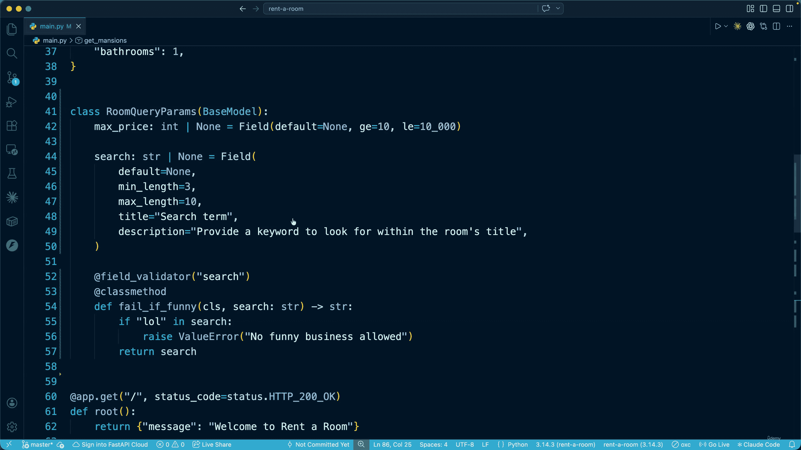
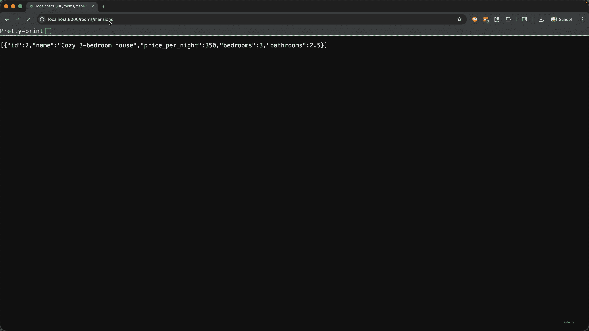
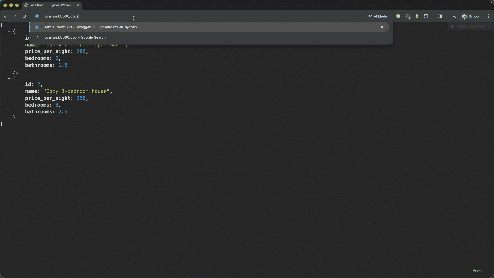
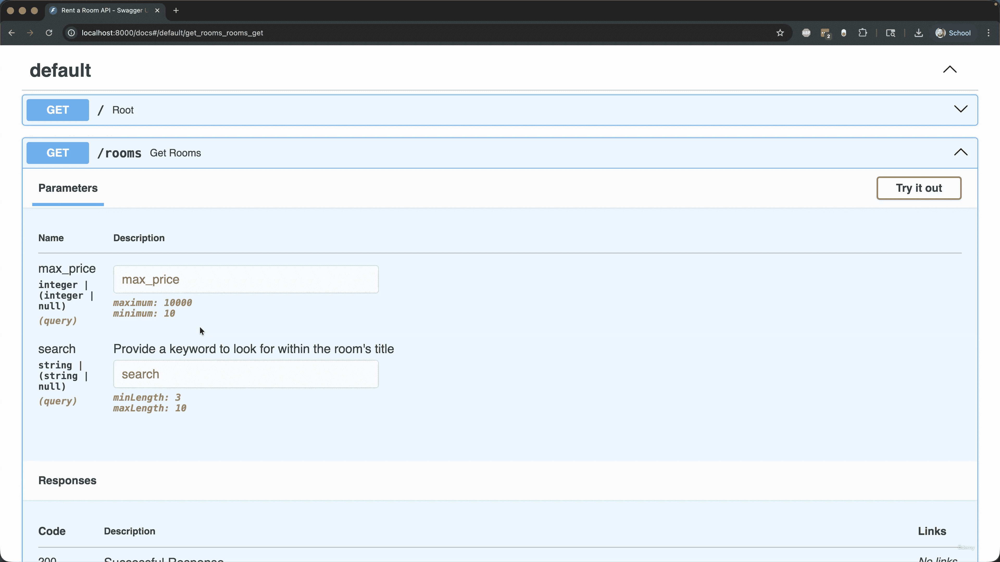

# FastAPI 大师课：第 38–39 章：使用 Pydantic 模型处理查询参数

本节课中，我们将学习如何使用 Pydantic 模型，把多个相关的查询参数收纳到一个对象中。这样做可以让代码更简洁，也能让多个路由共用同一套参数定义和验证规则。接下来，我们会从当前代码面临的问题开始，逐步创建模型，并把它应用到多个端点中。

## 一、为什么要把查询参数放进模型

上一节中，我们为查询参数添加了类型和验证规则，代码已经比之前更易用。不过，随着路由和查询参数不断增加，仍然有机会进一步整理代码。例如，可以把重复使用的 `Annotated` 类型定义提取到单独的变量中，避免重复编写。

更大的问题在于，应用中的端点数量和查询参数数量都可能增长。假设产品路线图要求我们最终提供 10 个端点，例如：

- `/rooms`
- `/mansions`
- `/boats`
- `/firehouses`

每个端点都需要进行筛选，并且都要支持相同的一组查询参数。假设查询参数也会增加到 10 个，涉及价格、入住时长、卧室数量、浴室数量等信息。

即使我们把每个参数的定义提取成可复用的变量，在每个路由处理函数中，还是要逐一声明这些参数。也就是说，10 个端点可能都要各自声明 10 个参数，并重复相关逻辑。

更合适的做法，是把这些相关参数集中到一个对象中。原本需要作为多个独立参数传递的数据，可以收集到一个对象里；在函数中，只需声明一个对象参数即可。

```text
多个相关参数 → 一个对象参数
```

这样，所有端点都可以通过一个参数接收整组查询参数。不过，要实现这一点，模型不仅要知道每个参数的数据类型，例如字符串或数字，还要保留每个字段对应的验证规则，例如字符串的最小长度或数字的最大值。

## 二、使用 Pydantic 的 `BaseModel` 定义参数模型

上一节介绍了把参数收集到对象中的思路。本节中，我们来看看如何借助 Pydantic 实现它。

Pydantic 的 `BaseModel` 是一个基类。我们创建的 Python 类可以继承它，以表示一个包含多个字段的对象。每个字段都可以拥有独立的数据类型和验证规则。

Pydantic 专注于数据验证，但它并不依赖 FastAPI。它可以在不同领域中验证各种数据。FastAPI 会使用 Pydantic 来处理数据验证，而我们也可以直接使用 Pydantic 来创建自己的数据模型。

首先，从 Pydantic 导入所需的构造：

```python
from pydantic import BaseModel, Field, field_validator
```

这里有三个重要构造：

- `BaseModel`：用于定义数据模型的基类。
- `Field`：用于定义模型中的字段，并设置字段的验证规则。
- `field_validator`：用于为模型字段添加自定义验证逻辑。

接下来，我们创建一个表示房间查询参数的模型：

```python
class RoomQueryParameters(BaseModel):
    ...
```

`RoomQueryParameters` 是普通的 Python 类，但它继承了 `BaseModel`，因此可以使用 Pydantic 提供的数据验证功能。这个模型只描述有哪些字段以及每个字段如何验证，并不需要知道它们会被用作查询参数。

之所以将类命名为 `RoomQueryParameters`，是因为将来可能会有用户、付款方式等不同领域的数据，也可能为不同资源定义多组查询参数。这个类专门表示用于获取房间的查询参数。

## 三、定义字段和验证规则

模型定义好之后，接下来要把原本分散在路由参数中的验证逻辑移到模型字段中。我们先定义 `max_price` 字段：

```python
class RoomQueryParameters(BaseModel):
    max_price: int | None = Field(
        default=None,
        ge=0,
        le=1000,
    )
```

字段左侧的类型注解表示，`max_price` 可以是整数，也可以是 `None`。右侧的 `Field` 用于设置字段验证规则：

- `default=None`：如果没有提供该字段，就使用 `None`。
- `ge=0`：数值必须大于或等于 `0`。
- `le=1000`：数值必须小于或等于 `1000`。

这里的验证效果与此前在 FastAPI 查询参数中使用的验证规则相同。FastAPI 的查询参数功能在内部也会使用 Pydantic 的字段验证机制。此前，FastAPI 帮我们隐藏了部分实现细节；现在，我们直接在 Pydantic 模型中定义字段。

然后添加 `search` 字段：

```python
class RoomQueryParameters(BaseModel):
    max_price: int | None = Field(
        default=None,
        ge=0,
        le=1000,
    )

    search: str | None = Field(
        default=None,
        min_length=3,
        max_length=50,
    )
```

`search` 可以是字符串，也可以是 `None`。当它是字符串时，长度必须在 3 到 50 个字符之间。如果没有提供该参数，则默认值为 `None`。

到这里，`max_price` 和 `search` 这两个相关字段已经被收纳在同一个模型中。模型会分别对每个字段应用对应的数据类型、默认值和验证规则。

## 四、为字段添加自定义验证器

上一节中，我们已经将常规验证规则放进了模型。现在，我们来处理额外的业务验证逻辑。此前，代码中使用了验证器检查搜索内容是否包含不允许的词语，例如 `lol`。

Pydantic 的 `field_validator` 可以为指定字段添加自定义验证器。我们将它与 `classmethod` 一起使用：

```python
class RoomQueryParameters(BaseModel):
    max_price: int | None = Field(
        default=None,
        ge=0,
        le=1000,
    )

    search: str | None = Field(
        default=None,
        min_length=3,
        max_length=50,
    )

    @field_validator("search")
    @classmethod
    def fail_if_funny(cls, search: str) -> str:
        if "lol" in search.lower():
            raise ValueError("搜索内容不能包含 'lol'")

        return search
```

`field_validator("search")` 表示这个验证器应用于 `search` 字段。传入的字段名称必须与模型中已定义的字段一致。

在 Python 中，类方法会把类本身作为第一个参数传入，通常命名为 `cls`。这里的验证逻辑不需要实际使用 `cls`，但为了符合类方法的语法，仍然需要声明它。

验证器的执行顺序是：先完成 `search` 的基本验证，例如类型和长度检查，再执行自定义验证。如果搜索内容中包含 `lol`，就抛出错误；否则，返回原始搜索词，表示验证通过。

## 五、在 FastAPI 路由中使用模型

模型和验证逻辑准备好后，我们就可以在路由中用一个参数接收整组查询参数。首先导入 FastAPI 所需的构造：

```python
from typing import Annotated
from fastapi import Query
```

然后，在路由函数中声明一个 `RoomQueryParameters` 类型的参数，并通过 `Query()` 指明数据来源是查询参数：

```python
@app.get("/rooms")
def get_rooms(
    parameters: Annotated[RoomQueryParameters, Query()],
):
    ...
```

`RoomQueryParameters` 是参数的类型，`Query()` 则告诉 FastAPI：这个模型的数据要从 URL 查询参数中读取。

```text
Annotated[数据类型, 元数据]
```

`RoomQueryParameters` 本身是一个普通的 Pydantic 模型，它并不知道 FastAPI 的数据来源。使用 `Annotated` 和 `Query()` 后，FastAPI 才能知道模型中的字段应当从查询参数中获取，而不是从请求正文、Cookie 或请求头中获取。

当请求到达时，FastAPI 会读取查询参数，并用这些值创建 `RoomQueryParameters` 的实例。随后，Pydantic 会运行字段验证和自定义验证。如果验证失败，请求会产生错误；如果验证通过，路由函数收到的 `parameters` 就是一个已完成验证的模型对象。

因此，路由函数中不再直接使用单独的 `max_price` 和 `search` 参数，而是通过对象属性访问它们：

```python
if parameters.max_price is not None:
    # 使用 parameters.max_price
    ...

if parameters.search is not None:
    # 使用 parameters.search
    ...

search_term = parameters.search.lower()
```

与字典不同，对象的属性通过点号访问，例如 `parameters.max_price`。这些属性的类型和验证规则来自模型定义。

## 六、在多个路由之间复用模型

上一节中，我们已经让 `/rooms` 使用参数模型。本节中，我们来看看如何把同一模型应用到其他路由，例如 `/mansions`。

```python
@app.get("/mansions")
def get_mansions(
    parameters: Annotated[RoomQueryParameters, Query()],
):
    if parameters.max_price is not None:
        # 使用 parameters.max_price
        ...

    if parameters.search is not None:
        # 使用 parameters.search
        ...
```

如果没有模型，每个路由都需要分别声明 `max_price`、`search` 以及其他所有查询参数。即使这些参数使用相同的可复用定义，每个路由函数仍然会有一长串参数。

使用模型后，每个路由只需要声明一个参数。以后如果需要增加更多查询参数，也只需在 `RoomQueryParameters` 中添加字段和对应的验证规则，路由函数的参数列表不必随之增长。

```text
新增查询参数 → 修改 RoomQueryParameters
多个路由 → 继续使用同一个模型
```

这样，所有路由都能复用同一套参数定义和验证逻辑。每个字段仍然可以拥有自己的验证规则，而这些规则会自动应用到使用该模型的路由中。

## 七、检查接口和文档

代码修改完成后，可以在浏览器中检查原有端点是否仍然正常工作。例如，访问 `/mansions`，再访问 `/rooms` 并提供 `search` 查询参数，例如 `Broom`，可以确认接口是否按预期返回结果。

还可以打开 FastAPI 的 Swagger 文档：

```text
http://localhost:8000/docs
```

展开对应的接口后，可以看到 FastAPI 能够解析 Pydantic 模型中的字段，并据此生成接口文档。文档中会展示模型定义的参数及其验证信息。





## 八、总结



本节课中，我们学习了如何使用 Pydantic 的 `BaseModel`，把多个相关查询参数收集到一个对象中；使用 `Field` 为字段设置类型、默认值和验证规则；使用 `field_validator` 添加自定义验证逻辑；并通过 `Annotated` 和 `Query()` 告诉 FastAPI 从查询参数中读取模型数据。



这种做法让查询参数定义更加集中，也让多个路由可以复用同一个模型。今后增加查询参数时，只需扩展模型，而不必在每个路由函数中重复添加参数和验证逻辑。

