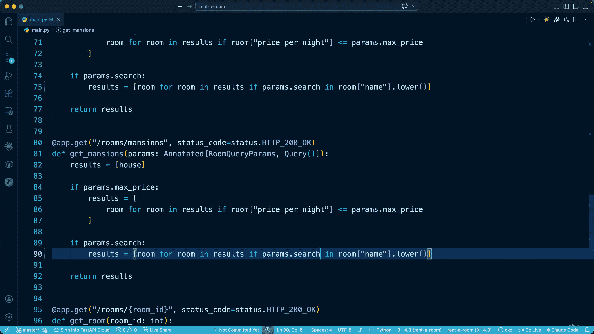
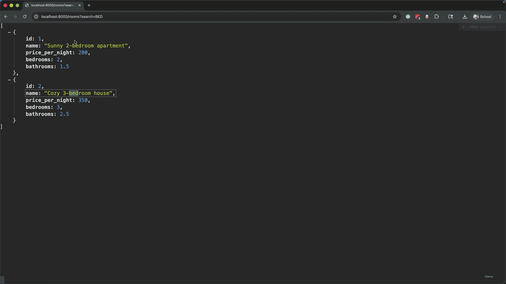
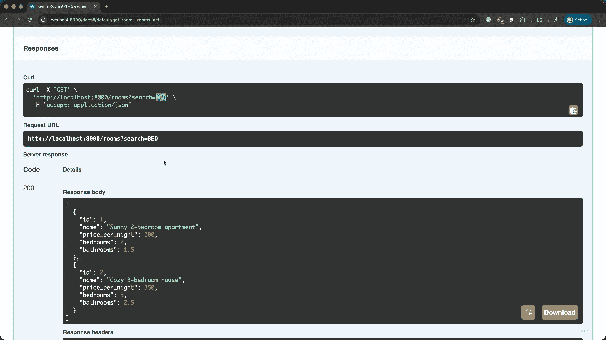

# Udemy - FastAPI Masterclass part1：p39：40. 额外的一项优化 🔧

在本节课中，我们将学习如何对房间查询参数的 Pydantic 模型再做一次优化。这个优化能帮助我们减少 `get_rooms` 和 `get_mans` 两个函数中的重复代码。简单来说，我们想让 `search` 查询参数在进入路由函数之前就已经是全小写状态，省掉两个函数里反复出现的 `.lower()` 调用。

在动手之前，先来看看为什么需要这个优化。我们知道，在处理 `search` 参数时，无论是 `get_rooms` 还是 `get_mans`，函数内部都要对搜索关键词调用一次 `lower()` 方法。这么做的目的是把文本统一成小写，因为客户端传过来的关键词可能是大写，比如 `BED`，而我们希望在比对真实房间名之前先把关键词转成小写，然后再执行包含搜索。你会发现，这段小写化的代码在两个路由函数里各写了一遍，虽然不难看，但确实有点重复。

如果 `search` 属性在到达路由处理函数时就已经是小写，那就省事了。这件事完全可以用 Pydantic 来做。在正式操作前，我们得先理解一下 Pydantic 的两副面孔。

## 验证与转换：Pydantic 的两种能力

Pydantic 当然是一个数据验证库。通常，我们说到“验证”这个词时，指的往往是“确认某件事为真”。例如，验证规则可以包括：

- 文本长度不能小于某个值。
- 数值必须大于或等于某个特定的数字。

这些规则都是在确认数据是否符合预期。

但在 Pydantic 社区里，验证其实还有第二层含义，那就是**转换**。Pydantic 不仅能确认数据是否符合某个形状，还能主动“捏”一下数据，把它变成我们想要的形状。换句话说，验证的一套流程里往往还夹带着数据整形的步骤。

我们刚才遇到的问题正好可以交给转换功能解决。与其在路由函数里手动调用 `lower()`，不如让 Pydantic 在解析查询参数时直接把字符串整理成小写。这样一来，路由函数拿到的 `search` 字段天然就是小写，也就不需要再去调用 `lower()` 了。

## 实现步骤：从导入到配置

接下来，我们就来看看具体怎么实现。第一步是到文件最顶部、引入 Pydantic 模块的地方，增加一个新的导入，名字叫 `StringConstraints`。这个类专门给字符串加约束，里面提供了一系列控制参数，能让我们轻松修改一段文本。

需要说明的是，这会是我们见过的所有语法选项里比较有意思的一个扩展。以前我们可能直接给字段指定一个普通类型，但现在我们可以在类型上做文章，把字段类型写成 `Annotated` 的形式。这个语法其实和 FastAPI 里用过的注解语法一模一样，只是这次我们把它应用到 Pydantic 模型里。

下面是使用 `Annotated` 时的关键点：

- 第一个参数是基础数据类型，例如 `str | None`。
- 第二个参数是元数据，例如 `StringConstraints(to_lower=True)`。

我们给 `search` 字段的类型加上 `Annotated` 包装，方括号里第一个条目是基础数据类型，所以 `search` 的类型是 `str`（字符串）或者 Python 的 `None` 对象，也就是 `str | None`；第二个条目代表元数据，我们就在这里放一个 `StringConstraints` 类的实例。

`StringConstraints` 的实例化参数会提供各种自动扭曲、塑形或修改字符串的选项。比如，有一个非常方便的 `to_lower` 参数，它可以把字符串改成小写；对应地还有 `to_upper` 参数，以及一些互补的参数。你可以猜到，一旦我们把 `to_lower=True` 传进去，Pydantic 就会自动把 `search` 字段对应的字符串内容变成小写。

下面是修改后的模型代码示例：

```python
from typing import Annotated
from pydantic import BaseModel, StringConstraints

class RoomQueryParams(BaseModel):
    search: Annotated[str | None, StringConstraints(to_lower=True)] = None
```

注意，这里我们用到了 `StringConstraints`、`Annotated` 和 `to_lower` 几个名字，它们就是这次优化的核心。还有一点值得一提：到了这一步，这个特性其实已经不再局限于查询参数验证器这个身份了。它既能用在查询参数这个场景里，也可以用在任何其他场景，无论是其他形状的数据，还是来自任何数据源的负载，只要这些数据里有一个名叫 `search` 的字段，Pydantic 都能用同样的方式处理。

也就是说，除了完成我们之前提到的所有验证之外，这个配置还会自动把字符串强制转换成小写。这意味着什么呢？意味着当代码实际运行时，最早运行的逻辑一定是 `RoomQueryParams` 的实例化，而我们已经告诉 FastAPI，这个对象要从查询参数里构造出来。所以，当查询参数最终到达这里时，`search` 字段、也就是 `search` 属性，已经是小写状态了。

## 删除多余代码：一个地方搞定

现在，我们不再需要路由函数里的手动小写化代码了，就可以把它们删掉。上面那个函数里有一段 `.lower()` 的调用，清理掉；下面那个函数里也有一段同样的代码，同样清理掉。

有一点要放心，这个改动不会改变任何功能，因为我们原本在两个路由处理器里做的事就是小写化。现在只是把它们从两个地方挪到了一个地方，也就是 Pydantic 类里，由它优雅地统一处理。代码量减少了，维护也变得更简单。

## 浏览器实测：大写进来，小写匹配

为了让效果更直观，我们可以快速切换到浏览器里测试一下。比如，我们发起一个请求，把查询参数 `search` 设置为 `BED`，注意这里写的是全大写。你会看到，即使我们提供的查询参数是全大写的，Pydantic 模型也会把它转成小写。因此，当我们在任意一个路由函数中执行包含搜索时，小写的 `bed` 就能在这两个房间名里被找到，结果和预期完全一样。





类似的，如果打开 Swagger 文档，也就是访问 `localhost:8000/docs`，在 `rooms` 接口下，你会看到完全相同的结果。顺便一提，这个结果在 `mans` 端点下也是一样的。我可以点击 `Try it out`，然后在搜索查询参数里输入一个大写的 `BED`，你会看到发往服务器的请求确实使用的是全大写的 `BED`。不过没关系，我们依然可以通过 Pydantic 自动小写化的机制，优雅地处理这种大写输入。

## 总结



本节课中，我们一起学习了如何用 Pydantic 的 `StringConstraints` 与 `Annotated` 给 `search` 字段加上自动小写化的能力。我们首先看到了验证的传统含义，然后又了解了转换这层含义，接着通过一个简单的代码示例完成配置，并删掉了两个路由函数里重复的 `.lower()` 调用。最后在浏览器和 Swagger 文档中验证了效果。归根结底，Pydantic 远远不只是传统意义上的验证，它还在验证之上提供了数据转换能力，确实是一个相当强大的库。

