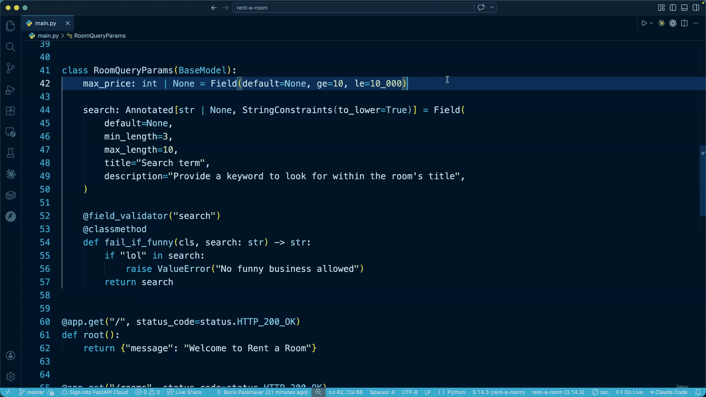
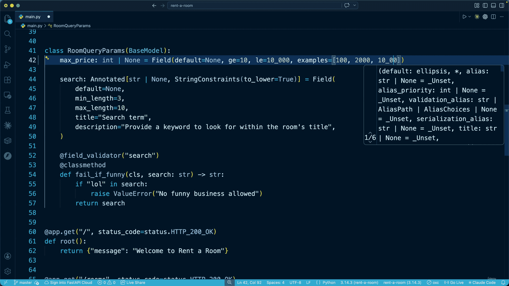
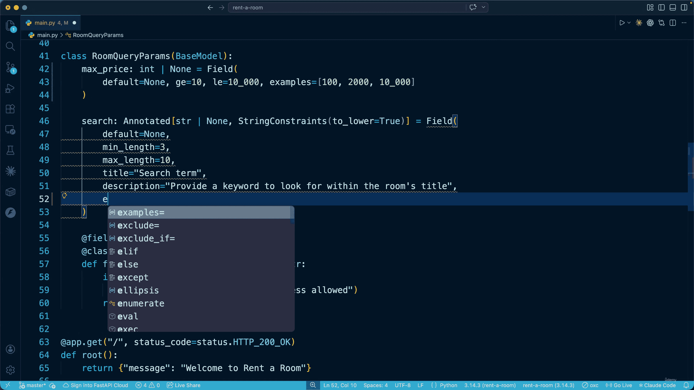
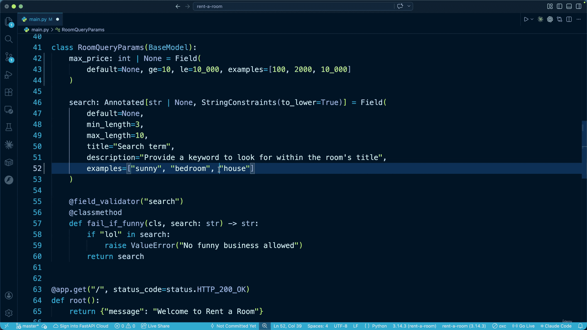

# 📘 FastAPI Masterclass：第40节：examples 参数

在本节课中我们将要学习 Pydantic 模型字段定义中的一个额外参数，也就是 `examples` 参数。它用来给字段补充示例值，让读代码的人和后续工具知道这个字段可以接收什么样的数据。我们会从基本写法开始，再结合 `max_price` 和 `search_terms` 两个例子说明，最后解释它对 Swagger 文档和其他开发者的意义。

## 🧱 FastAPI Masterclass：第40.1节：给字段添加 examples 参数

在 Pydantic 模型里，一个字段除了类型、默认值等信息之外，还可以增加 `examples` 这个参数。它的写法很直接：把 `examples` 设为 Python 列表，列表中的每一项都是该字段的示例值、样本值或者合法值。用公式表示就是：

`examples = [合法示例值1, 合法示例值2, ...]`

下面用代码展示一个字段定义中的基本写法，初学者可以把它理解成给字段附上一组“可以长这样”的参考值。

```python
from pydantic import BaseModel, Field

class Product(BaseModel):
    max_price: int = Field(..., examples=[100, 2000, 10000])
```

在这个例子中，`max_price` 字段的 `examples` 被设为列表 `[100, 2000, 10000]`，它们就是最高价格字段可以提供的示例值。把 `examples` 放在字段定义里，不会改变字段类型本身，它的作用是补充说明和展示样本，让字段的含义更清楚。

## 🛠️ FastAPI Masterclass：第40.2节：max_price 与 search_terms 的示例值

上一节我们说明了 `examples` 参数的基本写法，本节中我们来看看它在具体字段上的两个示例。对于 `max_price`，可以提供类似 100、2000、10000 这样的样本，表示这个最高价格字段可以接收的示例值。下面列出本节涉及的两个具体用法，方便对照理解。



- `max_price` 字段可以使用 `examples=[100, 2000, 10000]`，表示最高价格的示例值是 100、2000、10000。



- `search_terms` 字段同样可以把 `examples` 设为一个 Python 列表，例如 `["Sunny", "bedroom", "house"]`，表示搜索词可能出现的样本值是 Sunny、bedroom 和 house。



这两个列表背后的思路相同：`examples` 的值是一个列表，列表里放的是字段的样本值。对于搜索词字段，可以写成下面这样，让阅读代码的人一眼看出搜索参数大概会长什么样。

```python
from pydantic import BaseModel, Field

class SearchParams(BaseModel):
    search_terms: str = Field(..., examples=["Sunny", "bedroom", "house"])
```

这里需要再次说明，`search_terms` 的示例值只是样本，不是唯一允许的输入；它的作用是展示这个字段可能的取值样子。通过 `max_price` 和 `search_terms` 这两个例子，可以看到 `examples` 参数可以直接写在任意字段定义中，写法都是把参数设为一个列表。在掌握这些写法之后，下面我们再来看看 `examples` 在当前 Swagger 文档和代码阅读中的表现。

## 🧭 FastAPI Masterclass：第40.3节：Swagger 文档与代码可读性

上一节我们看了 `examples` 在两个字段上的具体写法，本节中我们来看看它在 Swagger 文档和代码可读性方面的表现。目前这些 `examples` 不会填充到生成的 Swagger 文档中，不过在未来的 FastAPI 版本中，它们当然可以展示出来。即使暂时不在 Swagger 文档里显示，`examples` 仍然有价值，因为它能帮助阅读代码的其他开发者。

下面列出 `examples` 在当前阶段的主要价值，便于理解它为什么值得写。

- 对其他开发者有帮助：他们阅读代码时，可以更好地理解查询参数或者流入服务器的其他数据到底应该表示什么。

- 提供上下文：示例值让字段的含义更具体，减少只靠字段名猜测数据格式的情况。

换句话说，`examples` 参数不仅是给工具看的，也是给读代码的人看的。再次强调，`examples` 参数可以提供给 Pydantic 数据模型中的任意字段，字段类型不同，示例列表的内容也可以不同。在理解了这些价值之后，本节最后做一个简单总结。

## ✅ FastAPI Masterclass：第40.4节：总结



本节课中我们一起学习了 Pydantic 模型字段定义中的 `examples` 参数。我们知道了 `examples` 的值是一个 Python 列表，列表里放的是字段的示例值、样本值或合法值；也看到了 `max_price` 可以写 `examples=[100, 2000, 10000]`，`search_terms` 可以写 `examples=["Sunny", "bedroom", "house"]`。目前这些示例不会填充到生成的 Swagger 文档中，但未来 FastAPI 版本可以展示它们；即使不展示，它们也能帮助其他开发者理解查询参数和其他流入服务器的数据代表什么。最后记住，`examples` 可以加在 Pydantic 数据模型的任意字段上。

