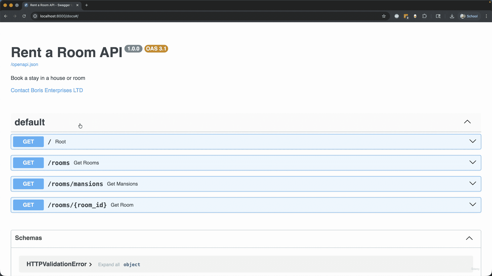
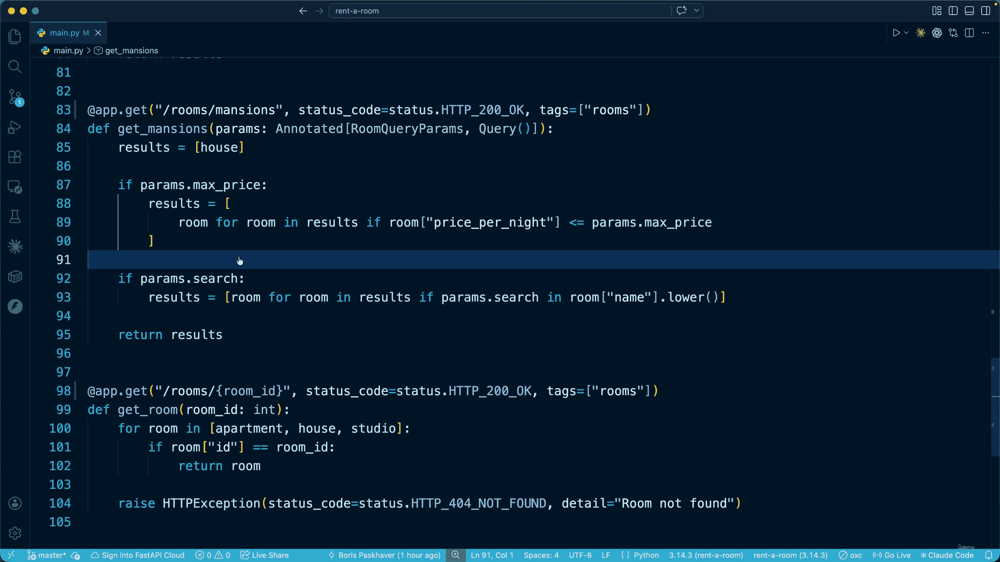
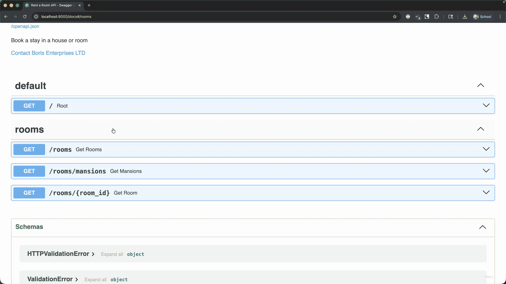
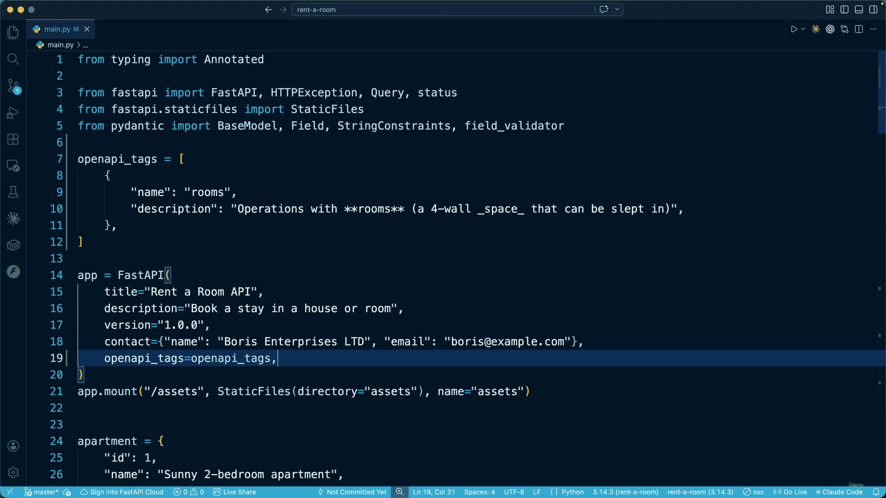
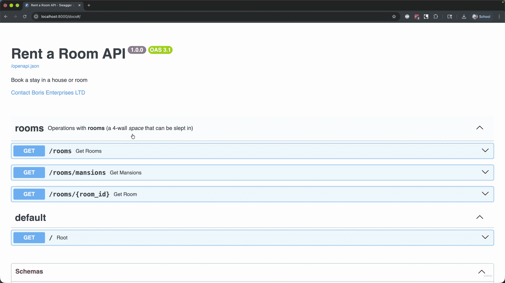

# 🚀 FastAPI 大师课：p41 42：使用标签对路由进行分组

在本节课中，我们将要学习如何在 FastAPI 中给路由加上标签，从而让 Swagger 文档把相关接口归到同一个分类下面。我们还会学习如何给整个标签添加一段描述，并且了解描述字符串里可以用类似 Markdown 的符号来做粗体和斜体。你可以把这件事理解成给文件建文件夹：路由少的时候全放在一个默认分类里也能找到，路由多起来之后，按类别放进不同文件夹就会清楚很多。



在进入具体操作之前，先看一下当前 Swagger 文档的现状。目前打开 Swagger 文档，会看到所有路由都被收在一个分类或小节下面；换句话说，它们默认都在 `default` 分类里。出现这个现象的原因，是我们没有给这些路由提供自定义注解来告诉 Swagger 应该如何组织或分类它们。以下是当前默认分组会带来的几个问题：

- 所有路由都挤在同一个默认分类里，看起来不够清晰。
- 当 FastAPI 应用扩展到几十个甚至几百个路由时，很难快速识别某个路由属于哪个业务类别。
- 我们需要一种在代码里直接指定分类的方式，而不是依赖 Swagger 的默认行为。

明白了问题之后，本节中我们来看看如何在代码里给路由打标签。我们可以给任意一个路由装饰器提供一个 `tags` 参数，从而在代码中设置分类。核心关系可以用下面这行公式来表示：

`路由 + tags=["rooms"] -> Swagger 文档中的 rooms 分类`

接下来回到 VS Code，并向下滚动代码。这里的根路由可以把它想象成一个普通的默认路由，或者换句话说，它可以继续作为一个单独的分类。现在真正想归到一组的是下面三个路由，它们都和“房间”这一类资源有关。以下是给这三个路由添加标签的代码示例：

```python
@app.get("/rooms", tags=["rooms"])
def get_rooms():
    ...

@app.get("/mansions", tags=["rooms"])
def get_mansions():
    ...

@app.get("/rooms/{room_id}", tags=["rooms"])
def get_room(room_id: int):
    ...
```

在具体的 `get` 方法调用里，我们添加 `tags` 参数，并提供一个包含一个或多个条目的列表；这里提供的条目是 `rooms`。然后，把同样的写法复制粘贴到下面另外两个路由上：一个是 mansion 路由，另一个是获取单个房间的 individual 路由。这样三个路由就都带上了相同的标签。





标签添加完成后，本节中我们来看看浏览器中的实际效果。回到 Chrome，可能需要刷新一下页面；刷新之后，就会看到一个 `rooms` 标题，这个标题来自我们传给 `tags` 的那个字符串。因为三个路由使用了完全相同的标签，所以它们现在都被归到了 `rooms` 这个指定分类下面。你还可以看到这个分类是完全可折叠的，既能隐藏也能展开，这会让文档浏览起来稍微方便一些。以下是标签分组带来的直接变化：

- Swagger 文档中会出现一个名为 `rooms` 的分组标题。
- 三个共享相同标签的路由会被放进同一个分类。
- 该分类可以折叠和展开，方便隐藏或查看其中的接口。

分组完成后，本节中我们来看看如何为整个标签补充说明描述。除了分组之外，我们还可以给这个资源所代表的内容提供一段简短描述，这段描述会渲染在更外层的标签旁边，也就是分类旁边。以下是这个描述在概念上的位置：

`openapi_tags 中的 description -> 渲染在 Swagger 的 rooms 标签/分类旁边`

接下来再次回到 VS Code。这个描述并不是写在某个具体路由上的，而是作为参数传给 FastAPI 应用实例化过程。向上滚动到最顶部，这里正是创建或初始化 FastAPI 应用的位置；应用初始化时会接受一个名为 `openapi_tags` 的参数（原文口述为 open API tags），它期望一个列表。因为直接写在参数里可能会比较长，所以先声明一个单独的变量来保存这些信息。以下是声明 `openapi_tags` 并传入 FastAPI 应用的代码示例：

```python
openapi_tags = [
    {
        "name": "rooms",
        "description": "**rooms** operations with _space_, a four wall space that can be slept in"
    }
]

app = FastAPI(openapi_tags=openapi_tags)
```

这个变量的值是一个字典列表，其中每个字典都要有一个 `name` 键，`name` 对应的值就是某个标签的名称；这里只声明了一个 `rooms` 标签。然后，为 `rooms` 标签再提供一个 `description` 键，`description` 的字符串值会渲染在 Swagger 文档中的 `rooms` 标签或分类旁边。这里需要把描述放在应用初始化处，而不是放在单个路由上，因为这个描述是每个标签一次，而不是每个路由一次。以后如果增加一个 `users` 标签，就可以在这个列表里再加一个字典，写上 `name` 为 `users`，并配上对应的描述。以下是这种“每个标签一个字典”的结构要点：

- 每个字典通过 `name` 指定标签名称。
- 通过 `description` 给该标签添加说明文字。
- 描述是标签级别的，不是路由级别的。

在描述字符串里，还可以写一些更有趣的内容，比如 `operations with rooms`，并在括号里补充类似 `a four wall space that can be slept in` 这样的解释。它还可以更强大，因为可以使用特殊符号给字符串中的片段应用特定格式。例如，想要加粗，可以使用连续两个星号；在 `rooms` 这个词前面和后面各加一个星号，就可以把 `rooms` 标记为粗体。这种写法其实和 Markdown 格式类似，如果你熟悉 Markdown 会更容易理解；它也可以作用于一段连续的单词。再比如，对于 `space` 这个词，可以用下划线来实现斜体，同样是在开始位置和结束位置各加一个下划线。以下是一个带格式的描述示例：

```python
"description": "**rooms** operations with _space_, a four wall space that can be slept in"
```

这些格式完全是可选的，只是在你想要格式化描述字符串时使用。现在有了这个列表，就可以把它传给 FastAPI 应用的 `openapi_tags` 参数；这个参数严格来说只用于 Swagger 文档。把上面声明好的完整 `openapi_tags` 列表传进去，然后保存代码。以下是这个参数的作用范围说明：

- `openapi_tags` 服务于 Swagger 文档展示。
- 它不会改变路由本身的业务逻辑。
- 它按标签统一提供名称和描述。

保存之后，回到浏览器并刷新页面，就会看到 Swagger 把 `rooms` 标签和第一个字典里 `name` 为 `rooms` 的条目匹配起来。对应渲染出来的内容里，也会包含我们对 `rooms` 设置的粗体，以及对 `space` 设置的斜体。以下是刷新后应该观察到的结果：

- `rooms` 分类旁边会出现自定义描述。
- 描述中的 `rooms` 显示为粗体。
- 描述中的 `space` 显示为斜体。

> **提示**：`description` 里的 `**rooms**` 会显示为粗体，`_space_` 会显示为斜体；这些格式是可选的，只影响 Swagger 文档中的描述展示。





本节课中，我们一起学习了如何使用 `tags` 对路由进行分组或分类，也学习了如何通过 FastAPI 应用的 `openapi_tags` 参数给每个标签提供自己的自定义描述。核心做法可以概括为：在路由装饰器里用 `tags=["rooms"]` 把相关接口归到同一组，在应用初始化时用 `openapi_tags` 列表为这个标签补充说明文字。这样 Swagger 文档会更清晰、更容易浏览，路由多起来之后也更方便维护。

