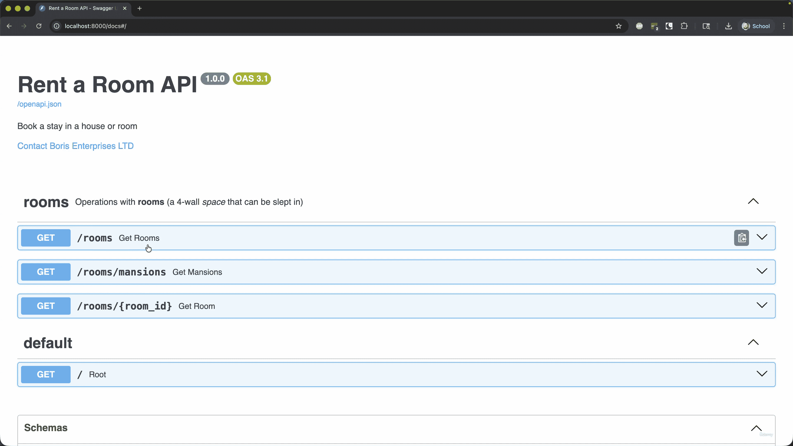
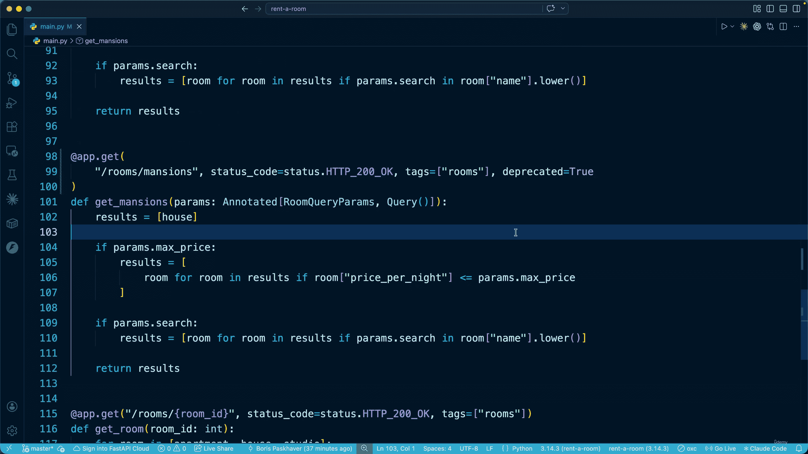
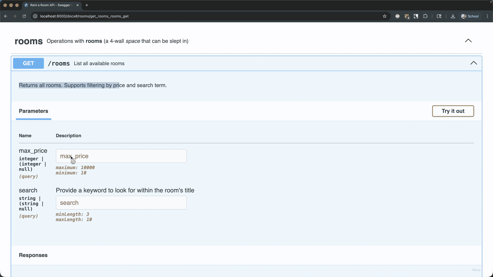

# 🚀 FastAPI 大师课：第43章：路由装饰器选项

在本节课中我们将要学习如何自定义 Swagger 文档中显示在端点右侧的文字。端点可以理解为 API 的一个接口地址，Swagger 文档则是自动生成给开发者看的接口说明书。我们会重点看路由装饰器里的几个可选参数，它们可以修改文档中的标题、详细说明、响应说明和弃用提示，让未来使用这个 API 的人更容易看懂每个接口的作用。

> 一句话理解：这些路由装饰器参数，就是给自动生成的 API 文档补充更清楚的文字说明。

在明确本节课目标后，我们先来看 Swagger 默认如何显示端点文字，以及 `summary` 参数如何修改顶层标题。

## 📌 FastAPI 大师课：第43.1节：Swagger 默认显示与 summary 参数

上一段概述说明了本节课要自定义 Swagger 文档文字，本节中我们来看看默认情况下 Swagger 显示的是什么，以及 `summary` 参数能做什么。默认情况下，我们在文档中看到的其实是函数名，而且这个函数名已经被处理得更适合阅读。Swagger 会取出类似 `get_rooms` 这样的 snake_case 函数名，去掉下划线，并把每个单词的首字母大写，于是显示成 `Get Rooms`。

核心概念可以用下面的公式表示：

```text
get_rooms → 去掉下划线 → 每个单词首字母大写 → Get Rooms
```



理解默认显示方式后，我们可以提供自定义描述，用来准确说明这个端点返回什么。回到 VSCode 编辑器，以 rooms 端点为例，在路由装饰器里增加一个名为 `summary` 的参数。这个参数会显示在 Swagger 中每个路由条目的顶层标题位置，我们可以给它写上“列出所有可用房间”，让未来使用 API 的人更清楚这个接口的用途。

以下代码展示了在 rooms 端点上添加 `summary` 参数的方式：

```python
@app.get(
    "/rooms",
    summary="列出所有可用房间",
)
def get_rooms():
    ...
```

对初学者来说，这一步的意义在于：Swagger 会自动生成文档，但自动生成的内容不一定足够清楚，而 `summary` 可以让我们用一句短话把接口目的讲明白。理解了 `summary` 的顶层标题作用后，本节中我们来看看 `description` 参数如何提供更详细的说明。

## 📝 FastAPI 大师课：第43.2节：description 详细说明参数

上一节介绍了 `summary` 会显示为路由条目的顶层标题，本节中我们来看看 `description` 参数如何补充更详细的内容。`summary` 是顶层标题，而 `description` 可以写得更展开，当用户点开某个具体路由，查看所有可用参数和文档时，这段内容就会显示出来。

除了 `summary`，我们还可以在路由装饰器里增加 `description` 参数，通常这个参数用来写更详细的说明。例如可以写“返回所有房间”，也可以再补充“支持按价格和搜索词过滤”。这段内容可以详细到你想要的程度，核心目的就是帮助最终使用这个 API 的人。

以下代码展示了同时使用 `summary` 和 `description` 的写法：

```python
@app.get(
    "/rooms",
    summary="列出所有可用房间",
    description="返回所有房间，支持按价格和搜索词过滤。",
)
def get_rooms():
    ...
```

以下是 `description` 参数需要记住的几个要点：

- `description` 会在用户展开具体路由、查看参数和文档时显示。
- `description` 通常比 `summary` 更详细，可以写“返回所有房间”，也可以补充“支持按价格和搜索词过滤”。
- 详细程度由你决定，目标始终是帮助最终用户理解接口。

这里再强调一次，文档不是写给自己看的，而是写给未来调用 API 的人看的，所以多写一句清楚的话通常很有价值。了解了如何描述路由本身后，本节中我们来看看如何用 `response_description` 描述响应内容。

## 📦 FastAPI 大师课：第43.3节：response_description 响应说明参数

上一节我们说明了 `description` 可以详细描述路由，本节中我们来看看 `response_description` 如何描述响应是什么形状。另一个可以提供的参数叫 `response_description`，这里已经进入比较细的定制层面。这个参数是一个字符串，用来描述响应的形状，也就是用大白话告诉用户：调用这个接口后，响应里会得到什么。

例如可以写“你将得到匹配筛选条件的房间列表”。这个例子本身有点取巧，但它说明我们可以用很多不同方式自定义这些文档。以下代码展示了添加 `response_description` 后的路由装饰器：

```python
@app.get(
    "/rooms",
    summary="列出所有可用房间",
    description="返回所有房间，支持按价格和搜索词过滤。",
    response_description="返回匹配筛选条件的房间列表。",
)
def get_rooms():
    ...
```

以下是 `response_description` 参数的核心用途：

- 它是一个字符串，用来描述响应的形状。
- 它可以用大白话回答“响应里会得到什么”。
- 例如可以写“返回匹配筛选条件的房间列表”。

到这里，我们已经能给文档补充标题、详细说明和响应说明。接下来，本节中我们来看看另一个有用的参数 `deprecated`，它用来标记某个端点已经不再推荐使用。

## ⚠️ FastAPI 大师课：第43.4节：deprecated 弃用标记参数

上一节介绍了 `response_description` 如何描述返回内容，本节中我们来看看如何用 `deprecated` 参数告诉用户某个端点不再推荐使用。继续向下查看路由装饰器参数，假设我们决定不再支持这个端点，原因可能是这个端点有点傻气，也没有带来收入，我们想表示它已经弃用。所谓弃用，就是告诉用户这个端点不应该再被使用，并且可能在未来的更新中被移除。

这时可以在路由装饰器里提供 `deprecated` 参数，并把它设置为 `True`。以下代码展示了带弃用标记的完整写法：

```python
@app.get(
    "/rooms",
    summary="列出所有可用房间",
    description="返回所有房间，支持按价格和搜索词过滤。",
    response_description="返回匹配筛选条件的房间列表。",
    deprecated=True,
)
def get_rooms():
    ...
```

以下是 `deprecated=True` 需要表达的含义：

- 这个端点不再推荐使用。
- 它可能在未来的更新中被移除。
- 它技术上仍然存在于 FastAPI 应用中，但文档会提示用户可能不应该使用它。

保存代码后，本节中我们来看看浏览器中的实际效果，以及 Swagger 和 Pydantic 能自动生成哪些文档内容。

## 🧪 FastAPI 大师课：第43.5节：浏览器效果与自动文档能力

上一节我们设置了 `deprecated=True`，本节中我们来看看保存并刷新浏览器后会出现哪些变化，同时理解 Swagger 自动生成文档的能力。保存代码并回到浏览器刷新后，我们会看到一系列变化。首先是弃用标记带来的效果：路由名称现在被划掉了，并且显示为灰色，不再那么吸引注意力。这个路由从技术上说仍然存在于 FastAPI 应用中，但文档已经在告诉用户，大概率不应该再使用它。

以下是刷新浏览器后可以观察到的几个变化：

- 弃用路由的名称会被划掉，并且变成灰色，不再吸引注意力。
- 该路由技术上仍然存在于 FastAPI 应用中，但文档会提示用户可能不应使用。
- `summary` 参数的内容会显示在路由条目的标题位置。
- 展开具体路由后，可以看到 `description` 参数提供的内容。

文档的详细程度最终由你决定，你可以根据想给最终用户多少帮助来调整这些文字。很多文档内容其实会由 Swagger 自动生成，这也是它和 Pydantic 结合后的美妙之处。它可以自动生成可用的查询参数文档、路径参数文档，最终还能生成进入服务器的请求载荷文档，以及从服务器发送回客户端的响应文档。核心概念可以用下面的代码关系表示：

```text
Swagger + Pydantic → 查询参数文档 + 路径参数文档 + 请求载荷文档 + 响应文档
```



也就是说，很多内容开箱即用，不需要我们手写。只有当我们想专门定制某一部分文字时，才需要添加这些额外参数。

## ✅ FastAPI 大师课：第43.6节：本节总结



到这里，我们已经看完了路由装饰器中几个常用的文档定制参数。本节课中我们一起学习了 Swagger 默认如何把函数名转换成更易读的标题，学习了 `summary` 如何设置顶层标题，`description` 如何提供更详细的说明，`response_description` 如何描述响应形状，以及 `deprecated=True` 如何标记端点弃用。我们还看到了浏览器中的实际显示效果，并理解了 Swagger 与 Pydantic 结合后可以自动生成大量 API 文档内容。掌握这些参数后，就可以在自动生成文档的基础上，按需补充更清楚的文字说明。

