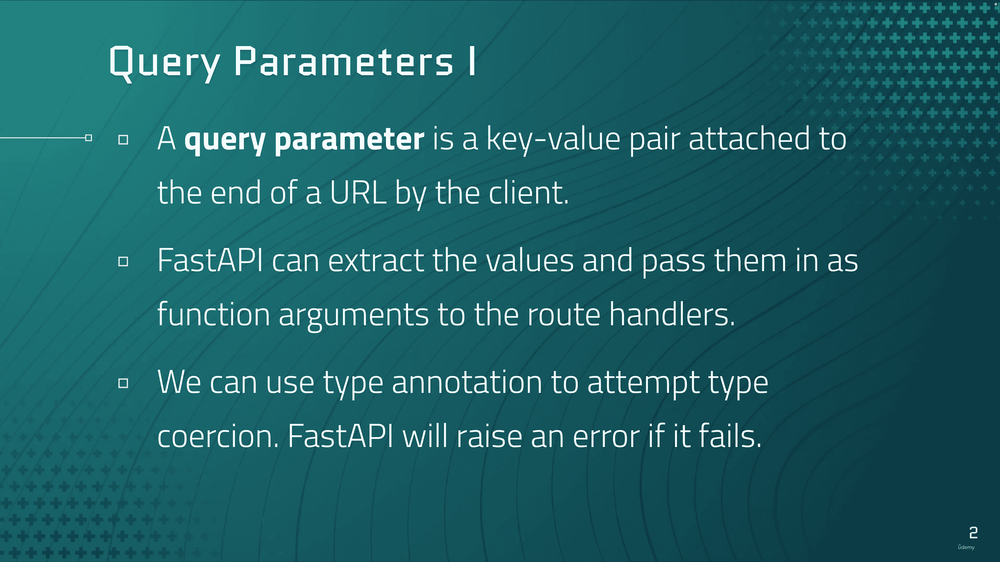
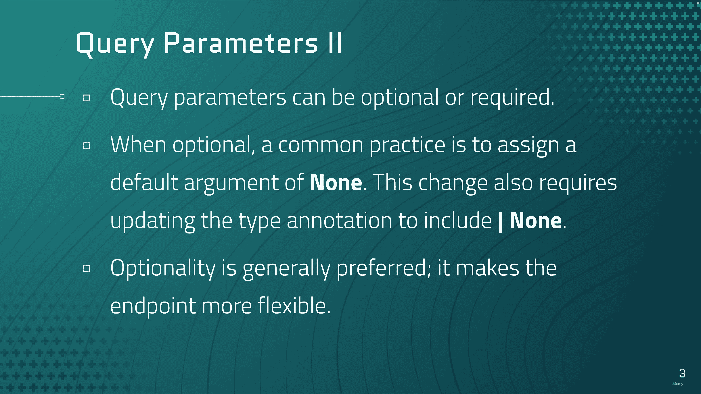
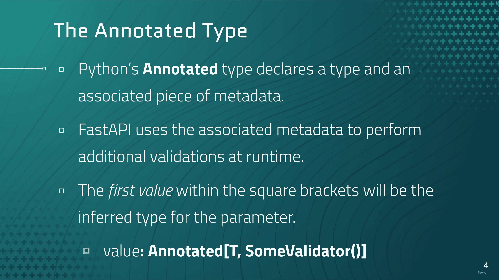
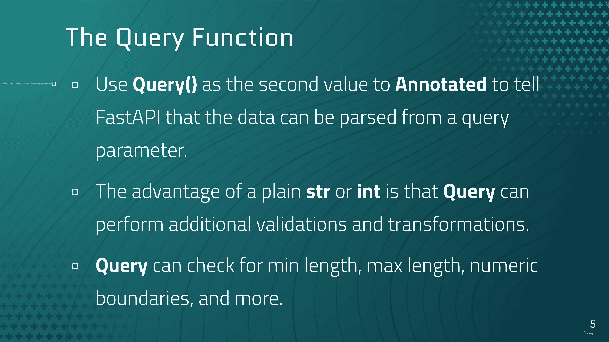
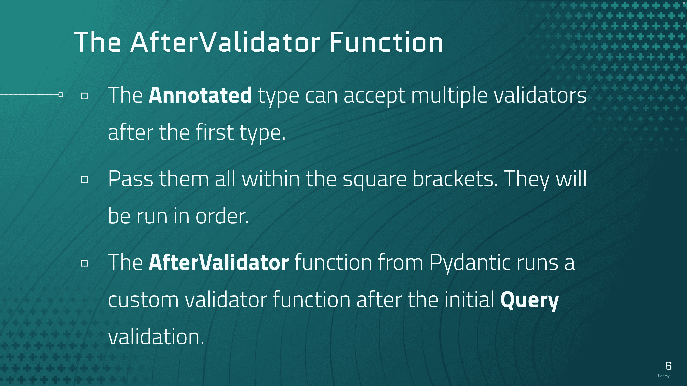
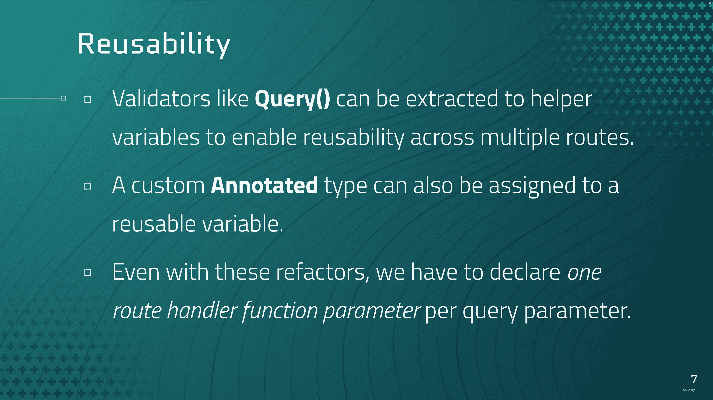
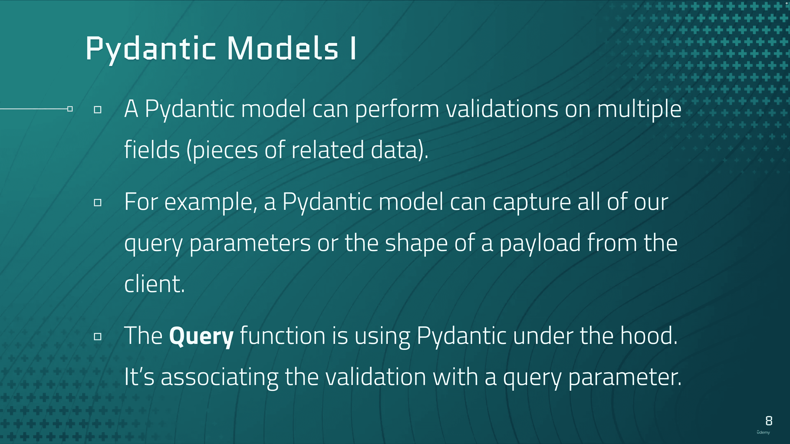
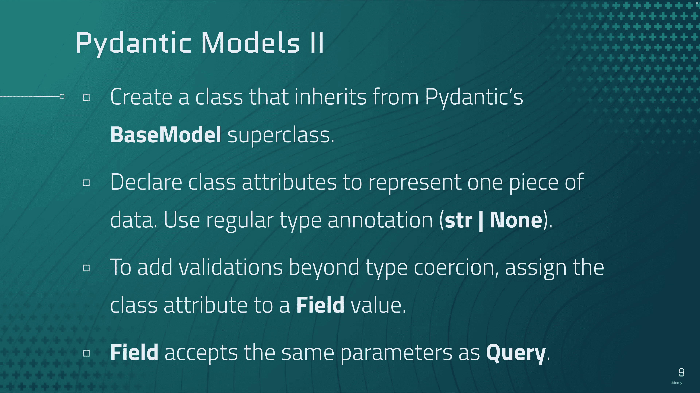
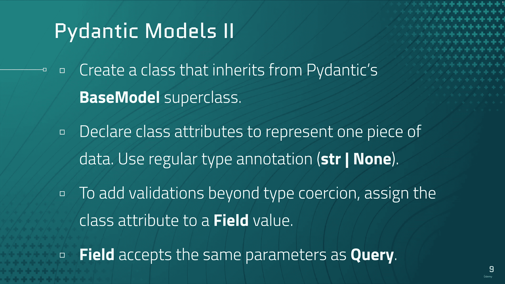
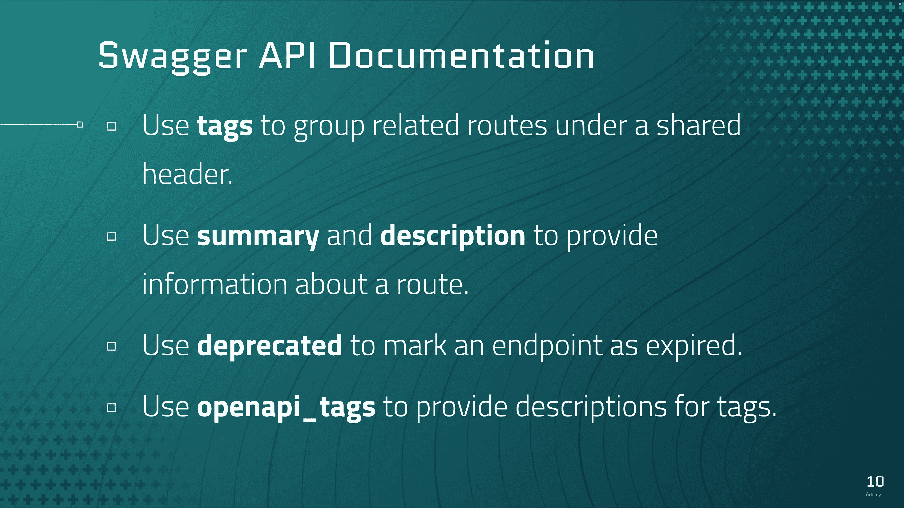

# FastAPI 大师课：第43课：章节回顾 🎯

在本节课中我们将要学习如何回顾查询参数、数据验证、可复用写法、Pydantic 模型以及 Swagger 文档定制这些内容。恭喜你完成另一个课程章节，和往常一样，我们花一点时间把本节学到的所有内容重新梳理一遍。本节的重点是查询参数和验证，这些知识看起来零散，但串起来以后就是一套很实用的接口开发思路。下面我们就按照从基础到进阶的顺序，把每一块内容都讲清楚。

## FastAPI 大师课：第43课：查询参数是什么 🧩

上一节我们完成了本节内容的学习，本节中我们来看看查询参数到底是什么。查询参数是客户端附加在 URL 末尾的键值对，服务器路由可以解析这些键值对，并利用它们完成某些操作。一个非常常见的用途是从一个较大的记录集合中过滤出一个子集，比如搜索、筛选、分页等场景都离不开它。FastAPI 可以自动提取这些值，而查询参数的键也就是标签，可以直接定义成函数的参数。再次强调，FastAPI 能区分查询参数和路径参数，依据是路径参数会出现在路由字符串声明里：只要出现花括号，FastAPI 就知道这个参数来自路径参数，其他参数则默认来自查询参数。

下面列出查询参数基础部分需要记住的几个要点：

- 查询参数是客户端附加到 URL 末尾的键值对，服务器路由能够解析它们并做相应处理。
- FastAPI 会自动提取查询参数的值，查询参数的键可以定义为路由处理函数的参数。
- 路径参数出现在路由字符串的花括号中，其他参数默认被当作查询参数。
- 我们可以在路由处理函数体中使用查询参数的值。

理解了查询参数从哪里来之后，我们还要看它的类型处理。我们可以为查询参数提供类型注解，和路径参数非常类似，FastAPI 会尝试把数据强制转换成期望的类型。所有查询参数到达时都是字符串，但如果想把它转换成整数，FastAPI 会尝试完成这个转换。等路由处理函数体开始运行时，你就可以假定自己拿到的是整数；如果转换失败，FastAPI 会自动返回错误码和错误响应。这一点让代码省心很多，因为很多类型检查工作已经被框架提前做掉了。

## FastAPI 大师课：第43课：可选参数与联合类型 🔧



上一节我们介绍了查询参数的基本提取和类型转换，本节中我们来看看查询参数的可选性。查询参数可以是可选的，也可以是必需的，通常更推荐把参数设计成可选，因为这样会让 API 端点更加灵活。为了让一个参数变成可选，需要在 Python 中给它一个默认参数，这个默认值就是参数没有被提供时 Python 会替换进去的备用值。对查询参数来说，这种情况就是客户端没有给出实际的那个键，或者没有给出指定名称的查询参数。

下面列出可选参数和联合类型的关键点：

- 查询参数可以是可选或必需的，可选性通常更受青睐，因为端点会更灵活。
- 让参数可选需要提供默认参数，默认参数表示客户端没有提供该参数时的备用值。
- 一个很常见的默认值是 Python 的 `None` 对象，它表示没有值或缺失。
- 因为 `None` 是一种不同的类型，还需要更新类型注解，让它包含 `None` 的可能性。
- 这时会使用联合类型，在多个可能类型之间放一个竖线。



例如，如果一个参数既可能是字符串，也可能是 `None`，就写成 `str | None`，这就是联合类型。代码看起来如下：

```python
def read_items(q: str | None = None):
    ...
```

这段代码很直白：`q` 可以传字符串，也可以不传；不传时它的值就是 `None`。这样一来，接口的灵活度就上来了，客户端可以根据需要决定是否携带这个查询参数。掌握可选参数之后，下一节我们进入 Python 的 `Annotated` 类型。

## FastAPI 大师课：第43课：Annotated类型 📝

上一节我们介绍了可选参数和联合类型，本节中我们来看看 Python 的 `Annotated` 类型。需要澄清的是，`Annotated` 是 Python 核心语言本身的一部分，不是 FastAPI 独有的东西。不过 FastAPI 大量使用了 `Annotated`，用来为路由提供很多运行时验证能力。我们从 Python 的 `typing` 模块导入 `Annotated`，然后对任意函数参数，把它的类型标记为 `Annotated`，后面跟一对方括号。方括号里的第一项是核心类型本身，比如 `str`；逗号后面的第二项是关联的元数据，从技术上说这一项是必需的。

下面列出 `Annotated` 在 FastAPI 中的几个要点：

- `Annotated` 属于 Python 核心语言，不是 FastAPI 专有类型。
- FastAPI 广泛使用 `Annotated` 来完成路由的运行时验证。
- 方括号第一项是核心类型，第二项是元数据，在 FastAPI 中通常表示验证或约束。
- 可以在路由处理函数体运行之前完成验证，从而保证数据到达时符合期望形状。
- 如果只需要类型声明、不需要额外验证，直接写 `str | None` 也没有问题。

在 FastAPI 的上下文里，`Annotated` 的元数据会是某种验证或约束。比如运行时可以声明一个查询参数，同时要求它有最小长度或最大长度，这样我们就获得了很大的灵活性，因为验证可以在路由处理函数体开始运行之前完成。等数据真正到达时，我们就可以放心地认为它已经处于期望的形状。下面的例子中，如果有一个 `value` 参数，类型检查器推断出的类型是字符串，但额外的验证器参数允许我们对传入函数的实际值再做一层检查。代码可以写成这样：





```python
from typing import Annotated
from fastapi import Query

def search(q: Annotated[str | None, Query(min_length=3)] = None):
    ...
```

作为 `Annotated` 第二项输入的一个例子，我们探索了 FastAPI 的 `Query` 函数。它告诉服务器数据应该来自查询参数，同时我们仍然标记精确类型，比如 `str | None`，既澄清了它应该从查询参数解析，又获得了额外验证和转换的好处。写 `str | None` 而不做额外验证没有错，但如果想对查询参数做额外检查，就用 `Annotated`，把 `Query` 作为方括号里的第二项，然后按需要添加验证逻辑。接下来我们继续看自定义验证器。

## FastAPI 大师课：第43课：Query与AfterValidator 🛡️

上一节我们介绍了 `Annotated` 和 `Query` 的基本组合，本节中我们来看看自定义验证。对于自定义验证，我们介绍了 `AfterValidator` 函数，它从 Pydantic 导入。Pydantic 是一个流行的数据验证库，`AfterValidator` 允许我们在 `Query` 完成初始转换之后，再做一次额外的顺序检查。`Query` 会检查常见的事情，比如长度或值是否在边界内；但如果我们想加入自己的业务逻辑，就可以在自己的 Python 函数里声明这些逻辑。

下面列出自定义验证器需要记住的行为：

- `Annotated` 在第一项类型之后，可以接受任意数量的顺序验证器。
- 提供 `Query` 之后，可以提供 `AfterValidator`，并定义自定义函数来执行验证逻辑。
- 传给 `AfterValidator` 的函数如果通过验证，就应该返回输入值。
- 如果没有通过验证，就应该在函数体里抛出错误，也就是某种 Python 异常。
- 这个验证器相当于一层中间件逻辑，会在实际路由处理函数开始执行之前运行。
- 这样可以创建可复用的验证片段，而且能把自己的业务逻辑放进去。

示例代码如下：



```python
from typing import Annotated
from fastapi import Query
from pydantic import AfterValidator

def fail_if_funny(value: str) -> str:
    if "funny" in value:
        raise ValueError("不能包含 funny")
    return value

q: Annotated[str | None, Query(min_length=3), AfterValidator(fail_if_funny)] = None
```

这段代码表达的意思很直接：先让 `Query` 做通用检查，再用 `AfterValidator` 执行自定义检查；通过就返回原值，不通过就抛出异常。它让我们可以复用验证逻辑，同时保留自定义业务规则。接下来我们看看如何把这些定义进一步复用。

## FastAPI 大师课：第43课：复用查询参数定义 ♻️

上一节我们介绍了 `Query` 和 `AfterValidator` 的组合，本节中我们来看看 FastAPI 如何优雅地支持复用。实现复用的方式之一，是把很多构造提取出来，比如把行内定义的 `Query` 从某个特定路由处理函数中移出去，赋值给一个变量，然后这个变量就可以在任意多个路由处理函数中复用。更进一步，我们还可以提取完整的自定义 `Annotated` 类型，比如提取一个搜索查询类型，让这个类型同时包含 `str | None` 的类型声明、要求最小长度的 `Query` 逻辑，以及 `AfterValidator` 逻辑；这些内容都被捕获在一个变量里，然后可以在两个需要相同参数和验证的路由处理函数中复用。



下面列出复用查询参数定义的关键点：

- 可以把 `Query` 定义从具体路由中移出，赋给变量，然后在多个路由中复用。
- 可以提取完整的自定义 `Annotated` 类型，把类型、查询逻辑和验证逻辑封装在一起。
- 提取后的变量可以在多个路由处理函数中复用相同的参数和验证规则。

示例代码如下：

```python
SearchQuery = Annotated[
    str | None,
    Query(min_length=3),
    AfterValidator(fail_if_funny),
]

def search_one(q: SearchQuery = None):
    ...

def search_two(q: SearchQuery = None):
    ...
```

不过，即使做了这些重构，我们还是遇到一个更大的问题：每个期望的查询参数仍然需要在路由处理函数中声明一个参数，这种写法不够可扩展。解决方案是把所有相关数据提取出来，放进一个类里，这个类就是 Pydantic 模型。下一节我们详细看这个方案。

## FastAPI 大师课：第43课：用Pydantic模型收拢参数 📦

上一节我们介绍了查询参数定义的复用，本节中我们来看看如何用 Pydantic 模型把一组参数收拢起来。Pydantic 模型就是一个 Python 类，它继承自我们从 Pydantic 导入的 `BaseModel` 超类。这个类允许我们定义若干数据片段，这些片段叫字段，有时也叫属性，每个字段都可以有自己的验证规则。比如，一个 Pydantic 模型可以表示一组端点需要的所有查询参数，也可以描述客户端发来的载荷，或者要发给客户端的载荷；后一种用法会在后面的课程中看到。

下面列出 Pydantic 模型相关要点：

- Pydantic 模型是继承自 `BaseModel` 的 Python 类。
- 模型里的数据片段叫字段或属性，每个字段可以有自己的验证规则。
- 一个模型可以表示一组端点的所有查询参数，也可以描述载荷的形状。
- Pydantic 是独立的数据验证库，FastAPI 广泛使用它，但它本身也可以单独存在。
- 使用模型后，所有查询参数可以收拢到一个对象里，路由只需要一个参数。

关键结论是，Pydantic 是一个独立的数据验证库，虽然 FastAPI 大量使用它，但它本身可以单独工作。你只需要把数据传给它，它就能按需求验证和转换数据。当我们创建自己的基于 Pydantic 的模型来表示房间端点的所有查询参数时，一个优点是这些查询参数都被限制在一个 Pydantic 对象里，于是所有参数只需要一个路由参数。代码大致如下：

```python
from typing import Annotated
from fastapi import Query
from pydantic import BaseModel, Field

class RoomQuery(BaseModel):
    min_price: int = Field(default=0, ge=0)
    max_price: int | None = None
    city: str | None = Field(default=None, min_length=2)

def list_rooms(filters: Annotated[RoomQuery, Query()]):
    ...
```

这里仍然需要提供 `Annotated` 类型，把实际的自定义 Pydantic 模型作为第一个值，把 `Query` 函数调用作为方括号里的第二项，明确告诉 FastAPI 这个 Pydantic 模型应该由该端点的查询参数填充。因为 Pydantic 模型可以在很多不同上下文中复用，它也可以接收来自不同数据源的数据；比如查询参数现在来自查询字符串，但以后“每次搜索的最高价格”可能来自完全不同的数据源。因此我们需要告诉 FastAPI：请构造这个 Pydantic 模型并运行它的所有验证，但请记住这些字段的数据来源是实际的查询参数。





在 Pydantic 模型定义内部，我们当然也可以提供默认值，还可以转换值。我们看到了把字符串转成小写的例子，除此之外还有很多转换和验证可以做，Pydantic 确实是一个很强大的数据验证库。再补充一点技术信息：创建自己的 Python 类时，让它继承 Pydantic 的 `BaseModel`，然后在类块里声明类属性；每个信息写成名称、冒号和类型注解，比如 `str | None`。如果要在类型本身之外添加额外验证，就从 Pydantic 导入 `Field` 函数，把这个属性赋值为 `Field` 调用，并在里面提供验证逻辑。`Field` 接受的参数和 FastAPI 的 `Query` 函数相同；更好的理解方式是反过来看：`Query` 接受和 `Field` 相同的参数，因为 FastAPI 底层就在使用 Pydantic。`Query` 是一个快捷方式，它表示从查询参数解析数据，然后用 Pydantic 完成额外的验证和转换。掌握这些之后，最后我们来看如何定制 Swagger 文档。



## FastAPI 大师课：第43课：定制Swagger文档 🧾

上一节我们介绍了用 Pydantic 模型收拢查询参数，本节中我们来看看如何定制 FastAPI 生成的 Swagger API 文档。比如，我们可以给实际的 `get` 方法调用提供 `tags` 参数，从而创建一个分类或标题，把相关路由归到同一组下面。默认情况下，所有路由都会被放在一个叫 `default` 的分类里；现在我们可以开始把 API 上的不同构造或端点分段、分类，让它们拥有各自的分类。一个标签可以是 `rooms`，另一个可以是 `users`，另一个可以是 `payment methods`，这样就能把相关路由组织在同一个标签下面。

下面列出 Swagger 文档定制的常用参数：

- `tags` 参数用于给路由分组，创建分类或标题。
- `summary` 参数提供路由摘要，页面初始加载时会显示。
- `description` 参数提供详细描述，展开某个路由查看详情时会显示。
- `deprecated` 参数把路由标记为已弃用，表示它过时或过期。
- 已弃用的路由会显示删除线和灰色样式，提醒用户不要继续使用。
- 在顶部创建 FastAPI 实例时，可以提供 `openapi_tags` 参数，为标签本身提供描述。

示例代码如下：

```python
from fastapi import FastAPI

app = FastAPI(
    openapi_tags=[
        {"name": "rooms", "description": "房间相关接口"},
        {"name": "users", "description": "用户相关接口"},
    ]
)

@app.get(
    "/rooms",
    tags=["rooms"],
    summary="获取房间列表",
    description="根据查询参数筛选房间，并返回房间列表。",
    deprecated=True,
)
def list_rooms():
    ...
```

对于任意路由，我们都可以提供 `summary` 和 `description` 参数来补充信息。`summary` 会在页面初始加载时出现，`description` 会在展开具体路由查看全部细节时出现。我们还介绍了 `deprecated` 参数，把一个东西标记为已弃用，基本上就是把它标记为过时、过期或者不再推荐使用；它有一个很直观的视觉效果，就是被划掉并变灰，从而告诉 API 使用者最好不要再用那个端点。最后，我们还提供了 `openapi_tags` 参数，它实际上是传给顶部 FastAPI 实例化调用的，用来给标签提供描述。这样我们就能描述房间是什么、支付方式是什么。显然，这些例子有些人为设计，因为大家可能都知道这些概念；但当你在处理一个复杂 API，可能有数百个端点和数百个领域模型，而且很多名字还很相似时，这种写在代码里的文档就会非常有用。

## FastAPI 大师课：第43课：本节总结 📌



本节课中我们一起学习了查询参数和验证相关的完整回顾。我们知道了查询参数是客户端附加到 URL 末尾的键值对，FastAPI 可以自动提取它们并区分路径参数；我们也知道了可以用类型注解让 FastAPI 做类型转换，转换失败会自动返回错误响应。我们还学习了可选参数、默认值和 `str | None` 这样的联合类型，接着学习了 `Annotated`、`Query` 和 `AfterValidator` 如何组合起来完成运行时验证和自定义业务逻辑。随后我们讨论了如何把查询参数定义提取成可复用变量，以及如何用 Pydantic 模型把一组查询参数收拢到一个对象里，最后还学习了如何通过 `tags`、`summary`、`description`、`deprecated` 和 `openapi_tags` 定制 Swagger 文档。本节内容很多，也很有趣；到这里本节需要覆盖的内容就全部讲完了，下节课再见。
