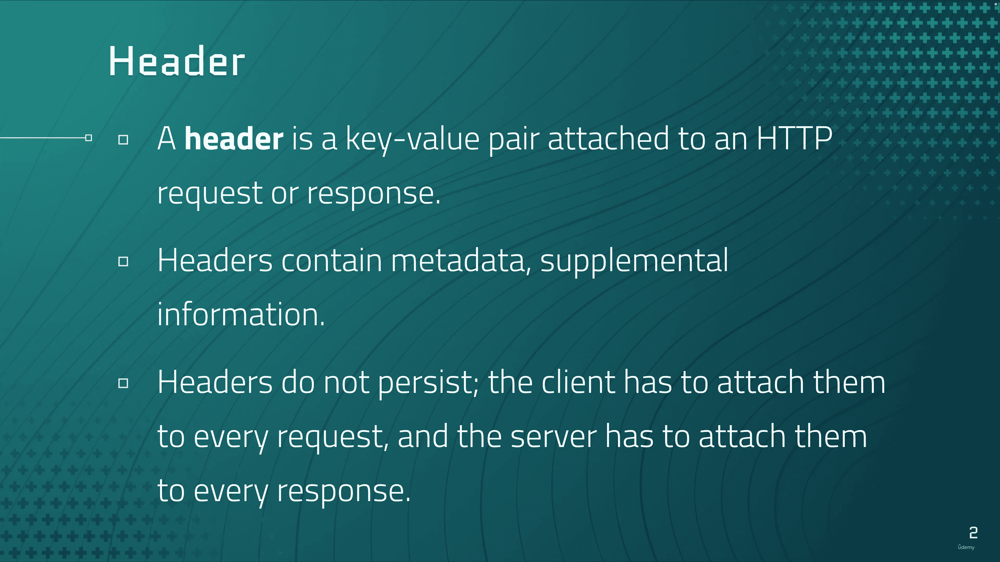
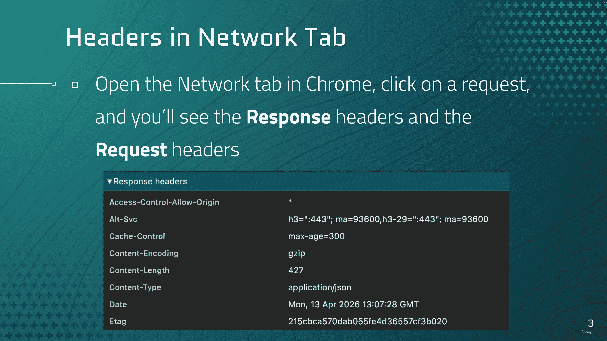
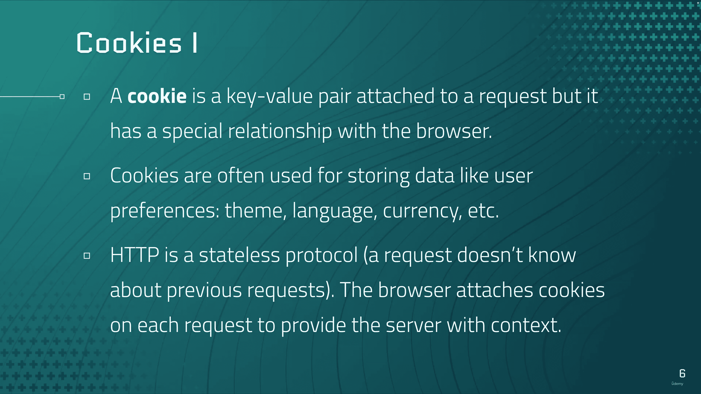
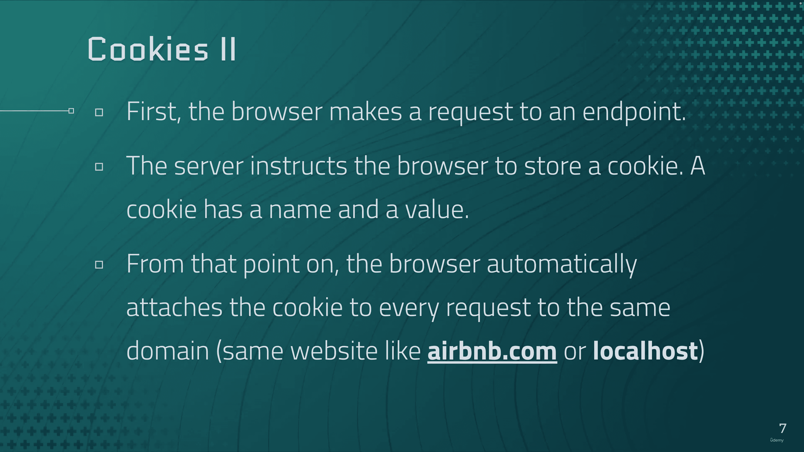
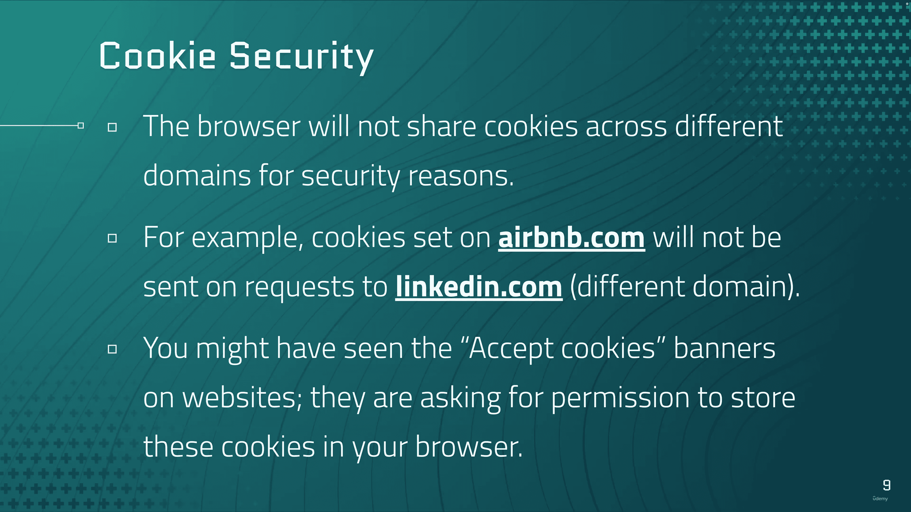

## FastAPI Masterclass part1：第1节：课程概述 🧭

欢迎来到课程的下一节。本节聚焦 FastAPI 中的 Cookies 和 Headers。像往常一样，我想先在高层次上把这些技术概念解释清楚，然后再进入代码实践。尤其这两个主题关系非常密切。我们先从 Headers 开始。

在本节课中，我们将学习 Headers 和 Cookies 的基本概念、它们在 HTTP 请求和响应中的作用、它们在浏览器中的实际工作方式，以及它们在安全方面需要注意的地方。Headers 和 Cookies 都是键值对，都用于给请求或响应附加额外信息，但它们在“是否自动发送”“是否持久保存”“作用域”等方面有重要区别。理解这些区别以后，我们再进入 FastAPI 的代码实践，会更容易看懂框架提供的接口和行为。

## FastAPI Masterclass part1：第2节：Headers 是什么 📨

上一节我们说明了本课的整体目标，本节中我们来看看 Headers。Header 是附加到 HTTP 请求或响应上的键值对。键值对意味着有一个标识符，也有一个与这个标识符对应的值，很像 Python 字典里的一个条目。它附加在实际 payload 之上，作为补充信息或额外元数据。payload 可以是发给服务器的数据，也可以是从服务器返回的数据。Headers 既可以由客户端发送，也可以由服务器发送。Headers 不会持久保存，这意味着客户端或服务器有责任在每个请求或每个响应上附加 header。换句话说，header 不会被一直保留，它只是附加到请求或响应上的额外信息或元数据。

为了更直观地理解，可以把 header 的核心结构写成下面的公式。

$$
\text{Header} = \{\text{key}: \text{value}\}
$$



也可以用 Python 字典来类比。

```python
header = {
    "Content-Type": "application/json"
}
```

下面用列表把这些特点拆开说明。

- Header 是键值对，包含名称和对应值。
- Header 可以附加在请求上，也可以附加在响应上。
- Header 可以由客户端发送，也可以由服务器发送。
- Header 不会自动持久保存，因此需要客户端或服务器在每个请求或响应上重新附加。
- Header 是 payload 之外的补充元数据，不改变 payload 本身。

在实际浏览网页时，可以打开 Chrome 的 Network 标签，点击任意网站上的任意请求。在路由信息和状态码信息下方，可以看到响应头和请求头被分类列出。左侧会显示 header 的名称，例如 content type 或 date；右侧会显示这个名称对应的值。也就是说，左侧是 key，右侧是 value。无论访问哪个网站，都会经常看到一些常见 header。下面是两个常见例子。

- 从客户端角度看，请求头经常包含 User-Agent。浏览器通常会自动附加这个 header。User-Agent 会向服务器传递发出请求的计算机信息，例如操作系统信息，也可能包含浏览器版本号或浏览器引擎信息。User-Agent 这个词指的是代表一个人发出请求的计算机程序。更重要的是，它是客户端发送给服务器的补充元数据，服务器收到并解析这个 header 后，可以在端点中执行不同的逻辑分支，根据这个 header 作出不同反应。
- 从服务器角度看，Content-Type 是经常看到的响应头。Content-Type 表示返回资源的类型。FastAPI 默认返回 JSON 响应，因此查看响应头时会看到 Content-Type 被设置为 application/json，告诉浏览器返回内容是 JSON 类型，浏览器可以按 JSON 解析。类似地，如果服务器想向客户端发送 CSS 文件，这个文件会有对应的 Content-Type，值为 text/css。服务器就是用这种方式告诉客户端它发送的数据是什么类型。payload 或数据本身保持不变，header 只是附加在数据旁边的扩展信息。



下面用代码形式展示这两个常见 header 的例子。

```http
User-Agent: Mozilla/5.0 (Macintosh; Intel Mac OS X ...)
Content-Type: application/json
Content-Type: text/css
```

> 可以打开 Chrome 的 Network 标签，点击任意请求，在左侧查看请求头和响应头的名称，在右侧查看对应的值。这是观察 header 的最直接方式。

上一节我们介绍了 Header 的结构和常见例子，本节中我们来看看与 Header 密切相关的 Cookies。

## FastAPI Masterclass part1：第3节：Cookies 是什么 🍪

Header 的对应概念是 Cookie。Cookies 和 Headers 非常相似，它们同样是键值对。主要区别在于，浏览器会自动在每个请求上发送 cookie。前面提到，headers 需要手动配置才能在每个请求上发送；相比之下，cookies 由浏览器自动管理。Cookies 常用于存储用户偏好，例如颜色主题、语言、货币等。我们需要 cookies 的原因是 HTTP 协议本质上无状态。无状态意味着每个请求都是独立的，请求不知道之前发生过哪些请求。

可以用公式表示这种无状态关系。

$$
\text{HTTP 请求}_n \perp \text{HTTP 请求}_{n-1}
$$

Cookies 允许客户端在每个请求上发送一致的信息，这样服务器就可以独立解析请求并作出反应。例如，cookie 可以在每个请求上告诉服务器：用户正在使用某个颜色主题，或者用户把语言设置为法语，或者用户偏好美元作为货币。因为这种自动发送的 cookie 元数据在每个请求上都可用，服务器就可以据此作出合适的响应。从根本上说，cookies 和 headers 的目的相同，都是提供额外信息，但 cookies 会自动随每个请求发送。

Cookie 的核心结构也可以用公式描述。

$$
\text{Cookie} = \{\text{name}: \text{value}\}
$$

下面是 cookies 常见存储内容的例子。

- 用户偏好，例如颜色主题。
- 用户语言设置，例如法语。
- 用户货币偏好，例如美元。
- 需要在多个独立请求之间保持一致的其他小段信息。

## FastAPI Masterclass part1：第4节：Cookies 在现实中的工作方式 🔄

上一节我们知道了 cookies 是什么，本节中我们来看看它在现实世界中通常如何工作。首先，浏览器会向某个服务器端点发出请求。此时，服务器会指示浏览器存储一个 cookie。这个 cookie 有一个名称和一个值。从那一刻开始，浏览器会自动把这个 cookie 键值对附加到发往同一域名的每个后续请求上。这里说的同一域名，指的是同一主机或同一网站。例如，Airbnb 是一个域名，本地的 localhost 是另一个域名。

与 headers 不同，cookies 不需要在每个请求上手动配置，它们由浏览器自动管理。但实际上是服务器指示浏览器持续发送这些 cookies，也就是持续发送这些键值对到每个后续请求。Cookies 会跨后续请求持久保存，直到过期，也就是在某个时间点之后失效；或者直到用户手动删除，例如刷新浏览器或从用户界面中删除。我们可以把 cookie 看成一种自动化 header。技术上，cookie 背后实际上就是作为 header 发送的。它几乎可以看作是 header 的一个子类别，由浏览器自动管理。

事实上，如果查看 Network 标签中的请求头，也就是客户端发给浏览器的请求头，会看到 cookie 名称，那实际上就是正在发送的 cookie。Cookies 是作为 headers 发送的，可以把它理解为自动化 headers。自动化的原因是浏览器会自动持续把它们发送到对应域名，直到过期。

下面用列表梳理 cookies 在现实世界中的典型流程。



- 浏览器先向服务器端点发出请求。
- 服务器指示浏览器存储一个 cookie，cookie 包含名称和值。
- 浏览器保存这个 cookie。
- 后续发往同一域名的请求会自动带上这个 cookie 键值对。
- Cookie 会持续发送，直到过期或被用户手动删除。

可以用公式表示 cookie 的发送条件。

$$
\text{Cookie}_{\text{domain}=A} \rightarrow \text{请求发往 } domain=A
$$

> 可以把 cookie 看成一个自动发送的 header。它仍然是键值对，只是浏览器负责在每个后续请求中自动附加。



上一节我们了解了 cookies 的工作流程，本节中我们来看看 cookies 的安全问题和用户同意问题。

## FastAPI Masterclass part1：第5节：Cookies 的安全与同意 🛡️

需要注意，cookies 存在一些安全方面的考虑。浏览器会做大部分工作来保证用户拥有安全的体验。例如，浏览器不会在不同域名之间共享 cookies。Airbnb 让浏览器设置的 cookies 仍然只会发回 Airbnb，不会在发往 LinkedIn.com 等不同域名的请求中发送。类似地，LinkedIn.com 的服务器设置的 cookies，在后续请求中由浏览器发回 LinkedIn.com，不会发往 Airbnb.com。因此，cookies 的作用范围被限制在设置它的域名上。

可以用公式表示这种作用域限制。

$$
\text{Cookie}_{\text{domain}=A} \not\rightarrow \text{domain}=B
$$

你可能在许多现代网站上见过“接受 cookies”的横幅。这是因为不同国家有相关立法。这些横幅本质上是在请求用户许可，让用户确认或同意 cookies 被保存在浏览器中。背后可能是这样的过程：你向服务器发出请求，但你可能并不知道这个网站或服务器正在要求你的客户端，也就是浏览器，保存这些 cookies，以便未来持续发送。点击这些横幅，基本上就是同意这种行为。

下面用列表总结 cookies 在安全方面的关键点。

- 浏览器不会跨不同域名共享 cookies。
- Cookies 被限制在设置它的域名范围内。
- 发往其他域名的请求不会带上不属于该域名的 cookies。
- “接受 cookies”横幅用于获取用户对保存 cookies 的确认或同意。
- 点击横幅表示用户同意浏览器保存并持续发送相应 cookies。

> Cookies 的域名作用域是浏览器安全模型的重要组成部分。理解这一点，有助于理解为什么不同网站之间的 cookies 不会混在一起。

上一节我们介绍了 cookies 的安全与同意问题，本节中我们对整个主题做一个简短收束，并预告 FastAPI 中的实践。

## FastAPI Masterclass part1：第6节：在 FastAPI 中实践预告 🚀

Cookies 和 headers 非常相似。它们都是键值对，都代表附加到每个请求或响应上的元数据或额外信息，用于增强用户体验，也帮助服务器解析请求。我们将在 FastAPI 部分看到这些概念如何落地，这也会加深我们对本主题的理解。前面还有很多有趣的内容，下节课见。

为了把本节要点连起来，下面是 FastAPI 实践前的概念清单。

- Headers 是请求或响应上的键值对元数据。
- Cookies 是浏览器自动管理的键值对，通常也作为 header 发送。
- HTTP 是无状态的，cookies 用于在多个独立请求之间保持一致性信息。
- Cookies 有域名作用域，并且会过期或被手动删除。
- 进入 FastAPI 后，我们会把这些概念对应到具体代码和接口上。

## FastAPI Masterclass part1：第7节：本课总结 🧾

本节课中我们一起学习了 Cookies 和 Headers。Headers 是附加到 HTTP 请求或响应上的键值对，可以由客户端或服务器发送，并且不会持久保存，因此需要在每个请求或响应上重新附加。Cookies 也是键值对，但由浏览器自动管理并在每个请求上自动发送，常用于保存用户偏好，原因是 HTTP 协议本身无状态。Cookies 会在同一域名下持续发送，直到过期或被用户删除；它们有域名作用域，不会跨不同域名共享。浏览器会处理大部分安全工作，“接受 cookies”横幅则是用户同意保存 cookies 的体现。接下来我们会在 FastAPI 中实践这些概念。

下面是本课核心要点的收束列表。

- Header 是键值对形式的请求或响应元数据。
- Cookie 是浏览器自动发送的键值对，技术上作为 header 发送。
- Headers 需要手动附加，cookies 由浏览器自动附加。
- HTTP 无状态，因此 cookies 用于跨请求保持一致性信息。
- Cookies 有域名作用域、过期时间和用户删除机制。
- FastAPI 部分会把这些概念落到代码实践中。



本课到这里结束。理解 headers 和 cookies 的区别以后，再看 FastAPI 中相关的请求和响应处理，就会清楚很多。

